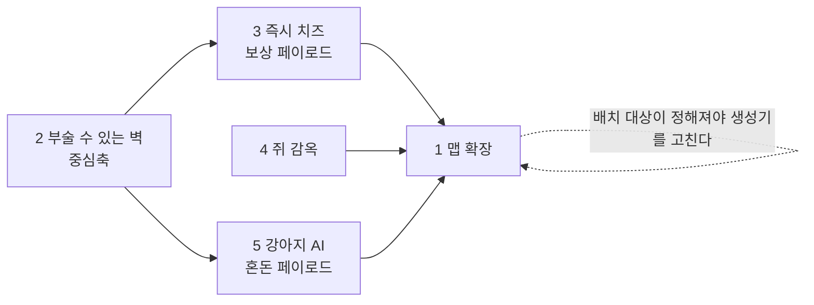

# v3.8 확장 로드맵

> 2026-08-09에 정한 확장 5항목의 의존관계와 순서. 각 항목의 상세는 개별 스펙으로 간다.
> **관련 노트**: [[승리 빌드 기획]](밸런스 의도) · [[코드 다이어그램]](현재 구조) · [[맵 레벨디자인]]

---

## 다섯 항목

| # | 항목 | 의도 |
|---|---|---|
| 1 | 맵 추가 확장 (42×42보다 넓게) | 공간 확보 |
| 2 | **부술 수 있는 벽(벽감)** | 3·5의 봉인 장치 · 파괴라는 새 선택 축 |
| 3 | 즉시 획득 치즈 (벽감 안) | **쥐끼리 경쟁 유발** — 먼저 닿는 놈이 먹는다 |
| 4 | 쥐 감옥 + 구출 | 탈락자 배제 해소 · 쥐 팀플레이 축 신설 |
| 5 | 강아지 AI (벽감 안) | 불리한 쪽의 판 뒤집기 |

## 의존관계

2번이 중심축이다 — 벽을 부수는 행위가 3·5의 유일한 입구다.
1번이 마지막에 가까운 이유는, **무엇을 배치할지 정해져야 생성기를 한 번만 고치기** 때문이다.

## 순서와 이유

| 순서 | 항목 | 위험 | 왜 이 자리인가 |
|---|---|---|---|
| 1 | 2 벽 + 3 치즈 | 낮음 | 가장 작은 완결 루프(부순다→보상). 3은 5의 리허설이 된다 |
| 2 | 1 맵 확장 | 중간 | 벽감·감옥·픽업이 정해진 뒤라야 배치 대상을 안다 |
| 3 | 4 쥐 감옥 | **높음** | 기획 난이도 최고 — 승리 조건을 갈아엎는다 |
| 4 | 5 강아지 | **높음** | 기술 난이도 최고 — AI·네비게이션이 프로젝트에 아직 없다 |

> **4번의 설계는 먼저 해두는 게 낫다.** 구현은 3순위여도, 승리 조건이 바뀌면
> 1·2·3의 배치 기준(감옥 위치·벽감 밀도)이 따라 흔들린다.

## 기존 시스템과 부딪히는 지점

| # | 부딪히는 것 | 메모 |
|---|---|---|
| 2 | **장난기** — `!IsPlayerObject`면 전부 구조물로 보고 지급 | 벽감은 면제. v3.5의 "벽 때리기가 최고 효율" 실패 재발 방지 |
| 3 | **치즈 총량 4900** — 고갈=성장 기한의 축 | 벽 몫을 총량 안에서 뗀다. 더하면 압축이 무너진다 |
| 1 | 치즈 지점 7개 제약(등급 1~7 각 하나) · 파밍 밀도 | 확장 맵이 이미 밀도 절반. 등급 체계 개편이 얹힐 수 있다 |
| 4 | **승리 조건(쥐 전멸)** · 관전 · 따봉 · 장난기 킬 30 | 파급 최대. 승리 빌드 검산도 다시 해야 한다 |
| 5 | NavMesh 없음 · 파괴 대상 판정 · 3세력 물리 레이어 | 레이어 매트릭스(Decoy×Mouse) 옆에 한 줄 더 생긴다 |

## 스펙 현황

| 항목 | 스펙 | 상태 |
|---|---|---|
| 2 + 3 | [부술 수 있는 벽(벽감) + 즉시 획득 치즈](../superpowers/specs/2026-08-09-breakable-alcove-design.md) | ✅ 작성 완료 |
| 1 | — | ⬜ 미착수 |
| 4 | — | ⬜ 미착수 (설계 우선 권장) |
| 5 | — | ⬜ 미착수 |
