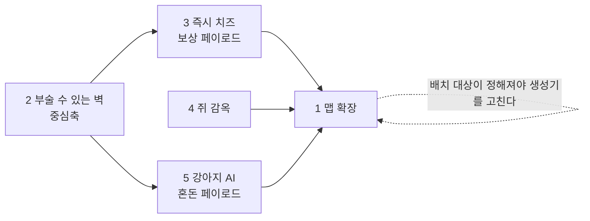

# v3.8 확장 로드맵

> 2026-08-09에 정한 확장 5항목의 의존관계와 순서. 각 항목의 상세는 개별 스펙으로 간다.
> **관련 노트**: [[승리 빌드 기획]](밸런스 의도) · [[코드 다이어그램]](현재 구조) · [[맵 레벨디자인]]

---

## 다섯 항목

| # | 항목 | 의도 |
|---|---|---|
| 1 | 맵 추가 확장 (42×42보다 넓게) | 공간 확보 |
| 2 | **부술 수 있는 벽(벽감)** | 3·5의 봉인 장치 · 파괴라는 새 선택 축 |
| 3 | 즉시 획득 치즈 (벽감 안) | **쥐끼리 경쟁 유발** — 먼저 닿는 놈이 먹는다 |
| 4 | 쥐 감옥 + 구출 | 탈락자 배제 해소 · 쥐 팀플레이 축 신설 |
| 5 | 강아지 AI (벽감 안) | 불리한 쪽의 판 뒤집기 |

## 의존관계

2번이 중심축이다 — 벽을 부수는 행위가 3·5의 유일한 입구다.
1번이 마지막에 가까운 이유는, **무엇을 배치할지 정해져야 생성기를 한 번만 고치기** 때문이다.

## 순서와 이유

| 순서 | 항목 | 위험 | 왜 이 자리인가 |
|---|---|---|---|
| 1 | 2 벽 + 3 치즈 | 낮음 | 가장 작은 완결 루프(부순다→보상). 3은 5의 리허설이 된다 |
| 2 | 1 맵 확장 | 중간 | 벽감·감옥·픽업이 정해진 뒤라야 배치 대상을 안다 |
| 3 | 4 쥐 감옥 | **높음** | 기획 난이도 최고 — 승리 조건을 갈아엎는다 |
| 4 | 5 강아지 | **높음** | 기술 난이도 최고 — AI·네비게이션이 프로젝트에 아직 없다 |

> **4번의 설계는 먼저 해두는 게 낫다.** 구현은 3순위여도, 승리 조건이 바뀌면
> 1·2·3의 배치 기준(감옥 위치·벽감 밀도)이 따라 흔들린다.

## 기존 시스템과 부딪히는 지점

| # | 부딪히는 것 | 메모 |
|---|---|---|
| 2 | **장난기** — `!IsPlayerObject`면 전부 구조물로 보고 지급 | 벽감은 면제. v3.5의 "벽 때리기가 최고 효율" 실패 재발 방지 |
| 3 | **치즈 총량 4900** — 고갈=성장 기한의 축 | 벽 몫을 총량 안에서 뗀다. 더하면 압축이 무너진다 |
| 1 | 치즈 지점 7개 제약(등급 1~7 각 하나) · 파밍 밀도 | 확장 맵이 이미 밀도 절반. 등급 체계 개편이 얹힐 수 있다 |
| 4 | **승리 조건(쥐 전멸)** · 관전 · 따봉 · 장난기 킬 30 | 파급 최대. 승리 빌드 검산도 다시 해야 한다 |
| 5 | NavMesh 없음 · 파괴 대상 판정 · 3세력 물리 레이어 | 레이어 매트릭스(Decoy×Mouse) 옆에 한 줄 더 생긴다 |

## 스펙 현황

| 항목 | 스펙 | 상태 |
|---|---|---|
| 2 + 3 | [부술 수 있는 벽(벽감) + 즉시 획득 치즈](../superpowers/specs/2026-08-09-breakable-alcove-design.md) | ✅ **구현 완료** |
| 4 | [쥐 감옥과 구출](../superpowers/specs/2026-08-09-mouse-jail-design.md) | ✅ **구현 완료** (밸런스 미조정) |
| 5 | [제3세력 강아지](../superpowers/specs/2026-08-09-dog-third-faction-design.md) | ✅ **구현 완료** (밸런스 미조정) |
| 1 | — | ⬜ 미착수 — **레벨디자인과 함께 마지막에** (2026-08-09 사용자 지정) |

## 구현 메모 (5)

| 무엇 | 어디 |
|---|---|
| 순수 로직 | `Map/NavGraphLogic`(레이아웃→그래프·다익스트라) · `Ai/DogAiLogic`(표적·상태·피해) |
| 판단 | `Ai/DogBrain` — 서버가 표적을 고르고 어그로를 쥔다 |
| 이동 | `Ai/DogMover` — NavMesh 없이 웨이포인트 주행. 회피는 `CharacterController`가 |
| 물기 | `Ai/DogBite` — 역할별 피해(쥐 22 · 고양이 90) |
| 소리 | `Ai/DogBark` + `Map/AlcoveIdleSound`(강아지 벽만 낑낑거린다) |
| 퇴장 | `Ai/DogDeath` — `PlayerDeath`를 쓰면 강아지가 **감옥에 갇힌다** |
| 교전 규칙 | `CombatLogic.CanAttack` — 무기마다 박아 둔 진영을 하나로 모았다 |

**설계 단계에서 놓친 것 하나**: `RoleTag.None`으로 두면 덮치기(Mouse만)도 팝건(Cat만)도
강아지를 못 때려 **아무도 못 죽인다**. `qa_v40`이 잡았다(덮치기 400→400).

## 구현 메모 (2 + 3)

| 무엇 | 어디 |
|---|---|
| 순수 로직 | `Map/AlcoveLogic` — 벽 몫 합계·픽업 분할 (EditMode 11) |
| 벽감 본체 | `Map/Alcove` — `Health.Died`를 직접 듣고 despawn 전에 페이로드를 꺼낸다 |
| 배치 | `Map/AlcoveSpawner`(Worker) — 매치 시작에 서버가 스폰, 로비 복귀에 걷는다 |
| 픽업 | `Economy/CheeseDrop` — 서버 트리거 판정, 쥐만 |
| 장난기 면제 | `Combat/BountyExempt` 마커 + `CatPounce` 분기 |
| 소리 | `SfxId.AlcoveHit`(20m) · `AlcoveBreak`(25m), `HitFeedback`에 재정의 필드 |
| 자리 계산 | `Editor/Setup/AlcoveFactory` — 기존 레이아웃에 **벽감만 덧쓴다**(시드 안 흔듦) |

전투 코드는 신규 0 — 팝건·덮치기가 씬의 `Health`를 찾아 때리는 구조라 `Health`만 붙이면 된다.

## 구현 메모 (4)

| 무엇 | 어디 |
|---|---|
| 순수 로직 | `Match/JailLogic` — 가장 가까운 감옥·구출 게이지·체류·석방 HP (EditMode 15) |
| 갇힘 상태 | `Match/JailedTag` — 플레이어가 들고 복제한다(세는 쪽·막는 쪽이 다 여기서 출발) |
| 진행 | `Match/JailDirector`(Worker) — 서버가 체류·구출을 돌린다 |
| 수감 전환 | `Combat/PlayerDeath` — 쥐는 despawn 대신 수감. 감옥이 없는 맵은 예전대로 |
| 승패 | `MatchFlowLogic.Evaluate(armed, cats, **free**, **jailed**)` |
| 표시 | `UI/JailHud` — 본인 카운트다운(10초 이하 빨강) |
| 배치 | `AlcoveFactory.PlanJailsInto` — 서로 가장 먼 방 두 곳 |

**검증**: `qa_v37` 24/24 · `qa_v39` 10/10 · EditMode 173/173 (2026-08-09).

한동안 실패하던 `qa_v37` 2항목은 **둘 다 QA 도구 결함이었고 게임 코드는 멀쩡했다**:
- *관전 전환* — `TestTeleportToOtherPlayer`에 매개변수가 없어 `_clientId`가 버려졌다.
  고양이가 늘 먼저 스폰된 쥐(호스트)를 잡아 **엉뚱한 쥐를 가뒀다**.
- *입력창 채팅* — 게임 뷰 포커스가 없으면 주입한 Enter가 통째로 버려진다. `Open()`은 되고
  `Submit()`만 안 돌아 채팅창이 열린 채 남았다.
