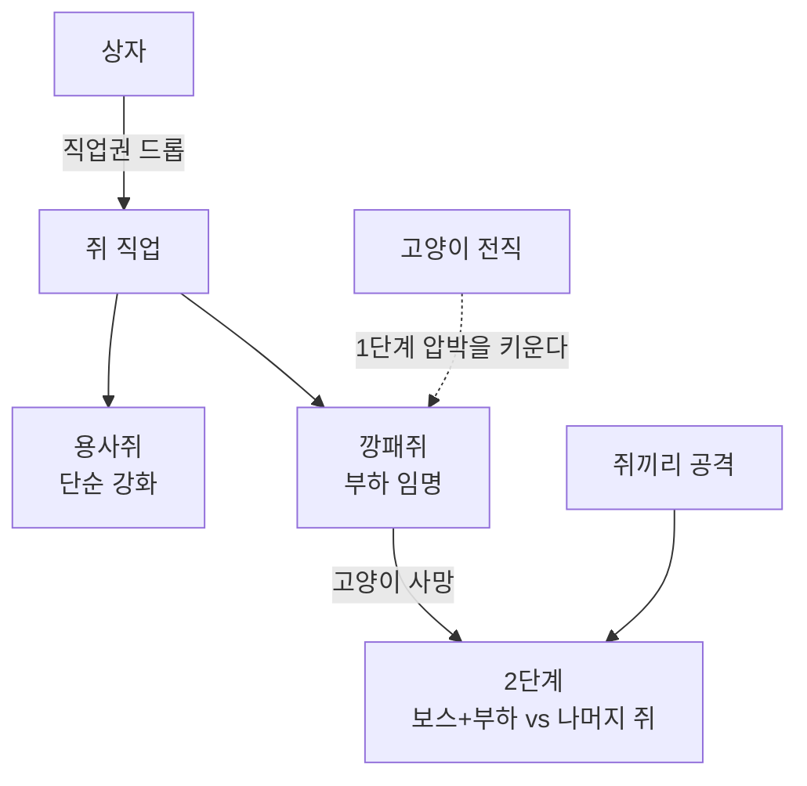

# v3.9 확장 로드맵 — 상자 · 직업 · 전직

> 2026-08-10에 정한 확장. **밸런스 수치는 전부 구현자 재량**(사용자 지시).
> **관련 노트**: [[v3.8 확장 로드맵]] · [[승리 빌드 기획]] · [[코드 다이어그램]]

---

## 무엇이 바뀌는가

v3.8까지는 **고양이 1팀 vs 쥐 1팀 + 제3세력**이었다. v3.9는 그 전제를 깬다 —
**쥐가 한 팀이 아니게 된다.**



## 네 항목

| # | 항목 | 한 줄 |
|---|---|---|
| 1 | **쥐끼리 공격** | 항상 가능. 단 **사람만** — 요새·미끼·창고·벽감·상자는 못 친다 |
| 2 | **상자** | 부수면 안에 든 것이 나온다. **그릇이고 내용물은 데이터** |
| 3 | **쥐 직업** | 상자에서 직업권이 나온다 — 용사쥐 · 깡패쥐 |
| 4 | **고양이 전직** | 모든 강화를 마치면 4종 중 하나를 고르고 스킬을 하나 배운다 |

---

## 1. 쥐끼리 공격 (확정 · 구현 완료)

**항상 열려 있다.** 판 시작부터 쥐가 쥐를 칠 수 있다.

`CombatLogic.CanAttack(attacker, target, targetIsPlayer)` 한 곳에서 정한다:

| 공격자 | 대상 | 결과 |
|---|---|---|
| 고양이 | 쥐·구조물·강아지 | ✅ |
| 쥐 | 고양이·강아지 | ✅ |
| 쥐 | **다른 쥐(사람)** | ✅ **신규** |
| 쥐 | 쥐의 구조물 | ❌ 제 요새를 쏘면 안 된다 |
| 고양이 | 다른 고양이 | ❌ 고양이는 끝까지 한 팀 |

> `RoleTag.Mouse`를 쥐와 쥐의 구조물이 **같이 쓴다**. `IsPlayerObject`로 가르지 않으면
> 쥐가 자기 요새를 부순다 — 이게 이 변경의 유일한 함정이다.

**관측할 것**: 초반에 쥐끼리 싸워 고양이가 가만히 있어도 이기는 판이 나오는가.
나오면 "깡패 등장 후에만"으로 좁힌다.

## 2. 상자 (구현 완료)

**상자는 안에 뭐가 들었는지 모른다.** 부서질 때 목록을 훑어 드롭을 뿌릴 뿐이다 —
새 물건이 늘어도 `LootBox`는 안 바뀐다.

| | 벽감(v3.8) | 상자(v3.9) |
|---|---|---|
| 성격 | **경쟁 유발** — 파괴음 25m, 다 같이 달려온다 | **탐색 보상** — 8m, 찾은 사람이 조용히 먹는다 |
| 자리 | 방 **벽면** 노출 | 방 **모서리** — 돌아다녀야 찾는다 |
| HP | 120 | 40 |
| 내용물 | 치즈 150 (고정) | **자리마다 다름**(고정 방식) |

**내용물은 배치 시점에 정해진다**(확률 표가 아니다). "저기 가면 그게 있다"를 외울 수 있고,
레벨디자인이 보상을 설계한다. 지금 든 것은 치즈뿐이고, 3번이 직업권을 얹는다.

> **치즈 총량 4900은 불변**이다. 상자가 품은 치즈도 지점 매장량에서 먼저 뗀다 —
> 안 떼면 총량이 늘어 고갈이 늦어지고 후반 압축이 무너진다(벽감과 같은 규칙).

## 3. 쥐 직업 (구현 완료)

상자에서 **직업권**이 나온다. 두 가지다.

| 직업 | 효과 |
|---|---|
| **용사쥐** | 그냥 세진다 (수치 강화) |
| **깡패쥐** | 다른 쥐에게 다가가 **부하로 임명**할 수 있다(UI) |

### 2단계 — 고양이가 죽어도 안 끝난다

```
1단계  고양이 vs 쥐 전원
   │
   ├─ 고양이 사망 · 깡패 없음 → 쥐 승리 (지금 규칙 그대로)
   └─ 고양이 사망 · 깡패 있음 → 2단계
                                깡패 보스 + 부하  vs  나머지 쥐
```

**깡패가 없으면 2단계가 안 열린다** — 누군가 깡패권을 주워 판을 역전으로 끌고 간 것 자체가
보상이 되게 한다. 항상 2단계면 깡패권이 특별하지 않게 되고 판이 무조건 길어진다.

### 2단계 규칙 (2026-08-10 확정)

| 항목 | 규칙 | 왜 |
|---|---|---|
| **승리** | 깡패 팀이 **나머지 쥐를 전멸**시키면 승리 | 목표가 하나뿐이라 읽기 쉽다 |
| **부하** | **거절 못 한다 · 배신 못 한다** | 임명당하면 그걸로 끝이다. 승리 조건이 팀에 묶여 있어 배신할 이유 자체가 없다 |
| **타이머** | 진입 시 **새로 3분** | 남은 시간을 쓰면 고양이가 9분에 죽었을 때 2단계가 1분이라 아무것도 못 하고 끝난다 |
| **감옥** | **풀려나지 않는다** — 갇히면 그대로 | 구출은 "쥐는 한 팀"이라는 전제 위의 장치다. 서로 죽이는 판에서 적팀 쥐가 구출하러 오는 그림은 성립하지 않는다 |
| **치즈·상점** | **그대로 유지** | 파밍하러 가면 그동안 안 싸우는 것이므로 이미 대가를 치른다 |

### 구현 메모

| 무엇 | 어디 | 수치 |
|---|---|---|
| 규칙 | `Match/MouseJobLogic` (순수, EditMode 12) | 임명 반경 2.5m |
| 직업 상태 | `Match/MouseJob` — 복제. 본인은 못 바꾼다 | 용사 HP ×2 · 화력 ×1.5 |
| 임명 | `Match/GangRecruit` — F키, 서버가 거리 판정 | 거절 없음 |
| 단계 | `Match/PhaseDirector` — 2단계 시계·승패 | 3분 |
| 직업권 | `Map/JobTicketDrop` — 상자에서 나오는 바닥 픽업 | 깡패권 맵당 1장 |

**깡패 팀이 3분을 못 채우면 나머지 쥐가 이긴다** — 시계를 쥔 쪽이 쫓는 쪽이다.
전멸과 시간 초과가 같은 틱에 성립하면 **전멸이 먼저**다(이미 이긴 판이다).

**아직 안 정한 것**: 강아지가 살아 있으면 4세력이 된다 — 지금 규칙대로면 전부 문다.

## 4. 고양이 전직 (구현 완료)

**조건**: 모든 강화 완료(공격 강화·이속 강화 각 최대 중첩). 그러면 UI가 떠서 하나를 고른다.

| 전직 | 스킬 |
|---|---|
| **불** | 공격력 강화 |
| **바람** | 이동속도 증가 |
| **빛** | **모든 쥐 투시** — 벽 너머 윤곽선(xray) |
| **어둠** | **쥐들의 시야를 어둡게** |

빛·어둠이 특히 소리 설계와 정면으로 맞물린다 — 이 게임은 정보가 곧 소리였는데,
빛은 그걸 **시각으로 대체**하고 어둠은 **상대의 시각을 뺏는다.**

**스킬은 전부 액티브다**(2026-08-10 확정) — 키를 눌러 쓰고 쿨다운이 돈다.

이게 빛·어둠의 문제를 스스로 푼다. 상시 투시였다면 쥐의 은신이 통째로 죽지만,
**지속 몇 초 + 긴 쿨다운**이면 "지금 쓸까"라는 판단이 생기고 쥐에게는
"쓰고 난 뒤의 빈 시간"이라는 대응 창이 남는다. 소리로 하던 정보 싸움이
**타이밍 싸움으로 번역**되는 것이지, 대체되는 게 아니다.

### 정해야 할 것 (구현 전)

- 어둠은 **누구 화면을 어둡게** 하나(전원 / 근처만) — 전원이 단순하고 읽기 쉽다
- 스킬을 쓸 때 **쥐가 알 수 있는가** — 이 게임의 규칙상 큰 효과에는 소리가 붙어야 한다
- 지속·쿨다운 수치 (구현자 재량)


### 구현 메모 (4)

| 무엇 | 어디 | 수치 |
|---|---|---|
| 조건 판정 | `Player/CatClassLogic` (순수) | 강화 **둘 다** 만렙(5/5) |
| 상태 | `Player/CatClass` — 복제. 서버가 조건을 다시 본다 | 한 번만 |
| 스킬 | `Player/CatSkill` — Q키, 액티브 | 지속 6초 · 쿨다운 35초 |
| 불·바람 | `CatPounce`·`PlayerMovement`가 배율을 곱한다(서버) | ×2 · ×1.35 |
| 빛·어둠 | `UI/CatSkillView` — **보는 쪽 화면**에만 있다 | 암전 0.75 |
| 창 | `UI/CatClassPopup` — 강화 스트림 구독(폴링 없음) | |

**불 ×2는 쥐를 한 방에 눕힌다**(120 ≥ 100). 즉사한 쥐는 감옥으로 가며 HP가 100으로
복구되므로, QA에서 피해량 차이로 재면 "0"으로 읽힌다 — **갇혔는지**로 재야 한다.

스킬은 켤 때 30m까지 소리가 간다. 파밍(20)·벽감 파괴(25)보다 멀리 보내는 이유는
판 전체가 알아야 하는 사건이라서다 — 모르면 대응할 수 없고, 그게 액티브로 만든 이유다.

---

## 순서

| 순서 | 항목 | 이유 |
|---|---|---|
| 1 | 쥐끼리 공격 | ✅ 완료 — 3번 2단계의 토대 |
| 2 | 상자 | ✅ 완료 — qa_v41 10/10 |
| 3 | 고양이 전직 | ✅ 완료 — qa_v42 15/15 |
| 4 | 쥐 직업 + 2단계 | ✅ 완료 — qa_v43 13/13 |
| 5 | 맵 확장 + 레벨디자인 | 배치 대상(상자·직업권)이 다 정해진 뒤 |
| 6 | 밸런스 전면 재조정 | 끝 |

> 4번이 마지막인 이유는 v3.8의 감옥과 같다 — **승리 조건을 건드리는 것이 파급이 제일 크다.**
