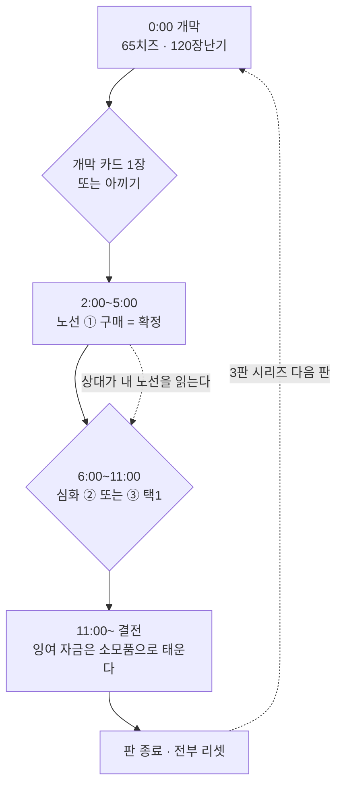

# 기획안 — 빌드 심화 v1 (초안)

> **⚠ 2026-09-05 대체됨** — 노선 잠금 모델은 폐기. 후추 탄만 살아남았고 현행 기획은 `docs/superpowers/specs/2026-09-05-build-scarcity-design.md`.
> **상태: 초안. 모든 결정은 「제안」이다.** 클라이언트 검토 전이며 수치는 전부 조정 대상.
> 발단: 사용자 지시 2026-08-31 — *"고양이, 쥐 둘 다 빌드 쌓는 내용이 너무 적다."*
> 기준 문서: [[승리 빌드 기획]] · [[상점]] · [[v3.9 확장 로드맵]] · `Assets/Resources/CSVInfo/*.csv`(2026-08-31 실사)
> 톤 기준: `docs/superpowers/specs/2026-08-31-night-pantry-map-art-design.md`(밤의 팬트리)

---

## 0. 진단 — 왜 지금은 빌드가 아닌가

지금 카탈로그를 실제 값으로 펼치면 문제가 숫자로 드러난다.

| 진영 | 전체 카탈로그 비용 | 1인 예상 수입(15분) | 결론 |
|---|---|---|---|
| 쥐 | 새총 150 + 기관총 600 + 대시 100 + 요새 80 + 창고 150 = **1080** | 700 ~ 1100 (`CheesePerMouse` 1400 중 경쟁분) | **거의 다 산다** → 순서만 남는다 |
| 고양이 | 공격 120×5 + 이속 90×5 = **1050** | 약 930 (킬 110 × 6 + 구조물) | 만렙이 곧 전직 조건 → **한 줄 진행** |

**빌드가 없는 진짜 이유는 항목 수가 아니라 예산이 안 빡빡해서다.** 다 살 수 있으면 선택이 아니라 순서다.
그래서 이 기획안은 **항목을 늘리는 것이 아니라 배타성을 도입한다.**

두 번째 이유는 고양이 쪽에 있다. 전직(불·바람·빛·어둠)은 이미 있지만 **조건이 "강화 두 줄 만렙"(1050 ≈ 9킬)**
이라 15분·2:8 판에서 거의 안 열린다. 판 안에서 만져지지 않는 시스템은 없는 것과 같다.

---

## 1. 한줄 컨셉

**"이번 판엔 어느 선반을 털지" — 쥐는 선반 하나, 고양이는 몸의 한 부위를 골라 판을 치른다.**
고른 것은 판이 끝날 때까지 못 바꾸고, 3판 시리즈라 다음 판에 다시 고른다.

---

## 2. 디자인 골 (Why)

| # | 목표 | 성공 판정 |
|---|---|---|
| 1 | **예산이 카탈로그보다 작아야 한다** | 1인 수입 ≒ 전체 카탈로그의 55~65% |
| 2 | **한 판에 의미 있는 선택 3회** | 개막(0:00) · 노선(2~5분) · 심화(6~11분) |
| 3 | **선택이 판을 바꾼다** | "쟤 후추다"를 상대가 알아보고 행동을 바꾼다 |
| 4 | **팀 구성이 대화거리가 된다** | 쥐 8명이 노선을 나눠 갖는 게 전원 동일보다 강함 |
| 5 | **기존 시스템 위에 얹는다** | 핫바 6칸 유지 · 전직 4스킬 전부 재사용 · CSV 파이프라인 유지 |
| 6 | **판 사이 이월 없음** | 시리즈 성장 0. 매 판 같은 자리에서 시작([[매치 재시작]]) |

---

## 3. 안티 골 (What this is NOT)

- **레벨·경험치·언락 트리가 아니다.** 판마다 리셋, 계정 진행도 0.
- **하이브리드 빌드를 권장하지 않는다.** 두 노선을 반씩 가는 건 가장 약한 선택이어야 한다.
- **핫바 칸을 늘리지 않는다.** 6칸 안에서 내용물이 바뀔 뿐이다.
- **신규 무기 모델을 여러 개 만들지 않는다.** 신규 리소스가 필요한 항목은 §6에 전부 표시했고, 최소로 묶었다.
- **고양이 전직 4종을 버리지 않는다.** 스킬은 그대로 두고 **여는 조건과 붙는 자리만** 옮긴다.
- **판 중 노선 변경을 허용하지 않는다.** 되돌릴 수 있으면 배타성이 사라진다(실수 환불 창은 예외, §9).

---

## 4. 플레이어 경험 흐름

**한 판의 이야기**: 개막 카드로 "이번 판 색깔"을 예열하고 → 2~5분에 노선을 확정하며 되돌릴 수 없는
약속을 하고 → 상대 노선이 드러나는 6~11분에 그 약속 안에서 대응 수를 고른다.

---

## 5. 핵심 디자인 결정 (전부 제안)

| # | 결정 | 왜 |
|---|---|---|
| **P1** | **쥐 3노선 · 고양이 3노선.** 노선 ① 상품을 처음 사는 순간 확정, 판 중 변경 불가 | 진입권을 따로 파는 것보다 구매 1회로 끝나 이해가 쉽고 신규 UI가 적다 |
| **P2** | **핫바 6칸 구성이 노선 확정 전후로 바뀐다** — 확정 전 `공용 3 + 노선① 3`, 확정 후 `공용 3 + 내 노선 ①②③` | 칸 수를 안 늘리고 배타성을 화면으로 보여준다 |
| **P3** | **노선 안에서 ②/③은 택 1**(같은 선택 그룹) | 두 번째 선택 시점을 만든다. 이게 없으면 노선 안에서 다시 "순서"가 된다 |
| **P4** | **고양이 전직 조건: 만렙(1050) → 노선 진입 300** | 4~6분에 열려 판 안의 선택이 된다. 최종 파워는 스택으로 유지되므로 상한은 안 오른다 |
| **P5** | **고양이 시작 장난기 120 지급** | t=0에 "공격 1스택 vs 아껴서 노선 선점"이 생긴다. 지금은 첫 킬까지 선택이 0이다 |
| **P6** | **쥐 개막 카드 3종을 60에 판다**(시작 치즈 65) | 지금은 65로 아무것도 못 산다 — 개막 선택 시점이 비어 있다 |
| **P7** | **기관총은 후추 노선 전용, 새총은 공용** | 모든 쥐가 고양이를 갉을 수는 있어야 승리조건 ①이 안 죽는다. 최종 화력만 배타 |
| **P8** | **창고는 밀가루 노선으로 이동** | 경제를 노선 정체성으로 만든다. 대신 밀가루 노선에서 창고 상한을 올려 맵 전체 창고 총량은 유지(§8) |
| **P9** | **고양이 2명일 때 같은 노선 중복 금지** | 2:8에서 두 고양이가 역할을 나누게 강제 — 3노선 중 2개를 고르므로 항상 성립 |
| **P10** | **노선 색이 핫바·머리 위 배지에 드러난다** | 상대가 읽을 수 있어야 카운터플레이가 성립(§7 UI) |

---

## 6. 콘텐츠 분량

### 6-1. 쥐 — 공용 (노선 무관, 항상 핫바 1~3번)

| 슬롯 | 이름 | 값 | 효과 | 상태 | 난이도 |
|---|---|---|---|---|---|
| 1 | 새총 | 150 | 12dmg / 0.8s / 10m | 기존 유지 | 재사용 |
| 2 | 대시 | 100 | 6m / 0.2s / 쿨 6s | 기존 유지 | 재사용 |
| 3 | 요새(즉발 방패) | 80 | HP 480 · 소모형 반복 구매 | 기존 유지 | 재사용 |

### 6-2. 쥐 — 후추 선반 「맵다」 (화력)

> 한 줄: **정면에서 갉는다.** 거리를 유지하며 지속적으로 HP를 깎는 정통 딜러.

| 슬롯 | 이름 | 값 | 효과 | CSV 컬럼 후보 | 난이도 |
|---|---|---|---|---|---|
| 4 | **후추 탄** ① | 200 | 모든 총알에 지속피해 부여 — 4초간 초당 3, 최대 3중첩 | `PepperDotDamage.int` 3 · `PepperDotSeconds.float` 4 · `PepperDotMaxStacks.int` 3 | 신규 코드 |
| 5 | **톱니 기관총** ② | 600 | 5dmg / 0.15s / 10m (기존 Tier 2) | `WeaponInfo` Tier 2 재사용 | 재사용 |
| 6 | **굵은 소금 산탄** ③ | 520 | 40dmg / 1.2s / **6m** · 부채꼴 3발(반각 12°) | `WeaponInfo` Tier 3 신규 행 + `PelletCount.int` · `SpreadHalfAngleDeg.float` | 신규 코드 + **신규 리소스**(발사 이펙트·사운드) |

- ②/③ **택 1.** 기관총은 카이팅용(멀리서 오래), 산탄은 붙었을 때용(짧고 굵게).
- 산탄이 있는 이유는 **수염(매복) 고양이 대응**이다 — 매복형은 거리를 안 주므로 카이팅 무기가 무력하다.

### 6-3. 쥐 — 꿀 선반 「끈적하다」 (설치·속박)

> 한 줄: **바닥을 무기로 쓴다.** 내가 딜을 넣기보다 팀의 딜 시간을 만든다.

| 슬롯 | 이름 | 값 | 효과 | CSV 컬럼 후보 | 난이도 |
|---|---|---|---|---|---|
| 4 | **꿀단지** ① | 180 | 발밑에 반경 2.5m 장판 8초 — **고양이만** 이속 −40% | `HoneyRadius.float` 2.5 · `HoneySeconds.float` 8 · `HoneySlowRatio.float` 0.6 | 신규 코드(요새 즉시배치 패턴 재사용) |
| 5 | **끈끈이 덫** ② | 420 | 밟으면 **1.2초 완전 속박**. 동시 2개 · 1회용 · 밟기 전엔 저시인성 | `TrapBindSeconds.float` 1.2 · `TrapMaxActive.int` 2 · `TrapArmDelay.float` 1 | 신규 코드 + **신규 리소스**(작은 설치물 메시) |
| 6 | **벌집 요새** ③ | 400 | 요새 HP 480 → **720**, 외벽에 닿은 고양이 3초간 이속 −25% (요새 가격은 80 그대로) | `HiveFortressHp.int` 720 · `HiveTouchSlowRatio.float` 0.75 · `HiveTouchSeconds.float` 3 | 신규 코드(기존 `FortressShield` 확장) |

- ②/③ **택 1.** 덫은 공격적(추격로 함정), 벌집은 방어적(내 자산·팀 방어).
- **속박 1.2초의 근거**: 덮치기 쿨 2.0초보다 짧다 — 무한 봉쇄가 아니라 "한 번 더 쏠 수 있는 창"이다.

### 6-4. 쥐 — 밀가루 선반 「하얗다」 (은폐·경제)

> 한 줄: **안 보이고 많이 번다.** 시간승([[승패]] ②)과 팀 자금을 담당한다.

| 슬롯 | 이름 | 값 | 효과 | CSV 컬럼 후보 | 난이도 |
|---|---|---|---|---|---|
| 4 | **치즈 창고** ① | 150 | 2초마다 10(=5/s) · HP 150 · 소리 24m · **상한 2** | 기존 `Warehouse*` + `WarehouseLimitPerMouse` 1 → 2 | 재사용(가격표 이동만) |
| 5 | **밀가루 자루** ② | 380 | 창고 상한 2 → **4**, 창고 HP 150 → **90**, 소리 24m → **14m** | `FlourSackLimit.int` 4 · `FlourSackWarehouseHp.int` 90 · `FlourSackSoundMeters.float` 14 | 신규 코드(창고 파라미터 분기) |
| 6 | **밀가루 구름** ③ | 340 | 반경 5m·10초 연막 — 안쪽 쥐의 발소리·파밍 소리 **0**, 고양이 투시 무효, 구출 속도 ×2 | `FlourCloudRadius.float` 5 · `FlourCloudSeconds.float` 10 · `FlourCloudRescueMul.float` 2 | 신규 코드 + **신규 리소스**(파티클) |

- ②/③ **택 1.** 자루는 순수 경제(작고 조용한 창고를 흩뿌린다), 구름은 정보전·구출.
- **자루가 "작고 많이"인 이유**는 발톱(파괴형) 고양이의 카운터다 — 큰 걸 빨리 부수는 특화가 헛돌게 한다.

### 6-5. 쥐 — 개막 카드 (노선을 잠그지 않는다 · 1회용 소모품)

시작 치즈 65. 셋 다 **60**이라 딱 한 장, 또는 안 사기.

| 이름 | 값 | 효과 | 난이도 |
|---|---|---|---|
| **후추 한 꼬집** | 60 | 다음 5발에 지속피해(초당 2 · 3초) | 신규 코드(후추 탄 축소판, 로직 공유) |
| **꿀 한 방울** | 60 | 발밑에 반경 1.5m·5초 소형 장판 1회 | 신규 코드(꿀단지 축소판, 로직 공유) |
| **밀가루 한 줌** | 60 | 15초간 내 발소리·파밍 소리 반경 절반 | 재사용(`FootstepLogic` 배율) |
| *(안 사기)* | 0 | 노선 ①에 약 40초 빨리 도달 | — |

> 개막 카드는 **예열이지 서약이 아니다.** 후추 꼬집을 쓰고 밀가루로 갈 수 있다.

### 6-6. 고양이 — 공용 (항상 핫바 1~2번)

| 슬롯 | 이름 | 값 | 효과 | 상태 |
|---|---|---|---|---|
| 1 | 발톱 갈기(공격 강화) | 120/스택 | 덮치기 +10, 캡 5 | 기존 유지 |
| 2 | 발 구르기(이속 강화) | 90/스택 | 이속 +0.2, 캡 5 | 기존 유지 |

### 6-7. 고양이 — 3노선 (핫바 3~5번, ①은 300 · ②③ 택1)

기존 전직 스킬 4종(`CatSkillId` 불·바람·빛·어둠)을 **하나도 안 버리고** 재배치한다.

| 노선 | ① 진입 300 | 액티브 Q (기존 스킬 재사용) | ② 택1 | ③ 택1 |
|---|---|---|---|---|
| **코** (추적) | 패시브: 쥐가 지나간 자리에 **잔향** 6초 표시(본인 화면) · 파밍 소리 가청 +50% | **「킁킁」** — 3초간 전 쥐 투시 (기존 **빛**, 지속 6→3 · 쿨 35) | **「길 따라」** 260 — 잔향 위를 달리면 이속 ×1.35 (기존 **바람** 배율 재사용) | **「코가 밝다」** 280 — 투시 3→6초 · 쿨 35→25 |
| **수염** (매복) | 패시브: 3초 이상 정지하면 **대기 상태** — 발소리 0·실루엣 흐림. 해제 후 첫 덮치기 +50% | **「하악」** — 6초간 근처 쥐 화면 암전 (기존 **어둠** 그대로) | **「그림자」** 260 — 잠행 이속 페널티 ×0.45 → **×0.70** | **「덫니」** 280 — 대기 기습 +50% → **+120%**(무업 원킬권) |
| **발톱** (파괴) | 패시브: 구조물 피해 **×2** · 구조물 장난기 ×0.25 → **×0.5** | **「깨진 항아리」** — 전방 부채꼴 일격, 구조물 ×2 / 쥐 ×1 (기존 **불** 배율 + 범위) | **「벽 타기」** 260 — 벽감·상자 1타 파괴 · 파괴 시 3초 이속 +20% | **「집어삼키기」** 280 — 파괴 반경 3m의 쥐에게 40 피해 + 장난기 추가 |

| CSV 컬럼 후보 (고양이) | 값 |
|---|---|
| `CatStartMischief.int` | 120 |
| `CatBranchCost.int` · `CatBranchTier2Cost.int` | 300 · 260/280 |
| `NoseTrailSeconds.float` · `NoseFarmHearMul.float` | 6 · 1.5 |
| `WhiskerIdleSeconds.float` · `WhiskerAmbushMul.float` | 3 · 1.5 (③ 2.2) |
| `ClawStructureMul.float` · `ClawBountyMul.float` | 2 · 0.5 |

**난이도**: 진입 ①은 전부 **신규 코드**(패시브 3종) · 액티브 Q는 전부 **재사용** · ②③은 대부분 배율 신규 코드,
「깨진 항아리」의 부채꼴 판정과 「집어삼키기」만 **신규 코드(중)**. **신규 리소스는 잔향 표시(코) 1종뿐.**

### 6-8. 예산 검산

| 진영 | 한 노선 풀빌드 | 전체 카탈로그 | 1인 예상 수입 | 살 수 있는 비율 |
|---|---|---|---|---|
| 쥐 | 공용 330(요새 2개 포함) + ① 200 + ②③ 중 600 = **1130** | 개막 60 + 공용 330 + 노선 3벌 2900 = **3290** | 700~1100 | **34%** |
| 고양이 | 스택 일부 + ① 300 + ② 280 = 상황별 | 스택 1050 + 노선 3벌 1740 = **2790** | 약 930 | **33%** |

목표(§2-1)인 55~65%보다 낮다. **의도된 여유**다 — 노선을 하나 다 채우면 예산이 끝나야 배타성이 살아 있다.
"전체 카탈로그의 55~65%"는 **자기 노선 안에서만** 재는 값으로 고쳐 읽는다: 쥐 1130 중 700~1100 = **62~97%**.

---

## 7. 톤 가이드

| 노선 | 어휘 | 감각 | 소리 |
|---|---|---|---|
| 후추 | 후추·소금·톱니 | 재채기, 알알이 튀는 것 | 건조하고 딱딱한 타격음 |
| 꿀 | 꿀·벌집·끈끈이 | 발이 안 떨어지는 짜증 | 끈적하게 늘어지는 저음 |
| 밀가루 | 밀가루·자루·구름 | 뿌옇게 지워지는 것 | 푹 하고 퍼지는 백색소음 |
| 코 | 냄새·잔향·킁킁 | 안 보이는 걸 본다 | 코를 킁킁대는 짧은 흡기음 |
| 수염 | 그림자·덫니·하악 | 정지, 그리고 갑작스러움 | 정적 → 파열 |
| 발톱 | 항아리·부수기·삼키기 | 나무 깨지는 것 | 목재·도자기 파열음 |

- **이름은 전부 식료품고 어휘로.** "레벨 2 관통탄" 같은 게임 용어는 쓰지 않는다.
- **효과는 반드시 물리적으로 설명된다.** 후추는 맵고, 꿀은 끈적하고, 밀가루는 뿌옇다.
- 고양이 쪽은 **집고양이의 몸**이다 — 마법이 아니라 코·수염·발톱이다.

### UI 시각 의도 (designer 참고)

| 노선 | 색 | 쓰임 |
|---|---|---|
| 후추 | `#A63A2E` 검붉은 | 핫바 4~6번 테두리 → 확정 후 핫바 하단 언더라인 |
| 꿀 | `#D9A441` 앰버 골드 | 〃 |
| 밀가루 | `#EDE6D6` 오프화이트 | 〃 |
| 코 | `#4FB8A8` 민트 | 〃 |
| 수염 | `#6A5AA8` 보라 | 〃 |
| 발톱 | `#C0574B` 벽돌 | 〃 |

- **쥐는 따뜻한 계열, 고양이는 차가운 계열**(발톱만 예외 — 파괴는 뜨거워야 한다).
- 밤의 팬트리 팔레트(네이비 어둠 · 앰버 빛웅덩이 · 치즈 옐로) 위에서 전부 판별 가능해야 한다.
  꿀 앰버가 배경 빛웅덩이와 겹치므로 **꿀만 채도를 한 단 올린다.**
- **머리 위 노선 배지**: 기존 `JobBadge`와 같은 자리·같은 크기. **쥐끼리는 서로 보이고, 고양이에게는 안 보인다.**
  (고양이가 노선을 알면 상성표를 보고 최적 표적만 고른다 — 그건 읽기가 아니라 정답이다.)
  고양이는 **행동으로 읽는다** — 장판을 깔면 꿀, 창고가 여러 개면 밀가루.
- **고양이의 노선은 쥐에게 보인다** — 잔향(코)·정지 실루엣(수염)·구조물 파괴 속도(발톱)로 드러난다. 배지는 없다.

---

## 8. 밸런스/튜닝 포인트

### 8-1. 선택 시점 타임라인 (900초)

| 시각 | 쥐 | 고양이 | 자금 근거 |
|---|---|---|---|
| **0:00 개막** | 개막 카드 1장(60) 또는 아끼기 | 공격 1스택(120) 또는 이속 1스택(90) 또는 아끼기 | 쥐 65 · 고양이 120(신규) |
| **2:00~5:00 노선** | 노선 ① 구매 = **확정** (150~200) | 노선 ① 구매 = **확정** (300) | 쥐: 등급 4 지점 60초 · 고양이: 킬 3회 |
| **6:00~11:00 심화** | ②/③ **택 1** (340~600) | ②/③ **택 1** (260~280) | 쥐: 누적 700~900 · 고양이: 누적 700~800 |
| **11:00~ 결전** | 잉여 → 요새 반복 구매·개막 카드 재구매 | 잉여 → 공용 스택 마저 | 태우는 구간, 선택 아님 |

**11분 이후를 "태우는 구간"으로 남긴 이유**: 마지막 4분에 새 선택을 주면 그 판단이 승패를 통째로 정한다.
결전은 **이미 한 선택으로 싸우는 시간**이어야 한다.

### 8-2. 카운터플레이 (가위바위보)

| 쥐 ↓ \ 고양이 → | 코(추적) | 수염(매복) | 발톱(파괴) |
|---|---|---|---|
| **후추**(화력) | **쥐 유리** | 고양이 유리 | 팽팽 |
| **꿀**(속박) | 팽팽 | **쥐 유리** | 고양이 유리 |
| **밀가루**(은폐) | 고양이 유리 | 팽팽 | **쥐 유리** |

각 행·각 열이 **1승 1무 1패**다. 상성의 이유는 전부 기계적이다:

| 관계 | 왜 |
|---|---|
| 후추 > 코 | 코는 직선으로 달려든다 — 접근 시간 내내 지속피해가 쌓인다 |
| 코 > 밀가루 | 투시·잔향이 은폐를 무효화한다 (단 밀가루 구름 안은 예외 → 팽팽으로 안 넘어가게 지속 10초 제한) |
| 밀가루 > 발톱 | 부술 게 작고 흩어져 있다. 창고 4채를 쫓는 동안 나머지가 계속 번다 |
| 발톱 > 꿀 | 꿀의 자산(덫·벌집 요새)이 크고 고정이다 — 구조물 ×2가 정확히 여기 꽂힌다 |
| 꿀 > 수염 | 매복은 예측 가능한 접근로에서 성립한다. 그 길에 장판이 깔리면 기습이 실패한다 |
| 수염 > 후추 | 후추는 거리 유지가 전제다. 대기 기습은 거리를 안 준다 |

**팀 구성 규칙**: 쥐 8명이 세 노선을 3:3:2쯤 나누면 어떤 고양이 조합에도 최소 한 축이 유리하다.
전원 같은 노선은 카운터 고양이 한 명에게 판이 무너진다 — **이게 이 설계가 만드는 대화**다.

### 8-3. 관측 지표 (플레이 후 `MatchStats/*.json`)

| 관측 | 기대 | 어긋나면 |
|---|---|---|
| 노선 확정 시각 | 쥐 2~5분 · 고양이 4~6분 | 늦으면 ① 가격↓ |
| 노선 픽률 | 어느 것도 20% 미만 / 45% 초과 안 함 | 편중되면 그 노선 ① 가격 조정 |
| ②/③ 선택 비율 | 30:70 ~ 70:30 | 한쪽이 90%면 약한 쪽 값↓ |
| 판당 두 노선 구매 시도 | 0에 가까워야 함 | 잦으면 예산이 헐겁다 |
| 상성 승률 | 유리 칸 60±10% | 넘으면 상성이 아니라 정답이다 |
| 개막 카드 구매율 | 60~85% (안 사기도 유효 선택) | 100%면 값↑, 20%면 효과↑ |
| 고양이 전직 도달률 | **100%** (지금은 거의 0) | 안 열리면 진입 300↓ |

### 8-4. 핵심 노브

| 노브 | 제안값 | 지키는 것 |
|---|---|---|
| 노선 ① 가격 | 쥐 150~200 · 고양이 300 | 노선 확정 시각. 이게 타임라인 전체를 민다 |
| ②/③ 가격 | 쥐 340~600 · 고양이 260~280 | "①까지는 확실히, ②③은 빠듯하게" |
| 후추 지속피해 총량 | 4초 × 3 = 12 (3중첩 36) | 새총 12dmg의 1~3배. 이게 기관총 2정 검산을 흔든다(§10 충돌 2) |
| 속박 1.2초 | 덮치기 쿨 2.0초 미만 | 봉쇄가 아니라 "한 발 더" |
| 창고 상한 2/4 | 맵 전체 창고 수 ≈ 현행 유지 | 창고 = 고양이의 자석([[승리 빌드 기획]]). 총량이 줄면 넓은 맵에서 서로 못 만난다 |
| 밀가루 구름 10초 | 코 투시 쿨 35초보다 훨씬 짧음 | 코를 무효화하지 않고 "한 번 흘리는" 수준 |
| 고양이 시작 장난기 120 | 1스택 정확히 | 애매하게 주면 t=0 선택이 흐려진다 |

---

## 9. 엣지 케이스 (게임플레이 차원)

| # | 상황 | 제안 |
|---|---|---|
| 1 | 노선 ①을 잘못 샀다 | **10초 전액 환불 창.** 그 사이 해당 노선 능력을 한 번도 안 썼을 때만 |
| 2 | 노선을 고르기 전에 죽었다(감옥) | 노선 미확정 유지. 나오면 그대로 고른다 |
| 3 | 감옥에서 풀려남 | 노선·지갑·구매물 전부 유지(기존 규칙과 동일) |
| 4 | 쥐 8명이 전원 같은 노선 | **허용.** 카운터 고양이가 압승 — 그게 학습이다. 제한을 두면 노선이 역할 배정이 된다 |
| 5 | 고양이 2명이 같은 노선을 원함 | **먼저 산 사람이 갖는다.** 두 번째는 남은 2개 중 선택 |
| 6 | 고양이가 1명뿐(1:6) | 중복 규칙 무의미 — 자유 선택 |
| 7 | 2단계(깡패) 진입 | 노선 유지. **꿀 장판·끈끈이가 적대 쥐에게도 작동한다**(1단계에선 고양이 전용) |
| 8 | 강아지(제3세력) | 꿀 장판·끈끈이에 **걸린다**. 후추 지속피해도 들어간다 |
| 9 | 영웅권(HP×2·화력×1.5)과 후추 노선 | 곱연산 유지 — 최강 조합이 되므로 §8-3에서 별도 관측 |
| 10 | 밀가루 구름 안에서 코 투시를 켰다 | 구름이 이긴다(투시 무효). 단 구름 밖으로 나오면 즉시 보인다 |
| 11 | 벌집 요새와 겹치기 | 기존 요새 규칙 그대로 — 서 있는 요새 안에서는 못 세운다 |
| 12 | 노선 확정 후 그 노선이 카운터당함 | **판 중 구제 없음.** 3판 시리즈에서 다음 판에 바꾼다 — 이게 시리즈의 존재 이유가 된다 |
| 13 | 밀가루 자루로 창고 4채를 짓기 전에 자루를 샀다 | 상한만 오른다. 이미 지은 창고의 HP·소리는 **소급 적용**(안 그러면 순서 최적화가 생긴다) |

---

## 10. 충돌 메모 (기존 문서와 어긋나는 부분)

| # | 충돌 대상 | 무엇이 어긋나는가 | 제안 처리 |
|---|---|---|---|
| 1 | [[상점]] — "쥐 5칸 / 고양이 2칸" | 노선 도입으로 **핫바 구성이 동적**이 된다 | [[상점]] 노트를 "6칸 고정, 내용물이 노선에 따라 바뀜"으로 개정 |
| 2 | [[승리 빌드 기획]] §검산 "기관총 2정 = 고양이 처치 턱걸이" | 기관총이 후추 전용이 되면 판에 2정이 안 모일 수 있다. 반대로 후추 지속피해가 얹히면 dps가 오른다 | **검산 재실행 필수.** 후추 노선 3명 기준으로 다시 계산 |
| 3 | `ShopLogicTests.Balance_CatAdvancementIsReachableWithinOneMatch` (5~10킬) | 전직 조건이 만렙 → 300으로 바뀌면 **3킬**에 열린다. 테스트가 깨진다 | 기준을 "2~4킬"로 재작성 |
| 4 | [[승리 빌드 기획]] — "창고 = 고양이의 초·중반 자석" | 창고가 밀가루 전용이 되면 맵 전체 창고 수가 준다 | 밀가루 상한 2(② 이후 4)로 총량 보전. §8-3에서 관측 |
| 5 | `ShopLogic.HOTBAR_SLOTS = 6` | 쥐 공용 3 + 노선 3 = **정확히 6, 여유 0** | 항목을 더 늘리려면 슬롯 확장이 선행돼야 한다. 이 기획안은 6칸 안에서 끝낸다 |
| 6 | [[v3.9 확장 로드맵]] §4 "전직 = 모든 강화 완료" | P4가 이 조건을 폐기한다 | v3.9 노트에 "2026-08-31 빌드 심화안으로 대체 제안" 배너 추가 |
| 7 | [[승리 빌드 기획]] 본문 수치 (요새 220·HP300, 미끼, 타이머 600) | 이미 낡음(문서 자체 경고 있음) | 이 기획안은 **`BalanceInfo.csv` 2026-08-31 실측값**을 기준으로 한다 |
| 8 | [[대시]] 노트 "쥐 6.0 vs 고양이 4.5" | 현행 CSV는 쥐 6.6 / 고양이 8.6 | 노트 갱신 필요(이 기획안 범위 밖) |
| 9 | `CatSkillSeconds` 6초 단일 값 | 코 노선은 3초, 수염은 6초로 갈라진다 | 노선별 컬럼으로 분리 |

---

## 11. 향후 확장 (Backlog)

| 후보 | 한 줄 | 왜 지금은 아닌가 |
|---|---|---|
| **4번째 노선** (쥐: 소금 / 고양이: 꼬리) | 상성 3×3 → 4×4 | 3×3 상성이 실제로 도는지 먼저 봐야 한다 |
| **하이브리드 비용** | 두 번째 노선을 정가 ×2에 개방 | 배타성이 자리 잡기 전에 열면 안 된다 |
| **시리즈 노선 밴** | 1판에 쓴 노선은 2판에 못 쓴다 | 3판 다양성 강제. 재미보다 강제가 먼저 오면 안 됨 |
| **노선별 파밍 보너스** | 후추는 고등급 지점, 밀가루는 저등급 지점에서 수입 +10% | 동선까지 갈라진다. 경제 설계 재검토가 필요 |
| **노선 배지 스킨** | 스팀 출시용 | 아트 여력 문제 |
| **봇의 노선 선택** | `BotAgent`가 노선을 고르고 상성을 본다 | 사람 플레이로 상성이 검증된 뒤 |

---

## 12. 참고/영감

- **약올리기 DX** — 원작의 "벌고 빠지기". 노선은 원작에 없던 축이지만, *판마다 리셋*이라는 원작 규칙은 지킨다.
- **Dead by Daylight** — 살인마 특성이 생존자의 행동을 바꾸는 구조. 다만 DbD는 판 전 선택이고 **여기는 판 중 선택**이다.
- **Deep Rock Galactic** — 클래스가 다르면 같은 동굴도 다르게 보인다. 팀 구성 대화의 모델.
- **Loop Hero / Slay the Spire** — 한 판 안에서 완결되는 빌드. 계정 진행도 없이 매 판이 새 빌드라는 감각.
- **밤의 팬트리** (`2026-08-31-night-pantry-map-art-design.md`) — 어휘와 색의 출처.

---

## 부록 A — CSV 스키마 확장 제안

> 최종 스키마는 클라이언트 판단. 여기는 **밸런스 원본이 어디에 살아야 하는가**의 제안이다.

| 표 | 변경 | 내용 |
|---|---|---|
| `ShopInfo.csv` | **컬럼 2개 추가** | `Branch.BranchId`(None/Pepper/Honey/Flour/Nose/Whisker/Claw) · `ChoiceGroup.int`(0=자유, 1=이 그룹 내 택1) |
| `ShopInfo.csv` | **행 추가** | 쥐 개막 3 + 노선 9 = 12행 · 고양이 노선 9행 |
| `WeaponInfo.csv` | **행 1 + 컬럼 2** | Tier 3(산탄) · `PelletCount.int` · `SpreadHalfAngleDeg.float` |
| `BalanceInfo.csv` | **컬럼 약 20** | §6의 CSV 컬럼 후보 전부 |

**새 표는 만들지 않는다.** `ShopInfo`에 두 컬럼을 얹는 것만으로 노선·택1 그룹이 전부 표현된다 —
기존 `Tools/CTC/Convert CSV → Info` 파이프라인이 그대로 돈다.

---

## 부록 B — 구현 난이도 요약

| 분류 | 항목 수 | 목록 |
|---|---|---|
| **재사용** (배선·수치만) | 8 | 새총·대시·요새·창고·기관총 · 고양이 액티브 Q 3종(빛·어둠·불) · 밀가루 한 줌 |
| **신규 코드** (로직만, 리소스 0) | 14 | 후추 탄 · 후추 꼬집 · 꿀단지 · 꿀 방울 · 벌집 요새 · 밀가루 자루 · 고양이 패시브 3 · 고양이 ②③ 6 |
| **신규 리소스** (모델·이펙트·사운드) | **4** | 산탄 발사 이펙트 · 끈끈이 덫 메시 · 밀가루 구름 파티클 · 코 잔향 표시 |
| **UI 신규** | 3 | 노선 확정 확인창 · 노선 배지(쥐끼리만) · 핫바 노선 색 |

**신규 리소스 4종이 이 기획안 전체의 아트 비용이다.** 나머지는 기존 프리팹·이펙트·사운드의 조합이거나 순수 수치다.
