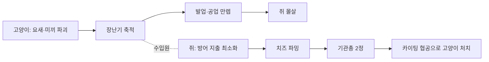

# 승리 빌드 기획 (1v4 기준)

> **이 문서의 용도**: "왜 이 숫자인가"를 나중에 5분 만에 되찾기 위한 기획 의도서.
> 수치 자체는 [스펙 §12](../superpowers/specs/2026-07-06-cheese-thief-and-cat-design.md)가 원본, 여기는 **의도와 계산 근거**.
> 최종 정리 2026-07-28 · 기준 인원 **고양이 1 vs 쥐 4** (초기 플레이테스트는 1v2로 진행)

---

## 한 줄 요약

**성장 경주 게임** — 쥐가 기관총 2정에 먼저 닿느냐, 고양이가 업그레이드를 먼저 채우느냐.
단 **동시 도달은 쥐의 승리**(뭉친 4정이 고양이를 잡고, 시간도 쥐 편) → 고양이는 반드시 **앞서야** 한다. [상세](#동시에-만렙이-되면--고양이가-진다)

마지막 점선이 핵심: **쥐가 방어에 쓴 돈이 곧 고양이의 수입**이라, 두 빌드가 서로를 직접 겨눈다.

---

## 고양이 승리 빌드

| 단계 | 행동 | 근거 |
|---|---|---|
| 1 | **초반에 킬을 노리지 않는다** | 추격 20~60초 → 장난기 120. 시간당 최악 |
| 2 | 요새·미끼부터 파괴 | 요새 12.5초 → **300**. 최고 효율 |
| 3 | 쥐를 적당히 위협해 방어 지출 유도 | 쥐가 요새를 지을수록 고양이 수입 증가 |
| 4 | **초반 40~60초는 무방비 쥐 사냥** | 초기 요새 폐지(2026-07-28)로 부술 자산이 없다. 쥐가 요새를 세우기 전 창 |
| 5 | 발업·공업 채운 뒤 사냥 개시 | 아래 검산대로 교전 계산이 뒤집힘 |

**하지 말아야 할 것**: 초반 킬 집착 → 추격에 시간 낭비 → 남은 쥐 3명이 고등급 치즈 독식 → 기관총 도달 → 역으로 사냥당함

## 쥐 승리 빌드

| 단계 | 행동 | 근거 |
|---|---|---|
| 1 | 시작 치즈 **50**(미끼 1개분)으로 개막 판단 | 요새는 무료가 아니다 — 지금 도망칠 카드를 살지, 아껴서 테크를 갈지 |
| 2 | 요새·미끼 지출 **최소화** | 방어 투자 = 고양이 먹이 |
| 3 | 치즈 파밍 집중, 기관총(600) | 2명이면 고양이 처치권 진입 |
| 4 | 사거리 10m 유지하며 카이팅 협공 | 붙으면 원킬당함 — 거리가 생명 |

**개막 40~60초가 쥐에게 가장 위험하다.** 요새(220)를 벌 때까지는 딱총(5dmg)뿐이라 사실상 무방비 —
등급 7 치즈 지점을 잡으면 31초, 등급 4면 55초 만에 요새값이 모인다. 이 구간을 넘기는 게 쥐의 첫 관문.

---

## 검산: 기관총 2정 vs 고양이

전제: 최대 사거리 10m에서 교전 시작, 쥐는 완벽히 후퇴하며 사격.

| 항목 | 값 |
|---|---|
| 기관총 | 5dmg / 0.15s = **33dps**, 사거리 10m |
| 2정 합계 | 66dps |
| 고양이 접근 속도 | 6.7 − 6.0 = **0.7m/s** |
| 10m → 2.2m(덮치기 사거리) | 7.8 ÷ 0.7 = **11초** |
| 접근 중 받는 피해 | 66 × 11 = **740** |
| 첫 쥐 처치(2.5s) 중 추가 | +83 → 823 |
| 둘째 쥐 상대 중 | ~900~990 → **고양이 HP 1000에 아슬아슬** |

**결론: 동일 컨트롤이면 기관총 2정이 고양이를 잡는다 (턱걸이).** 이게 의도된 균형점.

### 성장이 뒤집는다

| 고양이 상태 | 10m 접근 | 받는 피해 | 승패 |
|---|---|---|---|
| 무업 (6.7) | 11초 | ~1000 | 쥐 승 |
| **발업 만렙 (7.7)** | **4.6초** | ~300 | 고양이 압승 |
| 공업 만렙 (110dmg) | 쥐 **원킬** | 교전 시간 절반 | 고양이 압승 |

→ 그래서 게임은 "누가 먼저 스파이크에 도달하는가"의 경주가 된다.

### 동시에 만렙이 되면? — **고양이가 진다**

만렙 고양이(이속 7.7 = 4.6초 접근, 공업 110dmg = 원킬) vs 기관총 N정이 뭉쳐 있을 때:

| 기관총 | 접근 중 피해 | 교전 중 추가 | 합계 | 결과 |
|---|---|---|---|---|
| 2정 | 303 | +83 | 386 | 고양이 **압승**(614 남음) |
| 3정 | 460 | +250 | 710 | 고양이 신승 |
| **4정(전원 집결)** | 612 | +250 → +165 | **1027** | **고양이 사망** |

여기에 두 가지가 더 얹힌다:

- **타이머 10분 만료 = 쥐 승** → 교착은 자동으로 쥐의 승리
- **뭉치면 가난해짐** (치즈 지점당 1명) → 쥐도 계속 뭉쳐 있을 수는 없다

**결론: "성장 경주"는 실은 고양이가 반드시 앞서야 하는 경주.**
동시 도달 = 쥐 유리(뭉치면 승리 + 시간이 편). 고양이는 **먼저** 스파이크를 찍고, 쥐가 기관총 2정을 모으기 전에 머릿수를 줄이거나 — 뭉친 무리를 흩어 **각개격파**를 강제해야 한다. 이것이 고양이가 초반부터 부지런히 자산을 부숴야 하는 진짜 이유.

---

## 소리 = 정보 설계

| 소리 | 거리 | 의도 |
|---|---|---|
| 쥐 파밍(짤랑) | **20m** | 가장 큰 리스크에 가장 큰 노출. "벌면 위치가 팔린다" |
| 고양이 발소리 | **15m** | 들으면 도주가 성립하는 거리(18초 여유). 경보 역할 보장 |
| 쥐 발소리 | **8m** | 방 하나 크기. 은신은 쥐의 특권이되 능동 수색은 가능 |

**서열 자체가 기획**: 파밍 > 고양이 > 쥐. 각 역할의 정체성이 소리 크기 순서로 표현된다.

---

## 수치 노브 (바꾸면 무엇이 깨지는가)

| 상수 | 현재 | 지키는 것 | 바꿀 때 주의 |
|---|---|---|---|
| 고양이 이속 | 6.7 | 쥐(6.0) 우위 = 원작 술래 감성 | 6.0 이하면 추격 자체가 무의미해짐 |
| 발업 | +0.2 ×5 | 만렙 7.7 = 4.6초 접근(성장 보상) | 크면 도주가 원천 봉쇄됨 |
| 파운스 | 60dmg / 2.5s / 2.2m | 무업 2방킬, 공업 만렙 원킬 | 쿨 단축은 카이팅 계산 전체를 무너뜨림 |
| 고양이 HP | 1000 | 기관총 2정 턱걸이 처치선 | 낮추면 쥐 1명만으로 잡힘 |
| 기관총 | 5dmg/0.15s/10m, 600원 | 쥐의 최종 테크·역전 카드 | 사거리가 특히 민감(카이팅 성립 조건) |
| 요새 | 220원·HP300·회복10/s | 12.5초 지연 = 고양이 최고 수입원 | HP↑면 고양이 성장이 막히고 판이 늘어짐 |
| 쥐 시작 치즈 | **50** (미끼 1개분) | 개막의 선택지 + 무방비 구간 40~60초 | 220을 주면 t=0 요새와 같아지고, 기관총 진척도 37% 선지급됨 |
| 점프 높이 | 쥐 1.0m / 고양이 1.8m | **맵 지형의 격자 단위** — 1.0~1.8m = 쥐 전용 안전지대 | 두 값을 붙이면 안전지대 개념이 사라짐 |
| 착지 경직 | 고양이 0.4s | 점프로 붙고 덮치기로 마무리하는 확정 콤보 차단 | 없애면 고양이 접근 수단이 2개가 되어 카이팅이 붕괴 |
| 장난기 | 실데미지 1:1 + 킬 20 | "죽이기보다 갖고 놀기" | 킬 보너스↑면 초반 킬 집착이 최적해가 됨 |
| 타이머 | 600초(만료=쥐 승) | 고양이에게 시간 압박 | 늘리면 쥐의 농성이 강해짐 |

---

## 수직성 — 점프와 맵 (2026-07-28 결정)

점프를 넣는 목적은 조작감이 아니라 **숨는 방식의 다양화**다. 그런데 숨기는 세 가지가 다 있어야 성립한다.

| 요소 | 현재 | 점프가 기여하는가 |
|---|---|---|
| 높이차 지형 | 없음(전 구간 평지) | ✗ — 맵 작업이 필요 |
| 시야 차폐 | 벽만 | ✗ |
| 고양이의 접근 비용 | 없음(전부 뚫림) | **✓** |

**그래서 점프를 먼저 넣는다.** 맵부터 만들면 지형 높이를 무슨 기준으로 잡을지 알 수 없기 때문 —
점프 높이가 정해져야 그것이 맵 설계의 격자가 된다.

| 높이 구간 | 의미 |
|---|---|
| ~1.0m | 둘 다 올라감 — 평범한 엄폐 |
| **1.0 ~ 1.8m** | **쥐만 올라감 = 안전지대** |
| 1.8m 초과 | 둘 다 못 감 = 벽 |

비대칭 설계: 고양이는 높이 뛰지만 착지 후 0.4초 굳고 공중 제어가 없다(지름길·차단용).
쥐는 낮게 자주 뛰며 공중에서 방향을 튼다(회피용).

관련 계획: 맵을 현재 약 30×30m에서 **최소 2배(약 60×60m)로 확장 예정** — 그때 높이차 지형을 함께 깐다.

---

## 보류 중인 논의 (적용 안 함)

| 주제 | 결론 |
|---|---|
| **사망 = 영구 탈락으로 인한 플레이어 배제** | **미해결.** 3분에 죽으면 남은 7분을 관전만 — 수치로 못 고치는 재미 문제. 후보: 매치 시간 축소(600→300s), 유령 핑, 요새 기반 부활, 라운드제 |
| 미끼를 일회성 길막으로 (양방향 차단) | 성격은 합의, **세부 수치 미정** — 요새와 역할이 겹치는 문제가 남음 |
| 요새 짓는 동기 부족 (파괴 보상이 고양이 이득) | 초기 요새 폐지로 **"지을지 말지"가 선택지가 됨** — 동기 문제는 완화. 부활 거점화 안은 여전히 보류 |
| 미끼 다발 vs 요새 1개 가성비 역전 | 미끼 개수 제한/수명 축소안 있었으나 미적용 |

---

## 검증 방법

플레이 후 `%USERPROFILE%\AppData\LocalLow\DefaultCompany\CTC\MatchStats\*.json` (호스트 PC) 확인 —
승률 45~55% · 판 7~9분 · 첫 킬 2~4분 · 요새 파괴 1~3개가 목표치. 어긋나면 위 노브 표에서 해당 축을 조정.
