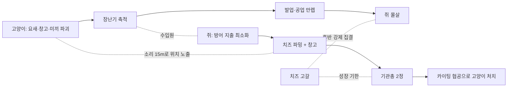

# 승리 빌드 기획 (1v4 기준)

> **이 문서의 용도**: "왜 이 숫자인가"를 나중에 5분 만에 되찾기 위한 기획 의도서.
> 수치 자체는 [스펙 §12](../superpowers/specs/2026-07-06-cheese-thief-and-cat-design.md)가 원본, 여기는 **의도와 계산 근거**.
> 최종 정리 2026-07-28 (v3.6) · 기준 인원 **고양이 1 vs 쥐 4** (초기 플레이테스트는 1v2로 진행)
> v3.6은 **첫 다인 플레이테스트 피드백 반영판** — [개정 내역](#v36-개정-첫-플레이테스트-반영-2026-07-28)
>
> **⚠ 2026-08-15 기준 낡은 부분** — 이 문서는 v3.6 의도서다. 그 뒤 바뀐 것: 기준 인원 **2:8**(v3.9+2:8 밸런스) ·
> **미끼 삭제**([[미끼]]) · **요새 80·HP 180·즉발 방패**([[요새]]) · 발소리 쥐 14m/고양이 12m · 감옥·구출·직업·2단계 추가.
> 현행 규칙은 `규칙과-현황.html`(발행본) 또는 [[v3.9 확장 로드맵]]. 본문의 미끼·요새 수치는 **역사 기록**으로 읽는다.

---

## 한 줄 요약

**성장 경주 게임** — 쥐가 기관총 2정에 먼저 닿느냐, 고양이가 업그레이드를 먼저 채우느냐.
단 **동시 도달은 쥐의 승리**(뭉친 4정이 고양이를 잡고, 시간도 쥐 편) → 고양이는 반드시 **앞서야** 한다. [상세](#동시에-만렙이-되면--고양이가-진다)

두 점선이 핵심이다. **쥐가 방어에 쓴 돈이 곧 고양이의 수입**이라 두 빌드가 서로를 직접 겨누고,
**치즈가 마르면 성장이 끝나 후반은 순수 전투**가 된다.

---

## 고양이 승리 빌드

| 단계 | 행동 | 근거 |
|---|---|---|
| 1 | **초반에 킬을 노리지 않는다** | 추격 20~60초 → 장난기 120. 시간당 최악 |
| 2 | 요새·창고부터 파괴 | 요새 12.5초 → **75**(v3.6에서 300→75). 쥐의 수입을 끊는 게 본목적, 장난기는 덤 |
| 3 | 쥐를 적당히 위협해 방어 지출 유도 | 쥐가 요새를 지을수록 고양이 수입 증가 |
| 4 | **초반 40~60초는 무방비 쥐 사냥** | 초기 요새 폐지(2026-07-28)로 부술 자산이 없다. 쥐가 요새를 세우기 전 창 |
| 5 | **창고 소리(15m)를 따라간다** | 2초마다 울린다. 넓은 맵에서 쥐를 찾는 가장 확실한 단서이자 부수면 성장이 끊긴다 |
| 5b | 접근은 **LCtrl 살금살금**(v3.6) | 발소리가 사라진다. 대신 이속 3.0 — 추격이 아니라 **매복·기습**용 |
| 6 | 후반엔 **남은 치즈 지점을 지킨다** | 고갈로 지점이 줄면 쥐가 거기로 올 수밖에 없다. 찾아다닐 필요가 없어짐 |
| 7 | 발업·공업 채운 뒤 사냥 개시 | 아래 검산대로 교전 계산이 뒤집힘 |

**하지 말아야 할 것**: 초반 킬 집착 → 추격에 시간 낭비 → 남은 쥐 3명이 고등급 치즈 독식 → 기관총 도달 → 역으로 사냥당함

## 쥐 승리 빌드

| 단계 | 행동 | 근거 |
|---|---|---|
| 1 | 시작 치즈 **50**(미끼 1개분)으로 개막 판단 | 요새는 무료가 아니다 — 지금 도망칠 카드를 살지, 아껴서 테크를 갈지 |
| 2 | **창고(150)를 일찍 세운다** | 30초면 본전(v3.6에서 75→30초). 자리를 비워도 벌리므로 지점에 묶이지 않는다 |
| 3 | 요새·미끼 지출 **최소화** | 방어 투자 = 고양이 먹이 |
| 4 | 치즈 파밍 집중, 기관총(600) | 2명이면 고양이 처치권 진입 |
| 5 | 사거리 10m 유지하며 카이팅 협공 | 붙으면 원킬당함 — 거리가 생명 |

**개막 40~60초가 쥐에게 가장 위험하다.** 요새(220)를 벌 때까지는 딱총(5dmg)뿐이라 사실상 무방비 —
등급 7 치즈 지점을 잡으면 31초, 등급 4면 55초 만에 요새값이 모인다. 이 구간을 넘기는 게 쥐의 첫 관문.

**창고는 양날이다.** 벌어주지만 2초마다 소리(15m)와 파티클로 위치를 알린다. 고양이 동선에서 먼 구석에
지어야 하고, 그 판단이 새로운 선택지다. 부서지면 생산이 즉시 멈춘다(HP 150 = 요새의 절반).
v3.6에서 수입을 2/s → **5/s**로 올렸다 — 2/s는 등급 2 지점과 같아서 150을 들일 값이 아니었다.
올린 대가는 소음이다: 지급 간격이 5초 → 2초로 좁아져 고양이에게 위치가 훨씬 빨리 팔린다.

**미끼는 소리 장치다(v3.6).** 예전엔 조용한 캡슐이라 아무도 속지 않았다. 이제 진짜 쥐와 같은
발소리(8m)를 30초간 흘린다 — 50치즈로 고양이의 30초를 사는 카드. 구매 즉시 발밑에 놓인다(조준 없음).
**충돌은 비대칭**: 쥐는 몸도 총알도 통과하고(도주 중 제 미끼에 걸리면 안 된다), 고양이는 몸으로
막힌다 — 부딪히는 순간 "쥐다"라는 오인이 확정된다. 소리에 이은 두 번째 속임수.

**치즈는 무한하지 않다.** 지점마다 매장량 700이 있고 다 캐면 사라진다(등급 7이면 100초, 등급 1이면 700초).
맵 총량 4900은 쥐 4마리 풀빌드(970×4=3880)보다 넉넉해서 고갈은 "굶기기"가 아니라 **성장 기한**이다.
후반에는 남은 지점이 몇 곳뿐이라 양 진영이 거기로 모인다 — 늘어지는 판이 구조적으로 사라진다.

---

## 검산: 기관총 2정 vs 고양이

전제: 최대 사거리 10m에서 교전 시작, 쥐는 완벽히 후퇴하며 사격.

| 항목 | 값 |
|---|---|
| 기관총 | 5dmg / 0.15s = **33dps**, 사거리 10m |
| 2정 합계 | 66dps |
| 고양이 접근 속도 | 6.7 − 6.0 = **0.7m/s** |
| 10m → 2.2m(덮치기 사거리) | 7.8 ÷ 0.7 = **11초** |
| 접근 중 받는 피해 | 66 × 11 = **740** |
| 첫 쥐 처치(2.5s) 중 추가 | +83 → 823 |
| 둘째 쥐 상대 중 | ~900~990 → **고양이 HP 1000에 아슬아슬** |

**결론: 동일 컨트롤이면 기관총 2정이 고양이를 잡는다 (턱걸이).** 이게 의도된 균형점.

### 성장이 뒤집는다

| 고양이 상태 | 10m 접근 | 받는 피해 | 승패 |
|---|---|---|---|
| 무업 (6.7) | 11초 | ~1000 | 쥐 승 |
| **발업 만렙 (7.7)** | **4.6초** | ~300 | 고양이 압승 |
| 공업 만렙 (110dmg) | 쥐 **원킬** | 교전 시간 절반 | 고양이 압승 |

→ 그래서 게임은 "누가 먼저 스파이크에 도달하는가"의 경주가 된다.

### 동시에 만렙이 되면? — **고양이가 진다**

만렙 고양이(이속 7.7 = 4.6초 접근, 공업 110dmg = 원킬) vs 기관총 N정이 뭉쳐 있을 때:

| 기관총 | 접근 중 피해 | 교전 중 추가 | 합계 | 결과 |
|---|---|---|---|---|
| 2정 | 303 | +83 | 386 | 고양이 **압승**(614 남음) |
| 3정 | 460 | +250 | 710 | 고양이 신승 |
| **4정(전원 집결)** | 612 | +250 → +165 | **1027** | **고양이 사망** |

여기에 두 가지가 더 얹힌다:

- **타이머 10분 만료 = 쥐 승** → 교착은 자동으로 쥐의 승리
- **뭉치면 가난해짐** (치즈 지점당 1명) → 쥐도 계속 뭉쳐 있을 수는 없다

**결론: "성장 경주"는 실은 고양이가 반드시 앞서야 하는 경주.**
동시 도달 = 쥐 유리(뭉치면 승리 + 시간이 편). 고양이는 **먼저** 스파이크를 찍고, 쥐가 기관총 2정을 모으기 전에 머릿수를 줄이거나 — 뭉친 무리를 흩어 **각개격파**를 강제해야 한다. 이것이 고양이가 초반부터 부지런히 자산을 부숴야 하는 진짜 이유.

---

## 소리 = 정보 설계

| 소리 | 거리 | 의도 |
|---|---|---|
| 쥐 파밍(짤랑) | **20m** | 가장 큰 리스크에 가장 큰 노출. "벌면 위치가 팔린다" |
| 고양이 발소리 | **15m** | 들으면 도주가 성립하는 거리(18초 여유). 경보 역할 보장 |
| 쥐 발소리 | **8m** | 방 하나 크기. 은신은 쥐의 특권이되 능동 수색은 가능 |
| 미끼 발소리 | **8m**·상시 | 쥐와 구별 불가 — 그게 미끼의 값어치 (v3.6) |
| 창고 생산 | **15m**·2초 | 고양이의 초·중반 자석 — 짧은 간격이 강한 수입의 대가 |
| 고양이 잠행 | **무음** | 대가는 이속 3.0(쥐보다 느림) — 추격이 아니라 매복 (v3.6) |

**서열 자체가 기획**: 파밍 > 고양이 > 쥐. 각 역할의 정체성이 소리 크기 순서로 표현된다.
v3.6에서 양쪽 다 소리를 **조작**할 수단을 얻었다 — 쥐는 가짜 소리(미끼), 고양이는 무음(잠행).
정보전이 일방(고양이가 듣는다)에서 쌍방(서로 속인다)이 됐다.

---

## 수치 노브 (바꾸면 무엇이 깨지는가)

| 상수 | 현재 | 지키는 것 | 바꿀 때 주의 |
|---|---|---|---|
| 고양이 이속 | 6.7 | 쥐(6.0) 우위 = 원작 술래 감성 | 6.0 이하면 추격 자체가 무의미해짐 |
| 발업 | +0.2 ×5 | 만렙 7.7 = 4.6초 접근(성장 보상) | 크면 도주가 원천 봉쇄됨 |
| 파운스 | 60dmg / 2.5s / 2.2m | 무업 2방킬, 공업 만렙 원킬 | 쿨 단축은 카이팅 계산 전체를 무너뜨림 |
| 고양이 HP | 1000 | 기관총 2정 턱걸이 처치선 | 낮추면 쥐 1명만으로 잡힘 |
| 기관총 | 5dmg/0.15s/10m, 600원 | 쥐의 최종 테크·역전 카드 | 사거리가 특히 민감(카이팅 성립 조건) |
| 요새 | 220원·HP300·회복10/s | 12.5초 지연 = 고양이 부수입(75) | HP↑면 고양이 성장이 막히고 판이 늘어짐 |
| 쥐 시작 치즈 | **50** (미끼 1개분) | 개막의 선택지 + 무방비 구간 40~60초 | 220을 주면 t=0 요새와 같아지고, 기관총 진척도 37% 선지급됨 |
| 창고 | 150원·HP150·**2초마다 10**(=5/s) | 회수 30초 = 등급 5 지점을 하나 낀 셈 | 2/s(회수 75초)는 등급 2 지점급이라 아무도 안 지었다(v3.5의 실패). 더 올리면 고갈 후에도 성장이 계속돼 '성장 기한'이 무의미해진다 |
| 창고 소리 | 15m·**2초 간격** | 고양이의 초·중반 유일한 자석 · 강한 수입의 대가 | 줄이면 넓은 맵에서 서로 못 만남. 수입을 올린 만큼 간격이 좁아져야 공짜 수입이 안 된다 |
| 미끼 | 50원·수명 30초·발소리 8m | 50치즈 = 고양이 30초. 쥐의 유일한 능동 기만 | 무음으로 되돌리면 아무도 안 삼(v3.5의 실패) |
| 고양이 잠행 | 이속 ×0.45 (3.0) | 무음의 대가. 쥐(6.0)보다 느려야 추격 대체재가 안 됨 | 0.7 이상이면 "느린 추격"이 되어 항상 켜는 게 최적해 |
| 치즈 매장량 | 총 4900 ÷ 지점 수 (균일) | 후반 압축 — 고갈된 자리부터 사라져 남은 곳으로 모임 | **등급 비례로 주면 전부 동시에 말라 압축이 사라진다.** 총량을 늘리면 고갈이 판 안에 안 옴 |
| 최후 부활 | 최고 등급 1곳·400·판당 1회 | 뒤처진 쥐의 만회 + 결전지 | 여러 번 부활시키면 압축이 무효화됨 |
| 점프 높이 | 쥐 1.0m / 고양이 1.8m | **맵 지형의 격자 단위** — 1.0~1.8m = 쥐 전용 안전지대 | 두 값을 붙이면 안전지대 개념이 사라짐 |
| 착지 경직 | 고양이 0.4s | 점프로 붙고 덮치기로 마무리하는 확정 콤보 차단 | 없애면 고양이 접근 수단이 2개가 되어 카이팅이 붕괴 |
| 장난기 | 플레이어 ×0.5 + 킬 30 / **구조물 ×0.25** | "쥐의 방어 지출 = 고양이 수입" 축은 유지, 배율만 하향 | 구조물을 1:1로 되돌리면 벽 때리기가 최고 효율이 되어 쥐를 쫓지 않음(v3.5의 실패) |
| 타이머 | 600초(만료=쥐 승) | 고양이에게 시간 압박 | 늘리면 쥐의 농성이 강해짐 |

---

## 넓은 맵의 밀도 문제 (2026-07-28)

맵을 넓히면 인원은 그대로인데 면적만 커져 **마주칠 확률이 반으로 준다.** 판 길이는 그대로라
아무 일도 안 일어나는 시간이 길어진다. 넓힐수록 이걸 메울 장치가 더 필요해진다.

| 층 | 장치 | 담당 구간 | 상태 |
|---|---|---|---|
| **자석** | 창고 — 소리 15m로 고양이를 끌어당김 | 초·중반 | ✅ v3.5 |
| **압축** | 치즈 고갈 — 남은 지점으로 강제 집결 | 후반 | ✅ v3.5 |
| **정보** | 발소리 서열(위 참조), 창고 파티클 | 전 구간 | ✅ |
| 추격 종결 | 막다른 길 비율·초크 배치 | 전 구간 | ⬜ 미착수 |

**압축이 가장 강하다.** 자석은 확률을 올릴 뿐이지만 고갈은 후반 조우를 **보장**한다.
출시 규모로 맵이 더 커지고 샛길이 늘어나면, 늘어난 만큼 자석을 더 놓고 고갈 속도를 조여야 한다.

마지막 줄이 반대 방향의 위험이다 — 샛길이 많을수록 쥐가 계속 갈라져 **추격이 영원히 안 끝난다.**
전부 뚫린 격자가 최악이고, 막다른 길을 3~4개 중 1개쯤 섞어야 잡을 방법이 생긴다. 확장 맵(42×42)은
기존 구조를 그대로 키운 것이라 이 비율은 현행과 같다.

---

## 수직성 — 점프와 맵 (2026-07-28 결정)

점프를 넣는 목적은 조작감이 아니라 **숨는 방식의 다양화**다. 그런데 숨기는 세 가지가 다 있어야 성립한다.

| 요소 | 현재 | 점프가 기여하는가 |
|---|---|---|
| 높이차 지형 | 없음(전 구간 평지) | ✗ — 맵 작업이 필요 |
| 시야 차폐 | 벽만 | ✗ |
| 고양이의 접근 비용 | 없음(전부 뚫림) | **✓** |

**그래서 점프를 먼저 넣는다.** 맵부터 만들면 지형 높이를 무슨 기준으로 잡을지 알 수 없기 때문 —
점프 높이가 정해져야 그것이 맵 설계의 격자가 된다.

| 높이 구간 | 의미 |
|---|---|
| ~1.0m | 둘 다 올라감 — 평범한 엄폐 |
| **1.0 ~ 1.8m** | **쥐만 올라감 = 안전지대** |
| 1.8m 초과 | 둘 다 못 감 = 벽 |

비대칭 설계: 고양이는 높이 뛰지만 착지 후 0.4초 굳고 공중 제어가 없다(지름길·차단용).
쥐는 낮게 자주 뛰며 공중에서 방향을 튼다(회피용).

**아직 미구현이다.** 맵은 v3.5에서 42×42로 넓혔지만(면적 2배) 여전히 평지라, 점프를 넣어도
올라갈 곳이 없다. 높이차 지형을 까는 시점에 함께 들어가야 한다.

---

## 맵 (v3.5)

로비에서 호스트가 고른다. 씬 전환이 아니라 지오메트리 교체 — 로비에서 고르면 그 맵이 바로 서서 미리보기가 된다.

| | 기본 맵 | 확장 맵 |
|---|---|---|
| 크기 | 30×30m | **42×42m** (면적 2배) |
| 방 | 6 | **9** |
| 복도 폭 | 1.6m | **3.0m** |
| 요새 자리 | 4 | **6** |
| 치즈 지점 | 7 | 7 |
| 총 매장량 | 4900 | 4900 |

**좌표를 ×1.4만 키운 게 핵심이다.** ×2로 키우면 방 하나가 14×18m 체육관이 되고 이동 시간만 2배가 된다.
남는 면적은 방 개수로 채워야 숨을 곳과 경로 선택지가 실제로 늘어난다. 복도 3.0m는 배율이 아니라
명시 상향 — 1.6m는 3인칭 카메라 기준 업계 권장(3m)의 절반이었다.

> 확장 맵도 치즈 지점이 7개다(등급 1~7 정확히 하나씩이라는 검증 때문). 맵은 2배인데 파밍 지점
> 밀도는 절반이라 이동 시간이 체감된다 — 등급 체계를 손대야 하는 별건.

---

## 보류 중인 논의 (적용 안 함)

| 주제 | 결론 |
|---|---|
| **사망 = 영구 탈락으로 인한 플레이어 배제** | **미해결.** 3분에 죽으면 남은 7분을 관전만 — 수치로 못 고치는 재미 문제. 후보: 매치 시간 축소(600→300s), 유령 핑, 요새 기반 부활, 라운드제 |
| 미끼를 일회성 길막으로 (양방향 차단) | 성격은 합의, **세부 수치 미정** — 요새와 역할이 겹치는 문제가 남음 |
| 요새 짓는 동기 부족 (파괴 보상이 고양이 이득) | 초기 요새 폐지로 **"지을지 말지"가 선택지가 됨** — 동기 문제는 완화. 부활 거점화 안은 여전히 보류 |
| 미끼 다발 vs 요새 1개 가성비 역전 | 미끼 개수 제한/수명 축소안 있었으나 미적용 |
| 창고를 요새에 합치기 | **기각** — 방어와 경제를 한 건물에 묶으면 고양이가 "왜 부수는지"가 흐려진다. 따로 둬야 "방어를 깰지 경제를 끊을지"라는 선택이 생김 |
| 시간마다 자동 치즈 지급 | **기각** — "벌면 위치가 팔린다"는 정보 설계의 뼈대가 끊긴다. 타이머 만료가 쥐 승이라 숨어서 버티기가 최적해가 됨 |
| 지점 수입 분배(동시에 여러 마리) | **기각** — 뭉치면 기관총 시너지로 쥐가 이기는 구조라 경제가 뭉치기를 보상하면 안 된다. 독점 유지 |
| 등급 체계 개편(치즈 지점 7개 제한 해제) | 확장 맵의 파밍 밀도 문제. 검증기(`CheeseGradesComplete`)가 1~7 정확히 하나씩을 요구 — **미착수** |

---

## 검증 방법

플레이 후 `%USERPROFILE%\AppData\LocalLow\DefaultCompany\CTC\MatchStats\*.json` (호스트 PC) 확인 —
승률 45~55% · 판 7~9분 · 첫 킬 2~4분 · 요새 파괴 1~3개가 목표치. 어긋나면 위 노브 표에서 해당 축을 조정.

v3.5에서 볼 것이 늘었다:

| 관측 | 기대 | 어긋나면 |
|---|---|---|
| 치즈 고갈 시각 | **3~4분** | 너무 이르면 총량↑, 너무 늦으면 총량↓ |
| 창고 건설률 | 쥐 대부분이 초반에 1채 | 안 지으면 회수 시간↓(가격↓), 무조건 지으면 가격↑ |
| 창고 파괴 횟수 | 판당 1~2 | 0이면 소리가 안 들리는 것(범위↑), 매번이면 HP↑ |
| 고갈 후 창고 수입 | 성장이 사실상 멈춰야 함 | 창고만으로 기관총까지 가면 5/s를 내리거나 고갈 시 생산 중단을 넣는다 |
| 고갈 후 결전 발생 | 부활 지점에서 교전 | 안 모이면 부활 매장량↑ |
| 확장 맵 판 길이 | 기본 맵과 비슷 | 길어지면 밀도 장치가 부족한 것 |

v3.6에서 추가로 볼 것:

| 관측 | 기대 | 어긋나면 |
|---|---|---|
| 고양이 만렙 도달 | 판당 2~3스택 (만렙 아님) | 만렙까지 가면 배율↓, 1스택도 못 가면 배율↑ |
| 잠행 사용 빈도 | 매복·모퉁이 접근에서 씀 | 안 쓰면 이속 배율↑, 항상 켜면 배율↓ |
| 미끼 구매율 | 쥐당 판당 1~2개 | 0이면 수명↑ 또는 가격↓ |
| 따봉 | 탈락자가 실제로 누름 | 안 누르면 관전 UI가 안 보이는 것 |

---

## v3.6 개정 (첫 플레이테스트 반영, 2026-07-28)

친구들과의 첫 다인 테스트에서 나온 건의 6건 + 버그 2건.

| 지적 | 조치 |
|---|---|
| 고양이가 소리 없이 움직이는 기능이 있으면 | **잠행 신설** — LCtrl 홀드, 발소리 0·이속 ×0.45 |
| 미끼가 의미 없다 | **발소리를 내는 미끼**(8m·30초) — 진짜 쥐와 구별 불가 |
| 설치기가 너무 힘들다 | 미끼는 **즉시 설치**(고스트 폐지), 요새·창고는 고스트 유지하되 **플레이어를 방해물에서 제외** |
| 죽었을 때 할 게 없다 | **따봉**(G) — 관전자→살아있는 쥐. 고양이에겐 전송조차 안 함 |
| 카메라 충돌이 오히려 불편 | **Decollider 제거** — 카메라가 벽을 통과하고 시야는 페이드로만 확보 |
| 창고가 주는 치즈가 너무 적다 | 2/s → **5/s** (회수 75초 → 30초, 지급 2초마다 10) |
| 고양이가 버는 돈이 너무 많다 | 플레이어 ×0.5·킬 30, **구조물 ×0.25** (요새 300 → 75) |

**버그**

| 증상 | 원인 |
|---|---|
| 일부 유저에게 치즈 잔량이 안 줄어듦 | **호스트 전용** — 서버는 자기 NetworkList 변경 이벤트를 되받지 않아 지점 라벨이 얼어붙었다. 실제 수치는 정상이고 표시만 정지 |
| 고양이인데 "치즈 부족"이라고 나옴 | 재화 이름이 하드코딩 — 역할별(`ShopLogic.CurrencyNameOf`)로 통일 |
