# 코드 다이어그램

> `Assets/Scripts/` 현재 구조. **코드를 고치면 이 문서를 같이 고친다**(2026-07-30 규칙).
> 갱신 **2026-08-30** (프론트엔드 4씬 · 3판 시리즈 · 화면 색 팔레트 · 프롭 메시/텍스처 · 스팀 배포) · 이전 **2026-08-15** (요새 즉발 방패화 `FortressShield`·`BodyPush`·미끼 삭제 · HUD 개편 `StatusHud`·칩 바 · 08-12: 구운 폴리곤 길찾기·행동트리·예약·지휘관) · 상세 멤버는 코드 참조 · 순수 로직(`*Logic`)은 아래 별도 절

**관련 노트**: [[00 기획 그래프 안내]] · [[코드 개편 계획]](왜 이렇게 나뉘었나) · [[승리 빌드 기획]](수치의 의도)
**여기서 다루는 기획 도메인**: [[상점]] · [[요새]] · [[치즈 지점]] · [[치즈 지갑]] · [[덮치기]] · [[매치 타이머]] · [[탈락과 관전]] · [[맵 레벨디자인]]

---

## 프론트엔드 흐름 (2026-08-30 신설)

게임 앞단이 씬 넷으로 갈렸다. **네트워크가 붙는 곳은 대기실부터**이고, 그 앞은 전부 오프라인이라
스팀이 흔들려도 게임이 안 죽는다. 기획: [2026-08-26 프론트엔드 흐름](../superpowers/specs/2026-08-26-frontend-flow-design.md)

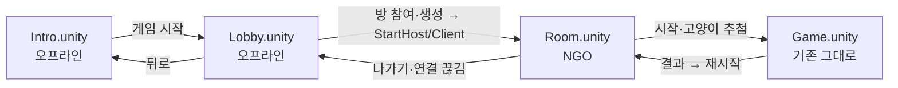

> **씬을 넘기는 주체가 둘이다.** 오프라인 구간(인트로↔로비)은 `UnityEngine.SceneManagement`,
> 네트워크 구간(로비→대기실→인게임)은 **`NetworkManager.SceneManager`**다. 이걸 섞으면
> 씬은 뜨는데 in-scene NetworkObject가 안 스폰돼 **상태가 통째로 빈다**(2026-08-30 실측:
> 대기실 화면은 떴는데 참가자가 0명이었다).

### 인트로 — 부팅 체크와 메인 메뉴

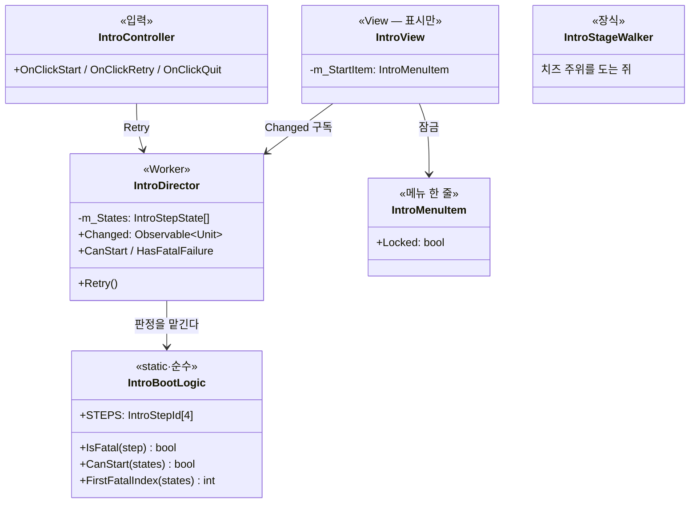

**검사 4종**: 게임 데이터(CSV) · 개인 설정 · 스팀 연결 · 스팀 릴레이.
막는 실패는 데이터·스팀 둘뿐이고, **에디터에서는 스팀을 아예 검사하지 않는다** — 검사하면 개발 중에
인트로를 영영 통과 못 한다(실측). 개발 빌드도 막지 않는다. 배포 빌드만 막는데, 거기서는 스팀이
실행 주체라 사실상 일어나지 않는 경우다.

화면에는 **검사 상태를 표시하지 않는다.** 4개 중 유저가 손쓸 수 있는 게 없고, 스팀 출시 뒤에는
"스팀 미실행"이라는 상태 자체가 성립하지 않는다. 막혔을 때만 사유 한 줄이 뜬다.

### 로비 — 방 목록

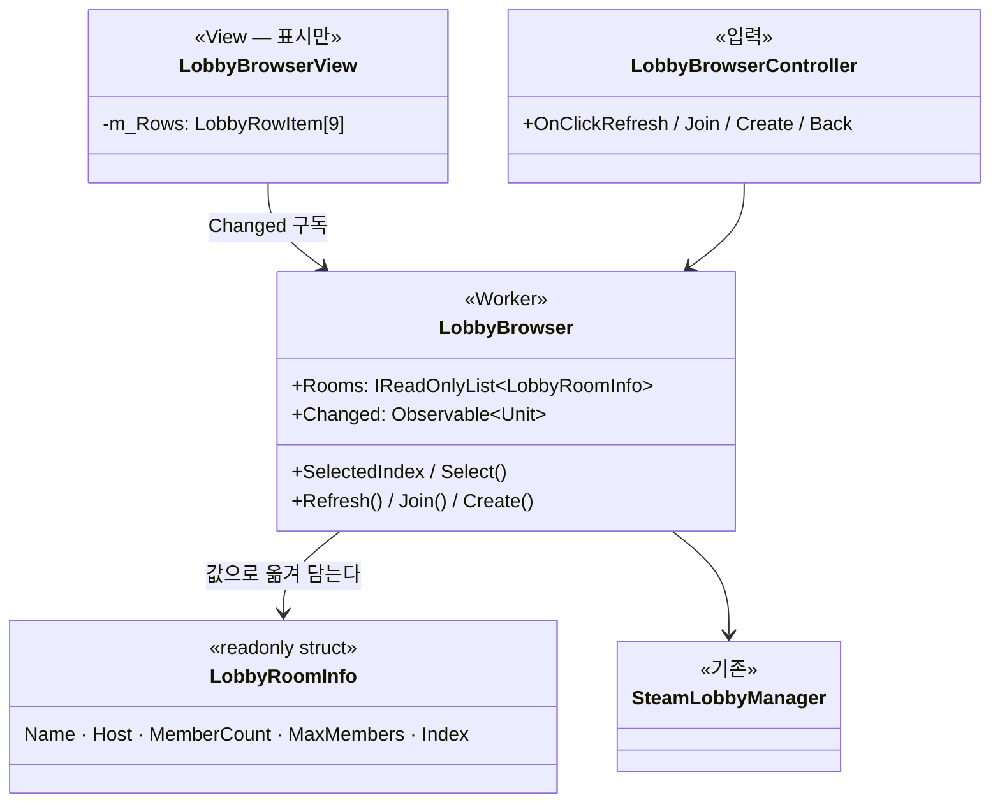

**왜 값으로 옮겨 담는가** — 화면이 `Steamworks.Data.Lobby`를 직접 들면 스팀 없이는 UI를 한 줄도
못 그린다. 에디터에는 스팀이 없으니 개발이 막힌다. `LobbyRoomInfo`에서 끊어 **에디터는 가짜 목록**으로
화면을 그대로 돌린다.

새로고침은 **명시 호출만** 한다 — 프레임마다 스팀을 찌르면 로그아웃 순간에 터진다(`ConnectionUI` 사고).

### 대기실 — 3D 방 · 참가자 보드 · 고양이 추첨 (2026-08-30)

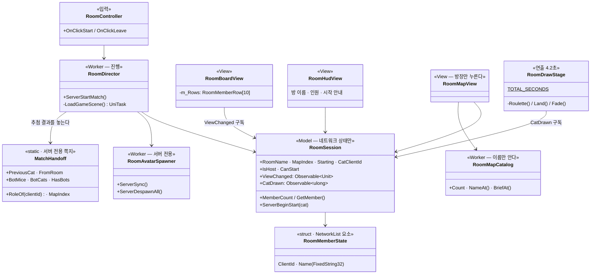

**추첨 연출 4.2초** (`RoomDrawStage`) — 전원 화면에서 같이 돈다. 본인만 문구가 다르다.

| 시각 | 하는 일 |
|---|---|
| 0.0s | 암전 — `Hud`를 통째로 끄고 채움광을 죽인다. 참가자와 스포트라이트만 남는다 |
| 0.4s | 스포트라이트가 참가자 사이를 돈다(easeOut로 감속) |
| 1.8s | 뽑힌 사람 위에서 정지 · 빛이 78°→26°로 좁아지고 카드가 커진다 |
| 2.6s | 이름 공개 |
| 3.8s | 검게 페이드 |
| 4.2s | `RoomDirector`가 인게임 씬을 연다 |

- **총 걸음을 `바퀴수 × 인원 + 목표거리`로 잡는다** — 감속 곡선이 어떻든 착지가 뽑힌 사람에서 어긋나지 않는다.
- 대기 중 화면은 `Hud` **하나**에 담는다. 요소마다 껐다 켜면 하나 빠뜨렸을 때 화면에 홀로 남는다.
- **결과는 RPC로 알린다.** `NetworkVariable`의 변경 이벤트에 기대면 두 군데서 샌다 —
  뽑힌 사람이 clientId 0이면 기본값과 같아 **변경이 안 일어나고**, 서버에서는 값을 넣는 그 줄에서
  콜백이 도는데 그때 시작 플래그가 아직 안 서 있다. 둘 다 "결과는 나왔는데 연출이 안 도는" 형태로 조용히 깨진다.
- 채팅·옵션은 **인게임과 같은 컴포넌트**(`ChatManager`·`ChatHud`·`OptionsPopup`·`EscapeRouter`)를 그대로 쓴다.
  자리만 다르다 — 대기실은 좌하단에 참가자 보드가 지나가서 채팅창을 그 아래로 내린다.

**시작을 누르면 도는 순서** (전부 서버):

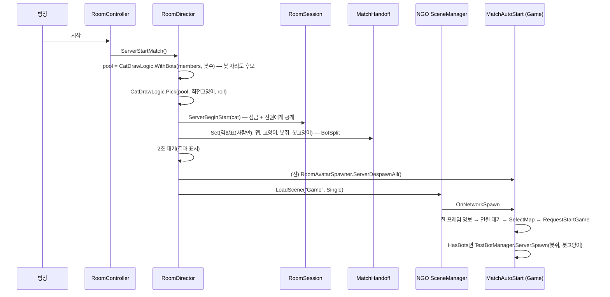

### 창고 평면도 — 「격자를 버린다」 (2026-09-07)

방 모듈 1단계 뒤 판정: "주방이 격자 던전 같다." 방 49 + 복도 62를 버리고 **손으로 그린 평면도 1장**
(`docs/design-vault/맵 시안 v2 창고.html`)을 굽는다. 존을 가르는 것은 벽이 아니라 선반 열·궤짝 벽이다.

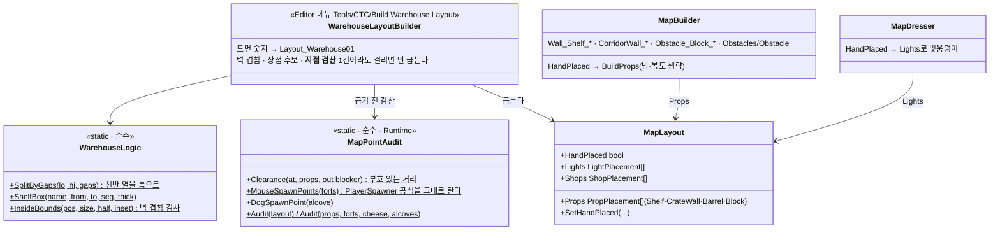

| 왜 이렇게 했나 | |
|---|---|
| **이름이 곧 옷·격자** | `Wall_Shelf_*`는 MapDresser가 선반을 타일링하고 NavGridBaker가 찍는다. `CorridorWall_*`는 궤짝(1.4배·2.4 m). 배럴은 `Obstacles/Obstacle`이라 배럴 비주얼로 바뀐다 — **MapDresser·NavGridBaker 변경 0** |
| **자동 계획 금지** | `HandPlaced`면 `Setup Networking Scene`의 벽감·상자·장애물 계획을 건너뛴다 — 좌표는 레이아웃이 다 든다 |
| **상점 좌표** | `MapLayout.Shops`는 **후보 8곳**(모서리 존 4 + 존 사이 통로 4). 그날 서는 것은 `ShopSpotLogic.PickPlaced`가 매치 시드로 고른 **4곳**이다 — 후보 4곳만 두면 아무리 섞어도 매 판 같은 자리였다(2026-09-08). 빌더가 원반(반경 3 m)이 차단물에 물리는지·후보끼리 25 m 이상인지 검산하고 어기면 굽지 않는다 |
| **실측** (BotLab) | 격자 15% 막힘(격자 맵 67%) · `giveups 0 · stuck 0 · detour 1.03` |
| **선반 2단·궤짝 더미** (B단계) | `Wall_Shelf_*`는 `MapDresser.TileTiers`가 선반을 2단으로(1단만이면 위 3 m가 맨 벽으로 읽혔다) · `Obstacle_Block_*`는 `CratePile`이 발자국을 궤짝으로 채운다(계단 5 m는 판벽 박스 유지) |
| **바닥은 20 m 타일** | URP는 오브젝트당 추가 광원 4개 — 120 m 바닥 한 장이면 빛웅덩이 7개 중 4개만 붙어 나머지 존이 캄캄했다(밤 실측). `MapBuilder.BuildGround`가 `FLOOR_TILE_METERS`로 쪼갠다 |
| **지점 검산** (2026-09-09) | 쥐 스폰(요새 입구 앞 1.8 m)·치즈 파밍 원반·강아지 벽감 정면이 차단물에 물리면 **굽지 않는다** — 규칙은 `MapPointAudit` 한 벌이고 `MapLayoutIntegrityTests`가 **구운 에셋**에 대고 같은 것을 다시 본다. 이 검사가 없던 동안 쥐 스폰 #2가 궤짝 벽 `C-y7` 속 1.27 m에 들어앉아 있었다(감사 M1) — 「좌표가 차단물 안에 박힌다」의 **네 번째**다. 손 배치 맵은 `MapValidator`(절차 전용)를 안 지나므로 이 층이 유일한 게이트다 |
| **격자 대형은 개발 전용** | `MapLayout.DevOnly` — `MapCatalogLogic.IsSelectable(half, devOnly, devBuild)`·`DefaultIndex(exts, devOnly)`. 맵 순서: 기본·확장·**창고(기본 맵)**·격자 대형 |

### 방 모듈 — 「레이아웃은 절차, 방은 손으로」 (2026-09-07, 1단계)

REPO 벤치마킹. 대형 맵의 방을 절차 큐브 대신 **손조립 모듈 프리팹**으로 세운다. 레이아웃 두뇌
(`MapGenerator`·`Layout_Large01`·격자 A\*)는 그대로다 — 바뀐 건 "방 하나를 어떻게 세우나"뿐이다.

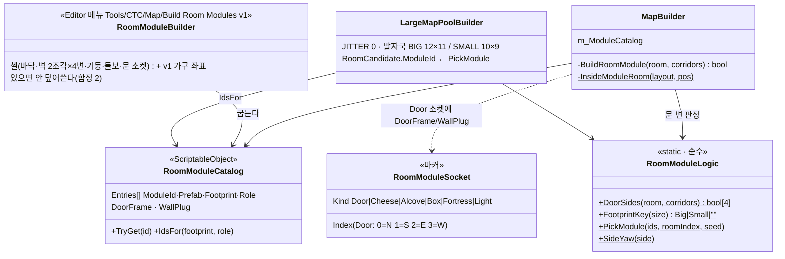

| 왜 이렇게 했나 | |
|---|---|
| **이름이 곧 기능** | 모듈 안 `Wall_*`·`Obstacle_*` 실물 BoxCollider는 `NavGridBaker`가 이름으로 찍는다 → 봇이 가구를 우회한다. `Floor_*`는 지형 아님, 트리거 박스는 무시(카메라 페이더용) |
| **지터 0** | 문 소켓이 변 한가운데라 방 중심이 흔들리면 복도가 소켓을 빗나간다. 격자 티는 모듈 내부 차이로 지운다(REPO) |
| **`RoomRect.ModuleId`가 비면 옛 길** | 기본·확장(개발용) 맵과 카탈로그 없는 씬은 큐브 벽 그대로 |
| **모듈 방엔 `ObstacleFactory` 장애물 안 세움** | 모듈이 제 가구로 시야를 끊는다(`InsideModuleRoom`) |
| **MapDresser는 모듈을 건드리지 않는다** | 직계 자식만 훑는데 모듈 내부는 손자라 자동으로 빠진다. 복도 크레이트·빛웅덩이는 그대로 |

2단계(미착수): 소켓 → 치즈·벽감·상자·요새 자리 · 역할별 모듈(요새·중앙·랜드마크) · 조명 소켓 · 배치 검수 메뉴.

**봇도 고양이 후보다**(2026-09-06). 봇 자리는 가짜 clientId(`CatDrawLogic.BOT_CAT`)로 후보 풀에 봇 수만큼
들어가 사람과 같은 확률로 뽑힌다. 걸리면 사람은 전원 쥐, 봇 쥐 하나가 봇 고양이로 바뀐다
(`BotSplit`). 예전엔 사람만 뽑아서 **혼자+봇이면 무조건 고양이**였다. 봇이 걸리면 추첨 연출은
비출 몸이 없어 룰렛을 건너뛰고 "봇 고양이" 카드만 띄운다.

| 왜 이렇게 했나 | |
|---|---|
| **`MatchHandoff`가 정적인 이유** | 씬이 바뀌는 그 순간, 대기실 NetworkObject는 이미 사라지고 인게임 것은 아직 스폰 전이다. 그 틈을 건널 수 있는 건 씬을 안 타는 정적 상태뿐이다. **복제하지 않는다** — 서버만 읽고, 클라는 인게임의 `LobbySession`으로 결과를 본다 |
| **대기실 몸을 따로 굽는 이유** | `PlayerMouse`를 그대로 쓰면 지갑·전투·상점·발소리가 딸려 온다. `RoomMouse`는 이동·시점·이름표뿐이다 |
| **자리를 슬롯 번호로 고정** | 인원수로 원을 나누면 누가 들어올 때마다 서 있던 사람이 밀린다 |
| **몸을 씬 전환 전에 걷는 이유** | 동적 스폰 NetworkObject는 기본이 `DestroyWithScene = false`라 씬을 넘어 살아남는다 — 안 걷으면 인게임 한복판에 대기실 쥐가 서 있다 |
| **`LobbyUI`를 숨기는 이유** | `MatchHandoff.FromRoom`이면 인게임의 옛 역할선택 패널을 아예 안 띄운다. 역할은 이미 뽑혔고 시작도 자동이다 |
| **맵 목록을 따로 둔 이유** | `MapDirector`는 레이아웃을 받아 지오메트리를 굽는 물건이다. 대기실에 들이면 대기실이 맵을 짓기 시작한다. `RoomMapCatalog`는 **이름만** 안다 |

### 3판 시리즈 (2026-08-30)

대기실에서 시작하면 **한 경기 = 3판**이다. 판이 끝나면 서버가 알아서 다음 판을 열고,
3판을 다 하면 대기실로 돌아간다. 사람이 "재시작"을 누를 자리가 없다.

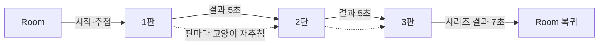

| 결정 | 값 | 왜 |
|---|---|---|
| 판 수 | **무조건 3판** | 2:0으로 갈려도 3판을 다 한다. 조기 종료를 넣으면 3판째에 고양이가 될 사람이 영영 안 걸린다 |
| 무승부 | 나올 수 없다 | 한 판은 반드시 한쪽 승이고 3은 홀수다 |
| 맵 | **시리즈 시작 전 한 번** | 대기실에서 방장이 고른 맵으로 3판을 다 한다 |
| 고양이 | **판마다 재추첨** | 직전 고양이는 후보에서 뺀다(3명 이상). 3판이면 대체로 돌아가며 해 본다 |

- **`Game.unity`를 혼자 열면 아무 일도 안 한다** — `MatchHandoff.FromRoom`이 false면 시리즈가
  꺼진 채로 있고, 지금까지처럼 사람이 재시작을 누른다. wesqa·MPPM 회귀 경로가 그대로다.
- 다음 판을 열 때 **역할을 먼저 앉히고 시작을 부른다**(`ServerAssignRoles` → `RequestStartGame`).
  순서가 바뀌면 시작이 옛 역할표를 보고 몸을 세운다.
- 대기실 복귀도 **NGO의 SceneManager**로만 한다 — 유니티 쪽 로드는 클라이언트가 안 따라온다.

**판 전이에서 챙겨야 하는 것 셋** (2026-09-09 감사 P0-4·5·6 — 셋 다 아무 에러 없이 조용히 깨졌다):

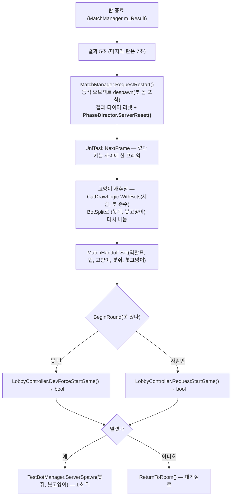

| 함정 | 증상 | 규칙 |
|---|---|---|
| `MatchHandoff.Set`의 봇 인자 생략 | 2판부터 `BotMice/BotCats = 0`. **3판제가 2판째부터 다른 게임**이 된다 | 스윕 **전에** 봇 수를 집어 두고 그대로 다시 넘긴다 |
| 봇을 다시 안 세움 | `RequestRestart`가 1판 봇을 걷는데 `MatchAutoStart`는 **씬 진입 1회**뿐이라 2·3판은 아무도 안 세운다 | 판마다 `SpawnBotsForRound` |
| `PhaseDirector.ServerReset()` 미호출 | 2단계로 끝난 판 뒤 단계가 `Gang`으로 남아 **다음 판이 시작 즉시 끝나거나 아예 안 열린다**(실측: 판 번호가 2에 멈춘 채 60초 넘게 결과 None) | 재시작 스윕이 단계도 되돌린다 |
| 시작 실패를 안 봄 | 사람이 빠져 `CanStart`가 깨지면 조용히 아무 일도 안 하고, `FromRoom`이라 로비 패널도 결과 패널도 없어 **빈 씬에 갇힌다** | 시작 함수가 `bool`을 준다 → 실패면 `ReturnToRoom()` |

### 네트워크 한 벌을 로비부터 들고 다닌다 (2026-08-30)

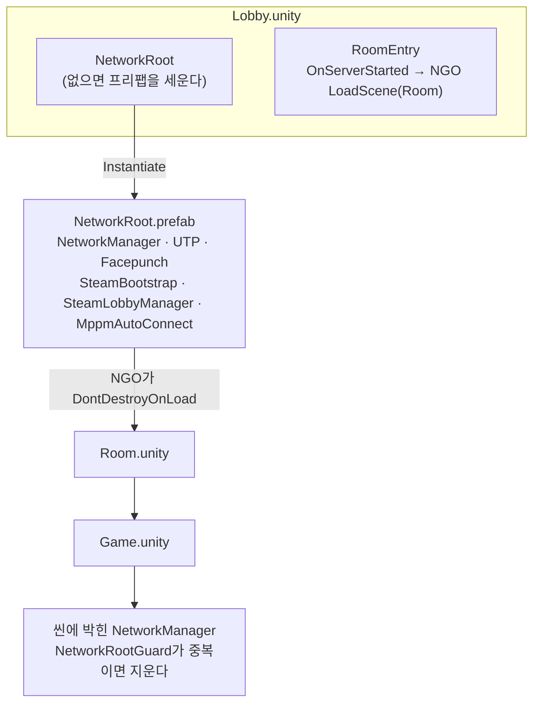

- 프리팹 목록은 `Assets/DefaultNetworkPrefabs.asset` **하나를 공유한다** — 갈라지면 접속이 NetworkConfig mismatch로 튕긴다.
- `Game.unity`를 혼자 열면(wesqa·MPPM) Singleton이 없어 `NetworkRootGuard`가 아무 일도 안 한다 — **기존 경로는 그대로다.**
- `SteamBootstrap`은 **소유 인스턴스만** 스팀을 내린다. 중복 오브젝트가 파괴되며 `SteamClient.Shutdown()`을 부르면 살아 있는 쪽 스팀까지 죽는다(실측: init 경고가 두 번 찍혔다).

### 씬은 코드로 굽는다

| 메뉴 | 만드는 것 |
|---|---|
| `Tools/CTC/Setup Intro Scene` | `Intro.unity` 전체 + 빌드설정 0번 등록 |
| `Tools/CTC/Setup Lobby Scene` | `Lobby.unity` 전체 + 빌드설정 등록 (`NetworkRoot.prefab`이 먼저 있어야 한다) |
| `Tools/CTC/Setup Room Scene (대기실)` | `RoomMouse.prefab` · `NetworkRoot.prefab` · `Room.unity` + 빌드설정 등록 |
| `Tools/CTC/Build Cheese Mesh` | 쐐기 치즈 메쉬·머티리얼·프리팹 |
| `Tools/CTC/Build Fortress Mesh` | 요새 치즈벽 메쉬 |
| `Tools/CTC/Build Prop Meshes` | 창고·벽감 패널·궤짝·직업권 메쉬 + 머티리얼 |
| `Tools/CTC/Apply Prop Textures` | AI 텍스처를 임포트 설정 맞춰 머티리얼에 물린다 |
| `Tools/CTC/Dev/프롭 진열장 (메시 확인)` | `Scenes/Dev/PropShowcase.unity` + `docs/design-vault/images/prop-showcase.png` (빌드에 안 들어간다) |

> 이펙트 프리팹(`FX_CatEyeSparkle`)은 **이미 있으면 안 덮어쓴다.** 자리·개수의 주인이 프리팹이라,
> 씬 재생성이 손으로 옮긴 값을 매번 지우면 프리팹으로 뺀 의미가 없다.

### 프롭 메시 파이프라인 (2026-08-30)

프리미티브 큐브였던 구조물을 절차적 메시로 바꿨다. 보유 에셋(Quirky)에는 쓸 게 없어 **전부 생성**이다.

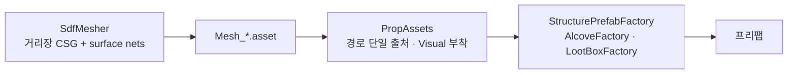

| 프롭 | 방식 |
|---|---|
| 요새 · 창고 | 구멍 뚫린 치즈벽 (절차) |
| 벽감 | 둥근 벽돌 더미 (절차) |
| 상자 · 직업권 | 궤짝 · 카드 (절차) |
| 바닥 치즈 | `Mesh_CheeseWedge` 재사용 |

- **콜라이더는 한 곳도 안 바뀌었다.** 프리미티브는 남기고 렌더러만 뗀 뒤,
  실제 치수 메시를 자식 `Visual`로 얹는다 — 밸런스에 걸린 치수를 메시 교체가 건드리면 안 된다.
- 메시가 없으면 팩토리는 **경고만 남기고 프리미티브 그대로** 굽는다. 순서를 어겨도 씬 생성이 안 멈춘다.
- **순서**: `Build Cheese Mesh` → `Build Fortress Mesh` → `Build Prop Meshes` → **`Apply Prop Textures`** → `Setup Networking Scene`.

**텍스처 (2026-08-30)** — AI 생성 3종. 프롬프트 원본은 [[텍스처 프롬프트]].

| 텍스처 | 물리는 머티리얼 | 타일 |
|---|---|---|
| `T_CheeseWall` | `M_CheeseWall`(요새) · `M_Cheese`(창고·쐐기) | 1m · 0.5m |
| `T_BrickWall` | `M_AlcovePanel` | 1m |
| `T_WoodCrate` | `M_LootCrate` | 0.5m |

- **UV는 1 = 1미터다.** 정점 좌표를 그대로 UV로 쓰는 박스 투영이라 그렇다.
  그래서 텍스처는 **반드시 seamless**여야 한다 — 이음새가 있으면 1m마다 격자가 드러난다.
- 붙일 때 **밑색을 흰색으로 되돌린다.** URP Lit은 `_BaseColor × _BaseMap`이라 노란 머티리얼에
  노란 치즈를 물리면 두 번 곱해져 탁하게 죽는다. 같은 텍스처를 쓰는 것들의 구분만 틴트로 남긴다.
- 텍스처가 없으면 `Apply Prop Textures`는 **아무것도 안 바꾼다** — 단색 그대로다.
- ⚠ **정점이 많다**(프롭당 13k 삼각형 안팎). surface nets가 격자 해상도만큼 뱉는다 —
  저폴리 톤에도 성능에도 과하다. 해상도를 낮추거나 데시메이션을 한 번 태워야 한다(미착수).

---

## 맵 지오메트리 아트 — 「밤의 식료품 창고」 (2026-08-31)

Gridbox 프로토타입이던 벽·바닥을 팬트리 테마로 교체했다. **레이아웃 두뇌(MapBuilder)는 불변** —
그리는 어휘만 바꿨다. 설계 원본: `docs/superpowers/specs/2026-08-31-night-pantry-map-art-design.md`.

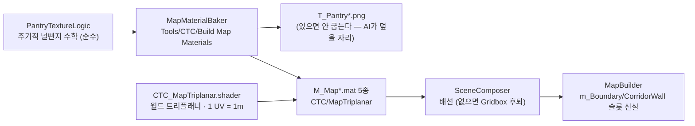

- **트리플래너인 이유**: 유니티 큐브는 면당 UV 0~1이라 120m 벽에 텍스처 한 장이 늘어난다(함정 5 계열).
  월드 좌표 투영이라 벽 세그먼트 분절과 무관하게 무늬가 이어진다. `_SkirtMeters`로 경계벽 하단 걸레받이.
- **높이만 거대화**: 방 벽 3→5m · 복도 벽 1.6→2.4m · 장애물 2.2→3m. 수평 치수·네비그리드·밸런스 불변.
- **재질 슬롯 분리**: `m_BoundaryMaterial`·`m_CorridorWallMaterial` — 비어 있으면 `m_WallMaterial`로 후퇴(옛 씬 호환).
- 치즈 등급 원반은 기능색(빨·주·노) 유지 + **원반 위에 쐐기 메시**(2026-08-31 리스킨 완료 — `m_CheeseVisualMesh` 슬롯, 비면 원반만).
- **MapDresser 배치 규약(2026-08-31)**: 피벗을 믿지 않는다 — 렌더 AABB로 뒷면을 벽면+2cm·바닥을 지면에 정렬,
  경계 밖 면은 안 입힌다, 궤짝은 1.4배(복도 보호). 가구 콜라이더는 전부 지우고 페이더용 AABB 트리거 하나만 남긴다.
- 다음 단계(계획 Phase 2~4): 대형 120×120 정식 최소 승격 + 밸런스 CSV → Poly Universal Pack 가구(MapDresser) → 밤 조명.

## 스팀 배포 (2026-08-30)

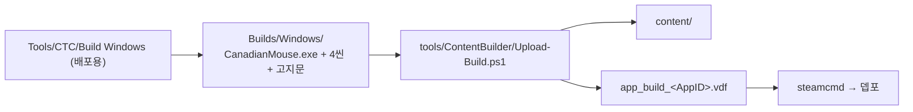

| 자리 | 무엇 |
|---|---|
| `Legal/Third-Party Notices.txt` | 3자 고지 원본. 빌드가 `__COMPANY__`를 채워 exe 옆에 복사 |
| `tools/ContentBuilder/steam-app.config` | **AppID·DepotID의 단독 출처** |
| `tools/ContentBuilder/scripts/app_build.vdf.template` | 뎁포 제외 목록 포함 |
| `tools/ContentBuilder/builder/` | `steamcmd.exe` (SDK에서 복사, 커밋 안 함) |

- 빌드는 **산출 폴더를 매번 비우고** 굽는다 — 이름 바꾼 옛 exe가 남으면 그대로 뎁포에 올라간다.
- `steam_appid.txt`는 빌드에 넣되 **뎁포에서는 뺀다**. 남으면 `RestartAppIfNecessary`가 항상
  false를 돌려줘 "스팀 거쳐 재실행"이 죽는다.
- `ProtocolVersion`은 `NetVersionLogic.Protocol(bundleVersion)`이 굽는다. **버전을 올리면 씬을
  다시 구워야** 반영된다.
- 상세와 계정 진행 상황은 [[스팀 출시 준비]] · 라이선스는 [[3자 에셋 라이선스]].

---

## 화면 색 — 출처는 하나다 (2026-08-30)

`Assets/Scripts/UI/UiPalette.cs`. 인트로·로비·대기실·인게임이 **같은 값을 읽는다.**
런타임에 둔 이유: 씬 생성기(에디터)와 HUD(런타임)가 같은 색을 봐야 하는데, 에디터 어셈블리가
런타임을 참조하므로 런타임에 두면 양쪽이 다 쓴다.

| 토큰 | 쓰임 |
|---|---|
| `Panel` · `PanelSolid` | 패널·모달 바탕 (남색 `#0b0f16`) |
| `Slot` · `Groove` | 버튼·타일·슬라이더 홈 |
| `Line` · `Veil` | 테두리 · 전체 암막 |
| `TextOn` · `TextDim` · `TextOnAccent` | 글자 |
| `Accent` · `AccentSoft` | 치즈 노랑 `#ffd84d` |
| `Good` · `Bad` · `Info` · `Warn` | **의미색** |

- **의미색은 의미를 지킨다.** 초록=보유·생존, 빨강=부족·위험, 파랑=영웅, 주황=깡패.
  톤만 팔레트에 맞추고 역할은 그대로다 — 색을 통일한다고 뜻까지 지우면 안 된다.
- 인게임만 따로 자라 있었다(갈색 타일·흰 버튼). 같은 게임의 다른 화면이 아니라
  **다른 게임처럼 보였다.** 그래서 색을 한 곳에 모았다.

---

## 재사용 풀 (2026-08-30 신설)

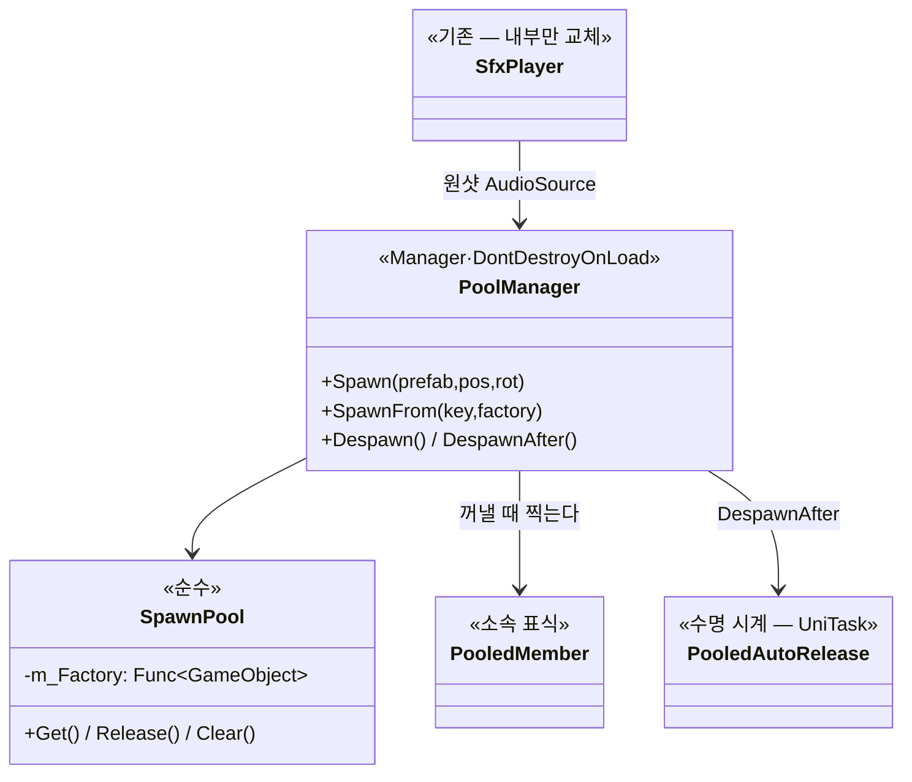

**왜 만들었나** — `SfxPlayer`가 발소리 한 발마다 `new GameObject` + `AddComponent` + `Destroy`를
했다. 쥐가 여덟이고 고양이가 뛰는 판에서 그 비용이 계속 쌓인다. **공개 API는 그대로**라 호출부와
wesqa는 하나도 안 고쳤다.

소속을 **인스턴스 id 사전이 아니라 표식 컴포넌트**로 기록한다 — 유니티가 그 id 타입을 바꾸는 중이라
(`GetInstanceID` → `GetEntityId` → int 캐스트까지 폐기 예정, 컴파일 에러로 확인) id에 기대면 계속 깨진다.

**언제 쓰나**: 생겼다 사라지는 것(원샷 소리·타격 이펙트). 상시 붙어 있는 이펙트는 대상이 아니다.

---

## 이펙트 (2026-08-30 신설)

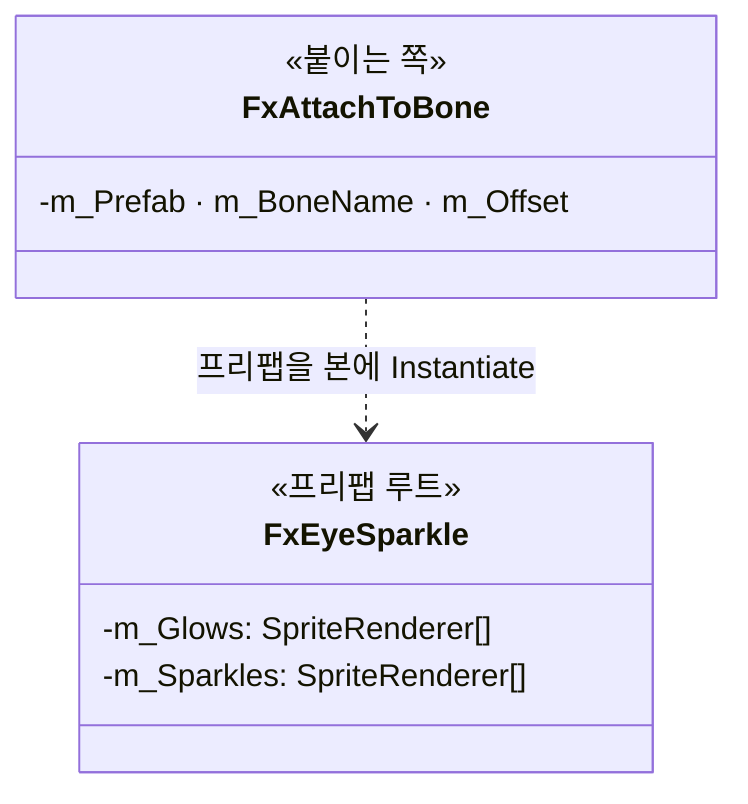

**무엇이 어디 있나**

| | |
|---|---|
| 자리·개수·크기·색 | **프리팹**(`FX_CatEyeSparkle.prefab`)의 자식 트랜스폼 |
| 박자(커짐·유지·사라짐·회전) | `FxEyeSparkle` 인스펙터 |
| 어느 본에 어떤 자세로 | `FxAttachToBone` |

`FxAttachToBone`이 두 가지를 바로잡는다. 안 하면 프리팹 저작 좌표가 뜻을 잃는다:
- **자세** — 본의 로컬 축은 모델마다 제멋대로다. 그래서 캐릭터의 자세를 따른다.
- **크기** — 본이 리그 스케일을 물고 있다(고양이 리그는 수십 배). 그걸 상쇄해 프리팹을 **월드 단위**로 저작한다.

---

## 게임 워크플로우

> 한 장이던 걸 네 장으로 쪼갰다(2026-07-31) — 26노드짜리 세로 그래프는 옵시디언 노트 폭에서 안 읽혔다.

### ① 매치 준비

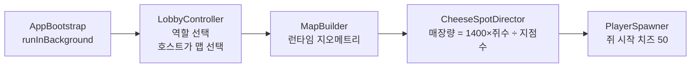

### ② 인게임 — 쥐 (벌고 산다)

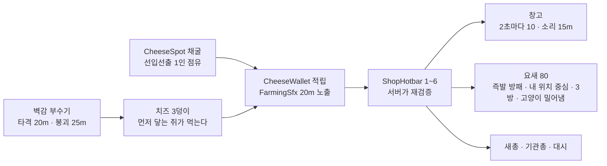

> 벽감(v3.8)은 채굴과 성격이 다르다 — 지점은 **1인 독점**이라 눌러앉는 경쟁이고,
> 벽감은 부수는 소리를 듣고 달려오는 **달리기 경쟁**이다. 부순 쥐가 독식하지 못한다.

### ③ 인게임 — 고양이 (찾고 덮친다)

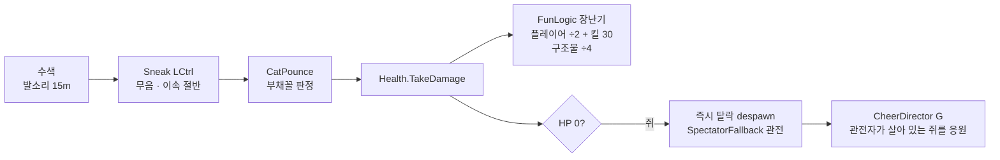

> **잡히면 즉시 탈락이다**(2026-08-17). v3.8의 감옥·구출(잡히면 감옥으로 순간이동 → 40초 안에
> 동료가 8초 머물면 석방)은 사람에게 안 읽혀서 뺐다. 타이머 만료는 쥐가 하나라도 살아 있으면 쥐 승.

### ④ 종료 판정 (MatchManager 0.5s)

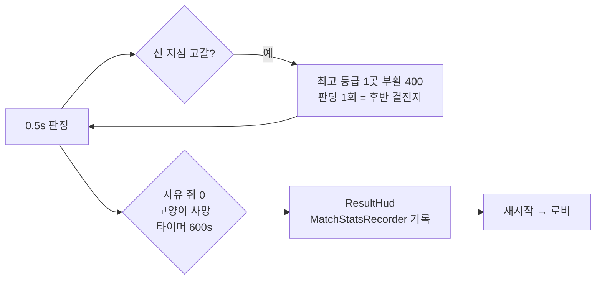

---

## 클래스 다이어그램 ① — 씬 레벨 상태 (로비·매치·맵)

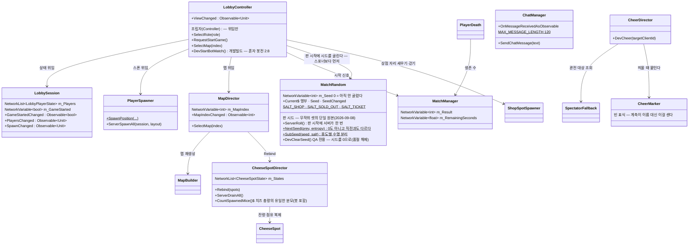

> `PlayerSpawner`를 뺀 전부가 `NetworkBehaviour` 파생이다 —
> 상속선은 그리지 않는다(7줄이 전부 같은 말이라 그림만 옆으로 늘어난다).
>
> 넷(`LobbyController`·`LobbySession`·`PlayerSpawner`·`MapDirector`)은 **같은 in-scene NetworkObject에 동승**한다.
> NetworkBehaviour를 여러 개 붙여도 RPC 발신자 식별은 각자 그대로 동작한다. `MatchRandom`도 같은 오브젝트에 탄다.

### 판 시드가 갈라지는 곳 (테크 v3 계획 3, 2026-09-08)

결과가 아니라 **시드 4바이트만** 복제하고, 서버와 클라가 같은 순수 함수로 답을 **다시 계산**한다.
품절 목록·상점 좌표를 실어 보내면 판정이 두 군데가 되어 어긋날 자리가 생긴다.

```mermaid
flowchart LR
    S["LobbyController.RequestStartGame<br/>DevForceStartGame"] --> R["MatchRandom.ServerRoll<br/>NetworkVariable int m_Seed"]
    R -->|SALT_SHOP| A["ShopSpotSpawner<br/>오늘 어느 자리에 서나"]
    R -->|SALT_SOLD_OUT| B["ShopController<br/>오늘의 품절"]
    R -->|SALT_TICKET| C["LootBoxSpawner · AlcoveSpawner<br/>직업권 자리"]
```

세 갈래가 다 붙었다(Task 2·3·4). 읽는 쪽은 `MatchRandom.Current != null && Seed != 0`이 아니면
옛 경로(맵 시드 · 품절 없음 · 항등 순열)로 후퇴한다 — 로비·봇 실험실은 시드가 0이라
판마다 같은 자리에 선다(서기는 한다).

#### 무작위를 재는 QA (qa_v50 · MPPM 3인 · 호스트=고양이 · 창고 맵)

**한 판으로는 못 잰다.** 그래서 `qa_v50`은 판을 **세 번** 연다 — 판을 끝내고(`TestExpireTimer`)
결과가 붙은 뒤에 `TestRestartMatch` → `TestStartGame`. `RequestRestart`는 `Result == None`이면
통째로 무시하므로 **끝나지 않은 판은 다시 못 연다**. 두 판이 아니라 셋인 이유는 조합 수다:
상점은 C(8,4)=70, 직업권은 벽감 6 중 둘이라 **우연히 같은 판**이 1~3% 나온다. 두 판만 보고
빨간 줄을 띄우면 그 줄은 버그가 아니라 주사위를 말한다.

- 읽는 훅: `TestGetMatchSeed` · `TestGetMatchSubSeed(use)` · `TestGetShopSpotPositions`(좌표 전부 —
  기존 `TestGetShopSpotPos`(하나)·`TestGetShopSpotCount`(개수)로는 「자리가 바뀌었나」를 못 잰다) ·
  `TestGetSoldOutTechs` · `TestGetJobTicketPositions` · `TestGetMapLootCheese`(셔플이 총량을 안 건드렸나) ·
  `TestGetEarnedOf(clientId)`(전직 문턱).
- 품절 판정은 **차감 0까지** 본다 — 레벨만 보면 "샀는데 레벨이 안 올랐다"와 구분이 안 된다.
- 호스트와 클론의 `TestGetSoldOutTechs`가 같아야 한다. 목록을 복제하지 않고 **각자 계산**하므로,
  다르면 그것 자체가 버그다.

**효과를 재는 스위트는 주사위를 끈다.** `qa_v46`·`qa_v47`은 쥐 테크 열 종류를 다 사야 하는데
품절이 매 판 둘을 막아 **구조적으로 불가능**해진다(2026-09-08 실측: 그 판에 품절이던
숨은 창고·빠른 발에서만 빨간 줄이 떴다 — 기대값이 낡은 것이지 회귀가 아니다). 그래서
`TestClearSoldOut`(→ `MatchRandom.DevClearSeed`)로 시드를 0으로 되돌려 품절을 걷고 효과만 잰다.
시드 0은 새 상태가 아니라 **로비·봇 실험실이 늘 쓰는 상태**고, 상점 자리·직업권은 판 시작에
이미 놓였으므로 그대로 남는다. 품절 자체의 검증은 `qa_v50`이 따로 한다.

### 오늘의 품절 — 목록이 아니라 시드가 건너간다 (2026-09-08)

```mermaid
flowchart TD
    M["MatchRandom.SubSeed(seed, SALT_SOLD_OUT)"] --> L
    C["TechLogic.Catalog(Mouse) 10종"] --> L["TechRandomLogic.SoldOut<br/>후보 = 카탈로그 − 면제 3<br/>7 중 SoldOutCount(2)"]
    E["NEVER_SOLD_OUT<br/>요새 · 대시 · 창고"] -.면제.-> L
    L --> S["ShopController.SoldOutToday<br/>시드를 키로 쓴 메모"]
    S --> B["CanBuyNow → TechLogic.CanBuy<br/>TechDeny.SoldOut"]
    S --> V["ShopHotbar<br/>후보에서 제외 · 판 시작 토스트"]
    S --> T["MouseBotLogic.NextPurchase<br/>품절인 줄은 건너뛴다"]
```

**후보에서 빼는 이유**: 남겨 두고 누를 때 거절하면 못 사는 것을 보여 주고 5키를 헛돌리게 된다.
**봇도 알아야 하는 이유**: 모르면 매 틱 서버에 거절당하는 죽은 구매를 반복한다(칸 상한과 같은 이유).
**카탈로그가 늘 쥐 것인 이유**: 품절은 쥐 테크만이라(§7) 고양이 테크와 id가 겹치지 않는다 —
고양이도 같은 목록을 읽어 같은 토스트를 띄우되(「전원 동일·공개」) 제 구매는 영향을 안 받는다.

`ShopController.SoldOutToday`는 **구독이 아니라 시드를 키로 쓴 메모**다. `MatchRandom.Current`가
아직 없는 순간(로비)에 구독을 걸면 그 판이 영영 빈 목록이 된다 — 키 비교는 언제 물어도 맞는 답을 준다.
View에 흘려 줄 스트림(`SoldOutChanged`)만 `SeedChanged`를 탄다.

### 직업권 자리 — 내용물을 통째로 교환한다 (2026-09-08)

```mermaid
flowchart TD
    M["MatchRandom.SubSeed(seed, SALT_TICKET)"] --> C["TicketShuffleLogic.ContentOrder(alcoves, seed)"]
    M --> P["TicketShuffleLogic.Permutation(n, seed)"]
    C --> S1["상자 벽감만 섞는다"]
    S1 --> T["직업권 1장 = 아무 상자 벽<br/>나머지 1장 = 그 벽에서 가장 먼 상자 벽"]
    S1 --> R["남은 상자 벽끼리 자유 교환"]
    C -.제외.-> D["강아지 벽감 — order[i] = i"]
    C --> A["AlcoveSpawner<br/>i번 벽감 ← order[i]번 BoxContents"]
    P --> B["LootBoxSpawner<br/>i번 상자 ← perm[i]번 Contents"]
    A -.안 섞는다.-> K["좌표 · 회전 · Payload(강아지 벽감)"]
```

> **전 자리 순열은 물건을 삼켰다** (2026-09-09 감사 M2·M3 · P0-2·P0-9). 강아지 벽감은 상자가 없어
> `BoxContents`가 **빈 목록**인데 그것도 섞였다 — 순열이 그 자리를 안 건드릴 확률은 1/6뿐이라
> **매 판 5/6로** 어떤 상자 벽이 빈 손을 받고, 사라진 물건(치즈 250 또는 직업권 1장)은
> 강아지 벽으로 가 영영 안 나왔다. 같은 순열이 「직업권 둘을 가장 먼 두 벽에」(`AlcoveFactory.FillBoxContents`)도
> 흩어 한 사람이 둘 다 먹는 배치를 만들었다.
> `ContentOrder`가 셋을 한꺼번에 푼다 — 강아지 벽 제외 · 최원거리 짝 유지 · 자리는 판마다 달라짐.
> 검증은 `TicketShuffleLogicTests`(구운 창고 에셋 + 합성 6칸, 시드 500개)가 든다.

**순열인 이유**: 맵 총 치즈량(`LootBoxLogic.TotalCheese`)이 지점 매장량에서 **이미 떼어져 있어서**,
항목이 하나라도 늘거나 줄면 고갈 시점이 밀려 후반 압축이 무너진다. 자리만 바꾸면 총량이 정의상 불변이다.
**페이로드를 안 섞는 이유**: 강아지가 든 벽감이 판마다 옮겨 다니면 낑낑거리는 소리 단서가 거짓말이 된다.
창고 맵은 상자 0개·벽감 6개라 **벽감이 실제 경로**고, 절차 맵은 상자다 — 그래서 둘 다 섞는다.

> **벽감 페이로드는 스폰 뒤에 흘린다.** `Alcove.ServerSetPayload`가 스폰 전 `NetworkVariable`에
> 직접 쓰던 탓에 판마다 벽감 수만큼 `NetworkVariable is written to, but doesn't know its
> NetworkBehaviour yet` 경고가 떴다. `ThornWall`처럼 pending 필드에 담았다 `OnNetworkSpawn`에서 올린다.
> **최대 HP는 미루지 않는다** — `Health.OnNetworkSpawn`이 현재 HP를 최대치로 채우므로 그 뒤에 올리면
> 강아지 벽이 치즈 벽의 HP(120)로 서 버린다.

### 상점 자리 — 개수는 맵이, 자리는 판이 정한다 (2026-09-08)

```mermaid
flowchart TD
    L["MapLayout<br/>HalfExtent · Rooms · Shops(후보)"] --> N["ShopSpotLogic.CountFor<br/>반경 ≥ ShopSpotLargeHalfExtent(40) ? 4 : 2"]
    M["MatchRandom.SubSeed(seed, SALT_SHOP)"] --> P
    N --> P["ShopSpotLogic.Resolve"]
    P -->|손 배치| H["PickPlaced — 후보 8 중 4"]
    P -->|절차| R["Pick — 방 중심, 원반 들어가는 방 먼저"]
    H --> G["간격 완화 재시도<br/>25 → 12.5 → 6.25 → 바닥(지름 6)"]
    R --> G
    G --> S["ShopSpotSpawner.ServerSpawnAll → ShopSpot"]
```

**개수를 맵에서 뽑는 이유**: 기본 맵(30×30)에 넷을 세우면 서로 붙어 서서
「한 곳을 지키는 동안 나머지가 열린다」가 성립하지 않는다.

**간격을 맵 크기에 비례시키지 않는 이유**: 25 m는 "고양이 하나가 두 상점을 동시에 못 지키는 거리"라
**절대값에 뜻이 있다**. 맵 크기로 곱하면 30×30에서 6 m가 되어 상점 둘이 나란히 선다.
그래서 25를 **목표**로 두고, 못 채울 때만 반씩 양보한다 — 바닥은 원반 지름(겹치면 "다른 곳"이 아니다).
섞은 순서는 **한 번만** 만들어 시도마다 재사용한다: 시도마다 다시 섞으면 같은 시드가 다른 답을 낸다.

실측(2026-09-08): 기본 맵 상점 **1곳 → 2곳**, 창고 맵은 판마다 4곳이 바뀐다
(1판 `(40,-24)·(-36,-28)·(32,32)·(0,-6)` → 2판 `(0,32)·(40,4)·(-40,4)·(-40,36)`).

## 클래스 다이어그램 ② — 플레이어 컴포넌트

```mermaid
classDiagram
    direction TB

    class CheeseWallet {
        NetworkVariable~int~ m_Cheese
        NetworkVariable~int~ m_Earned  누적 획득(줄지 않음)
        +AddCheese(amount)  잔액+누적
        +RefundCheese(amount)  잔액만(창고 환급)
        +TrySpend(amount)
        +Earned  전직 문턱이 보는 스트림
    }
    class Health {
        NetworkVariable~int~ m_Hp
        +TakeDamage(amount) int
    }
    class IDamageAbsorber {
        <<interface>>
        +ServerAbsorb(damage) int
    }
    class CheeseShield {
        +ServerAbsorb(damage) int
    }
    class CheeseShieldLogic {
        <<static>>
        +Absorb(damage, ratio, rate, cheese, currentHp, out hp, out cost)$
        currentHp — 어차피 죽는 타격이면 치즈를 안 받는다
    }
    class ThornWall {
        가시 벽(요새 Lv3) — 요새 프리팹에 항상 붙는다
        NetworkVariable~int~ m_Reflect
        +ServerSet(reflect)
    }
    class StickyPatch {
        끈끈이 장판(쥐 액티브) — 바닥 쿼드 1장·콜라이더 없음
        NetworkVariable~float~ m_Radius (스폰 전엔 pending)
        서버 UniTask 0.1초 틱 — 반경 안 고양이만 감속
        +ServerSetup(radius, slowRatio) 스폰 전에
    }
    class StickyUser {
        끈끈이 쿨다운(쥐 프리팹) — 서버 시계
        NetworkVariable~double~ m_ReadyAt
        +Ready · CooldownRemaining
        +ServerStartCooldown(seconds)
    }
    class StickyLogic {
        <<static · 순수>>
        +SpeedMultiplier(slowRatio)$ · Inside(center, point, r)$ · Ready(readyAt, now)$
        +MinMultiplier(muls)$ 겹친 장판 중 가장 센 것(없으면 1)
    }
    class CatPounce {
        NetworkVariable~int~ m_DamageStacks
    }
    class MousePopgun {
        NetworkVariable~int~ m_Tier
    }
    class Sneak {
        NetworkVariable~bool~ m_Sneaking
    }
    class EyeLook {
        눈동자가 조준을 따라간다(연출 전용 · NetworkBehaviour 아님 · 통신 0)
        머리 본 아래에 흰자/눈동자/눈꺼풀 구를 Awake에 얹는다 — 팩 모델엔 눈 본이 없다
        Vector3 m_EyeCenterLocal · m_EyeAxisLocal (머리 본 로컬 · 프리팹에 구움)
        float m_ScleraRadiusLocal · m_LidRadiusLocal (CSV 비율이 곱해진다)
        흰자는 눈 축(로컬 +z)으로 눌린 타원체 — 옆에서 안 솟는다
        LateUpdate: 내 몸=카메라 정면 · 남의 몸=제 몸 정면 → 클램프 → 부드럽게
        +DevGazeRight() · DevPupilWorldRight() · DevBlinkNow() · DevSetVisible(on) (QA)
    }
    class EyeLookLogic {
        <<static · 순수>>
        +ClampGaze(rest, aim, maxDeg)$ 최대 각도까지만 — 눈이 뒤집히지 않는다
        +Follow(cur, target, speed, dt)$ 지수 감쇠(프레임률 무관)
        +BlinkCover(elapsed, duration)$ 0→1→0 · NextBlinkDelay(min, max, rand)$
        +Mirror(right)$ 왼눈은 x만 뒤집는다
    }
    EyeLook ..> EyeLookLogic
    class EarPerk {
        귀가 반대편 소리를 따라 선다(연출 전용 · NetworkBehaviour 아님 · 통신 0)
        리그 본 ear.L·ear.R을 LateUpdate에서 덧돌린다 — 새 클립·메시 0
        static List~EarPerk~ s_All (OnEnable/OnDisable 명부 — 판 도중 난입·퇴장을 탄다)
        발소리: 명부의 반대편 중 IsStepping을 CanHear로 — 내 몸 HeardRange · 남의 몸 CurrentRange
        일회성: SfxPlayer.Played 구독 → IsPreySound로 거르고 CanHear
        겹치면 가장 가까운 소리 · EarHoldSeconds 유지 후 천천히 원위치
        회전축 2개: 밑동 좌우 스위블(몸 세로축) + 앞으로 세우기(몸 좌우축) — 접히지 않는다
        FAR_EAR_RATIO 0.45 — 소리 반대쪽 귀는 덜 돈다(뻣뻣함·정중선 가로지름을 같이 막는다)
        +DevTurnDegrees · DevTurnRight · DevTurnLeft · DevPerk · DevHearing · DevHeardKind · DevStepAudible (QA)
    }
    class EarPerkLogic {
        <<static · 순수>>
        +TurnDegrees(forward, toSound, maxDeg)$ 수평 부호각 · 최대 각 클램프(뒤집힘 금지)
        +Follow(cur, target, speed, dt)$ 지수 감쇠(프레임률 무관)
        +Holding(sinceHeard, holdSeconds)$ · Closer(cand, best)$ 가까운 소리가 이긴다
        +SideScale(turnDeg, earLocalX, farRatio)$ 소리 쪽 귀가 더 크게 돈다
    }
    EarPerk ..> EarPerkLogic
    class PlayerMovement {
        NetworkVariable~int~ m_SpeedStacks
        NetworkVariable~float~ m_ExternalSpeedMul (끈끈이 — 서버가 쓰고 소유자가 읽는다)
        Dictionary~ulong,float~ m_SlowSources (서버 전용 — 건 쪽마다 한 칸)
        TechSlots m_TechSlots (Awake 캐시 — 빠른 발)
        +CurrentSpeed (기본+강화+빠른발) × 외부배율 — QA 훅도 이걸 읽는다
        +ServerAddSlowSource(sourceId, mul) · ServerRemoveSlowSource(sourceId)
        -FastFeetBonus() 이속 가산
    }
    class LocalControl {
        <<static>>
        +Mine(nb)$ 입력 읽기 게이트
        +Drives(nb)$ 몸 움직이기 게이트
    }
    class LocalControlLogic {
        <<static · 순수>>
        +Mine(owner, playerObj)$
        +Drives(owner, playerObj, server)$
    }
    LocalControl --> LocalControlLogic
    PlayerMovement --> LocalControl : Drives=이동 · Mine=키보드
    MouseDash --> LocalControl : Drives=대시 이동 · Mine=Space
    PlayerMovement --> TechSlots : 빠른 발 레벨 → TechInfo P1(+0.3/0.7/1.2)
    MouseDash --> TechSlots : 대시 레벨 → 쿨 P1(6·4.5·3.5초 · 0이면 BalanceInfo 후퇴)
    class ShopController {
        테크 v3 진입점(소유자 → 서버 RPC)
        +Buy(id) 사거나 키운다
        +Use(id) 즉발 — 요새·끈끈이·대시
        +UseAt(id, pos) 조준 — 창고
        +CanBuyNow(id) TechDeny
        +CanUse(id) UseDeny
        +UseCostOf(id)$ 설치비
        +SoldOutToday 오늘 못 사는 테크(시드 메모)
        +SoldOutChanged : Observable
    }
    class TechSlots {
        NetworkList~TechEntry~ 보유 테크·레벨 (Model)
        +Owned · Count · LevelOf(id)
        +Changed : Observable~Unit~
        +ServerApplyNextLevel(id)
    }
    class TechLogic {
        <<static · 순수>>
        +Catalog(role)$ · Candidates(role, owned)$
        +RowOf(id, lv)$ · NextRow(owned, id)$ · MaxLevel(id)$
        +CanBuy(owned, id, role, cheese, slotCap, soldOut?)$ TechDeny
        +IsActive(id)$ · NeedsShopSpot(role)$
        +DenyText / UseDenyText$
    }
    class TechRandomLogic {
        <<static · 순수>>
        오늘의 품절 — 시드가 같으면 답도 같다
        +NEVER_SOLD_OUT$ 요새 · 대시 · 창고
        +SoldOut(catalog, count, seed)$
        +IsSoldOut(soldOut, id)$ · IsExempt(id)$
    }
    class ShopSpot {
        상점 자리 — 쥐는 이 반경 안에서만 산다
        +AnyContains(point)$
        +Nearest(from, out center)$ 봇 목적지·QA 워프 공용
    }
    class ShopSpotSpawner {
        Worker — 판 시작에 자리를 고른다
        개수는 맵 크기 · 시드는 MatchRandom(SALT_SHOP)
        +ServerSpawnAll(layout)
        +ServerDespawnAll()
    }
    class ShopSpotLogic {
        순수 — 오늘 상점이 몇 곳, 어디에 서나
        +GAP_RELAX_STEPS$ = 3
        +CountFor(halfExtent, large, small, largeHalf)$
        +RoomHoldsShop(size, radius)$ 원반이 방에 들어가나
        +Pick(rooms, count, minGap, radius, seed)$
        +PickPlaced(placed, count, minGap, radius, seed)$
        +Resolve(handPlaced, placed, rooms, ...)$
        +Contains(center, point, radius)$
    }
    class WarehouseProduction {
        창고 — 소유 쥐에게 틱마다 치즈 (서버)
        NetworkVariable: 소유자 · 창고Lv · 숨은창고Lv · 설치비
        지어질 때의 레벨을 박아 둔다(나중에 키워도 그대로)
        +ServerSetOwner(clientId)
        +ServerSetTech(warehouseLv, hiddenLv, placeCost)
        +CountOwnedBy(clientId)$
    }
    class FortressShield {
        요새 = 즉발 방패 (2026-08-15)
        OnNetworkSpawn: 겹친 몸 밀어냄
    }
    class BodyPush {
        +ServerPush(delta) → 소유자 텔레포트
    }
    class FortressPushLogic {
        순수 — PushDelta(center, yaw, body, r, isCat)$
    }
    class Alcove {
        부술 수 있는 벽 (v3.8)
        AlcovePayload m_Payload
        +ServerSetPayload(payload)
    }
    class CheeseDrop {
        바닥 치즈 · 트리거
        +ServerSetAmount(amount)
    }
    class BountyExempt {
        부숴도 장난기 없음
    }

    CheeseSpot --> CheeseWallet : 채굴 적립
    CheeseSpot --> TechOwner : 큰 주머니 배율
    ShopController --> TechLogic : 살 수 있나·다음 레벨 값
    ShopController --> TechSlots : 서버가 레벨 적용
    ShopController ..> ShopSpot : 쥐는 상점 안에서만 구매
    ShopController --> CheeseWallet : TrySpend (테크값 · 설치비)
    ShopController --> WarehouseProduction : 창고 스폰·소유자 각인·스폰 전 테크 각인
    ShopController ..> WarehouseLogic : 설치 상한 · 창고 HP
    ShopController --> FortressShield : 내 위치 중심 스폰
    ShopController --> ThornWall : 스폰 전 반사값(TechInfo P2)
    ShopController --> Health : 스폰 전 요새·창고 HP(TechInfo P1/P2)
    ShopController --> StickyPatch : 발밑 스폰 · 스폰 전 반경·감속(TechInfo P1/P2)
    ShopController --> StickyUser : 쓸 수 있나(쿨) · 쿨 시작(TechInfo P3)
    StickyUser ..> StickyLogic : 쿨 판정
    StickyPatch ..> StickyLogic : 반경 안 판정 · 감속 배율
    StickyPatch --> PlayerMovement : 고양이만 ServerAdd/RemoveSlowSource(NetworkObjectId)
    TechSlots ..> TechLogic : 레벨 조회
    ShopSpotSpawner --> ShopSpot : 판마다 스폰·철거
    ShopSpotSpawner ..> ShopSpotLogic : 개수·자리 고르기(맵 크기·간격 완화)
    ShopSpotSpawner ..> MatchRandom : SALT_SHOP — 판마다 다른 자리
    ShopController ..> TechRandomLogic : 오늘의 품절 추첨
    ShopController ..> MatchRandom : SALT_SOLD_OUT — 판마다 다른 품절
    FortressShield --> FortressPushLogic : 누구를 어디로
    FortressShield --> BodyPush : 고양이 밖·벽 자리 쥐 밀어냄
    WarehouseProduction --> CheeseWallet : 생산 지급(AddCheese) · 파괴 환급(RefundCheese)
    WarehouseProduction ..> WarehouseLogic : 틱 치즈 · 소리 반경 · 환급
    WarehouseProduction ..> Health : Died 구독(서버) → 환급
    CatPounce --> Health : 덮치기
    CatPounce ..> ThornWall : 실피해 났으면 고양이가 되맞음
    MousePopgun --> Health : 팝건
    Health --> PlayerDeath : HP 0
    Health ..> IDamageAbsorber : HP 쓰기 전에 흡수 한 번
    IDamageAbsorber <|.. CheeseShield
    CheeseShield ..> CheeseShieldLogic : 치즈/HP 배분
    CheeseShield --> CheeseWallet : 막은 만큼 차감
    CheeseShield ..> TechSlots : 치즈 방패 레벨
    Alcove --> CheeseDrop : 파괴 시 3덩이
    CheeseDrop --> CheeseWallet : 쥐가 닿으면 지급
    BountyExempt <.. CatPounce : 있으면 장난기 건너뜀
```

> **치즈 방패는 `Health`가 HP를 쓰기 전에 끼어든다**(테크 v3 계획 2a). `TakeDamage`가 `IDamageAbsorber`를
> 한 번 부르고, `CheeseShield`가 피해의 일부(TechInfo P1)를 치즈로 대신 낸다(1 HP = `BalanceInfo.CheeseShieldRate`).
> 그래서 `TakeDamage`가 돌려주는 "깎인 HP"는 치즈가 막고 **남은** 몫이다 — 고양이는 치즈가 대신 낸 피해로는
> 장난기를 못 번다(의도). 지갑이 모자라면 낼 수 있는 만큼만 치즈로 내고 나머지는 HP로 간다.

> **요새의 단단함과 가시는 스폰 전에 정해진다**(테크 v3 계획 2a). `ShopController.SpawnFortressAround`가
> `TechInfo` Fortress P1(HP 480·900·1200)을 `Health.ServerSetMaxHp`에, P2(반사 0·0·25)를 `ThornWall.ServerSet`에
> **`NetworkObject.Spawn` 앞에서** 넣는다 — `OnNetworkSpawn`이 현재 HP를 최대치로 채우기 때문이다.
> `ThornWall`은 레벨과 무관하게 요새 프리팹에 늘 붙어 있고(프리팹 종류를 안 늘리려고), 값이 0이면 아무 일도 없다.
> 되맞는 쪽은 벽을 친 고양이 자신이고, 실피해가 0이면 반사도 없다. 요새엔 `CatPounce`가 없어 되튐이 반복되지 않는다.

> **끈끈이는 콜라이더가 없다**(테크 v3 계획 2a). 얇은 바닥판에 `CharacterController`가 스치면 트리거
> Enter/Exit이 잘 안 떠서, 서버가 0.1초마다 `StickyLogic.Inside`로 **수평 거리**를 직접 잰다 —
> 눈에 보이는 원과 판정이 정확히 같다. 감속은 `PlayerMovement.m_ExternalSpeedMul`(NetworkVariable)로 간다:
> 이동이 소유자 권위라 서버가 값을 복제해야 그 몸이 실제로 느려진다. 나가면·지속(`BalanceInfo.StickySeconds` 10초)이
> 끝나면 되돌리고 despawn 한다 — 안 되돌리면 영구 감속이다. 쓰기 비용은 치즈가 아니라 쿨다운(`StickyUser`, 서버 시계 · TechInfo P3)이고,
> 막히면 `UseDeny.Cooldown`("아직 쿨다운")으로 이유를 말한다.

> **겹친 장판은 더 센 쪽이 이긴다**(2026-09-07 리뷰). 감속 칸이 하나뿐이던 시절엔 A(0.25) 위에 B(0.6)가
> 겹쳤다가 B가 나가며 1을 덮어써서, **아직 A를 밟고 있는 고양이가 제 속도로 달렸다.** 이제 `PlayerMovement`가
> 건 쪽(`NetworkObjectId`)마다 한 칸을 갖고 `StickyLogic.MinMultiplier`로 최솟값을 복제한다.
> 장판 루프는 `try/finally`로 감싼다 — `UniTask.Delay`가 취소 시 **예외로** 빠져나가서, 판이 끝나거나 씬이
> 바뀌면 되돌리는 코드가 통째로 건너뛰어졌다. 명단(반경 안 후보 고양이)은 스폰 때 한 번만 훑는다:
> 매 틱 `FindObjectsByType`은 장판 8장이면 초당 80회 전수 조사였다. **판 도중 난입한 고양이는 이미 깔린
> 장판에 안 걸린다** — 장판 수명이 10초라 감수한다.

> **QA 계측 훅 6개**(2026-09-07, `TestManager.Tech.cs`): `TestGetHpOf` · `TestGetMaxHpOf` ·
> `TestGetWarehouseCountOf` · `TestGetStickyPatchCount` · `TestGetNearestFortressMaxHp` ·
> `TestGetMoveSpeedOf`(= `PlayerMovement.CurrentSpeed`를 그대로 읽는다 — 식을 베끼면 갈라진다).

> **입력 게이트는 둘이다**(2026-09-06). `Mine` = 내가 조종하는 몸(소유자 + 플레이어 오브젝트)만 키보드·마우스를
> 읽는다. `Drives` = 내 몸 **또는 서버가 조종하는 봇**(플레이어 오브젝트가 아닌 서버 소유 몸)의 Update가 돈다.
> 2026-09-02에 봇이 내 WASD를 같이 먹는 걸 고치며 이동 Update를 `Mine`으로만 막았더니 **봇이 한 발도 못 뗐다**
> (길은 짜이는데 이동 0m). 이동·대시처럼 몸을 미는 코드는 `Drives`, 입력 읽기만 `Mine`.

> **쥐는 잡히면 즉시 despawn(탈락)이다.** v3.8 감옥(`JailDirector`·`JailedTag`·`JailHud`)은
> 2026-08-17에 통째로 뺐다 — `PlayerDeath`가 바로 despawn 한다.

> **벽감은 전투 코드를 새로 안 짰다.** 팝건도 덮치기도 씬의 `Health`를 찾아 때리는 구조라
> `Health` + `RoleTag.Mouse`만 붙이면 쥐도 고양이도 부순다. `RoleTag.Mouse`인데 매치
> 생존 수에 안 끼는 건 `MatchManager.CountAlive`가 `IsPlayerObject`로 거르기 때문(요새·창고와 같다).
>
> `PlayerDeath`를 안 쓴 이유: 그건 죽자마자 despawn하는데 벽감은 **despawn 전에 안의 것을
> 꺼내야** 한다. 순서를 남에게 맡길 수 없어 `Health.Died`를 직접 듣는다.

> 전부 `NetworkBehaviour` 파생 — 상속선은 생략했다(①과 같은 이유).
>
> 기능 하나 = 컴포넌트 하나(CTC 규칙 7). 역할별로 붙는 게 달라진다 —
> 고양이는 `CatPounce`+`Sneak`, 쥐는 `MousePopgun`+`MouseDash`+`FarmingSfx`.

> **`EyeLook`만 `NetworkBehaviour`가 아니다**(2026-09-08). 눈은 순수 연출이라 보낼 것도 받을 것도
> 없다 — 내 눈은 내 카메라가, 남의 눈은 그 몸의 회전이 정한다(대역폭 0).
> 팩 모델(Quirky Pets)의 눈은 **본도 텍스처도 아니고 스킨드 메시의 한 덩어리**라 돌릴 트랜스폼이
> 없다. 그래서 흰자·눈동자·눈꺼풀 구를 머리 본 아래에 새로 얹는다. 셋 다 **모델과 같은 머티리얼**을
> 쓰고 8×8 팔레트의 텍셀만 골라 찍어 새 머티리얼이 0이다.
> 눈의 **자리**는 밸런스가 아니라 지오메트리라 `EyeAnchorBaker`가 종별로 프리팹에 굽는다
> (원본은 `Tools/CTC/Dev/Probe Eye Geometry`가 잰 값). 반면 **각도·속도·깜빡임과 모양 비율**은
> `BalanceInfo.csv`다 — 모양은 얼굴 인상을 바꾸는 손잡이라 플레이 거리에서 보고 맞춰야 한다.
>
> **얹는 것은 구가 아니라 눈 축으로 눌린 돔이다**(2026-09-08). 완전한 구를 얹으면 **옆에서 볼 때
> 얼굴 실루엣 밖으로 공처럼 솟는다** — 정면 컷으로는 안 보이는 종류의 문제라 옆면을 꼭 찍는다.
> 팩 눈동자를 재 보면 **두께가 사실상 0인 납작한 원판**(반지름 0.00047, 축 방향 두께 ~0)이라
> 가로만 덮으면 되고 축 방향은 얇아도 된다. 그래서 `EyeFlatten` 0.25까지 눌러도 밑이 안 비친다.
> `EyeInsetRatio`(눈 축 안쪽으로 밀기)는 0이다 — 0.13을 넘으면 원판 **테두리**가 돔 밖으로 나온다.
> 최종: `EyeScleraScale` 1.0 · `EyePupilRatio` 0.80 · `EyePupilOffsetRatio` 0.42 · `EyeFlatten` 0.25.
>
> 「전/후」를 같은 거리·같은 각도로 비교하려면 `TestHideEyes`/`TestShowEyes`를 쓰고,
> 옆면은 `TestCaptureHeadShot(path, size, yaw, pitch)`로 머리 둘레를 돌며 찍는다.

> **`EarPerk`도 `NetworkBehaviour`가 아니다**(2026-09-08). 귀는 **없던 정보를 만들지 않는다** —
> 이미 난 소리만 그림으로 바꾼다. 그래서 동공 축소(기각)와 달리 살금살금을 배신하지 않는다:
> 고양이가 잠행하면 발소리 반경이 20 m→4 m로 줄고 그 밖의 쥐 귀는 **한 톨도 안 움직인다**
> (실측: 8 m 근방에서 뛸 때 78/78 표본이 들리고, 살금살금이면 0/48이다 —
> `docs/design-vault/images/ear-perk-comparison.png`).
> 들리는지 판정은 **봇 청각과 같은 함수**(`BotSenseLogic.CanHear`·`IsPreySound`)를 그대로 쓴다.
> 소리 이벤트도 발소리 상태도 이미 모든 클라에 있으므로 각 클라가 제 화면의 모든 몸을 계산한다(대역폭 0).
> 「예민한 귀」테크는 **내 몸에만** 태운다 — `ListenerRange.Multiplier`는 *이 클라이언트*의 테크라
> 남의 몸 귀에 곱하면 내가 산 테크로 남의 귀를 부풀려 보게 되고, 그게 곧 없던 정보다.
> 그래서 발소리 반경은 내 몸이면 `FootstepPlayer.HeardRange`(배율 적용), 남의 몸이면
> `CurrentRange`(설계값)를 읽는다. 각도·유지·속도는 `BalanceInfo.csv`
> (`EarTurnMaxDeg`·`EarPerkDeg`·`EarHoldSeconds`·`EarFollowSpeed`).
> **QA는 `DevStepAudible`(그 프레임에 실제로 닿았나)로 잰다** — `DevHearing`은 유지 시간 동안
> 참으로 남아 「지금 들리나」와 다르고, 덮치기·요새 파괴음은 잠행 중에도 들려 귀가 서기 때문이다.

> **회전축을 지오메트리에서 뽑았다**(2026-09-08 사용자 피드백 「귀도 너무 기괴한 각도로 꺾여있어」).
> 처음엔 쫑긋을 **몸의 정면 축 둘레 롤**로 줬는데, 그건 귀를 세우는 게 아니라 **접는** 동작이라
> 반대쪽 귀가 머리를 가로질러 부러진 것처럼 보였다. `Tools/CTC/Dev/Probe Ear Geometry`로 실제
> 메시를 재 보니 귀는 **이미 위로 뻗어 있고**(모델 로컬 up 0.91~0.94) 바깥으로 20°쯤 기운다 —
> 거기 안쪽 35°를 더하면 기울기를 넘어 정중선을 가로지른다.
> 고친 축은 둘뿐이다: **밑동에서 좌우 스위블**(몸 세로축 — 소리 쪽으로 도는 것이 이 기능의 값어치)과
> **앞으로 세우기**(몸 좌우축 — 좌우가 같은 방향이라 어느 쪽도 정중선을 안 넘는다).
> 각도도 절제했다(55°→26° · 35°→18°): 플레이 거리 3 m에서 **알아챌 정도면 충분하다**.
> 두 귀가 같은 양으로 도는 뻣뻣함은 `SideScale`이 없앤다 — 소리 쪽 귀가 1, 반대쪽이 0.45다.

## 클래스 다이어그램 — 씬 기능(Worker)·표시(View)

```mermaid
classDiagram
    direction TB

    class MapBuilder {
        +Build(layout)
        +Clear()
        +Spots
        -m_BoundaryMaterial
        -m_CorridorWallMaterial
    }
    class SfxPlayer {
        +PlayAt(id, pos, vol, maxDist)$
        +PlayUi(id, vol)$
    }
    class OccluderFader {
        +FadedCount
    }
    class SpectatorFallback {
        +Current
    }
    class MatchStatsRecorder
    class OrbitCameraController {
        +Bind(target, fov, distance)
    }

    class LobbyUI
    class StatusHud {
        우상단 클러스터 (HUD 개편 2026-08-15)
        내 HP 바 + 재화 + 상시 배지 (고양이 HP는 쥐에게 안 보임)
        +BuildBadge()$ 순수
    }
    class MinimapMarkers {
        미니맵 Model(Worker) — 2026-09-08
        0.2초 UniTask 루프로 마커 수집(리스트 재사용)
        발견한 치즈는 **클라 전용 HashSet** · 판마다 초기화
        역할 판정은 MinimapLogic.Shows*만 쓴다
    }
    class MinimapHud {
        좌상단 미니맵 View — 입력 없음(클릭·토글·확대 전부 없다)
        지형은 판 시작에 한 장(MinimapPainter) · 마커 아이콘은 풀 재사용
        나(삼각형)만 매 프레임 — YawToUiAngle
        +IsShown / CountShownIcons(kind) / NearestShownIconMeters(world) QA
    }
    class AbilityBar {
        능력 칸 (핫바 아래 줄, 2026-08-17)
        슬롯 구성은 스트림 · 채움은 살아 있을 때만 틱
        쥐 Space=대시 · 고양이 Space=광분(2026-09-09) — 역할이 갈려 안 겹친다
    }
    class AbilitySlotView {
        칸 1개 그리기 — 시계방향 덮개·남은 초·잔여 바·번쩍
    }
    class AbilityBarLogic {
        +Build(role, job, dashOwned, class, frenzyOwned)$ 순수
        +StateOf()$ +FillRatio()$ +SecondsText()$
        KEY_DASH/KEY_APPOINT/KEY_SKILL/KEY_FRENZY — 키 글자의 단일 출처
    }
    class CatSkillView {
        빛: 실루엣(CTC/Silhouette, ZTest Always)
        어둠: 거리 기반 후처리 강도 0.5s 페이드
    }
    class DarknessFeature {
        URP 렌더러 피처 (PC_Renderer 등록)
        CTC/Darkness — 깊이→월드 거리→어둡게
        +Apply(center, near, far, farBrightness, strength)$
    }
    class MapInfoHud
    class TimerHud
    class ResultHud
    class ShopHotbar {
        View — 두 모드 (테크 v3)
        상점 안: 숫자키=산다/키운다 · Enter=확정
        밖: 숫자키=쓴다 (요새 즉발·창고 조준·대시)
        상점 면제 역할(고양이)은 「밖」이 없다 → 액티브 전용 키 Space(2026-09-09 P0-1)
        고스트는 벽을 넘지 않는다 — 막히면 발치로 당긴다(2026-09-08)
        +IsPlacing
        +CanConfirmBuy
        +CancelPlacementFromEscape()
        +TryConfirmBuy() Enter 확정 구매
        +PressSlot(slot) 숫자키 분기 — QA가 타는 사람 손 입구
        +PressActiveKey() Space 분기 — 맨 왼쪽 액티브 칸
    }
    class OptionsPopup {
        +IsOpen
        +Open()
        +Close() 닫히면 미리듣기 원복
    }
    class ChatHud {
        +IsOpen
        +Open()
        +Submit()
        +Close()
    }
    class EscapeRouter {
        ESC · Enter 단독 소유자
        +QuitGame()$
    }
    class EnterRouteLogic {
        Enter 배분 순수 로직
        +Route(chatOpen, canConfirm) EnterRoute$
    }
    class UiFocus {
        +IsTyping$
        +ModalOpen$
        +BlocksGameplay$
    }

    LobbyUI ..> LobbyController : 역할·맵·시작 요청
    StatusHud ..> Health : 내 HP 바
    CatSkillView --> DarknessFeature : 내 쥐 위치·강도 매 프레임
    CatSkillView ..> CatSkill : Active·CatClass 구독
    StatusHud ..> CheeseWallet : 재화 표시
    AbilityBar --> AbilitySlotView : 슬롯 2칸
    AbilityBar ..> AbilityBarLogic : 슬롯 목록·상태
    AbilityBar ..> MouseDash : 대시 쿨·지속
    AbilityBar ..> CatSkill : Q 쿨·지속(서버 시각 NetworkVariable)
    AbilityBar ..> CatFrenzy : Space 쿨·지속(2026-09-09)
    AbilityBar ..> TechSlots : 광분 보유 여부(칸이 생긴다)
    AbilityBar ..> MouseJob : 임명 잠금
    AbilityBar ..> CatClass : 전직명·잠금
    MinimapHud ..> MinimapMarkers : Active·마커 스트림 구독 · 내 몸(Transform)
    MinimapHud ..> MapLayout : 판 시작에 지형 1장
    MinimapMarkers ..> ShopSpot : 상점 명부(s_All)
    MinimapMarkers ..> CheeseSpotDirector : 치즈 지점 목록 — 발견분만
    MinimapMarkers ..> WarehouseProduction : 내 창고(소유자 명부)
    MinimapMarkers ..> FortressShield : 내 요새(소유자 명부)
    MapInfoHud ..> MapLayout : 맵 정보
    TimerHud ..> MatchManager : 남은 시간
    ResultHud ..> MatchManager : 결과·재시작
    ShopHotbar ..> ShopController : 구매·설치 확정 · 거절 사유 · 오늘의 품절
    ShopHotbar ..> TechRandomLogic : 빈 칸 후보에서 품절 제외
    ShopHotbar ..> TechSlots : Changed 구독 — 칸 다시 그리기
    ShopHotbar ..> ShopSpot : 어느 모드인지(쥐 한정)
    ShopHotbar ..> CheeseWallet : 잔액·보유 갱신 구독
    ShopHotbar ..> CatFrenzy : Space 쿨 표시(고양이)
    ShopHotbar ..> TechLogic : NeedsActiveKey — 이 칸이 Space인가
    OrbitCameraController <-- PlayerCameraBinder : 스폰 시 바인딩
    SpectatorFallback --> OrbitCameraController : 탈락 시 재바인딩

    OptionsPopup ..> UserSettings : 미리듣기 · Save 확인 · Revert 취소
    ChatHud ..> ChatManager : 전송·수신 구독
    EscapeRouter --> ShopHotbar : 배치 취소 · Enter 확정 구매
    EscapeRouter --> ChatHud : 닫기 · Enter 전송·열기
    EscapeRouter --> OptionsPopup : 열기·닫기
    EscapeRouter ..> EnterRouteLogic : Enter 갈 곳
    UiFocus <.. EscapeRouter : 모달 여부

    note for LobbyUI "View 전부 R3 구독(Model→View 단방향, 2026-08-08 완료)<br/>WalletHud·CombatHud는 StatusHud로 통합(HUD 개편 2026-08-15)<br/>Update에 남은 건 프레임 단위 입력·연출뿐 — 핫키·고스트 추적·토스트·커서 잠금"
    note for UiFocus "게임플레이 입력 가드 한 곳<br/>이동·대시·덮치기·팝건·잠행·핫키가 전부 BlocksGameplay를 본다"
```

## 클래스 다이어그램 — 제3세력 강아지 (v3.8 5번)

> 벽감에서만 나온다. 어느 편도 아니라 `RoleTag.None`이고, 그래서 무기의 표적 규칙을
> `CombatLogic.CanAttack`("제 진영만 아니면 때린다")으로 모았다 —
> 안 그러면 **아무도 강아지를 못 죽인다**(qa_v40이 잡았다).

```mermaid
classDiagram
    direction LR

    class Alcove {
        +Payload : NetworkVariable
        +ServerSetPayload(p)
        +ServerSetLayout(layout)
        +PayloadChanged
    }
    class AlcoveIdleSound {
        낑낑·긁는 루프(강아지 벽만)
    }
    class DogBrain {
        +State : DogState
        +Target : Health
        표적 선정·어그로
    }
    class DogMover {
        +ServerBindLayout(layout)
        +DevDiagnostics
        표적 좌표만 정하고 주행은 NavRoute
    }
    class NavRoute {
        +SetGoal(goal)
        +TryGetDirection(dt, out dir)
        +OnStuck()
        +ConsumeGaveUp()
        +NeedsBreaking · BreakTarget
        +DetourSum · DetourSamples (계측 누적)
        +ShortfallSum · ShortfallSamples
        직접 만든 격자 위로 길을 찾는다
    }
    class NavStatsLogic {
        +IsDetourSample(corners, direct)$ 포기는 표본이 아니다
        +Detour(corners, walked, direct)$ 아니면 -1
        +Shortfall(corners, gaveUp, ...)$ 포기는 목표까지 통째로
        계측의 표본 규칙(순수 · EditMode)
    }
    class NavGrid {
        0.5m 셀 · 지형층 + 구조물층
        여유 거리로 몸 굵기를 가린다
        +CanEnter(cell, agent, radius, breakCost)
        +SealUnreachable()
    }
    class GridPathfinder {
        8방 A* · 대각선 검사 · 직선 검사
        1차(안 부수고) → 2차(부수고)
    }
    class NavCellReservations {
        지나갈 셀을 예약해 비용을 올린다
    }
    class NavGridBlocker {
        판 중에 선 구조물이 자국을 남긴다
        요새 입구는 쥐 전용 문
    }
    class DogBite {
        역할별 피해·쿨다운
    }
    class DogBark {
        배회 중 주기적 짖음
    }
    class DogDeath {
        HP 0 → despawn
    }
    class BountyExempt

    Alcove --> DogBrain : 부수면 스폰
    Alcove ..> AlcoveIdleSound : Payload로 소리를 가른다
    DogMover --> NavRoute : 어디로 갈지만 준다
    NavRoute --> GridPathfinder : 길 계산
    NavRoute ..> NavStatsLogic : 우회율·목표미달의 표본 규칙(순수)
    GridPathfinder --> NavGrid : 통행·비용
    GridPathfinder --> NavCellReservations : 남의 경로는 비싸다
    NavGridBlocker --> NavGrid : 요새·창고·벽감·상자
    DogBrain <-- DogMover : 표적을 읽는다
    DogBrain <-- DogBite : 상태를 읽는다
    DogBrain <-- DogBark : 상태를 읽는다
    DogBrain ..> BountyExempt : 때려도 장난기 없음
```

**PlayerDeath를 안 쓰는 이유**: 그건 플레이어 규칙(쥐 즉시 탈락)이라 제3세력에 맞지 않는다.

### 길찾기 — 직접 만든 격자 A\* (2026-08-18)

세 벌째다. ① 방·문에 점을 찍은 웨이포인트 그래프(마지막 한 구간이 검사 없는 직선이라 실패)
→ ② 유니티 NavMesh 폴리곤(2026-08-12) → ③ **직접 만든 격자**(지금).

**왜 NavMesh를 버렸나** — 폴리곤 내부를 못 건드려 두 가지를 못 했다:

| 못 한 것 | 결과 | 격자에서는 |
|---|---|---|
| 노드 비용 | 예약 시스템(앨리스 19~20p)을 **목표 점수**로만 흉내 냄 — 같은 복도에 줄 서는 건 못 막았다 | 지나갈 **셀을 예약**해 비용을 올린다(원형 그대로) |
| 부술 수 있는 벽 | 요새가 "구멍"이라 요새 안 쥐를 고양이가 **영영 못 쫓았다**(2026-08-17 사용자 발견) | 요새 벽 = 비싼 통과 가능 셀 → 우회로가 없을 때만 관통 경로가 나온다 |
| — | `SamplePosition`이 목표를 평균 **4.9m** 당겼다(폴리곤 밖이면 되는 대로 스냅) | 막힌 목표는 **한 칸 옆**으로만(실측 1.6m) |

```
목표 좌표
  ⓪ 장애물 검사 — 격자 직선이 뚫려 있으면 A*를 아예 안 부른다
  ① 1차 A*  (부술 셀 = 벽)     → 길 있음 → 우회 확정
  ② 2차 A*  (부술 셀 = 비싼 통과) → 길 있음 → 낀 셀이 "부술 자리"
                                 → 없음   → 포기(두뇌가 목표를 버린다)
  ③ 대각선 검사(53p) · 직선 검사(14p) · 노드 예약(20p)
  ④ 꺾임점만 따라 걷는다 — 막히면 다음 점 건너뛰기 → 재계산
```

**비용 상수를 튜닝하지 않는다.** "우회로가 있나"가 1차/2차로 이미 갈리므로, 부수기 비용을
얼마로 잡든 결론이 안 바뀐다.

**몸 굵기는 막는 게 아니라 값을 매긴다.** 셀이 0.5m라 고양이 몸(0.35)은 반 칸에서 갈린다 —
딱 잘라 막으면 벽 옆 치즈에 영영 못 가고, 다 열어 주면 벽을 긁으며 걷는다(실측: 제자리걸음 3배).
그래서 통행은 느슨하게, 스치는 셀에 `TIGHT_COST`를 얹어 여유가 있으면 복도 한가운데로 돌게 했다.
**도착점만은 엄격**하다 — 벽에 붙은 좌표를 목표로 두면 벽을 밀며 도착 판정을 영영 못 받는다.

**못 닿는 곳은 봉인한다**(`SealUnreachable`). 격자는 맵보다 한 칸 넓고, 방과 방 사이 들판은
벽으로 막혀 실제로는 못 간다. 그대로 두면 맵 밖으로 도망치려는 쥐가 그리로 목표를 잡고
A\*가 맵 전체를 훑다 실패한다(실측: 요청 282번 중 256번 포기).

**`NavMeshAgent`는 여전히 안 쓴다** — 그건 오브젝트를 직접 옮겨 이속·잠행·발소리가 사람과 다른
코드를 타게 만든다. 길 계산만 하고 이동은 사람과 같은 입구로 넣는다.
(폴리곤 굽기는 아직 남겨 뒀다 — QA 훅 몇 개와 "맵이 섰나" 검사가 그걸 본다. 같은 콜라이더에서
나오므로 격자와 어긋나지 않는다.)

---

## 밸런스 측정용 봇 (개발 빌드 전용)

MPPM으로는 최대 8명이라 **2:8을 한 판도 못 돌린다.** 봇이 그 간극을 메우는 계측기다.
배포판에 안 들어간다(`#if UNITY_EDITOR || DEVELOPMENT_BUILD`).

**게임플레이 코드는 손대지 않는다.** 봇은 사람이 쓰는 프리팹을 그대로 스폰해
사람이 누르는 것과 **같은 입구**(`DevSetMoveInput`·`DevPounce`·`ShopController`)로 입력을 넣는다.
그래야 이속·쿨다운·발소리가 같은 코드를 타서 측정값이 뜻을 갖는다.

```mermaid
classDiagram
    direction LR

    class TestBotManager {
        +Instance$
        +ServerSpawn(mice, cats)
        +FirstSightSeconds() 가장 이른 목격(죽은 고양이 포함)
        +MouseCheese() · MouseTechStats() 퇴장분 이월
        +NavStats() 누적 평균
        씬 오브젝트 하나 · 매 틱 굴린다
    }
    class BotStatsLogic {
        +FoldFirstSight(best, sec, dist)$ 더 이른 쪽이 이긴다
        +AverageDetour(sum, n)$ 표본 0이면 -1
        +AverageShortfall(sum, n)$
        계측기 자신의 집계 규칙(순수 · EditMode)
    }
    class BotCommander {
        +SetCats(cats)
        +Tick(dt)
        고양이 팀에 하나 · 트리를 갖는다
    }
    class BotOrders {
        +Set(bot, order)
        +Get(bot)
        명령판 (TEAM_ORDER)
    }
    class Reservations {
        +Claim(owner, point)
        +WeightAt(point, asking)
        누가 어디를 맡았나
    }
    class BotAgent {
        +Tick(dt)
        +VisiblePrey()
        +Reserve(point)
        +TryGetShop(out shop) 상점에 갈까·어디로
        +IsInsideShop() 도착 판정은 반경
        +TryGetShootTarget(out pos) 서로 시선이 통하나
        +IsBeingChased 노출되면 질주·끊기면 잠행
        +CanShootNow() · Shoot() 반격
        +CalmActivity 걸리기 직전에 하던 일
        +ShopSeekSeconds · ShopReached (계측)
        몸을 잡고 트리를 굴린다
    }
    class MouseCombatLogic {
        +ShouldShoot(...)$ 사거리·시야·들켰나·쿨다운
        +AimDirection(from, to, err, roll)$ 조준 오차 ±7도
        +KeepsEyeOn(초)$ 도망치며 뒤를 본다
        봇을 사람 수준으로 묶는 규칙(순수)
    }
    class BotBrainTrees {
        +BuildCat(agent)$
        +BuildMouse(agent)$
        판단이 트리 모양으로 적힌다
    }
    class BotSenses {
        들리는 것·보이는 것만 추린다
    }
    class BotNavigator {
        +SetGoal(goal)
        +GaveUp()
    }
    class BotShopper {
        +NextWant() 살 것만 따로 뽑는다
        +BuyForMouse()
        +BuyForCat()
        상점 밖이면 미리 접는다(죽은 구매 금지)
    }
    class SoundLog {
        SfxPlayer.Played 구독
    }
    class NavRoute

    TestBotManager ..> BotStatsLogic : 무엇을 표본으로 세는가
    TestBotManager --> BotAgent : N마리
    TestBotManager --> BotCommander
    TestBotManager --> Reservations
    BotCommander --> BotOrders : 명령을 쓴다
    BotAgent ..> BotOrders : 명령을 읽는다
    BotAgent ..> Reservations : 맡았다고 알린다
    BotAgent --> BotBrainTrees : 트리를 받는다
    BotAgent --> BotSenses
    BotAgent --> BotNavigator
    BotAgent --> BotShopper
    BotAgent ..> MouseCombatLogic : 쏠까·어디를 겨눌까
    BotAgent ..> MousePopgun : BotFire — 사람과 같은 입구
    BotAgent ..> ShopSpot : Nearest — 판마다 바뀌므로 캐시 안 한다
    BotNavigator --> NavRoute : 강아지와 같은 코드
    BotSenses --> SoundLog
```

### 판단은 트리 모양이다 (2026-08-12)

`Decide()`가 if 순서로 정하던 걸 행동트리로 옮겼다 — **위아래 순서가 곧 우선순위**다.
기술소개서(리그오브레전드 6p)의 챔피언 트리 구조를 그대로 가져왔다:
**개인행동 → 지휘관명령 → 배회**. 눈앞의 일은 스스로 처리하고, 그게 없을 때만 명령을 따른다.

```mermaid
flowchart TB
    subgraph 지휘관["지휘관 트리 — 고양이 팀에 하나"]
        CRoot[Selector] --> CZone[맵을 갈라 각자 수색]
    end

    CGuard -.명령판.-> MRoot
    CZone -.명령판.-> MRoot

    subgraph 고양이["고양이 트리"]
        MRoot[Selector] --> P{{사거리 안}}
        P -->|예| PA[덮치기]
        MRoot --> C{{보인다}}
        C -->|예| CA[쫓기 · 예약]
        MRoot --> I{{소리 단서}}
        I -->|예| IA[조사 · 잠행 · 예약]
        MRoot --> O{{명령 있다}}
        O -->|예| OA[그 자리로]
        MRoot --> W[배회]
    end
```

```mermaid
flowchart TB
    subgraph 쥐["쥐 트리 — 지휘관 없음(각자 논다)"]
        Root[Selector] --> F{{시선이 통한다 · 사거리 · 쿨다운}}
        F -->|예| FA[물러나며 쏜다 — 반격<br/>조준 오차 ±7도라 멀수록 빗나간다]
        Root --> T{{위협 — 보이거나 들린다}}
        T -->|예| TA[도망 — <b>노출되면 질주</b>·시야 끊기면 잠행<br/>질주 중에만 대시·긴급 요새<br/>이길 수 있는 요새가 있으면 피난 Shelter<br/>없으면 위협에게 안 보이는 자리로 꺾는다]
        Root --> SH{{살 것 있다 · 상점 60m 안}}
        SH -->|예| SHA[상점으로 · 원반 안이면 산다]
        Root --> S{{쓸 지점}}
        S -->|예| SA[멀면 이동 · 닿으면 파밍]
        Root --> WW[배회]
    end

    subgraph 강아지["강아지 트리 — 제3세력(지휘관 없음)"]
        DRoot[Selector] --> DB{{사거리 안}}
        DB -->|예| DBA[문다]
        DRoot --> DC{{표적 있다}}
        DC -->|예| DCA[쫓는다]
        DRoot --> DR[배회]
    end
```

### 쥐의 도주·반격 (2026-09-09 — 감사 A1 + 승률 진단 §9-3의 4번)

**「보이나」로 도주를 재면 안 된다.** 봇에는 카메라가 없어 **몸이 보는 방향 = 걷는 방향**이다
(`PlayerMovement`는 이동 입력 쪽으로 몸을 돌린다). 그래서 도주 가지가 `Senses.NearestVisible()`로
질주·대시·긴급 요새를 잠그면, **등을 돌리는 다음 틱(0.5초)에 셋이 전부 꺼졌다** —
잠행이 켜져 6.6 → 2.97 m/s. 고양이가 7.4이니 실효 추격비가 1.12배가 아니라 **2.49배**였다.
「도주 202회 탈출 0」·「Flee 사망 199/202」·「도주가 직선이다」가 전부 이 두 줄이다.

고친 기준은 **서로 시선이 통하는가**(`TryGetShootTarget`)다. 세 가지가 여기에 같이 걸린다:

| 상태 | 몸짓 | 왜 |
|---|---|---|
| 시선이 통한다 | **전력 질주** + 대시 + 긴급 요새 + **반격 사격** | 숨어 봐야 소용없다 |
| 끊겼다(기둥·선반 뒤) | 몇 초 뒤 **잠행**(발소리 22 → 6 m) | 쥐는 고양이보다 느리다 — **자취를 지우는 게 유일한 탈출**이다 |
| 본 적 없이 기척만 | 잠행 | 제 발소리로 위치를 알려 주지 않는다 |

몸이 등을 돌려도 **카메라는 그쪽을 본다** — `LOOK_BACK_SECONDS`(3초) 동안, 가림이 없는 한
계속 보고 있는 것으로 친다. 벽 뒤로 사라지면 그 순간 끊긴다.

**반격은 사람 수준으로 묶는다.** 2026-08-12에 통째로 뺐던 이유는 「쏜다」가 아니라 셋이었다 —
거리와 무관하게 쐈고(사거리 밖도 소리를 냈다), **백발백중**이었고, 지나가는 고양이도 쐈다.
그래서 `MouseCombatLogic`이 셋을 각각 막는다: 유효 사거리 85% · **조준 오차 ±7°**(거리 감쇠가
공짜로 따라온다 — 3 m 95% · 5 m 57% · 8 m 36%) · **「고양이가 나를 볼 때만」**(반격이지 저격이 아니다).
맞았는지는 여기서 안 정한다 — **실제 레이캐스트**가 정하므로 벽·기둥도 같이 막는다.

**계측기도 같이 고쳤다**(감사 A4·A5·A6): 죽은 봇의 길찾기 통계를 이월하고(안 하면 쥐 전멸 판의
`giveups 0`이 살아남은 고양이의 값이다), 시야 정직성은 **고양이 표본만** 세고, 사망 라벨에
**「걸리기 직전에 하던 일」**을 같이 남긴다(위협 가지가 셀렉터 상단이라 죽을 땐 무조건 `Flee`다 —
그 라벨로는 「상점 가다 잡힌다」를 기각할 수 없었다).

**예약 시스템** — 기술소개서(앨리스 19~20p)의 그것이다. 원본은 A\*가 지나간 **노드**를 예약해
다음 몬스터가 우회하게 했고, 격자로 갈아탄 2026-08-18부터 **그 원형 그대로**다
(`NavCellReservations` — 지나갈 셀을 잡으면 다른 봇의 A\*에서 그 셀 비용이 오른다).
목표를 고르는 점수(`ReservationLogic`)도 그대로 남아 있다 — 둘은 층이 다르다:
**무엇을 향해 갈까**(목표 점수)와 **어느 길로 갈까**(셀 비용).
협동이 아니다 — 서로 신호를 주고받지 않고 각자 제 비용만 본다.

**지휘관이 아는 것** — 고양이들이 **실제로 보고 들은 것**과 화면에 뜨는 것(남은 시간·살아 있는 쥐 수)뿐이다.
서버는 전지적이라 쥐 좌표를 그냥 읽을 수 있지만, 그 순간 봇 승률이 "밸런스가 좋다"가 아니라
**"봇이 반칙했다"**를 뜻하게 된다. 사람 둘이 채팅으로 공유하는 딱 그만큼만 안다.

**봇은 사람이 아는 것만 안다.** 서버는 전지적이라 쥐 좌표를 그냥 읽으면 고양이 봇이 완벽해지고,
그러면 "발소리 18m가 쓸모 있는가"를 잴 수 없다. `BotSenses`가 소리 반경과 시야로 거르는 것이
곧 계측기다.

---

## 순수 로직 (MonoBehaviour 없음 · EditMode가 덮는다)

> 회귀 판정은 러너가 찍는 수를 기준으로 한다 — 지금은 `Passed: 514, Failed: 0`
> (2026-09-08 미니맵 Task 1·2의 좌표·역할표·지형 칠하기 신규분을 더한 수).
>
> `TechLogic`도 여기 식구다 — 선언은 중복을 피해 경제 다이어그램 한 곳에만 둔다.

```mermaid
classDiagram
    direction LR
    class ShopLogic {
        밸런스 접근자만 남았다 (테크 v3, 2026-09-07)
        +CanBuy(cheese, cost)$
        +CurrencyNameOf(role)$
        +WarehouseTickSeconds$
        +PounceDamage / MoveSpeed / WeaponStatsForTier$
    }
    class FunLogic {
        +AccruedFun(dealt, killedPlayer, isStructure)$
        +StructureFun(dealt, maxHp, baseHp)$ 레벨로 커진 HP를 기본 HP로 환산
        요새·창고를 키워도 고양이 수입은 Lv1 그대로 (v3.6 회귀 방지)
    }
    class CheeseSpotLogic {
        +CheesePerMouse$
        +MapTotal(miceCount)$
        +EffectiveMiceCount(mice, recommendedMin)$
        +ReservePerSpot(count, reserved, mice)$
        +Extract(remaining, requested)$
        +SelectEarner(cur, order)$
        +ScaleMined(mined, multiplier)$
    }
    class WarehouseLogic {
        <<Economy — 맵 평면도의 동명이인과 남남>>
        창고 테크 수학 — 값은 TechInfo P열
        +LimitOf(warehouseLv)$ 동시 설치 상한
        +TickCheese(baseTick, warehouseLv)$ 수입 배율
        +SoundRange(baseRange, hiddenLv)$ 0이면 무음
        +MaxHp(baseHp, hiddenLv)$
        +Refund(placeCost, hiddenLv)$ 파괴 환급
    }
    class StickyLogic {
        <<Economy — 끈끈이 · 경제 다이어그램과 같은 식구>>
        끈끈이 수학 — 반경(P1)·감속(P2)·쿨(P3)
        +SpeedMultiplier(slowRatio)$ 0.4 → 0.6
        +Inside(center, point, radius)$ 수평 거리만
        +Ready(readyAt, now)$
    }
    class CombatLogic {
        +IsInPounceArc(...)$
        +IsCooldownReady(...)$
        +CanAttack(attacker, target, isPlayer, isMapLoot)$
    }
    class MatchFlowLogic {
        MATCH_DURATION_SECONDS$
        +ShouldArm(...)$
        +Evaluate(armed, cats, mice)$
        +EvaluateAtTimeUp(mice)$
    }
    class LobbyRoleLogic {
        +CanStart(roles)$
        +ClampMapIndex(i, count)$
    }
    class DisplayLogic {
        MIN_WIDTH$ MIN_HEIGHT$
        +Options(available)$
        +NearestIndex(options, w, h)$
        +ToUnity(mode)$ +FromUnity(mode)$
    }
    class SteamInviteLogic {
        CONNECT_ARG$ RICH_PRESENCE_CONNECT_KEY$
        +ConnectValue(lobbyId)$
        +TryParseConnectLobby(args, out id)$
    }
    class NetVersionLogic {
        +Protocol(version)$
    }
    class RoomLogic {
        MIN_PLAYERS$ MAX_PLAYERS$ CAT_COUNT$
        +CanStart(count, isHost)$
        +StartHint(count, isHost)$
        +DisplayName(name, index)$
        +StandPosition(slot, count, radius)$
        +StandYaw(slot, count)$
    }
    class MatchSeriesLogic {
        ROUNDS$
        +IsFinalRound(round)$
        +NextRound(round)$
        +Winner(catWins, mouseWins)$
        +ScoreLabel(...)$ +FinalLabel(...)$
    }
    class CatDrawLogic {
        REPEAT_GUARD_MIN_PLAYERS$
        BOT_CAT$
        +IsBot(cat)$
        +WithBots(members, botCount)$
        +BotSplit(botCount, cat)$
        +Candidates(members, prevCat)$
        +Pick(members, prevCat, roll, fallback)$
        +RoleTable(members, cat)$
    }
    class CursorPolicyLogic {
        +ShouldRelease(inGame, result, modal)$
    }
    class AlcoveLogic {
        +TotalCheese(cheeseAlcoveCount)$
        +CountCheese(placements)$
        +SplitDrop(total, count)$
    }
    class AlcoveSpotLogic {
        MIN_DOOR_DIST$
        MIN_CHEESE_DIST$
        FLOOR_DOOR_DIST$
        FLOOR_CHEESE_DIST$
        +CollectSpots(rooms, corridors, cheese, floorCount)$
        +TryWallSpot(room, corridors, cheese, minDoor, minCheese)$
    }
    class FootstepLogic {
        +AudibleRange(moving, sneaking, normal, sneak)$
        +IsMoving(speed, threshold)$
    }
    class MouseJobLogic {
        +IsGangSide(job)$
        +CanRecruit(me, target, dist, radius)$
        +EvaluateGangPhase(gang, others, timeUp)$
    }
    class DogAiLogic {
        +ChooseTarget(candidates, pos, radius)$
        +ShouldDropAggro(visible, since, drop)$
        +NextState(hasTarget, dist, biteRange)$
        +BiteDamage(targetIsCat)$
    }
    class MinimapLogic {
        미니맵 규칙 한 곳 (2026-09-08)
        +WorldToPixel(world, halfExtent, px)$
        +RectToPixels(center, size, halfExtent, px, minThickness)$
        +PixelToWorld(pixel, halfExtent, px)$ QA 역변환
        +IsDiscovered(marker, me, meters)$
        +ShowsShops / ShowsCheese / ShowsOwnStructures / ShowsTeammates(role)$
        +YawToUiAngle(yawDeg)$
    }
    class MinimapPainter {
        MapLayout → Texture2D 1장 (Rooms·Corridors·Props 같은 코드로)
        +Paint(layout, px)$
    }
    class MapGenerator
    class MapValidator
    class CameraOrbitLogic
    class OcclusionFadeLogic
    class MovementInput
    class AnimationStateLogic
```

---

## 후추 탄 — 빌드 심화 v1 첫 항목 (2026-08-31)

`PepperRounds`(쥐 프리팹, 보유 플래그 NetworkVariable) → `MousePopgun` 명중 시
고양이·강아지에게만 `PepperDot.ServerApply` — **서버가 피격자에게 런타임 부착**하는
비(非)네트워크 틱커. 깎인 HP는 `Health`의 NetworkVariable이 나른다(신규 트래픽 0).
수학은 `PepperDotLogic`(순수: AddStack·Accumulate·IsExpired, EditMode 4건).
수치는 전부 CSV(`PepperDot*` 3컬럼 + TechInfo `Pepper,Mouse,Attack,1,120`).
구조물·상자·쥐엔 안 붙는다 — 벽감 총량 QA(qa_v38) 불변 조건.
**핫바 6칸이 찼다** — 다음 항목은 노선 UI(빌드 심화 Phase 1)가 전제.

## 고양이 테크 — 계획 2b (2026-09-08)

쥐 테크와 **같은 길**을 쓴다(`TechInfo` P1~P3 → `TechSlots` 레벨 → `ShopController.TryApplyLevel`).
새로 난 길은 셋뿐이다.

| 테크 | 값(TechInfo) | 누가 들고 있나 | 왜 새 길인가 |
|---|---|---|---|
| 두꺼운 가죽 `CatHide` | P1 = 최대 HP (1150·1300·1450) | `CatHide` → `Health.ServerRaiseMaxHp` | **이미 스폰된 몸**의 MaxHp를 올려야 한다. `MaxHp`를 NetworkVariable로 돌려 클라도 같은 값을 본다 |
| 배고픔 `CatHunger` | P1 = 장난기 배율 (1.2·1.4·1.6) | `CatPounce` → `FunLogic.WithHunger` | 패시브. 나눗셈이 끝난 뒤에 곱한다(잔돈은 이미 버려져 있다) |
| 광분 `CatFrenzy` | P1 배율 · P2 지속 · P3 쿨 | `CatFrenzy` + `CatFrenzyLogic` | 고양이의 **첫 액티브 테크**. `CatSkill`의 「지속+쿨」을 본떴지만 전직과 무관하고, 입력을 안 읽는다 — 켜는 것은 **핫바의 Space**(`ShopHotbar.PressActiveKey` → `ShopController.Use`, 2026-09-09 P0-1) |
| 예민한 귀 `CatEar` | P1 = 가청 배율 (1.3·1.6·2) | `ListenerRange`(정적) ← `ListenerRangeBinder` | 서버가 아니라 **듣는 클라**가 곱한다 — 소리는 각 클라가 제 프로세스에서 재생한다. 복제도 서버 판정도 없다(신뢰 경계 밖) |

```mermaid
classDiagram
    direction LR
    class CatHide {
        +ServerApplyLevel(level)
        산 순간 몸에 반영만 한다
    }
    class Health {
        +ServerRaiseMaxHp(newMax)
        늘어난 만큼 현재 HP도 오른다 · 내리지 않는다
    }
    class CatFrenzy {
        NetworkVariable~bool~ m_Active
        NetworkVariable~double~ m_ReadyAt / m_ActiveUntil
        +ServerTryUse()
        +Active / PounceMultiplier
        +CooldownRemaining / ActiveRemaining
    }
    class CatFrenzyLogic {
        <<static>>
        +CanUse(level, readyAt, now, active)$
        +PounceMultiplier(active, levelMul)$
    }
    class FunLogic {
        <<static>>
        +WithHunger(fun, multiplier)$
    }
    class ListenerRange {
        <<static>>
        +Multiplier
        +Set(m) / Reset()
        복제 없음 — 내 프로세스만
    }
    class ListenerRangeBinder {
        HUD 캔버스의 얇은 Worker
        LocalPlayer → TechSlots.Changed 구독
    }
    class CatPounce {
        불(전직)·광분(테크)은 max — 곱하지 않는다
        +CatClassLogic.PounceMultiplier(frenzy, fire)
        +FunLogic.WithHunger로 적립
    }
    class SfxPlayer
    class FootstepPlayer

    ShopController --> CatHide : TryApplyLevel
    CatHide --> Health : ServerRaiseMaxHp
    ShopHotbar --> ShopController : Space(PressActiveKey) → Use
    ShopController --> CatFrenzy : Use → ServerTryUse
    CatFrenzy ..> CatFrenzyLogic
    CatPounce ..> CatFrenzy : 배율을 읽는다
    CatPounce ..> FunLogic
    ListenerRangeBinder --> ListenerRange
    SfxPlayer ..> ListenerRange : maxDistance ×
    FootstepPlayer ..> ListenerRange : 가청 거리 ×
```

**둘을 같이 켜도 큰 쪽 하나만 곱한다**(2026-09-09, 계획 3 Task 5) — 기획서 §5의 "불을 고르면 광분이
흡수된다"다. 곱이면 ×2.5 × ×2 = ×5.0인데, 전직 문턱이 300으로 내려오면서 그 조합이 흔해졌다.
합성은 `CatClassLogic.PounceMultiplier(frenzy, fire) = max`이고, 요새 Lv3(HP 1200)을 한 방에
못 부수는 선은 `TechLogicTests`가 지킨다.

### 동작이 보이게 — 팩 미사용 클립 원샷 (새 클립 0)

| 동작 | 어디서 켜나 | 상태 · 초 |
|---|---|---|
| 대시 | `MouseDash` 대시 시작 | `Roll` 0.45 |
| 끈끈이 | `ShopController` Sticky 사용 Rpc | `Bounce` 0.5 |
| 요새 | 요새 설치음 Rpc | `Jump` 0.5 |
| 광분 | `CatFrenzy.FrenzyFxRpc` | `Spin` 0.6 |
| 구매 | `ShopController.BuySoundRpc` | `Clicked` 0.35 |
| 채굴 | `CheeseSpot` 채굴 중 0.8초마다 | `Eat` 0.5 |

상태 이름은 `AnimationStateLogic` 상수 하나가 원본이다(오타는 에러가 안 난다 — EditMode가 문자열을 못 박는다).

### 봇도 신규 테크를 산다

살 것을 고르는 규칙은 아래와 같고, **상점까지 걸어가는 것**은 바로 뒤 절에 있다.

- 쥐 `MouseBotLogic.NextPurchase` — 대시 → 요새 → 창고 → **치즈 방패 → 큰 주머니**.
  칸 수(`TechSlots.Count`)를 인자로 받아 `TechSlotCap`을 넘으면 `None`을 돌려준다.
  뒤의 둘도 **요새 설치비는 남기고** 산다(지갑을 털면 쫓길 때 벽을 못 세운다).
- 고양이 `CatBotLogic.PURCHASE_ORDER` — 발톱 → 발 구르기 → 두꺼운 가죽 → 배고픔.
  `BotShopper.BuyForCat`은 표를 위에서 훑어 살 수 있는 첫째를 산다.
- **광분·예민한 귀는 안 산다.** 광분은 "언제 누르나"가 곧 실력이고, 예민한 귀는 사람 귀가
  있어야 값이 난다(봇 청각은 오디오가 아니라 설계값을 읽는 `SoundLog`다).
  사게 하면 재는 대상이 밸런스가 아니라 봇의 실력이 된다 — 쥐 봇이 새총을 안 사는 것과 같은 규칙.

### 봇도 상점까지 걸어간다 (2026-09-08, 계획 3 Task 6)

서버가 봇만 상점 조건을 면제하던 `ShopController.IsBotExempt`를 **지웠다**.
그것이 있는 동안 봇 계측치에는 상점 이동 비용이 통째로 빠져 있었고,
그 수치로 인원수 밸런스를 잡으면 전부 틀린다.

```mermaid
flowchart TD
    N["BotShopper.NextWant<br/>살 것 — 품절·칸 상한은 이미 빠졌다"] --> W
    S["ShopSpot.Nearest<br/>명부 — 판마다 자리가 바뀜다"] --> W
    W["MouseBotLogic.WantsShopping<br/>살 것 있나 · 돈 있나 · SHOP_TRAVEL_MAX(60m) 안인가"]
    W -->|예| G["BotAgent.TryGetShop → 행동 트리 쇼핑 가지"]
    G --> I{"IsInsideShop()<br/>ShopSpot.AnyContains"}
    I -->|밖| M["Nav.SetGoal(상점) — 걷는다"]
    I -->|안| B["Nav.Stop + BuyForMouse — 산다"]
```

우선순위는 **도망 > 쇼핑 > 파밍 > 배회**다. 파밍 뒤에 두면 치즈가 마를 때까지
영영 안 사서 상점이 있나 마나가 된다.

함정 둘:
- **도착 판정은 반경**(`ShopSpot.AnyContains`)이지 `ARRIVE_DISTANCE`가 아니다 —
  거리로 재면 반경 밖에 서서 영원히 구매에 실패한다(서버가 보는 식을 그대로 쓴다).
- **빈손으로는 안 간다.** 살 것이 정해졌고 돈이 있을 때만 간다 — 아니면 봇이 상점
  주위를 맴돌아 쟴 승률이 밸런스가 아니라 봇의 길찾기 실력이 된다.

계측(대형 맵 · 2대하 8 · 3판 평균, 2026-09-08):

| | 상점 면제(전) | 걸어간다(후) |
|---|---|---|
| 판당 산 테크 수 | 11.3 | **9.0** (−20%) |
| 판당 치즈(최대 보유) | 730 | 742 |
| 쥐 봇 이동 거리 | 935 m | **1414 m** (+51%) |
| 판 결과 | CatWin 3/3 | CatWin 3/3 |
| 상점 도달 실패 | — | **0 / 21회** |

**이동이 계측에 실렸다**: 산 테크가 줄고 걷는 거리가 늘었다. 그만큼이 상점의 시간 비용이다.
승률은 전후 둘 다 쥐 0% — 기획서 §11의 게이트(20~50%) 밖이지만 **이 변경 이전부터 그랬다**.
수치를 고치지 않고 표만 남긴다 — 밸런스 조정은 그다음 판단이다.

QA 훅: `TestGetBotTechStats`(mice·techs·buyers) · `TestGetBotShopStats`(seekers·reached·**unreached**·seek·inside).
둘 다 탈락한 봇을 잊지 않는다 — 죽은 봇은 `m_Agents`에서 빠지므로 누적기에 옥기지 않으면
판이 끝난 뒤에 물을 때 **언제나 0**이 나온다(실측로 한 번 속았다).

### QA 훅 (qa_v48 · MPPM 3인 · 호스트=고양이)

`TestGetCatFrenzyActive(clientId)` · `TestGetCatFrenzyCooldown(clientId)`(둘 다 복제된다) ·
`TestGetListenerMultiplier()`(**복제 안 됨** — 고양이를 쥔 인스턴스에서만 참).
피해 배율은 쥐(HP 100)가 아니라 **요새 벽(Lv3 = 1200)**으로 잰다 — 쥐로 재면 배율이 아니라
"죽었다"만 보인다.

### 사람 손 입력 경로를 재는 훅 (qa_v51 · 2026-09-09)

`TestUseTech`는 `ShopController.Use`를 **직접** 부른다 — 핫바의 상점 모드 분기를 통째로 건너뛴다.
그래서 「고양이는 산 광분을 켤 수 없다」가 qa_v48 ③에서 초록으로 통과했다(감사 G-1·G-2).
입력 계약을 재는 스위트는 아래만 쓴다:

| 훅 | 무엇을 탄다 |
|---|---|
| `TestPressSlotKey(slot)` | `ShopHotbar.PressSlot` — 숫자키가 실제로 타는 분기 |
| `TestPressActiveKey()` | `ShopHotbar.PressActiveKey` — Space가 타는 분기(고양이 액티브) |
| `TestGetHotbarModeText()` | 모드 줄이 화면에 그린 글자 |
| `TestGetHotbarSlots()` | 칸마다 "라벨#값#힌트" — **쿨다운이 보이는지**를 재는 유일한 길 |
| `TestGetUseDeny(clientId, techId)` | `ShopController.CanUse`의 사유(판정을 베끼지 않는다) |
| `TestGetSeries()` · `TestGetActiveSceneName()` · `TestForceGangPhase()` | 시리즈 판 전이(qa_v52) |

**핫바는 쿨다운이 시작될 때 스스로 다시 안 그린다**(2026-09-09 qa_v51 ⑥-a 실측): 다시 그리기는
「지금 쿨이 흐른다」를 본 뒤에야 켜지는데 그걸 볼 기회 자체가 없었다. 쓴 직후 1.5초의 유예
(`USE_REDRAW_GRACE_SECONDS`)를 둬 서버에서 복제돼 오는 쿨다운을 잡는다 — 광분·끈끈이·대시 공통.

### 전직 문턱 — 「무엇을 샀나」에서 「얼마나 벌었나」로 (2026-09-09, 계획 3 Task 5)

옛 조건은 `CanAdvance(damageStacks, speedStacks, MAX_UPGRADE_STACKS)` — 테크 v3에서 스택 = 테크 레벨이라
실효로 **발톱 Lv3(100+140+180) + 발 구르기 Lv3(80+120+160) = 780**이었다. 문턱이 아니라
**정해진 두 테크를 사라는 강제**였고, 그러면 테크 v3의 칸 5가 남긴 "무엇을 고르나"가 통째로 사라진다.

지금 문턱은 **누적 획득 장난기**(CSV `BalanceInfo.CatAdvanceMischief` = 300) 하나뿐이다.
**잔액이 아니다** — 잔액으로 재면 테크를 사는 순간 문턱이 되돌아가 "전직하려면 아무것도 사지 마라"가 된다.

```mermaid
flowchart LR
    P[CatPounce 덮치기<br/>실피해 · 킬 보너스] -->|AddCheese| W[CheeseWallet<br/>m_Cheese 잔액 · m_Earned 누적]
    R[WarehouseProduction 파괴 환급] -->|RefundCheese<br/>누적엔 안 섞는다| W
    S[ShopController 구매] -->|TrySpend<br/>잔액만 준다| W
    W -->|EarnedValue| C[CatClass.CanAdvance]
    B[BalanceInfo.CatAdvanceMischief] --> L[CatClassLogic.MischiefThreshold]
    L --> C
    C --> U[CatClassPopup<br/>Earned 스트림 구독 · 폴링 없음]
    C --> BS[BotShopper.BuyForCat<br/>열리면 불로 전직]
```

- `m_Earned`는 **차감과 무관하게 늘기만 한다.** 전 클라 읽기다 — 전직 창(View)이 구독한다.
- 환급이 `RefundCheese`로 갈라진 이유: 누적에 섞이면 "내 구조물을 짓고 부수기"가 문턱을 채우는
  펌프가 된다. 지금 환급은 쥐 테크(창고)뿐이라 고양이엔 안 닿지만, 규칙을 값의 성격에 맞춰 둔다.
- QA 훅: `TestGetAdvanceMischief()`("번값/문턱") · `TestGrantAdvanceMischief()`(**아무것도 사지 않고**
  문턱까지 벌게 한다). `TestMaxAllUpgrades`는 이제 전직을 열지 않는다 — 덮치기 피해 기준선용이다.

## 미니맵 — 「레이더가 아니라 창고 평면도」 (2026-09-08)

답해 주는 질문은 **「나 어디 · 상점 어디 · 내 창고 어디」**뿐이다. 「적 어디」는 답하지 않는다 —
팀 쥐도 안 그린다(뭉치면 안 되는 게임이다). 화면은 좌상단 위젯 하나, **입력이 없다**(새 화면 0 · 커서 해제 0).

```mermaid
flowchart LR
    L[LobbyController<br/>GameStarted · ActiveLayout] --> MM[MinimapMarkers<br/>Model/Worker]
    LP[LocalPlayerBinder] -->|내 몸·역할| MM
    SS[ShopSpot.All] --> MM
    CD[CheeseSpotDirector.Spots] --> MM
    WH[WarehouseProduction.All<br/>FortressShield.All] --> MM
    MM -->|0.2초 · R3| HUD[MinimapHud<br/>View]
    ML[MinimapLogic<br/>역할표·좌표·발견] -.판정.-> MM
    MP[MinimapPainter] -->|판 시작 1장| HUD
```

- **역할 판정은 `MinimapLogic.Shows*` 한 곳**이다. 팀 쥐 표시는 지금 `false`지만 상수가 아니라
  함수다 — 밸런스가 뒤집히면 그 한 줄만 고친다(호출부는 안 건드린다).
- **발견은 클라 전용 기억**이다(`HashSet<int>`). 네트워크로 안 보내고 판마다 비운다.
- 지형은 판 시작에 텍스처 한 장(`MinimapPainter`) — 실시간 오소 카메라·RenderTexture는
  URP 패스가 매 프레임 하나 늘어 버렸다. 마커 아이콘은 **풀 재사용**(생성·파괴 없음).
- 명부(`ShopSpot.All`·`WarehouseProduction.All`·`FortressShield.All`)는 **서버·클라 양쪽이 채운다** —
  0.2초마다 씬을 뒤지지 않기 위해서다(규칙 3).
- 좌상단은 개발용 IMGUI 두 개(`ConnectionUI`·`FrameStatsOverlay`)가 이미 쓴다 — 미니맵은 그 아래(y −128)에서 시작한다.
- 수치는 CSV(`MinimapTexturePx` 256 · `MinimapSizePx` 200 · `MinimapDiscoverMeters` 12), 색은 `UiPalette`뿐이다.
- QA 훅(`TestManager.Minimap`)은 **Model 목록이 아니라 View가 켠 아이콘**을 센다 —
  `TestIsMinimapVisible` · `TestGetMinimapMarkerCount(kind)` · `TestGetMinimapDiscoveredCheese` ·
  `TestGetMinimapNearestMarkerMeters(x, z)`. 마지막 것이 「상대가 선 자리에 점이 없다」를 재는 자다
  (종류만 세면 적 마커가 상점인 척 섞여도 안 걸린다). 실플레이 검증은 `tools/wesqa/tests/qa_v49.py`.

## 데이터 파이프라인 (CSV — 2026-07-31)

```mermaid
flowchart LR
    CSV[Assets/Resources/CSVInfo/*.csv<br/>BalanceInfo · PlayerInfo · TechInfo · WeaponInfo]
    CSV -->|Tools/CTC/Convert CSV → Info| Gen[ConvertInfo/*.cs 스키마 4종<br/>+ Generator/InfoLoader.cs = InfoManager.LoadAllInfo]
    CSV -->|Resources.Load 런타임| IM[InfoManager<br/>첫 접근 시 동기 로드]
    Gen -.타입 제공.-> IM
    IM --> Logic[TechLogic · ShopLogic · FunLogic<br/>CheeseSpotLogic · MatchFlowLogic]
    IM --> Setup[SetupNetworkingScene<br/>PlayerInfo를 프리팹에 굽는다]
    Logic --> Game[게임플레이]
    Setup --> Prefab[PlayerCat/PlayerMouse.prefab<br/>HP·이속·덮치기·발소리 반경]
```

| 표 | 내용 | 반영 방식 |
|---|---|---|
| `TechInfo` | 테크 × 레벨 12행(계획 1) — 역할·축·값·라벨·힌트. **구매값의 단일 원본**(옛 `ShopInfo` 대체, 2026-09-07) | 런타임 (재컴파일 없이 즉시) |
| `WeaponInfo` | 무기 티어 3종 데미지·쿨·사거리 | 런타임 |
| `BalanceInfo` | 매치 시간·시작 치즈·창고·요새 HP·치즈 총량·장난기 배율<br/>+ 대시 3종·설치 사거리 3종·수입 노출 반경<br/>+ 카메라 프레이밍 4종·개인 설정 **기본값** 3종 | 런타임 |
| `PlayerInfo` | HP·이속·회전·FOV·CC 치수·덮치기 4종·발소리 반경·잠행 배율 | **프리팹에 굽는다** → 씬 재생성 필요 |

> 2026-07-31 마무리: 코드에 남아 있던 튜닝 노브 9개를 마저 옮겼다. 이제 **밸런스 수치는 전부 CSV가 원본**이고,
> 코드에 남은 상수는 연출(볼륨·크로스페이드·토스트)과 구조 제약(벽 두께·`CAT_CAPACITY`·버퍼 크기)뿐이다.

> WES와 다른 점: WES는 `File.ReadAllLines("Assets/CSVInfo/…")`로 읽는데 빌드엔 `Assets/`가 없다.
> CTC는 배포 빌드를 테스터에게 주므로 `Resources.Load<TextAsset>`을 쓴다.

## MVC 데이터 흐름 (개편 3b, 2026-07-31)

```mermaid
flowchart LR
    Input[입력] --> C[Controller<br/>LobbyController · ShopController]
    C -->|서버 RPC| S[서버 판정]
    S -->|NetworkVariable| M[Model<br/>CheeseWallet · Health · LobbySession · MatchManager]
    M -->|R3 스트림| V[View<br/>StatusHud · TimerHud · ResultHud · AbilityBar<br/>LobbyUI · MapInfoHud · ShopHotbar · MinimapHud]
    W[Worker<br/>LocalPlayerBinder] -.로컬 플레이어 발행.-> V
```

브리지 2개: `NetworkVariableObservable`(NGO→R3 어댑터 — `NetworkVariable`·`NetworkList` 둘 다) ·
`LocalPlayerBinder`(스폰/디스폰 발행).

**개인 설정은 네트워크가 아니다** (2026-08-01). 마우스 감도·볼륨은 그 사람 기기의 값이라
`UserSettings`(PlayerPrefs + R3 `ReactiveProperty`)가 Model이고, CSV는 *처음 켰을 때의 기본값*만 준다.

```mermaid
flowchart LR
    CSVd[BalanceInfo.csv<br/>기본값 3종] -.저장된 적 없을 때만.-> US
    Prefs[(PlayerPrefs<br/>저장된 값 = baseline)] -->|Revert 취소·ESC| US[UserSettings<br/>ReactiveProperty x3<br/>지금 들리는 값]
    US -->|Save 확인| Prefs
    OP[OptionsPopup<br/>슬라이더] -->|끄는 즉시 미리듣기| US
    US --> Cam[OrbitCameraController<br/>감도]
    US --> Sfx[SfxPlayer 원샷]
    US --> Foll[AudioVolumeFollower<br/>루프 소스: 발소리·앰비언스·BGM]
```

**미리듣기 / 확인 / 취소** (2026-08-09). 값이 두 층인 이유는 소리는 **들어 봐야** 고를 수 있어서다 —
슬라이더를 끌면 스트림만 바뀌어 즉시 들리고, 디스크는 "확인"에서만 바뀐다. "취소"·ESC는
저장된 값을 다시 흘려 되돌린다. baseline을 따로 안 들고 있어도 되는 건 **저장된 값이 곧 baseline**이라서다.

되돌리기는 `OptionsPopup.Close()` 한 곳에만 있다. 창을 닫는 길이 셋(취소·ESC·씬 종료)이라
길마다 흩으면 하나를 빠뜨린다. "확인"은 저장부터 하므로 이어지는 되돌리기가 무효타다 —
**닫히고 나면 언제나 저장된 값 = 지금 들리는 값**이 공짜로 선다.

`AudioVolumeFollower`가 따로 있는 이유: 루프 소스는 생성기가 볼륨을 프리팹·씬에 **구워 두고**
아무도 안 만진다. 구워진 값을 설계값으로 기억해 두고 `설계값 × 사용자 볼륨`을 쓴다 —
그래야 밸런스로 정한 소리 크기 비율이 유지된다.

> **붙이는 걸 잊으면 소리만 안 따라온다** (2026-08-09에 실제로 그랬다 — 5개 전부 미부착이라
> 배경음 슬라이더가 아무 일도 하지 않았다). 소스를 만드는 자리마다 `AddVolumeFollower`를 부른다.
> Model 값만 보는 QA로는 안 잡힌다 — `TestGetAudioVolume`으로 **실제 `AudioSource.volume`**을 본다.

| 루프 소스 | 구워진 볼륨 | 카테고리 | 만드는 곳 |
|---|---|---|---|
| 인게임 BGM | 0.35 | Bgm | `LobbyCanvasBuilder` |
| 로비 BGM | 0.35 | Bgm | `LobbyCanvasBuilder` |
| 부엌 앰비언스 | 0.15 | Bgm | `LobbyCanvasBuilder` |
| 발소리(쥐·고양이) | 0.6 | Sfx | `PlayerPrefabFactory` |

원샷(`SfxPlayer.PlayAt`·`PlayUi`)은 재생 시점에 사용자 볼륨을 곱하므로 팔로워가 필요 없다.

## 입력 소유권 (2026-08-01 · 커서 2026-08-08)

```mermaid
flowchart TD
    ESC[ESC 입력] --> R{EscapeRouter<br/>단독으로 읽는다}
    R -->|설치 배치 중| C1[배치 취소]
    R -->|채팅 열림| C2[채팅 닫기]
    R -->|옵션 열림| C3[옵션 닫기]
    R -->|그 외| C4[옵션 열기]

    ENT[Enter 입력] --> R2{EscapeRouter<br/>EnterRouteLogic.Route}
    R2 -->|채팅 열림| E1[채팅 전송]
    R2 -->|상점 안 · 후보 있음| E2[확정 구매<br/>ShopHotbar.TryConfirmBuy]
    R2 -->|그 외| E3[채팅 열기]

    UF[UiFocus.BlocksGameplay] --> G1[PlayerMovement WASD]
    UF --> G2[MouseDash · CatPounce · MousePopgun · Sneak]
    UF --> G3[ShopHotbar 핫키 · CheerDirector G]
```

**커서 잠금도 소유자가 하나다** — `LobbyUI.Update()`가 매 프레임 `CursorPolicyLogic`에 묻는다.
잠금을 푸는 쪽이 여럿(옵션 창·결과 패널)이라 "누가 풀었는지"를 판정 한 곳에 모아야 한다.

```mermaid
flowchart LR
    P{CursorPolicyLogic<br/>ShouldRelease}
    P -->|로비 · 매치 전| Rel[커서 놓기<br/>None · visible]
    P -->|결과 패널| Rel
    P -->|모달 = 옵션 창| Rel
    P -->|그 외 인게임| Lock[커서 잠금<br/>Locked · 숨김]
```

`IsTyping`(채팅)은 **항이 아니다** — 커서를 풀면 `OrbitCameraController`가 멈춰 카메라가 굳는다.
채팅은 잠근 채로 `ActivateInputField()`를 쓴다.

**Enter도 소유자가 하나다**(2026-09-07). `ChatHud`와 `ShopHotbar`가 각자 읽던 때는 Enter 한 번이
채팅을 열면서 동시에 구매했다 — `UiFocus.IsTyping`은 `EventSystem`의 선택을 보는데 TMP의
`ActivateInputField()`는 LateUpdate에나 선택을 넣어, 그 프레임 Update에서는 아직 막히지 않는다.
상점 안에서 채팅을 열려면 후보가 없거나 칸이 찼을 때, 또는 상점 밖에서 누른다.

전에는 `QuitOnEscape`와 `ShopHotbar`가 같은 프레임에 ESC를 각자 읽어 경합했고(스크립트 실행 순서 미지정),
이동·대시에는 가드가 아예 없어 **채팅을 치면 캐릭터가 걸어가고 ESC로 게임이 꺼졌다.**
**ESC로 게임을 끄는 동작은 없앴다** — 종료는 옵션 창의 버튼이다.

**로비 View는 합친 신호 하나를 쓴다** (2026-07-31). `LobbyController.ViewChanged`가
스폰·참가자·역할·시작·맵 변경을 `Merge`해 흘리고, `LobbyUI`·`MapInfoHud`는 그때만 다시 그린다.
필드별로 쪼개지 않은 이유는 로비 표시가 통짜 텍스트·버튼 몇 개라 어차피 전부 다시 그리기 때문이다 —
델타를 나르면 배선만 늘고 얻는 게 없다.

## 채팅 예약어 — /send log (2026-08-20)

테스터가 로그 파일을 복사해 메신저로 나르던 것을 채팅 한 줄로 줄였다. `/`를 치면
예약어 힌트가 입력창 아래 뜨고(`ChatCommandLogic.Match` — 순수 로직, EditMode가 덮는다),
완성해 보내면 채팅 대신 실행된다. **모르는 `/문자열`은 그냥 채팅이다** — 오타를 삼키면
"보냈는데 아무 일도 없는" 상태가 된다. 개발 빌드 전용(`DEVELOPMENT_BUILD`, wesqa·봇과 같은 기준).

```mermaid
flowchart LR
    T["입력창 '/…' 타이핑"] --> M{ChatCommandLogic.Match}
    M -->|일치 있음| HINT["CommandHint 패널<br/>입력창 아래 표시"]
    M -->|없음·일반 글| HIDE[숨김]

    E[Enter] --> P{IsSendLog?}
    P -->|예| L["ChatManager.SendMyLogToHost<br/>Player.log 꼬리 512KB →<br/>16KB 조각 RPC (프레임당 4개)"]
    L --> SV["호스트: 조립 → persistentDataPath/ClientLogs/ 저장<br/>→ 채팅 줄 '[로그] 도착 NKB'로 전원 확인"]
    P -->|아니오| C[일반 채팅 전송]
```

진행은 채팅 줄 세 개로 보인다(2026-08-23) — 시작 "보내는 중… NKB (M조각)"·거부("이미
보내는 중"·"잠깐 — N초 뒤에 다시")는 **내 화면에만**(로컬, 네트워크 안 탐), 완료 "도착 NKB →
파일명"은 호스트가 방송한다. 연사는 이중으로 막는다: 클라 쿨다운 15초(안내 줄) +
서버 쿨다운 10초(조작 클라 대비, 조용히 버림 — 서버가 짧은 이유는 시계 오차로 정상
재전송을 안 막기 위해서다).

수신은 서버가 방어한다 — 조각 수 상한 64(=1MB)·조각 크기 상한 밖이면 조립을 시작하지
않고, **새 전송은 0번 조각으로만 시작**한다(끊긴 반쪽 위에 새 조각이 덮여 섞인 파일이
나오지 않게 그때마다 조립을 새로 판다). 로그 파일은 게임이 쥔 채 돌고 있으므로
`FileShare.ReadWrite`로 연다.

## 스팀 매칭 — 수명과 접속 (2026-08-20)

**스팀 클라이언트의 수명은 `SteamBootstrap` 혼자 소유한다.** 트랜스포트(Facepunch)의
`Shutdown()`이 `SteamClient.Shutdown()`까지 부르던 것을 CTC 패치로 제거했다 — NGO는
Disconnect·접속 실패 정리·앱 종료 **때마다** transport.Shutdown()을 부르므로, 거기서 스팀을
내리면 세션 한 번 끝날 때마다 방 목록·재호스트가 전부 NRE로 죽는다(2인 테스트 실측:
상대 화면에 `Lobby.GetData` NRE가 OnGUI 매 프레임 폭주).

```mermaid
flowchart TD
    subgraph 시작["앱 시작 — SteamBootstrap (수명 소유자)"]
        A[Awake] --> I{SteamClient.Init 480}
        I -->|성공| W["릴레이 예열 InitRelayNetworkAccess<br/>+ 첫 접속 타임아웃 25초"]
        I -->|실패| L["로컬 모드 — UI '다시 연결' 버튼이 재시도"]
    end

    subgraph 호스트["방 만들기 — SteamLobbyManager.CreateLobby"]
        H1[CreateLobbyAsync] --> H2[트랜스포트를 Facepunch로 교체] --> H3[StartHost<br/>CreateRelaySocket]
    end

    subgraph 클라["참여 — SteamLobbyManager.JoinLobby"]
        C1[lobby.Join] --> C2[트랜스포트 교체<br/>targetSteamId = 방장] --> C3[StartClient<br/>ConnectRelay]
        C3 --> C4{핸드셰이크}
        C4 -->|성공| C5["Connected with … 로그<br/>→ NGO 접속 → 인원 N"]
        C4 -->|실패| C6["Disconnected 로그 → NGO 정리<br/>→ LeaveLobby → UTP 복원"]
    end

    subgraph 종료["세션 종료 — 스팀은 살아 있다"]
        D1[Disconnect 버튼 · 접속 실패 · 앱 종료] --> D2[NetworkManager.Shutdown]
        D2 --> D3["transport.Shutdown<br/>소켓만 닫는다 (CTC 패치 — SteamClient는 안 죽인다)"]
        D3 --> D4["LeaveLobby → UTP 복원<br/>방 목록·재호스트 계속 가능"]
    end

    W -.스팀 살아 있는 동안.-> 호스트
    W -.-> 클라
```

**종료 순서 함정** — 앱 종료 시 NGO의 `OnApplicationQuit`(→ transport.Shutdown)이
`Application.quitting` 구독자보다 먼저 돈다. 그래서 `SteamLobbyManager`의 로비 이탈은
`Application.quitting`에서 하되 `SteamBootstrap.Ready` 가드 + try/catch로 감싼다 —
스팀이 먼저 내려가 있어도(과거 패치 전 빌드) 조용히 넘어간다. 프로세스가 죽으면
스팀이 알아서 방에서 빼 주므로 유령 방은 안 남는다.

**접속 UI는 스팀을 프레임마다 찌르지 않는다** — `ConnectionUI`는 방 라벨을
`RefreshLobbies` 응답 순간에 한 번 만들어 캐시한다(`LobbyEntry`). `OnGUI`에서
`lobby.GetData`를 부르면 스팀이 흔들린 순간 매 프레임 NRE가 된다.

## 물리 레이어 규칙

| 레이어 | 용도 | 충돌 |
|---|---|---|
| 0 Default | 벽·구조물·고양이 | 전부 |
| 2 Ignore Raycast | 바닥 | 설치 판정(`~(1<<2)`)에서 제외 |
| 8 Decoy | (미끼 — 2026-08-15 삭제, 슬롯만 남음) | — |
| **9 Mouse** | 쥐 플레이어 | 벽은 막힘. 원래 미끼 통과용이었고 지금은 마스크 전제라 그대로 둔다 |

`CharacterController`는 `Physics.IgnoreCollision`·`excludeLayers`를 무시하고 **레이어 매트릭스만** 존중한다 —
미끼가 이걸로 쥐만 통과시켰다. 미끼는 요새(즉발 방패)에 흡수됐고, 요새는 문 크기로 고양이를 거른다.

## 프롭 메시 파이프라인 (절차 생성 — 2026-08-30)

프리미티브 + Gridbox 프로토타입 색으로 서 있던 오브젝트를 **거리장(SDF)에서 구운 메시**로 바꿨다.
외부 에셋을 사지 않는다는 전제라, 보유 팩(Quirky = 동물 3종뿐)으로 안 되는 건 전부 코드로 만든다.

```mermaid
flowchart LR
    SM[SdfMesher<br/>거리장 원시형·CSG·surface nets·에셋 저장]
    CB[CheeseMeshBuilder<br/>Tools/CTC/Build Cheese Mesh] --> MC[Mesh_CheeseWedge<br/>M_Cheese]
    SM --> FB[FortressMeshBuilder<br/>Tools/CTC/Build Fortress Mesh]
    SM --> PB[PropMeshBuilder<br/>Tools/CTC/Build Prop Meshes]
    FB --> MF[Mesh_CheeseFortress · M_CheeseWall]
    PB --> MW[Mesh_CheeseWarehouse]
    PB --> MA[Mesh_AlcovePanel · M_AlcovePanel]
    PB --> MK[Mesh_LootCrate · M_LootCrate]
    PB --> MT[Mesh_JobTicket · M_HeroTicket · M_GangTicket]

    MC --> PA[PropAssets<br/>경로 단일 출처 + 로더]
    MF --> PA
    MW --> PA
    MA --> PA
    MK --> PA
    MT --> PA
    PA --> SN[SetupNetworkingScene 팩토리들<br/>Tools/CTC/Setup Networking Scene]
    SN --> PF[요새 · 창고 · 벽감 · 상자 · 직업권 · 치즈 덩이 프리팹]
```

**콜라이더는 절대 안 바뀐다.** 프리미티브는 남고 거기서 렌더러만 뗀 뒤, 실제 치수의 메시를 자식
`Visual`로 얹는다. 밸런스(쥐만 통과하는 문 1.0×0.75, 설치 풋프린트, 상자 0.7)가 콜라이더 치수에
걸려 있어서다. 상자만 예외로 **단위 크기(±0.5) 메시**라 큐브의 메시만 갈아 끼운다 —
균등 스케일(0.7)이라 늘어나지 않고, 그러면 BoxCollider에 손이 안 닿는다.

| 오브젝트 | 이전 | 지금 | 조달 |
|---|---|---|---|
| 요새 벽 | 큐브 8개 (Gridbox Brown) | 문 둘 뚫린 치즈 벽 메시 1개 | 절차 |
| 창고 | 큐브 1×0.8×1 (Yellow) | 한 조각 빠진 치즈 바퀴 | 절차 |
| 벽감 | 큐브 1.2×1×0.4 (Brown) | 줄눈 파인 벽돌 패널 | 절차 |
| 상자 | 큐브 0.7³ (Orange) | 나무 궤짝 (단위 크기) | 절차 |
| 직업권 | 얇은 큐브 (Blue2/Purple) | 테두리·끈 구멍 있는 패 | 절차 |
| 치즈 덩이 | 구 0.45 (Yellow) | `Mesh_CheeseWedge` | **재사용** |
| 창고 생산 파티클 | 큐브 (Yellow) | 큐브 + `M_Cheese` | 재사용(메시는 유지 — 파티클당 정점) |
| 강아지·고양이·쥐 | — | Quirky Pets Vol.1 | 이미 완료 |
| 엄폐물·차폐벽 | 큐브 (벽 재질) | (그대로) | **백로그** — 런타임에 임의 비율로 스케일된다 |
| 치즈 지점 원반 | 실린더 | (그대로) | **백로그** — UI에 가까운 표식 |
| 설치 고스트 | 큐브 | (그대로) | 의도 — 풋프린트를 보여 주는 것이 목적 |

**메뉴 순서**: `Build Cheese Mesh` → `Build Fortress Mesh` → `Build Prop Meshes` → `Setup Networking Scene`.
메시가 없으면 팩토리는 경고만 남기고 **프리미티브 그대로** 굽는다 — 순서를 어겨도 씬 생성이 멈추지는 않는다.
