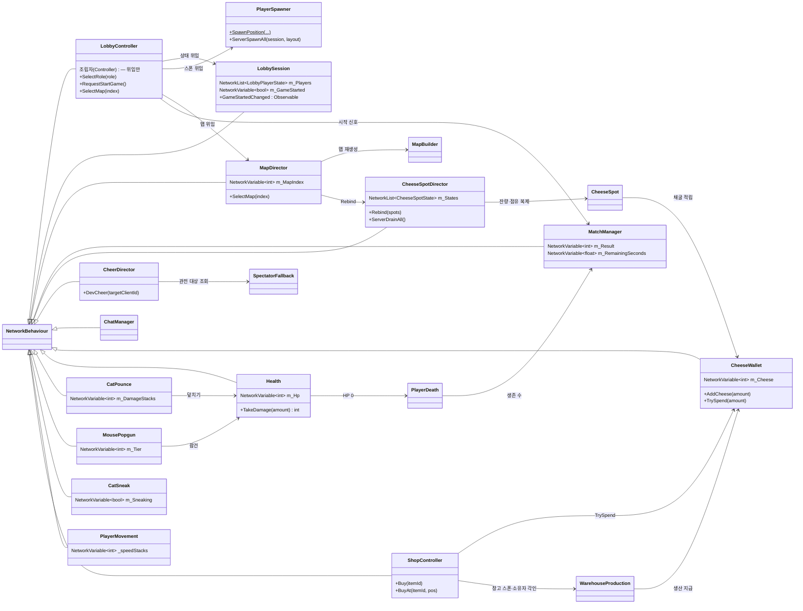
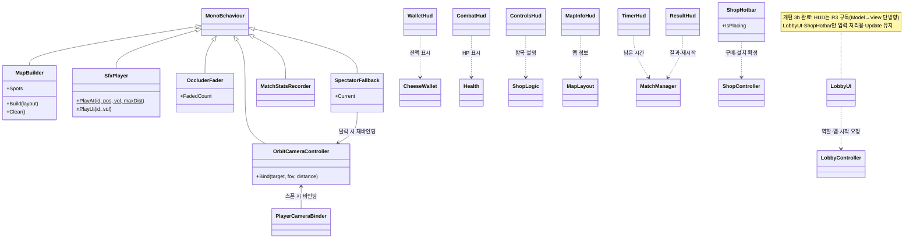
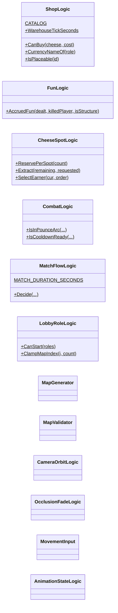
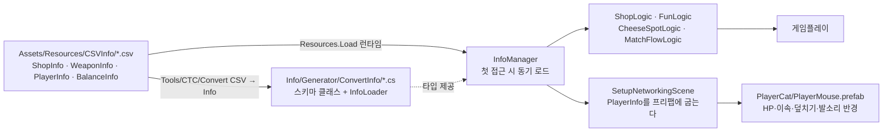
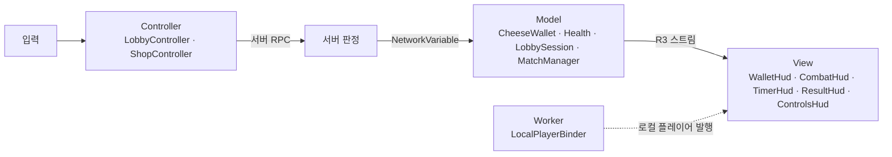

# 코드 다이어그램

> `Assets/Scripts/` 현재 구조. **코드를 고치면 이 문서를 같이 고친다**(2026-07-30 규칙).
> 갱신 2026-07-31 (v3.6 + CSV 데이터 분리 + **코드 전면 재편 완료 — 잔여 3건까지**) · 상세 멤버는 코드 참조 · 순수 로직(`*Logic`)은 아래 별도 절

---

## 게임 워크플로우

---

## 클래스 다이어그램 — 네트워크 상태 소유자

## 클래스 다이어그램 — 씬 기능(Worker)·표시(View)

## 순수 로직 (MonoBehaviour 없음 · EditMode 141개가 덮는다)

---

## 데이터 파이프라인 (CSV — 2026-07-31)

| 표 | 내용 | 반영 방식 |
|---|---|---|
| `ShopInfo` | 아이템 8종 가격·역할 | 런타임 (재컴파일 없이 즉시) |
| `WeaponInfo` | 무기 티어 3종 데미지·쿨·사거리 | 런타임 |
| `BalanceInfo` | 매치 시간·시작 치즈·창고·요새·미끼·치즈 총량·장난기 배율 + 대시 3종·설치 사거리 3종·수입 노출 반경·요새 힐 주기 | 런타임 |
| `PlayerInfo` | HP·이속·회전·FOV·CC 치수·덮치기 4종·발소리 반경·잠행 배율 | **프리팹에 굽는다** → 씬 재생성 필요 |

> 2026-07-31 마무리: 코드에 남아 있던 튜닝 노브 9개를 마저 옮겼다. 이제 **밸런스 수치는 전부 CSV가 원본**이고,
> 코드에 남은 상수는 연출(볼륨·크로스페이드·토스트)과 구조 제약(벽 두께·`CAT_CAPACITY`·버퍼 크기)뿐이다.

> WES와 다른 점: WES는 `File.ReadAllLines("Assets/CSVInfo/…")`로 읽는데 빌드엔 `Assets/`가 없다.
> CTC는 배포 빌드를 테스터에게 주므로 `Resources.Load<TextAsset>`을 쓴다.

## MVC 데이터 흐름 (개편 3b, 2026-07-31)

브리지 2개: `NetworkVariableObservable`(NGO→R3 어댑터) · `LocalPlayerBinder`(스폰/디스폰 발행).

## 물리 레이어 규칙

| 레이어 | 용도 | 충돌 |
|---|---|---|
| 0 Default | 벽·구조물·고양이 | 전부 |
| 2 Ignore Raycast | 바닥 | 설치 판정(`~(1<<2)`)에서 제외 |
| **8 Decoy** | 미끼 | **Mouse와 충돌 끔** (`DecoyLayers`) |
| **9 Mouse** | 쥐 플레이어 | Decoy만 통과, 벽은 막힘 |

`CharacterController`는 `Physics.IgnoreCollision`·`excludeLayers`를 무시하고 **레이어 매트릭스만** 존중한다 — 그래서 레이어를 쓴다.
