# 코드 다이어그램

> `Assets/Scripts/` 현재 구조. **코드를 고치면 이 문서를 같이 고친다**(2026-07-30 규칙).
> 갱신 **2026-08-12** (길찾기를 구운 폴리곤으로 · **봇·강아지 두뇌를 행동트리로** · 예약 시스템 · 지휘관) · 상세 멤버는 코드 참조 · 순수 로직(`*Logic`)은 아래 별도 절

**관련 노트**: [[00 기획 그래프 안내]] · [[코드 개편 계획]](왜 이렇게 나뉘었나) · [[승리 빌드 기획]](수치의 의도)
**여기서 다루는 기획 도메인**: [[상점]] · [[미끼]] · [[요새]] · [[치즈 지점]] · [[치즈 지갑]] · [[덮치기]] · [[매치 타이머]] · [[탈락과 관전]] · [[맵 레벨디자인]]

---

## 게임 워크플로우

> 한 장이던 걸 네 장으로 쪼갰다(2026-07-31) — 26노드짜리 세로 그래프는 옵시디언 노트 폭에서 안 읽혔다.

### ① 매치 준비

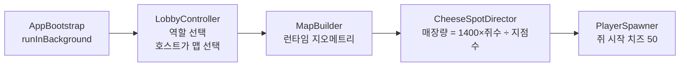

### ② 인게임 — 쥐 (벌고 산다)

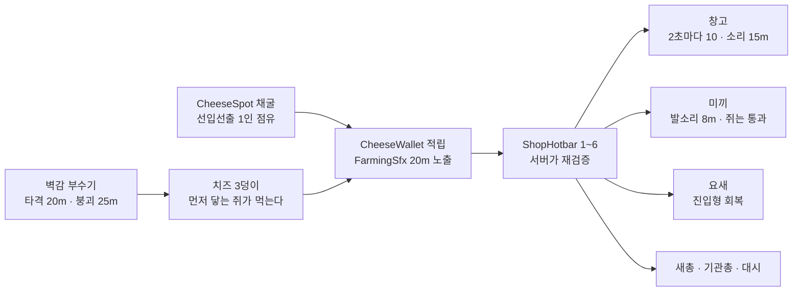

> 벽감(v3.8)은 채굴과 성격이 다르다 — 지점은 **1인 독점**이라 눌러앉는 경쟁이고,
> 벽감은 부수는 소리를 듣고 달려오는 **달리기 경쟁**이다. 부순 쥐가 독식하지 못한다.

### ③ 인게임 — 고양이 (찾고 덮친다)

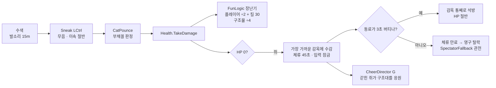

> **v3.8: 잡는다고 끝이 아니다.** 고양이의 승리는 두 갈래가 됐다 —
> 자유로운 쥐를 0으로 만들거나(전원 수감), 체류를 만료시켜 말려 죽이거나.
> 타이머 만료도 **자유로운** 쥐가 있어야 쥐 승이다.

### ④ 종료 판정 (MatchManager 0.5s)

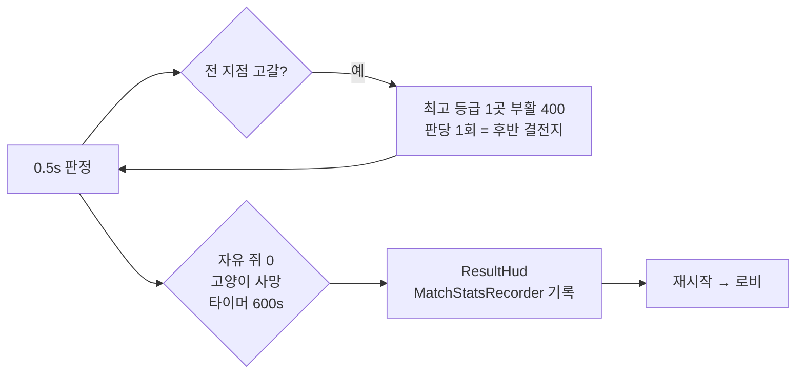

---

## 클래스 다이어그램 ① — 씬 레벨 상태 (로비·매치·맵)

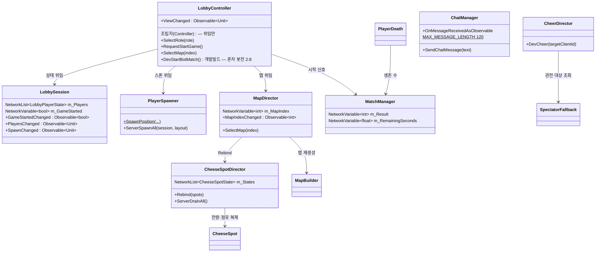

> `PlayerSpawner`를 뺀 전부가 `NetworkBehaviour` 파생이다 —
> 상속선은 그리지 않는다(7줄이 전부 같은 말이라 그림만 옆으로 늘어난다).
>
> 넷(`LobbyController`·`LobbySession`·`PlayerSpawner`·`MapDirector`)은 **같은 in-scene NetworkObject에 동승**한다.
> NetworkBehaviour를 여러 개 붙여도 RPC 발신자 식별은 각자 그대로 동작한다.

## 클래스 다이어그램 ② — 플레이어 컴포넌트

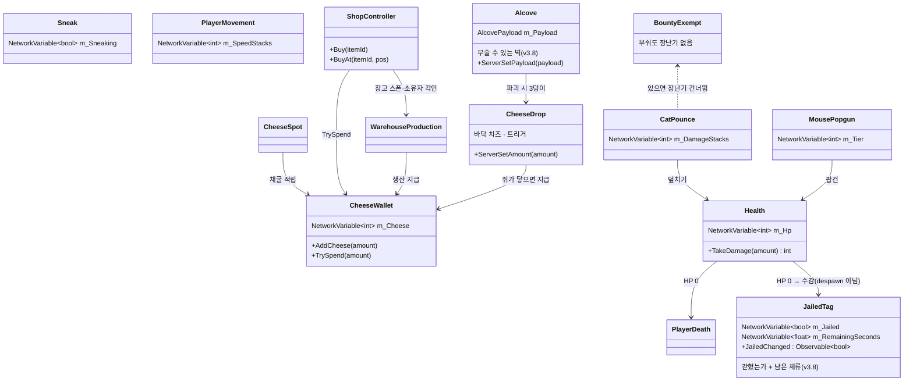

> **v3.8: 쥐는 죽지 않고 갇힌다.** `PlayerDeath`가 despawn 대신 `JailDirector.ServerJail`을
> 부르고, 진짜 탈락은 체류(40초)가 만료될 때뿐이다. 감옥이 없는 맵에서는 예전대로 despawn한다.

> **벽감은 전투 코드를 새로 안 짰다.** 팝건도 덮치기도 씬의 `Health`를 찾아 때리는 구조라
> `Health` + `RoleTag.Mouse`만 붙이면 쥐도 고양이도 부순다. `RoleTag.Mouse`인데 매치
> 생존 수에 안 끼는 건 `MatchManager.CountAlive`가 `IsPlayerObject`로 거르기 때문(요새·미끼와 같다).
>
> `PlayerDeath`를 안 쓴 이유: 그건 죽자마자 despawn하는데 벽감은 **despawn 전에 안의 것을
> 꺼내야** 한다. 순서를 남에게 맡길 수 없어 `Health.Died`를 직접 듣는다.

> 전부 `NetworkBehaviour` 파생 — 상속선은 생략했다(①과 같은 이유).
>
> 기능 하나 = 컴포넌트 하나(CTC 규칙 7). 역할별로 붙는 게 달라진다 —
> 고양이는 `CatPounce`+`Sneak`, 쥐는 `MousePopgun`+`MouseDash`+`FarmingSfx`.

## 클래스 다이어그램 — 씬 기능(Worker)·표시(View)

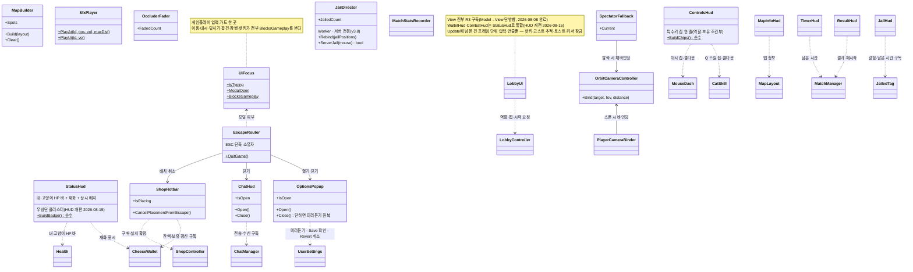

## 클래스 다이어그램 — 제3세력 강아지 (v3.8 5번)

> 벽감에서만 나온다. 어느 편도 아니라 `RoleTag.None`이고, 그래서 무기의 표적 규칙을
> `CombatLogic.CanAttack`("제 진영만 아니면 때린다")으로 모았다 —
> 안 그러면 **아무도 강아지를 못 죽인다**(qa_v40이 잡았다).

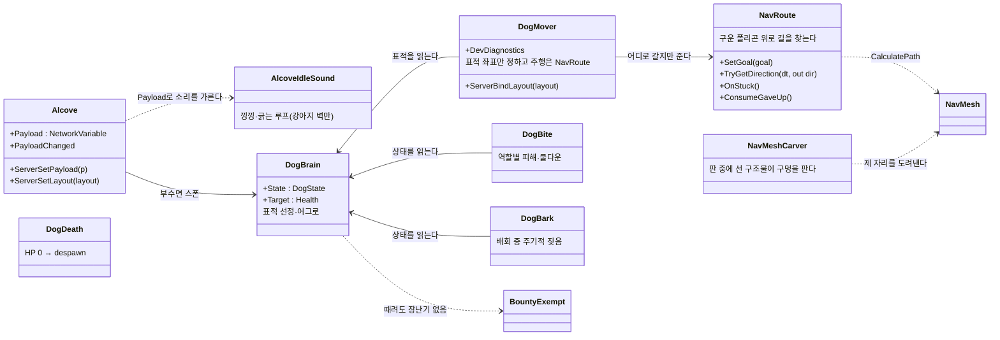

**PlayerDeath를 안 쓰는 이유**: 그건 고양이가 아닌 것을 **감옥으로 보낸다**. 강아지가 갇히면
갇힌 수에 끼고 구출 대상이 된다 — 제3세력이라는 전제가 무너진다.

**길찾기는 구운 폴리곤이다**(2026-08-12). 그전에는 방 중심·모서리·문에 점을 찍어 이은
웨이포인트 그래프였는데, 점만 아니까 목표가 점이 아닐 때 **마지막 한 구간을 검사 없이 직선**으로
줬다. 그 직선에 기둥이나 쥐가 판 중에 지은 창고가 있으면 걷는 쪽이 그걸 영원히 밀었다.
`MapBuilder`가 지형을 다 지은 뒤 `NavMeshSurface.BuildNavMesh()`로 굽고, 판 중에 서는
구조물은 `NavMeshCarver`가 제 자리만 도려낸다.

**`NavMeshAgent`는 쓰지 않는다** — 그건 오브젝트를 직접 옮겨 이속·잠행·발소리가 사람과 다른
코드를 타게 만든다. 길 계산만 쓰고 이동은 사람과 같은 입구로 넣는다.

---

## 밸런스 측정용 봇 (개발 빌드 전용)

MPPM으로는 최대 8명이라 **2:8을 한 판도 못 돌린다.** 봇이 그 간극을 메우는 계측기다.
배포판에 안 들어간다(`#if UNITY_EDITOR || DEVELOPMENT_BUILD`).

**게임플레이 코드는 손대지 않는다.** 봇은 사람이 쓰는 프리팹을 그대로 스폰해
사람이 누르는 것과 **같은 입구**(`DevSetMoveInput`·`DevPounce`·`ShopController`)로 입력을 넣는다.
그래야 이속·쿨다운·발소리가 같은 코드를 타서 측정값이 뜻을 갖는다.

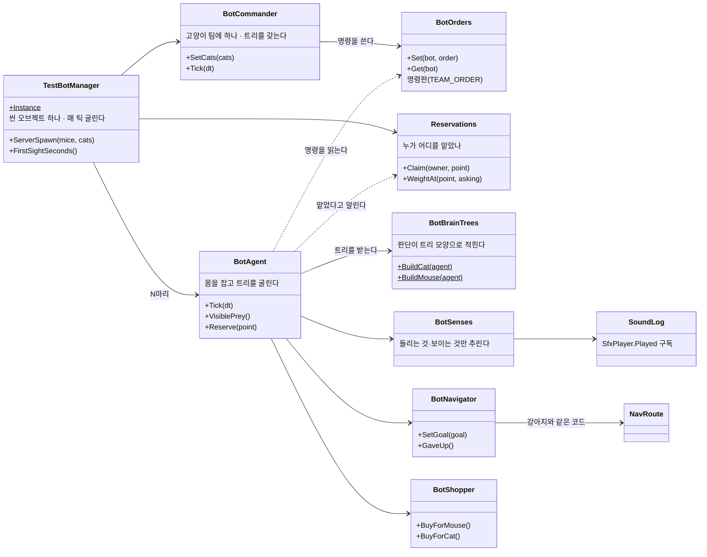

### 판단은 트리 모양이다 (2026-08-12)

`Decide()`가 if 순서로 정하던 걸 행동트리로 옮겼다 — **위아래 순서가 곧 우선순위**다.
기술소개서(리그오브레전드 6p)의 챔피언 트리 구조를 그대로 가져왔다:
**개인행동 → 지휘관명령 → 배회**. 눈앞의 일은 스스로 처리하고, 그게 없을 때만 명령을 따른다.

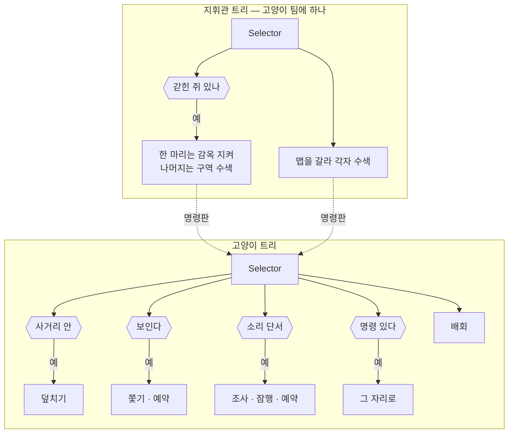

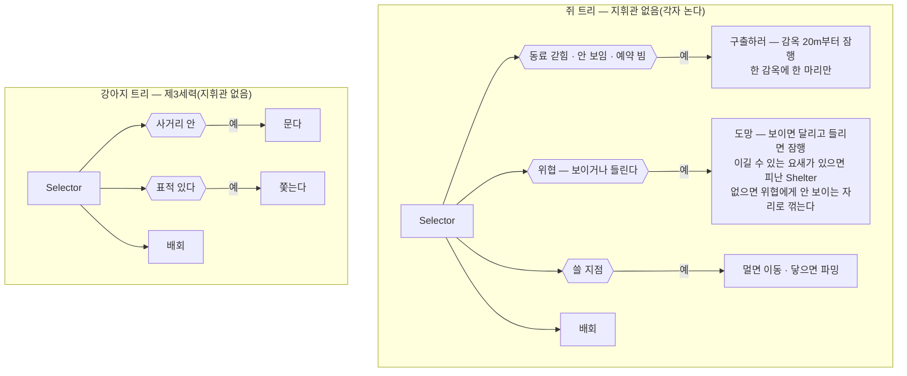

**예약 시스템** — 기술소개서(앨리스 19~20p)의 그것이다. 원본은 A\*가 지나간 **노드**를 예약해
다음 몬스터가 우회하게 했다. 여기서는 길찾기가 유니티 폴리곤이라 노드 비용을 못 건드려,
같은 규칙을 **목표를 고르는 점수**에 건다. 협동이 아니다 — 서로 신호를 주고받지 않고
각자 제 점수만 본다.

**지휘관이 아는 것** — 고양이들이 **실제로 보고 들은 것**과 화면에 뜨는 것(갇힌 수·남은 시간)뿐이다.
서버는 전지적이라 쥐 좌표를 그냥 읽을 수 있지만, 그 순간 봇 승률이 "밸런스가 좋다"가 아니라
**"봇이 반칙했다"**를 뜻하게 된다. 사람 둘이 채팅으로 공유하는 딱 그만큼만 안다.

**봇은 사람이 아는 것만 안다.** 서버는 전지적이라 쥐 좌표를 그냥 읽으면 고양이 봇이 완벽해지고,
그러면 "발소리 18m가 쓸모 있는가"를 잴 수 없다. `BotSenses`가 소리 반경과 시야로 거르는 것이
곧 계측기다.

---

## 순수 로직 (MonoBehaviour 없음 · EditMode가 덮는다)

> 회귀 판정은 러너가 찍는 수를 기준으로 한다 — 지금은 `Passed: 240, Failed: 0`
> (2026-08-10, 2:8 밸런스 + 직업 UI 이후. 1개는 패키지에서 딸려 온다).

```mermaid
classDiagram
    direction LR
    class ShopLogic {
        CATALOG$
        +CanBuy(cheese, cost)$
        +CurrencyNameOf(role)$
        +IsPlaceable(id)$
        +WarehouseTickSeconds$
    }
    class FunLogic {
        +AccruedFun(dealt, killedPlayer, isStructure)$
    }
    class CheeseSpotLogic {
        +CheesePerMouse$
        +MapTotal(miceCount)$
        +EffectiveMiceCount(mice, recommendedMin)$
        +ReservePerSpot(count, reserved, mice)$
        +Extract(remaining, requested)$
        +SelectEarner(cur, order)$
    }
    class CombatLogic {
        +IsInPounceArc(...)$
        +IsCooldownReady(...)$
        +CanAttack(attacker, target, isPlayer, isMapLoot)$
    }
    class MatchFlowLogic {
        MATCH_DURATION_SECONDS$
        +ShouldArm(...)$
        +Evaluate(armed, cats, mice)$
        +EvaluateAtTimeUp(mice)$
    }
    class LobbyRoleLogic {
        +CanStart(roles)$
        +ClampMapIndex(i, count)$
    }
    class CursorPolicyLogic {
        +ShouldRelease(inGame, result, modal)$
    }
    class AlcoveLogic {
        +TotalCheese(cheeseAlcoveCount)$
        +CountCheese(placements)$
        +SplitDrop(total, count)$
    }
    class AlcoveSpotLogic {
        MIN_DOOR_DIST$
        MIN_CHEESE_DIST$
        FLOOR_DOOR_DIST$
        FLOOR_CHEESE_DIST$
        +CollectSpots(rooms, corridors, cheese, floorCount)$
        +TryWallSpot(room, corridors, cheese, minDoor, minCheese)$
    }
    class FootstepLogic {
        +AudibleRange(moving, sneaking, normal, sneak)$
        +IsMoving(speed, threshold)$
    }
    class MouseJobLogic {
        +IsGangSide(job)$
        +CanRecruit(me, target, dist, radius)$
        +EvaluateGangPhase(gang, others, timeUp)$
    }
    class DogAiLogic {
        +ChooseTarget(candidates, pos, radius)$
        +ShouldDropAggro(visible, since, drop)$
        +NextState(hasTarget, dist, biteRange)$
        +BiteDamage(targetIsCat)$
    }
    class JailLogic {
        +NearestJailIndex(from, jails)$
        +AdvanceRescue(progress, dt, inside)$
        +AdvanceHold(remaining, dt)$
        +ReleaseHp(maxHp, ratio)$
    }
    class MapGenerator
    class MapValidator
    class CameraOrbitLogic
    class OcclusionFadeLogic
    class MovementInput
    class AnimationStateLogic
```

---

## 데이터 파이프라인 (CSV — 2026-07-31)

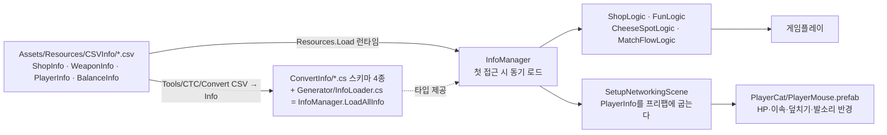

| 표 | 내용 | 반영 방식 |
|---|---|---|
| `ShopInfo` | 아이템 8종 가격·역할 | 런타임 (재컴파일 없이 즉시) |
| `WeaponInfo` | 무기 티어 3종 데미지·쿨·사거리 | 런타임 |
| `BalanceInfo` | 매치 시간·시작 치즈·창고·요새·미끼·치즈 총량·장난기 배율 + 대시 3종·설치 사거리 3종·수입 노출 반경·요새 힐 주기 + 카메라 프레이밍 4종·개인 설정 **기본값** 3종 | 런타임 |
| `PlayerInfo` | HP·이속·회전·FOV·CC 치수·덮치기 4종·발소리 반경·잠행 배율 | **프리팹에 굽는다** → 씬 재생성 필요 |

> 2026-07-31 마무리: 코드에 남아 있던 튜닝 노브 9개를 마저 옮겼다. 이제 **밸런스 수치는 전부 CSV가 원본**이고,
> 코드에 남은 상수는 연출(볼륨·크로스페이드·토스트)과 구조 제약(벽 두께·`CAT_CAPACITY`·버퍼 크기)뿐이다.

> WES와 다른 점: WES는 `File.ReadAllLines("Assets/CSVInfo/…")`로 읽는데 빌드엔 `Assets/`가 없다.
> CTC는 배포 빌드를 테스터에게 주므로 `Resources.Load<TextAsset>`을 쓴다.

## MVC 데이터 흐름 (개편 3b, 2026-07-31)

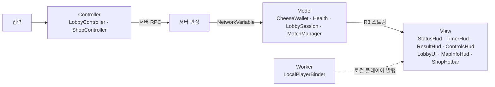

브리지 2개: `NetworkVariableObservable`(NGO→R3 어댑터 — `NetworkVariable`·`NetworkList` 둘 다) ·
`LocalPlayerBinder`(스폰/디스폰 발행).

**개인 설정은 네트워크가 아니다** (2026-08-01). 마우스 감도·볼륨은 그 사람 기기의 값이라
`UserSettings`(PlayerPrefs + R3 `ReactiveProperty`)가 Model이고, CSV는 *처음 켰을 때의 기본값*만 준다.

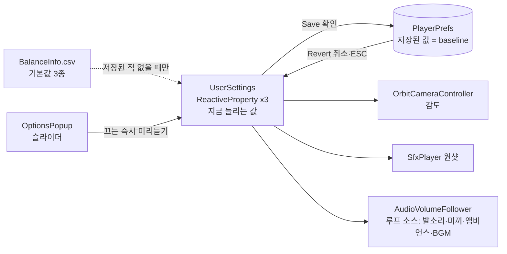

**미리듣기 / 확인 / 취소** (2026-08-09). 값이 두 층인 이유는 소리는 **들어 봐야** 고를 수 있어서다 —
슬라이더를 끌면 스트림만 바뀌어 즉시 들리고, 디스크는 "확인"에서만 바뀐다. "취소"·ESC는
저장된 값을 다시 흘려 되돌린다. baseline을 따로 안 들고 있어도 되는 건 **저장된 값이 곧 baseline**이라서다.

되돌리기는 `OptionsPopup.Close()` 한 곳에만 있다. 창을 닫는 길이 셋(취소·ESC·씬 종료)이라
길마다 흩으면 하나를 빠뜨린다. "확인"은 저장부터 하므로 이어지는 되돌리기가 무효타다 —
**닫히고 나면 언제나 저장된 값 = 지금 들리는 값**이 공짜로 선다.

`AudioVolumeFollower`가 따로 있는 이유: 루프 소스는 생성기가 볼륨을 프리팹·씬에 **구워 두고**
아무도 안 만진다. 구워진 값을 설계값으로 기억해 두고 `설계값 × 사용자 볼륨`을 쓴다 —
그래야 밸런스로 정한 소리 크기 비율이 유지된다.

> **붙이는 걸 잊으면 소리만 안 따라온다** (2026-08-09에 실제로 그랬다 — 5개 전부 미부착이라
> 배경음 슬라이더가 아무 일도 하지 않았다). 소스를 만드는 자리마다 `AddVolumeFollower`를 부른다.
> Model 값만 보는 QA로는 안 잡힌다 — `TestGetAudioVolume`으로 **실제 `AudioSource.volume`**을 본다.

| 루프 소스 | 구워진 볼륨 | 카테고리 | 만드는 곳 |
|---|---|---|---|
| 인게임 BGM | 0.35 | Bgm | `LobbyCanvasBuilder` |
| 로비 BGM | 0.35 | Bgm | `LobbyCanvasBuilder` |
| 부엌 앰비언스 | 0.15 | Bgm | `LobbyCanvasBuilder` |
| 발소리(쥐·고양이) | 0.6 | Sfx | `PlayerPrefabFactory` |
| 미끼 유인음 | 0.6 | Sfx | `SetupNetworkingScene` |

원샷(`SfxPlayer.PlayAt`·`PlayUi`)은 재생 시점에 사용자 볼륨을 곱하므로 팔로워가 필요 없다.

## 입력 소유권 (2026-08-01 · 커서 2026-08-08)

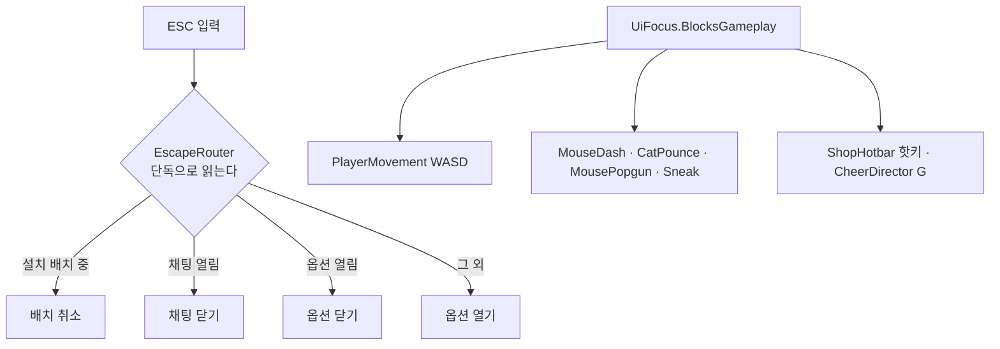

**커서 잠금도 소유자가 하나다** — `LobbyUI.Update()`가 매 프레임 `CursorPolicyLogic`에 묻는다.
잠금을 푸는 쪽이 여럿(옵션 창·결과 패널)이라 "누가 풀었는지"를 판정 한 곳에 모아야 한다.

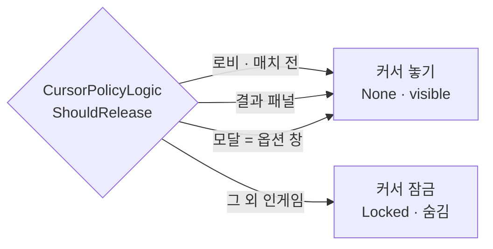

`IsTyping`(채팅)은 **항이 아니다** — 커서를 풀면 `OrbitCameraController`가 멈춰 카메라가 굳는다.
채팅은 잠근 채로 `ActivateInputField()`를 쓴다.

전에는 `QuitOnEscape`와 `ShopHotbar`가 같은 프레임에 ESC를 각자 읽어 경합했고(스크립트 실행 순서 미지정),
이동·대시에는 가드가 아예 없어 **채팅을 치면 캐릭터가 걸어가고 ESC로 게임이 꺼졌다.**
**ESC로 게임을 끄는 동작은 없앴다** — 종료는 옵션 창의 버튼이다.

**로비 View는 합친 신호 하나를 쓴다** (2026-07-31). `LobbyController.ViewChanged`가
스폰·참가자·역할·시작·맵 변경을 `Merge`해 흘리고, `LobbyUI`·`MapInfoHud`는 그때만 다시 그린다.
필드별로 쪼개지 않은 이유는 로비 표시가 통짜 텍스트·버튼 몇 개라 어차피 전부 다시 그리기 때문이다 —
델타를 나르면 배선만 늘고 얻는 게 없다.

## 물리 레이어 규칙

| 레이어 | 용도 | 충돌 |
|---|---|---|
| 0 Default | 벽·구조물·고양이 | 전부 |
| 2 Ignore Raycast | 바닥 | 설치 판정(`~(1<<2)`)에서 제외 |
| **8 Decoy** | 미끼 | **Mouse와 충돌 끔** (`DecoyLayers`) |
| **9 Mouse** | 쥐 플레이어 | Decoy만 통과, 벽은 막힘 |

`CharacterController`는 `Physics.IgnoreCollision`·`excludeLayers`를 무시하고 **레이어 매트릭스만** 존중한다 — 그래서 레이어를 쓴다.

매트릭스는 **프로젝트 세팅에만** 있다(2026-08-01). 런타임 적용 코드는 지웠다 — 세팅이 커밋돼 있어 할 일이 없었다.

| 무엇 | 어디 |
|---|---|
| 레이어 `Decoy`(8)·`Mouse`(9) | `ProjectSettings/TagManager.asset` |
| `Decoy × Mouse` 끔 | `ProjectSettings/DynamicsManager.asset` |
| 둘 다 만들고/굽는 것 | `Tools/CTC/Setup Networking Scene` |

> 매트릭스는 레이어 **번호**로 저장된다. 레이어가 8·9가 아닌 슬롯에 앉으면 구워둔 칸이 어긋난다 —
> 그때는 생성기를 다시 돌린다.
