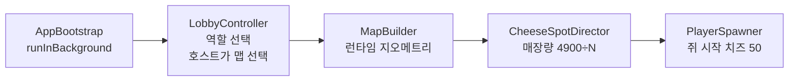
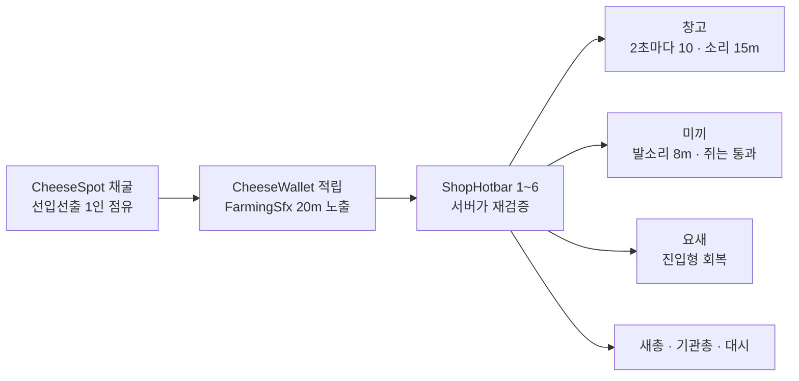
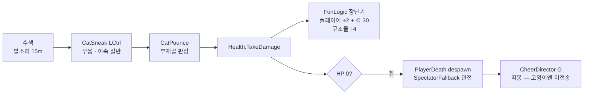
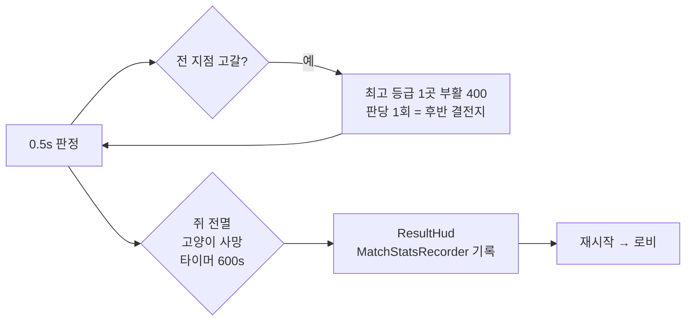
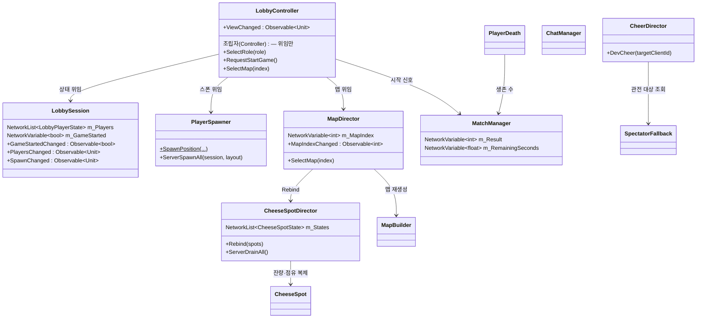
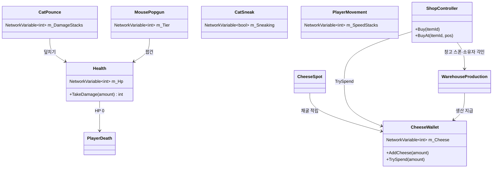
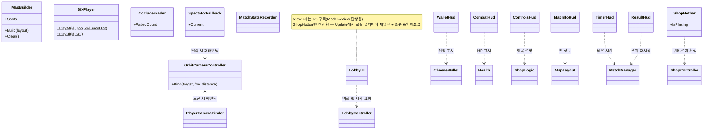
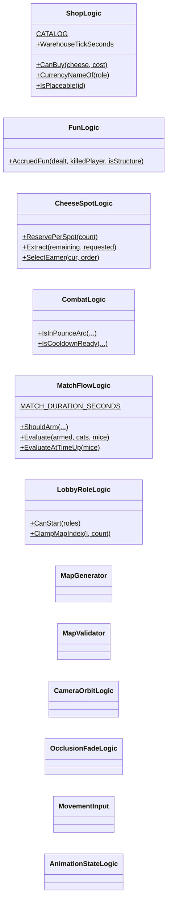
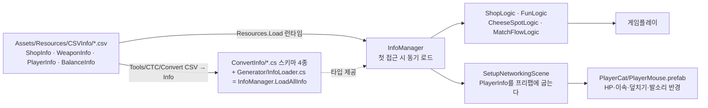
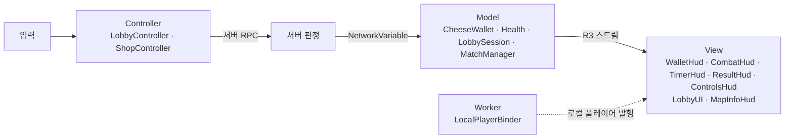

# 코드 다이어그램

> `Assets/Scripts/` 현재 구조. **코드를 고치면 이 문서를 같이 고친다**(2026-07-30 규칙).
> 갱신 2026-07-31 (v3.6 + CSV 데이터 분리 + **코드 전면 재편 완료 — 잔여 3건까지**) · 상세 멤버는 코드 참조 · 순수 로직(`*Logic`)은 아래 별도 절

**관련 노트**: [[00 기획 그래프 안내]] · [[코드 개편 계획]](왜 이렇게 나뉘었나) · [[승리 빌드 기획]](수치의 의도)
**여기서 다루는 기획 도메인**: [[상점]] · [[미끼]] · [[요새]] · [[치즈 지점]] · [[치즈 지갑]] · [[덮치기]] · [[매치 타이머]] · [[탈락과 관전]] · [[맵 레벨디자인]]

---

## 게임 워크플로우

> 한 장이던 걸 네 장으로 쪼갰다(2026-07-31) — 26노드짜리 세로 그래프는 옵시디언 노트 폭에서 안 읽혔다.

### ① 매치 준비

### ② 인게임 — 쥐 (벌고 산다)

### ③ 인게임 — 고양이 (찾고 덮친다)

### ④ 종료 판정 (MatchManager 0.5s)

---

## 클래스 다이어그램 ① — 씬 레벨 상태 (로비·매치·맵)

> `PlayerSpawner`를 뺀 전부가 `NetworkBehaviour` 파생이다 —
> 상속선은 그리지 않는다(7줄이 전부 같은 말이라 그림만 옆으로 늘어난다).
>
> 넷(`LobbyController`·`LobbySession`·`PlayerSpawner`·`MapDirector`)은 **같은 in-scene NetworkObject에 동승**한다.
> NetworkBehaviour를 여러 개 붙여도 RPC 발신자 식별은 각자 그대로 동작한다.

## 클래스 다이어그램 ② — 플레이어 컴포넌트

> 전부 `NetworkBehaviour` 파생 — 상속선은 생략했다(①과 같은 이유).
>
> 기능 하나 = 컴포넌트 하나(CTC 규칙 7). 역할별로 붙는 게 달라진다 —
> 고양이는 `CatPounce`+`CatSneak`, 쥐는 `MousePopgun`+`MouseDash`+`FarmingSfx`.

## 클래스 다이어그램 — 씬 기능(Worker)·표시(View)

## 순수 로직 (MonoBehaviour 없음 · EditMode가 덮는다)

> 우리 `[Test]`는 **140개**. 메뉴가 찍는 수는 **141**인데 1개는 패키지에서 딸려 온다 —
> 회귀 판정은 러너가 찍는 `Passed: 141, Failed: 0`을 기준으로 한다.

---

## 데이터 파이프라인 (CSV — 2026-07-31)

| 표 | 내용 | 반영 방식 |
|---|---|---|
| `ShopInfo` | 아이템 8종 가격·역할 | 런타임 (재컴파일 없이 즉시) |
| `WeaponInfo` | 무기 티어 3종 데미지·쿨·사거리 | 런타임 |
| `BalanceInfo` | 매치 시간·시작 치즈·창고·요새·미끼·치즈 총량·장난기 배율 + 대시 3종·설치 사거리 3종·수입 노출 반경·요새 힐 주기 | 런타임 |
| `PlayerInfo` | HP·이속·회전·FOV·CC 치수·덮치기 4종·발소리 반경·잠행 배율 | **프리팹에 굽는다** → 씬 재생성 필요 |

> 2026-07-31 마무리: 코드에 남아 있던 튜닝 노브 9개를 마저 옮겼다. 이제 **밸런스 수치는 전부 CSV가 원본**이고,
> 코드에 남은 상수는 연출(볼륨·크로스페이드·토스트)과 구조 제약(벽 두께·`CAT_CAPACITY`·버퍼 크기)뿐이다.

> WES와 다른 점: WES는 `File.ReadAllLines("Assets/CSVInfo/…")`로 읽는데 빌드엔 `Assets/`가 없다.
> CTC는 배포 빌드를 테스터에게 주므로 `Resources.Load<TextAsset>`을 쓴다.

## MVC 데이터 흐름 (개편 3b, 2026-07-31)

브리지 2개: `NetworkVariableObservable`(NGO→R3 어댑터 — `NetworkVariable`·`NetworkList` 둘 다) ·
`LocalPlayerBinder`(스폰/디스폰 발행).

**로비 View는 합친 신호 하나를 쓴다** (2026-07-31). `LobbyController.ViewChanged`가
스폰·참가자·역할·시작·맵 변경을 `Merge`해 흘리고, `LobbyUI`·`MapInfoHud`는 그때만 다시 그린다.
필드별로 쪼개지 않은 이유는 로비 표시가 통짜 텍스트·버튼 몇 개라 어차피 전부 다시 그리기 때문이다 —
델타를 나르면 배선만 늘고 얻는 게 없다.

## 물리 레이어 규칙

| 레이어 | 용도 | 충돌 |
|---|---|---|
| 0 Default | 벽·구조물·고양이 | 전부 |
| 2 Ignore Raycast | 바닥 | 설치 판정(`~(1<<2)`)에서 제외 |
| **8 Decoy** | 미끼 | **Mouse와 충돌 끔** (`DecoyLayers`) |
| **9 Mouse** | 쥐 플레이어 | Decoy만 통과, 벽은 막힘 |

`CharacterController`는 `Physics.IgnoreCollision`·`excludeLayers`를 무시하고 **레이어 매트릭스만** 존중한다 — 그래서 레이어를 쓴다.

매트릭스는 **프로젝트 세팅에만** 있다(2026-08-01). 런타임 적용 코드는 지웠다 — 세팅이 커밋돼 있어 할 일이 없었다.

| 무엇 | 어디 |
|---|---|
| 레이어 `Decoy`(8)·`Mouse`(9) | `ProjectSettings/TagManager.asset` |
| `Decoy × Mouse` 끔 | `ProjectSettings/DynamicsManager.asset` |
| 둘 다 만들고/굽는 것 | `Tools/CTC/Setup Networking Scene` |

> 매트릭스는 레이어 **번호**로 저장된다. 레이어가 8·9가 아닌 슬롯에 앉으면 구워둔 칸이 어긋난다 —
> 그때는 생성기를 다시 돌린다.
