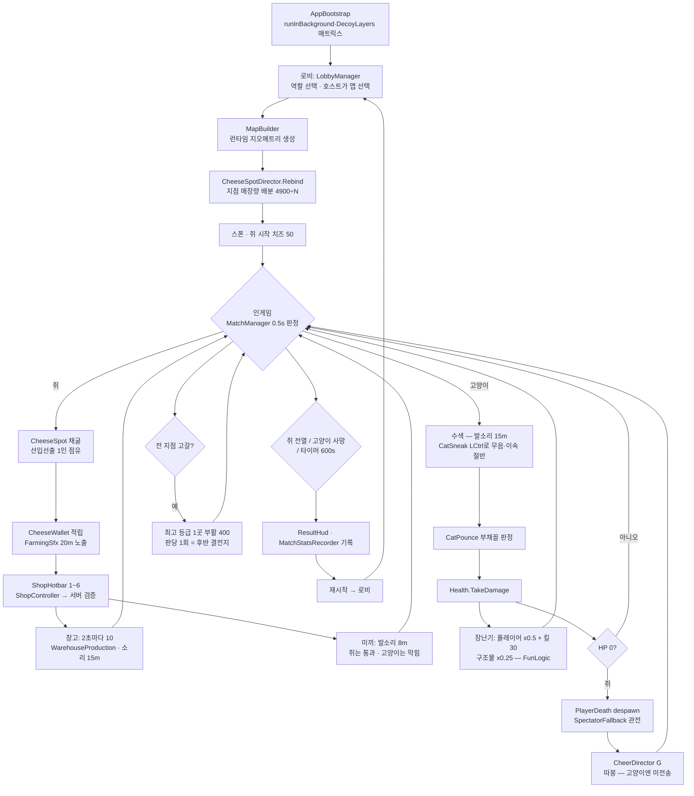
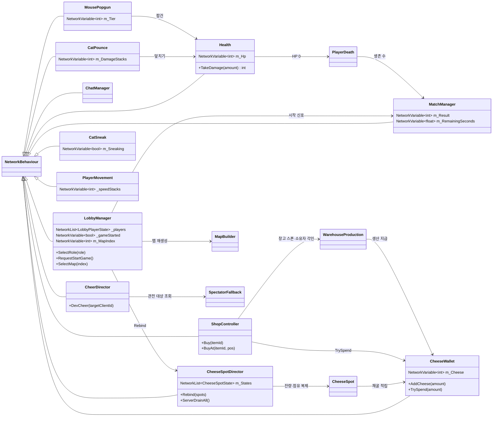
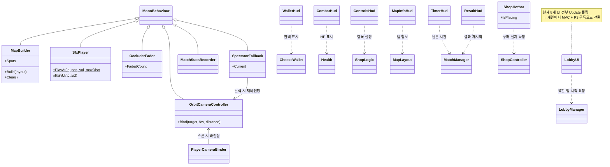
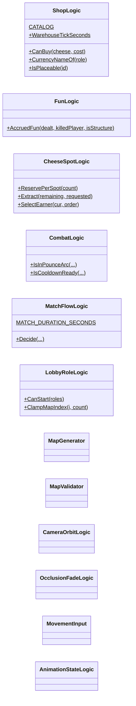

# 코드 다이어그램

> `Assets/Scripts/` 현재 구조. **코드를 고치면 이 문서를 같이 고친다**(2026-07-30 규칙).
> 갱신 2026-07-30 (v3.6) · 상세 멤버는 코드 참조 · 순수 로직(`*Logic`)은 아래 별도 절

---

## 게임 워크플로우

---

## 클래스 다이어그램 — 네트워크 상태 소유자

## 클래스 다이어그램 — 씬 기능(Worker)·표시(View)

## 순수 로직 (MonoBehaviour 없음 · EditMode 141개가 덮는다)

---

## 물리 레이어 규칙

| 레이어 | 용도 | 충돌 |
|---|---|---|
| 0 Default | 벽·구조물·고양이 | 전부 |
| 2 Ignore Raycast | 바닥 | 설치 판정(`~(1<<2)`)에서 제외 |
| **8 Decoy** | 미끼 | **Mouse와 충돌 끔** (`DecoyLayers`) |
| **9 Mouse** | 쥐 플레이어 | Decoy만 통과, 벽은 막힘 |

`CharacterController`는 `Physics.IgnoreCollision`·`excludeLayers`를 무시하고 **레이어 매트릭스만** 존중한다 — 그래서 레이어를 쓴다.
