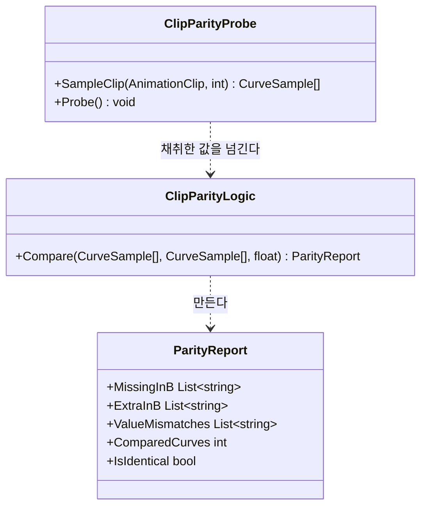

# 블렌더 애니메이션 파이프라인 구현 계획

> **For agentic workers:** REQUIRED SUB-SKILL: Use superpowers:subagent-driven-development (recommended) or superpowers:executing-plans to implement this plan task-by-task. Steps use checkbox (`- [ ]`) syntax for tracking.

**Goal:** 블렌더로 만든 클립이 지금 쥐 리그에 **틀어짐 없이** 붙는다는 것을 기계로 증명한다 — 새 동작은 하나도 만들지 않는다.

**Architecture:** 먼저 **자**를 만든다(클립 두 개가 같은지 재는 에디터 도구). 그 자를 「Walk vs Walk = 같다 / Walk vs Run = 다르다」로 검증한 뒤에야 블렌더를 세우고, 팩 `Walk`를 아무것도 안 고치고 왕복시켜 그 자에 올린다. **자가 먼저 초록이 아니면 왕복 결과를 믿을 수 없다.**

**Tech Stack:** Unity 6000.5.2f1 (Generic rig · `AnimationUtility`) · NUnit EditMode · Blender 5.2.1 LTS (`bpy`, 헤드리스) · FBX

**설계 문서:** [2026-09-12-blender-animation-pipeline-design.md](../specs/2026-09-12-blender-animation-pipeline-design.md)

---

## 사전 지식 (이 프로젝트를 모르는 사람용)

| 알아야 할 것 | 내용 |
|---|---|
| 리그가 **Generic** | 휴머노이드 리타깃이 없다. 클립은 **트랜스폼 경로 문자열**로 뼈를 찾는다 — `Rig/root/body/head/ear.L`. 한 글자만 달라도 **에러 없이** 그 커브가 죽는다 |
| 뼈 계층 | `Rig/root/body` 아래 `head`(→`ear.R`,`ear.L`) · `leg.F.L` · `leg.F.R` · `leg.B.L` · `leg.B.R` · `tail.01`(→`tail.02`). 전부 11개 |
| 팩 구조 | `Models/Mouse_LOD0.fbx`(메시+리그)와 `Animations/Mouse_Animations.fbx`(클립 20, 메시 없음)가 **따로**다. 새 클립은 후자 옆에 FBX를 하나 더 놓는 것 |
| 클립 예산 | 팩 클립 20개가 **전부 0~10프레임**이다 |
| 코딩 규칙 | `m_` 멤버 · `_` 매개변수 · public 필드 금지 · 상수 `UPPER_SNAKE_CASE` · **Unity 객체는 `if (x != null)`** (`?.`·`??` 금지) |
| 테스트 실행 | 메뉴 `Tools/CTC/Run EditMode Tests` (MCP `u_editor_menu`로 호출 가능) |
| 에셋 수정 후 | `u_editor_asset(action: refresh)` |
| **에디터에서 `GameDebug.Log`는 아무것도 안 찍는다** | `[Conditional("DEVELOPMENT_BUILD")]`. 에디터 도구에서는 `Debug.Log`를 쓴다 |

**경로 주의**: git 저장소 루트는 `C:/GitFork/The-Cheese-Thief-and-the-Cat/`이고 유니티 프로젝트는 그 밑 `CTC/`다. 아래 셸 명령은 **저장소 루트 기준**이고, 유니티 에셋 경로(`Assets/...`)는 프로젝트 기준이다.

---

## 파일 구조

| 파일 | 책임 |
|---|---|
| `CTC/Assets/Scripts/Editor/ClipParityLogic.cs` (신규) | **순수 비교.** 샘플된 커브 두 벌을 받아 차이 보고서를 만든다. Unity 애니메이션 API를 모른다 |
| `CTC/Assets/Scripts/Editor/ClipParityProbe.cs` (신규) | **채취 + 메뉴.** `AnimationUtility`로 클립에서 커브를 뽑아 위 로직에 넘기고, 보고서를 파일로 쓴다 |
| `CTC/Assets/Scripts/Tests/EditMode/ClipParityLogicTests.cs` (신규) | 비교 로직의 단위 테스트 |
| `CTC/Assets/Scripts/Tests/EditMode/ClipParityProbeTests.cs` (신규) | **자가 검증.** 팩 `Walk`↔`Walk`는 같다고, `Walk`↔`Run`은 다르다고 말하는지 |
| `CTC/Assets/Scripts/Tests/EditMode/CTC.Tests.EditMode.asmdef` (수정) | `CTC.Editor` 참조 추가 |
| `tools/blender/import_pack.py` (신규) | 팩 리그를 블렌더로 들인다 + 뼈 이름 검사 |
| `tools/blender/export_clips.py` (신규) | 내보내기 설정을 코드로. 체크박스를 사람이 외우지 않는다 |
| `art/blender/mouse.blend` (신규, 바이너리) | 블렌더 작업 파일. **`Assets/` 밖** |
| `CTC/Assets/Animations/Pets/CTC_Mouse_Clips.fbx` (신규) | 산출물 — 동작만, 메시 없음 |

**왜 로직과 채취를 가르나**: `AnimationUtility`는 에디터 API라 값을 지어내기 어렵다. 비교 규칙을 순수 함수로 떼어 두면 **"경로가 하나 빠졌다"** 같은 상황을 테스트에서 직접 만들 수 있다. 이 프로젝트의 `*Logic` 패턴 그대로다.

---

## Task 1: 비교 로직 — 순수 부분

**Files:**
- Create: `CTC/Assets/Scripts/Editor/ClipParityLogic.cs`
- Test: `CTC/Assets/Scripts/Tests/EditMode/ClipParityLogicTests.cs`
- Modify: `CTC/Assets/Scripts/Tests/EditMode/CTC.Tests.EditMode.asmdef`

- [ ] **Step 1: 테스트 어셈블리가 에디터 어셈블리를 보게 한다**

`CTC/Assets/Scripts/Tests/EditMode/CTC.Tests.EditMode.asmdef`를 아래 내용으로 바꾼다 (`references`에 `"CTC.Editor"`가 늘어난 것이 전부다):

```json
{
    "name": "CTC.Tests.EditMode",
    "rootNamespace": "CTC.Tests",
    "references": [
        "CTC.Runtime",
        "CTC.Editor",
        "Unity.Netcode.Runtime",
        "UnityEngine.TestRunner",
        "UnityEditor.TestRunner"
    ],
    "includePlatforms": [ "Editor" ],
    "excludePlatforms": [],
    "allowUnsafeCode": false,
    "overrideReferences": true,
    "precompiledReferences": [ "nunit.framework.dll", "R3.dll" ],
    "autoReferenced": false,
    "defineConstraints": [ "UNITY_INCLUDE_TESTS" ],
    "versionDefines": [],
    "noEngineReferences": false
}
```

순환 참조가 아니다 — `CTC.Editor`는 `CTC.Runtime`만 보고, 테스트가 그 둘을 본다.

- [ ] **Step 2: 실패하는 테스트를 쓴다**

`CTC/Assets/Scripts/Tests/EditMode/ClipParityLogicTests.cs`:

```csharp
using CTC.Editor;
using NUnit.Framework;

namespace CTC.Tests
{
    public class ClipParityLogicTests
    {
        private static CurveSample S(string _key, params float[] _values)
        {
            return new CurveSample(_key, _values);
        }

        [Test]
        public void SameKeysSameValues_IsIdentical()
        {
            var a = new[] { S("Rig/root:m_LocalPosition.x", 0f, 1f, 2f) };
            var b = new[] { S("Rig/root:m_LocalPosition.x", 0f, 1f, 2f) };

            ParityReport r = ClipParityLogic.Compare(a, b, 1e-3f);

            Assert.IsTrue(r.IsIdentical, r.ToText());
        }

        [Test]
        public void KeyMissingInB_IsReportedAsMissing()
        {
            var a = new[] { S("Rig/root:x", 0f), S("Rig/root/body:x", 0f) };
            var b = new[] { S("Rig/root:x", 0f) };

            ParityReport r = ClipParityLogic.Compare(a, b, 1e-3f);

            Assert.IsFalse(r.IsIdentical);
            CollectionAssert.AreEqual(new[] { "Rig/root/body:x" }, r.MissingInB);
            CollectionAssert.IsEmpty(r.ExtraInB);
        }

        [Test]
        public void KeyOnlyInB_IsReportedAsExtra()
        {
            var a = new[] { S("Rig/root:x", 0f) };
            var b = new[] { S("Rig/root:x", 0f), S("Rig/root/body_end:x", 0f) };

            ParityReport r = ClipParityLogic.Compare(a, b, 1e-3f);

            Assert.IsFalse(r.IsIdentical);
            CollectionAssert.AreEqual(new[] { "Rig/root/body_end:x" }, r.ExtraInB);
            CollectionAssert.IsEmpty(r.MissingInB);
        }

        [Test]
        public void ValueBeyondEpsilon_IsReportedWithIndexAndDelta()
        {
            var a = new[] { S("Rig/root:x", 0f, 0f, 0f) };
            var b = new[] { S("Rig/root:x", 0f, 0.5f, 0f) };

            ParityReport r = ClipParityLogic.Compare(a, b, 1e-3f);

            Assert.IsFalse(r.IsIdentical);
            Assert.AreEqual(1, r.ValueMismatches.Count);
            StringAssert.Contains("Rig/root:x", r.ValueMismatches[0]);
            StringAssert.Contains("[1]", r.ValueMismatches[0]);
        }

        [Test]
        public void ValueWithinEpsilon_IsNotReported()
        {
            var a = new[] { S("Rig/root:x", 0f, 1.0000f) };
            var b = new[] { S("Rig/root:x", 0f, 1.0005f) };

            ParityReport r = ClipParityLogic.Compare(a, b, 1e-3f);

            Assert.IsTrue(r.IsIdentical, r.ToText());
        }

        [Test]
        public void SampleCountMismatch_IsReported()
        {
            var a = new[] { S("Rig/root:x", 0f, 1f) };
            var b = new[] { S("Rig/root:x", 0f) };

            ParityReport r = ClipParityLogic.Compare(a, b, 1e-3f);

            Assert.IsFalse(r.IsIdentical);
            Assert.AreEqual(1, r.ValueMismatches.Count);
            StringAssert.Contains("샘플 수", r.ValueMismatches[0]);
        }

        [Test]
        public void EmptyBothSides_IsNotSilentlyIdentical()
        {
            ParityReport r = ClipParityLogic.Compare(new CurveSample[0], new CurveSample[0], 1e-3f);

            Assert.IsFalse(r.IsIdentical,
                "커브가 0개인 두 클립을 '같다'고 하면 배선이 죽은 것을 통과시킨다");
        }
    }
}
```

**마지막 테스트가 핵심이다** — 커브를 하나도 못 뽑았을 때 "차이가 없다 = 같다"로 새는 것이 이런 도구의 전형적인 거짓 초록이다.

- [ ] **Step 3: 실패를 확인한다**

메뉴 `Tools/CTC/Run EditMode Tests`를 돌린다 (MCP: `u_editor_menu(menuPath: "Tools/CTC/Run EditMode Tests")`).

기대: **컴파일 에러** — `CurveSample`·`ParityReport`·`ClipParityLogic`이 없다.

- [ ] **Step 4: 최소 구현을 쓴다**

`CTC/Assets/Scripts/Editor/ClipParityLogic.cs`:

```csharp
using System.Collections.Generic;
using System.Text;

namespace CTC.Editor
{
    /// <summary>
    /// 클립 하나에서 뽑은 **커브 한 줄** — 키(경로:프로퍼티)와 같은 간격으로 잰 값들.
    /// </summary>
    public readonly struct CurveSample
    {
        public CurveSample(string _key, float[] _values)
        {
            Key = _key;
            Values = _values;
        }

        /// <summary>`Rig/root/body/head:m_LocalRotation.x` 꼴. **이 문자열이 곧 유니티가 뼈를 찾는 방법이다.**</summary>
        public string Key { get; }

        public float[] Values { get; }
    }

    /// <summary>두 클립의 차이. 비어 있고 **커브가 1개 이상일 때만** "같다"고 말한다.</summary>
    public sealed class ParityReport
    {
        public List<string> MissingInB { get; } = new List<string>();
        public List<string> ExtraInB { get; } = new List<string>();
        public List<string> ValueMismatches { get; } = new List<string>();

        /// <summary>비교에 쓴 커브 수(양쪽에 다 있는 키). 0이면 잰 것이 없다는 뜻이다.</summary>
        public int ComparedCurves { get; set; }

        public bool IsIdentical =>
            ComparedCurves > 0 &&
            MissingInB.Count == 0 && ExtraInB.Count == 0 && ValueMismatches.Count == 0;

        public string ToText()
        {
            var sb = new StringBuilder();
            sb.AppendLine($"견준 커브: {ComparedCurves}");
            Section(sb, "A에만 있음(사라진 뼈·프로퍼티)", MissingInB);
            Section(sb, "B에만 있음(늘어난 뼈·말단 본)", ExtraInB);
            Section(sb, "값 어긋남", ValueMismatches);
            sb.AppendLine(IsIdentical ? "판정: 같다" : "판정: 다르다");
            return sb.ToString();
        }

        private static void Section(StringBuilder _sb, string _title, List<string> _items)
        {
            if (_items.Count == 0) return;
            _sb.AppendLine($"[{_title}] {_items.Count}건");
            foreach (string s in _items) _sb.AppendLine("  " + s);
        }
    }

    /// <summary>
    /// 클립 두 벌을 견준다. **Unity 애니메이션 API를 모른다** — 채취는 <see cref="ClipParityProbe"/>가 한다.
    ///
    /// 왜 키 집합을 값보다 먼저 보는가(2026-09-12): 블렌더 FBX 왕복이 깨지는 세 가지가
    /// 전부 **키 집합의 사고**다 — 뼈 이름이 `아마추어이름+뼈이름`으로 바뀌거나, 계층에
    /// Armature가 한 겹 끼거나, Add Leaf Bones가 없던 말단을 만든다. 셋 다 값을 재기 전에
    /// **이름에서 죽는다.** 그래서 집합 차이가 곧 진단명이다.
    /// </summary>
    public static class ClipParityLogic
    {
        public static ParityReport Compare(
            IReadOnlyList<CurveSample> _a, IReadOnlyList<CurveSample> _b, float _epsilon)
        {
            var report = new ParityReport();

            var byKeyA = new Dictionary<string, float[]>();
            foreach (CurveSample s in _a) byKeyA[s.Key] = s.Values;

            var byKeyB = new Dictionary<string, float[]>();
            foreach (CurveSample s in _b) byKeyB[s.Key] = s.Values;

            foreach (CurveSample s in _a)
            {
                if (!byKeyB.ContainsKey(s.Key)) report.MissingInB.Add(s.Key);
            }

            foreach (CurveSample s in _b)
            {
                if (!byKeyA.ContainsKey(s.Key)) report.ExtraInB.Add(s.Key);
            }

            foreach (CurveSample s in _a)
            {
                if (!byKeyB.TryGetValue(s.Key, out float[] other)) continue;
                report.ComparedCurves++;

                if (s.Values.Length != other.Length)
                {
                    report.ValueMismatches.Add(
                        $"{s.Key}: 샘플 수가 다르다 {s.Values.Length} vs {other.Length}");
                    continue;
                }

                for (int i = 0; i < s.Values.Length; i++)
                {
                    float delta = s.Values[i] - other[i];
                    if (delta < 0f) delta = -delta;
                    if (delta <= _epsilon) continue;

                    report.ValueMismatches.Add(
                        $"{s.Key}[{i}]: {s.Values[i]:F5} vs {other[i]:F5} (Δ{delta:F5})");
                    break; // 커브당 한 건만 — 보고서가 수천 줄이 되면 안 읽는다
                }
            }

            return report;
        }
    }
}
```

- [ ] **Step 5: 통과를 확인한다**

`Tools/CTC/Run EditMode Tests` 실행.

기대: `ClipParityLogicTests` **7개 전부 PASS**. 기존 761개도 여전히 초록.

- [ ] **Step 6: 커밋**

```bash
cd CTC
git add Assets/Scripts/Editor/ClipParityLogic.cs \
        Assets/Scripts/Editor/ClipParityLogic.cs.meta \
        Assets/Scripts/Tests/EditMode/ClipParityLogicTests.cs \
        Assets/Scripts/Tests/EditMode/ClipParityLogicTests.cs.meta \
        Assets/Scripts/Tests/EditMode/CTC.Tests.EditMode.asmdef
git commit -m "test(anim): 클립 비교 로직 — 키 집합이 먼저, 값은 그 다음

블렌더 왕복이 깨지는 세 가지가 전부 키 집합 사고다(뼈 이름 접두·Armature 한 겹·
말단 본). 값을 재기 전에 이름에서 죽으므로 집합 차이가 곧 진단명이다.

커브 0개를 '같다'로 읽지 않게 ComparedCurves > 0을 조건에 넣었다 — 배선이 죽었을 때
차이가 없다는 이유로 통과하는 것이 이런 도구의 전형적인 거짓 초록이다.

Co-Authored-By: Claude Opus 5 <noreply@anthropic.com>"
```

---

## Task 2: 채취 — 클립에서 커브를 뽑는다

**Files:**
- Create: `CTC/Assets/Scripts/Editor/ClipParityProbe.cs`
- Test: `CTC/Assets/Scripts/Tests/EditMode/ClipParityProbeTests.cs`

- [ ] **Step 1: 실패하는 테스트를 쓴다 — 자를 자기 자신으로 검증한다**

`CTC/Assets/Scripts/Tests/EditMode/ClipParityProbeTests.cs`:

```csharp
using CTC.Editor;
using NUnit.Framework;
using UnityEditor;
using UnityEngine;

namespace CTC.Tests
{
    /// <summary>
    /// **자가 잴 수 있는지를 잰다.** 블렌더는 아직 없다 — 팩 클립끼리만 견준다.
    ///
    /// 같은 클립을 자기 자신과 견줘 "같다"가 나오는 것만으로는 부족하다. 그건 항진명제라
    /// 비교가 통째로 죽어 있어도 통과한다. **다른 클립을 "다르다"고 말해야** 자가 살아 있다.
    /// </summary>
    public class ClipParityProbeTests
    {
        private const string PACK_FBX =
            "Assets/Quirky Series/Ultimate Pack Vol.1/Mega Pack Vol.1/Pets Vol.1/Animations/Mouse_Animations.fbx";

        private const int SAMPLES = 21;
        private const float EPSILON = 1e-3f;

        private static AnimationClip LoadFrom(string _assetPath, string _name)
        {
            foreach (Object o in AssetDatabase.LoadAllAssetsAtPath(_assetPath))
            {
                var clip = o as AnimationClip;
                if (clip != null && clip.name == _name) return clip;
            }
            return null;
        }

        private static AnimationClip Pack(string _name)
        {
            AnimationClip clip = LoadFrom(PACK_FBX, _name);
            if (clip == null) Assert.Ignore($"팩 원본에 '{_name}'이 없다: {PACK_FBX}");
            return clip;
        }

        [Test]
        public void SampleClip_FindsBoneCurves()
        {
            CurveSample[] samples = ClipParityProbe.SampleClip(Pack("Walk"), SAMPLES);

            Assert.Greater(samples.Length, 0, "커브를 하나도 못 뽑았다 — 채취가 죽어 있다");

            bool sawRig = false;
            foreach (CurveSample s in samples)
            {
                if (s.Key.StartsWith("Rig/root")) { sawRig = true; break; }
            }
            Assert.IsTrue(sawRig, "경로가 'Rig/root...'로 안 나온다 — 유니티가 뼈를 못 찾는다는 뜻");
        }

        [Test]
        public void Walk_ComparedToItself_IsIdentical()
        {
            AnimationClip walk = Pack("Walk");
            ParityReport r = ClipParityLogic.Compare(
                ClipParityProbe.SampleClip(walk, SAMPLES),
                ClipParityProbe.SampleClip(walk, SAMPLES), EPSILON);

            Assert.IsTrue(r.IsIdentical, r.ToText());
        }

        [Test]
        public void Walk_ComparedToRun_IsDifferent()
        {
            ParityReport r = ClipParityLogic.Compare(
                ClipParityProbe.SampleClip(Pack("Walk"), SAMPLES),
                ClipParityProbe.SampleClip(Pack("Run"), SAMPLES), EPSILON);

            Assert.IsFalse(r.IsIdentical,
                "Walk와 Run을 '같다'고 한다 — 자가 아무것도 안 재고 있다");
        }

        [Test]
        public void PackWalk_IsWithinTenFrames()
        {
            AnimationClip walk = Pack("Walk");

            Assert.LessOrEqual(walk.length * walk.frameRate, 10.5f,
                $"팩 예산이 0~10프레임인데 {walk.length * walk.frameRate:F1}프레임이다 — " +
                "새 클립의 기준이 흔들린다");
        }
    }
}
```

- [ ] **Step 2: 실패를 확인한다**

`Tools/CTC/Run EditMode Tests` 실행.

기대: **컴파일 에러** — `ClipParityProbe.SampleClip`이 없다.

- [ ] **Step 3: 구현을 쓴다**

`CTC/Assets/Scripts/Editor/ClipParityProbe.cs`:

```csharp
using System.Collections.Generic;
using System.IO;
using UnityEditor;
using UnityEngine;

namespace CTC.Editor
{
    /// <summary>
    /// 클립 두 개가 **같은 동작인지** 잰다. 블렌더 왕복이 뼈를 틀어뜨렸는지 보는 자다.
    /// Tools > CTC > Dev > Probe Clip Parity
    ///
    /// 씬에 세워서 재지 않는다. `AnimationUtility.GetEditorCurve`로 **클립 안의 커브를 직접**
    /// 평가한다 — 본을 코드로 돌려도 에디터에서 스킨드 메시가 다시 스키닝되지 않기 때문이다
    /// (CLAUDE.md 애니메이션 함정). 커브를 직접 읽으면 그 문제를 통째로 비껴간다.
    /// </summary>
    public static class ClipParityProbe
    {
        private const string PACK_MOUSE_FBX =
            "Assets/Quirky Series/Ultimate Pack Vol.1/Mega Pack Vol.1/Pets Vol.1/Animations/Mouse_Animations.fbx";

        private const string ROUNDTRIP_FBX = "Assets/Animations/Pets/CTC_Mouse_Clips.fbx";
        private const string ROUNDTRIP_CLIP = "Walk";
        private const int SAMPLE_COUNT = 21;
        private const float EPSILON = 1e-3f;

        private static string ReportPath => Path.Combine(Path.GetTempPath(), "ctc-clip-parity.txt");

        /// <summary>
        /// 클립의 모든 커브를 <paramref name="_sampleCount"/>번 균등하게 잰다.
        /// 키는 `경로:프로퍼티` — **이 문자열이 곧 유니티가 뼈를 찾는 방법이다.**
        /// </summary>
        public static CurveSample[] SampleClip(AnimationClip _clip, int _sampleCount)
        {
            if (_clip == null) return new CurveSample[0];

            var result = new List<CurveSample>();
            float length = _clip.length;

            foreach (EditorCurveBinding binding in AnimationUtility.GetCurveBindings(_clip))
            {
                AnimationCurve curve = AnimationUtility.GetEditorCurve(_clip, binding);
                if (curve == null) continue;

                var values = new float[_sampleCount];
                for (int i = 0; i < _sampleCount; i++)
                {
                    float t = _sampleCount <= 1 ? 0f : length * i / (_sampleCount - 1);
                    values[i] = curve.Evaluate(t);
                }

                result.Add(new CurveSample($"{binding.path}:{binding.propertyName}", values));
            }

            return result.ToArray();
        }

        [MenuItem("Tools/CTC/Dev/Probe Clip Parity")]
        public static void Probe()
        {
            AnimationClip packWalk = FindClip(PACK_MOUSE_FBX, ROUNDTRIP_CLIP);
            AnimationClip madeWalk = FindClip(ROUNDTRIP_FBX, ROUNDTRIP_CLIP);

            if (packWalk == null)
            {
                Debug.LogError($"[ClipParityProbe] 팩 '{ROUNDTRIP_CLIP}'을 못 찾았다: {PACK_MOUSE_FBX}");
                return;
            }

            if (madeWalk == null)
            {
                Debug.LogError(
                    $"[ClipParityProbe] 왕복 '{ROUNDTRIP_CLIP}'을 못 찾았다: {ROUNDTRIP_FBX}\n" +
                    "아직 내보내지 않았거나, 유니티가 클립을 하나도 못 읽었다(= 리그 인식 실패).");
                return;
            }

            ParityReport report = ClipParityLogic.Compare(
                SampleClip(packWalk, SAMPLE_COUNT), SampleClip(madeWalk, SAMPLE_COUNT), EPSILON);

            string text =
                $"=== 클립 동일성 ===\nA(팩)   {PACK_MOUSE_FBX} :: {ROUNDTRIP_CLIP}\n" +
                $"B(왕복) {ROUNDTRIP_FBX} :: {ROUNDTRIP_CLIP}\n" +
                $"길이 {packWalk.length:F4}s vs {madeWalk.length:F4}s · " +
                $"fps {packWalk.frameRate:F1} vs {madeWalk.frameRate:F1}\n\n" +
                report.ToText();

            File.WriteAllText(ReportPath, text);

            if (report.IsIdentical) Debug.Log($"[ClipParityProbe] 같다 → {ReportPath}\n{text}");
            else Debug.LogError($"[ClipParityProbe] 다르다 → {ReportPath}\n{text}");
        }

        private static AnimationClip FindClip(string _assetPath, string _clipName)
        {
            foreach (Object o in AssetDatabase.LoadAllAssetsAtPath(_assetPath))
            {
                var clip = o as AnimationClip;
                if (clip != null && clip.name == _clipName) return clip;
            }
            return null;
        }
    }
}
```

- [ ] **Step 4: 통과를 확인한다**

`Tools/CTC/Run EditMode Tests` 실행.

기대: `ClipParityProbeTests` **4개 PASS**. 특히 `Walk_ComparedToRun_IsDifferent`가 초록이어야 한다 — **이게 자가 살아 있다는 유일한 증거다.**

- [ ] **Step 5: 자를 일부러 부러뜨려 본다 (뮤테이션)**

`ClipParityLogic.Compare`의 값 비교 줄 `if (delta <= _epsilon) continue;`를 잠시 `continue;`로 바꾼다.

`Tools/CTC/Run EditMode Tests` 실행.

기대: `Walk_ComparedToRun_IsDifferent`가 **FAIL**. 실패하지 않으면 그 테스트가 항진명제이므로 멈추고 원인을 찾는다.

확인했으면 **원래대로 되돌린다**.

- [ ] **Step 6: 커밋**

```bash
cd CTC
git add Assets/Scripts/Editor/ClipParityProbe.cs \
        Assets/Scripts/Editor/ClipParityProbe.cs.meta \
        Assets/Scripts/Tests/EditMode/ClipParityProbeTests.cs \
        Assets/Scripts/Tests/EditMode/ClipParityProbeTests.cs.meta
git commit -m "test(anim): 클립 채취 + 자가 검증 — Walk↔Run이 '다르다'로 나와야 자가 산 것

블렌더를 세우기 전에 자부터 만든다. 같은 클립을 자기 자신과 견줘 '같다'가 나오는 건
항진명제라 비교가 죽어 있어도 통과한다 - Walk와 Run을 다르다고 말하는 쪽이 증거다.
값 비교를 지워 보고 그 테스트가 빨개지는 것까지 확인했다.

씬에 세우지 않고 GetEditorCurve로 클립 안의 커브를 직접 평가한다. 본을 코드로 돌려도
에디터에서 스킨드 메시가 다시 스키닝되지 않는 함정을 통째로 비껴간다.

Co-Authored-By: Claude Opus 5 <noreply@anthropic.com>"
```

---

## Task 3: 블렌더 설치 · `art/` 자리 만들기

**Files:**
- Create: `art/README.md`
- Create: `art/blender/.gitkeep`

- [ ] **Step 1: 블렌더 LTS를 깐다**

```bash
winget install --id BlenderFoundation.Blender --accept-package-agreements --accept-source-agreements
```

**2026-09-12 실측: 이게 깔아 주는 것이 `5.2.1 LTS`다**(2026-08-25 빌드, `C:\Program Files\Blender Foundation\Blender 5.2\`). 설계 초안은 4.5 LTS로 적혀 있었지만 그건 **지난 LTS**다 — 웹 자료가 낡았다.

버전을 받아들이기 전에 파이썬 API를 쟀다. 아래 Task 4·5의 스크립트가 쓰는 인자가 **전부 그대로 있다**:

| | 확인 |
|---|---|
| `export_scene.fbx` | 42개 인자 중 우리가 쓰는 **19개 전부 존재** |
| `import_scene.fbx` | `ignore_leaf_bones` · `automatic_bone_orientation` **존재** |
| `export_scene.fbx_new` | 없다 (새 C++ 내보내기는 아직 이 이름이 아니다) |

**다른 버전이 깔렸으면 진행하기 전에 같은 것을 재라** — 인자 이름이 하나라도 빠지면 `export_scene.fbx`는 그냥 `TypeError`를 낸다(조용히 깨지진 않는다):

```bash
"<blender.exe>" -b --factory-startup --python-expr "import bpy; print(sorted(p.identifier for p in bpy.ops.export_scene.fbx.get_rna_type().properties))"
```

- [ ] **Step 2: 헤드리스로 도는지 확인한다**

```bash
ls -d "/c/Program Files/Blender Foundation"/*/blender.exe
```

나온 경로로:

```bash
"/c/Program Files/Blender Foundation/Blender 5.2/blender.exe" -b --version
```

기대: `Blender 5.2.1 LTS (hash ... built 2026-08-25 ...)`가 찍힌다. **이 경로를 이후 단계에서 그대로 쓴다.**

- [ ] **Step 3: 작업 폴더와 설명을 만든다**

저장소 루트에서:

```bash
mkdir -p art/blender && touch art/blender/.gitkeep
```

`art/README.md` (내용 안의 명령 블록은 4칸 들여쓰기로 넣는다 — 중첩 펜스를 피하려고):

```markdown
# art — 원본 작업 파일

여기 있는 것은 **유니티가 읽지 않는다.** `Assets/` 밖이다.

| | |
|---|---|
| `blender/*.blend` | 블렌더 작업 파일 |
| 산출물 | `CTC/Assets/Animations/Pets/*.fbx` (커밋한다) |

## 왜 `Assets/` 안에 두지 않는가

유니티는 `.blend`를 발견하면 **블렌더를 직접 실행해** FBX로 변환한다. 그 순간부터
**블렌더가 안 깔린 기계에서는 프로젝트가 열리지 않는다** — 빌드 머신·다른 사람 전부.
FBX를 커밋하면 그 의존이 생기지 않는다.

## 내보내기

    blender -b art/blender/mouse.blend -P tools/blender/export_clips.py -- CTC/Assets/Animations/Pets/CTC_Mouse_Clips.fbx

설정은 `tools/blender/export_clips.py` 안에 있다. 체크박스를 사람이 외우지 않는다.

설계: `CTC/docs/superpowers/specs/2026-09-12-blender-animation-pipeline-design.md`
```

- [ ] **Step 4: 유니티가 `art/`를 안 본다는 것을 확인한다**

```bash
ls CTC/Assets | grep -i "^art$"
```

기대: **아무것도 안 나온다**(`art/`는 저장소 루트 밑이지 `Assets/` 밑이 아니다).

- [ ] **Step 5: 커밋**

```bash
git add art/
git commit -m "chore(art): 블렌더 작업 폴더 — Assets/ 밖에 둔다

유니티는 .blend를 발견하면 블렌더를 직접 실행해 변환한다. 그때부터 블렌더가 안 깔린
기계에서 프로젝트가 안 열린다. FBX만 커밋하면 그 의존이 안 생긴다.

Co-Authored-By: Claude Opus 5 <noreply@anthropic.com>"
```

---

## Task 4: 팩 동작을 블렌더로 들인다

**Files:**
- Create: `tools/blender/import_pack.py`
- Create: `art/blender/mouse.blend` (바이너리)

- [ ] **Step 1: 가져오기 스크립트를 쓴다**

`tools/blender/import_pack.py`:

```python
"""팩 리그와 동작을 빈 블렌더 파일에 들인다.

usage:
  blender -b --factory-startup -P tools/blender/import_pack.py -- <in.fbx> <out.blend>

들인 뒤 아마추어 오브젝트 이름을 반드시 'Rig'로 맞춘다 — 유니티 Generic 리그는
트랜스폼 경로 문자열로 뼈를 찾고, 팩 프리팹의 그 자리 이름이 'Rig'다.
어긋나면 에러 없이 모든 커브가 죽는다.
"""
import bpy
import os
import sys

ARMATURE_NAME = "Rig"

EXPECTED_BONES = {
    "root", "body", "head", "ear.L", "ear.R",
    "leg.F.L", "leg.F.R", "leg.B.L", "leg.B.R",
    "tail.01", "tail.02",
}


def args_after_dashdash():
    if "--" not in sys.argv:
        raise SystemExit("usage: ... -P import_pack.py -- <in.fbx> <out.blend>")
    return sys.argv[sys.argv.index("--") + 1:]


def main():
    argv = args_after_dashdash()
    if len(argv) != 2:
        raise SystemExit("usage: ... -P import_pack.py -- <in.fbx> <out.blend>")

    src = os.path.abspath(argv[0])
    dst = os.path.abspath(argv[1])

    bpy.ops.wm.read_factory_settings(use_empty=True)
    bpy.ops.import_scene.fbx(
        filepath=src,
        ignore_leaf_bones=False,  # 2026-09-12 실측: True면 진짜 뼈 tail.02가 사라진다
        automatic_bone_orientation=False,
    )

    armatures = [o for o in bpy.data.objects if o.type == "ARMATURE"]
    if len(armatures) != 1:
        raise SystemExit(f"아마추어가 {len(armatures)}개다 — 1개여야 한다")

    arm = armatures[0]
    arm.name = ARMATURE_NAME
    arm.data.name = ARMATURE_NAME

    got = {b.name for b in arm.data.bones}
    missing = EXPECTED_BONES - got
    extra = got - EXPECTED_BONES
    if missing or extra:
        raise SystemExit(
            "뼈 이름이 어긋났다\n"
            f"  빠짐:   {sorted(missing)}\n"
            f"  늘어남: {sorted(extra)}"
        )

    actions = sorted(a.name for a in bpy.data.actions)
    print(f"BONES {len(got)} OK")
    print(f"ACTIONS {len(actions)}: {actions}")

    os.makedirs(os.path.dirname(dst), exist_ok=True)
    bpy.ops.wm.save_as_mainfile(filepath=dst)
    print(f"SAVED {dst}")


main()
```

> **2026-09-12 실측 정정 — 이 플래그는 `False`여야 한다.**
>
> 계획 초안은 `ignore_leaf_bones=True`로 적혀 있었다(안 켜면 없던 말단 뼈가 생겨 나갈 때
> 따라 나간다는 이유로). **이 FBX에서는 정반대다.** 양쪽으로 직접 재 봤다:
>
> | `ignore_leaf_bones` | 뼈 수 | |
> |---|:--:|---|
> | `True` | **10** | **진짜 뼈 `tail.02`가 사라진다** |
> | `False` | 11 | 정확히 기대한 집합. 없던 `_end` 뼈는 **0개** |
>
> 블렌더의 말단 제거 휴리스틱이 「자식 없는 뼈」를 가짜로 오인하는데, 하필 `tail.02`만
> 지우고 똑같이 자식 없는 `ear.L/R`·다리 넷은 남긴다. 일관성이 없다.
>
> **`EXPECTED_BONES`는 건드리지 않는다.** 그쪽이 정확한 집합 비교라, 진짜로 가짜 말단
> 뼈를 가진 팩이 나중에 오면 플래그와 무관하게 「늘어남」으로 걸린다 — 위험 3은 여전히 잡힌다.

- [ ] **Step 2: 돌린다**

저장소 루트에서:

```bash
"/c/Program Files/Blender Foundation/Blender 5.2/blender.exe" -b --factory-startup \
  -P tools/blender/import_pack.py -- \
  "CTC/Assets/Quirky Series/Ultimate Pack Vol.1/Mega Pack Vol.1/Pets Vol.1/Animations/Mouse_Animations.fbx" \
  "art/blender/mouse.blend"
```

기대 출력:

```
BONES 11 OK
ACTIONS 19: ['Attack', 'Bounce', 'Clicked', 'Death', 'Eat', 'Fear', 'Fly', 'Hit', 'Idle_A', ...]
SAVED ...\art\blender\mouse.blend
```

액션 이름·개수는 FBX take 규약에 따라 다를 수 있다. **`Walk`가 목록에 있으면 통과다.**

- [ ] **Step 3: 실패하면 — 진단표**

| 증상 | 원인 | 조치 |
|---|---|---|
| `뼈 이름이 어긋났다 … 빠짐: ['tail.02']` | `ignore_leaf_bones`가 **켜졌다** | 끈다. 위 정정 상자를 읽어라 |
| `뼈 이름이 어긋났다 … 늘어남: ['..._end']` | 이 팩은 진짜로 가짜 말단 뼈를 갖고 있다 | 그때는 `ignore_leaf_bones=True`가 맞다. **재 보고 정하라** |
| `아마추어가 0개다` | 동작 전용 FBX에 스킨이 없어 못 읽었다 | `Models/Mouse_LOD0.fbx`를 먼저 들이고 동작 FBX를 그 위에 얹는 2단계로 바꾼다: `import_scene.fbx(model)` 후 `import_scene.fbx(anim)` |
| `ACTIONS 1: ['Take 001']` | FBX가 take을 하나로 묶어 왔다 | 그대로 진행한다. Task 5 Step 5의 마지막 줄에서 유니티 임포터가 자른다 |
| 뼈 이름이 `Rig_root` 꼴 | 팩 FBX 자체가 접두를 갖고 있다 | `EXPECTED_BONES`를 실제 이름으로 고치지 **말고**, 접두를 떼는 줄을 추가한다: `for b in arm.data.bones: b.name = b.name.replace("Rig_", "")` |

- [ ] **Step 4: 커밋**

```bash
git add tools/blender/import_pack.py art/blender/mouse.blend
git commit -m "feat(art): 팩 리그를 블렌더로 들인다 — 뼈 11개와 이름을 스크립트가 검사한다

아마추어 오브젝트 이름을 Rig로 못 박는다. 유니티 Generic은 트랜스폼 경로 문자열로
뼈를 찾고 팩 프리팹의 그 자리가 Rig다. 어긋나면 에러 없이 커브가 전부 죽는다.

ignore_leaf_bones는 끈다 - 실측해 보니 이 FBX에서는 그 플래그가 진짜 뼈 tail.02를
지운다. EXPECTED_BONES는 정확한 집합 비교라 가짜 말단 뼈는 여전히 잡힌다.

Co-Authored-By: Claude Opus 5 <noreply@anthropic.com>"
```

---

## Task 5: 내보내고 왕복을 잰다

**Files:**
- Create: `tools/blender/export_clips.py`
- Create: `CTC/Assets/Animations/Pets/CTC_Mouse_Clips.fbx`

- [ ] **Step 1: 내보내기 스크립트를 쓴다**

`tools/blender/export_clips.py`:

```python
"""블렌더 동작을 유니티가 읽는 FBX로 내보낸다.

usage:
  blender -b art/blender/mouse.blend -P tools/blender/export_clips.py -- <out.fbx>

설정을 코드에 두는 이유: 체크박스 하나가 조용히 파이프라인을 죽인다.
  add_leaf_bones            켜져 있으면 없던 말단 뼈가 생겨 Generic 경로가 어긋난다 (기본 True)
  bake_anim_simplify_factor 0이 아니면 키를 솎아내 원본과 값이 달라진다 (기본 1.0)
  use_armature_deform_only  유니티가 원하는 뼈대만 내보낸다
"""
import bpy
import os
import sys

ARMATURE_NAME = "Rig"


def args_after_dashdash():
    if "--" not in sys.argv:
        raise SystemExit("usage: ... -P export_clips.py -- <out.fbx>")
    return sys.argv[sys.argv.index("--") + 1:]


def main():
    argv = args_after_dashdash()
    if len(argv) != 1:
        raise SystemExit("usage: ... -P export_clips.py -- <out.fbx>")

    out = os.path.abspath(argv[0])
    os.makedirs(os.path.dirname(out), exist_ok=True)

    arm = bpy.data.objects.get(ARMATURE_NAME)
    if arm is None:
        raise SystemExit(f"아마추어 '{ARMATURE_NAME}'이 없다 — 이 이름이 곧 유니티 경로다")

    bpy.ops.object.select_all(action="DESELECT")
    arm.select_set(True)
    bpy.context.view_layer.objects.active = arm

    bpy.ops.export_scene.fbx(
        filepath=out,
        use_selection=True,
        object_types={"ARMATURE"},
        add_leaf_bones=False,
        use_armature_deform_only=True,
        primary_bone_axis="Y",
        secondary_bone_axis="X",
        axis_forward="-Z",
        axis_up="Y",
        global_scale=1.0,
        apply_unit_scale=True,
        apply_scale_options="FBX_SCALE_NONE",  # 2026-09-12 실측: ALL이면 뼈 위치가 100배 어긋난다
        bake_anim=True,
        bake_anim_use_all_bones=True,
        bake_anim_use_nla_strips=True,
        bake_anim_use_all_actions=True,
        bake_anim_force_startend_keying=True,
        bake_anim_step=1.0,
        bake_anim_simplify_factor=0.0,
        path_mode="AUTO",
    )

    print(f"EXPORTED {out}")


main()
```

- [ ] **Step 2: 내보낸다**

저장소 루트에서:

```bash
"/c/Program Files/Blender Foundation/Blender 5.2/blender.exe" -b art/blender/mouse.blend \
  -P tools/blender/export_clips.py -- "CTC/Assets/Animations/Pets/CTC_Mouse_Clips.fbx"
```

기대: `EXPORTED ...\CTC_Mouse_Clips.fbx`

- [ ] **Step 3: 유니티가 읽게 한다**

MCP: `u_editor_asset(action: "refresh")`

그다음 임포트 타입을 확인한다:

```bash
grep -n "animationType\|avatarSetup" "CTC/Assets/Animations/Pets/CTC_Mouse_Clips.fbx.meta"
```

기대: `animationType: 2` (Generic). `2`가 아니면 인스펙터 Rig 탭에서 **Animation Type = Generic**으로 바꾸고 Apply.

- [ ] **Step 4: 잰다**

MCP: `u_editor_menu(menuPath: "Tools/CTC/Dev/Probe Clip Parity")` → `u_console`로 결과를 읽는다. 전문은 `%TEMP%\ctc-clip-parity.txt`.

기대: `[ClipParityProbe] 같다`

- [ ] **Step 5: 다르게 나오면 — 진단표**

**보고서의 첫 절이 병명이다. 값부터 보지 않는다.**

| 보고서에 나온 것 | 원인 | 조치 |
|---|---|---|
| `A에만 있음`이 대부분, `B에만 있음`도 비슷한 수 | 뼈 이름에 접두가 붙었거나(`Rig_root`) Armature가 한 겹 꼈다(`Rig/Rig/root`) | `B에만 있음`의 경로를 그대로 읽으면 어느 쪽인지 보인다. 접두면 블렌더 아마추어 이름을, 한 겹이면 계층을 고친다 |
| `B에만 있음`에 `_end`로 끝나는 것들 | `add_leaf_bones`가 켜졌다 | 스크립트에서 `add_leaf_bones=False` 확인 |
| `왕복 'Walk'을 못 찾았다` | 유니티가 클립을 하나도 못 읽었다 = **리그 인식 실패**(맨 위가 Null 본인 경우) | 메타를 **Copy From Other Avatar**로 바꿔 `Mouse_LOD0`의 아바타를 가리킨다. **설계 §9의 열린 질문이 여기서 닫힌다** — 어느 쪽으로 닫혔는지 커밋 메시지에 적는다 |
| 키 집합은 같은데 `값 어긋남`이 다수 | `bake_anim_simplify_factor`가 0이 아니거나 축 설정이 틀렸다 | 스크립트 값을 확인. 그래도 남으면 `Δ` 크기를 본다 — 전부 1e-3 근처면 부동소수 잡음이니 `EPSILON`을 `1e-2`로 올리고 **그 사실과 실제 Δ를 커밋 메시지에 적는다** |
| `견준 커브: 0` | 양쪽 다 커브가 없다 | `bake_anim` 관련 인자를 확인한다 |
| 클립이 전부 `Take 001` | FBX가 take을 하나로 묶었다 | 유니티 임포터 Animation 탭에서 팩 메타(`Mouse_Animations.fbx.meta`)의 `takeName`/`firstFrame`/`lastFrame`대로 클립을 잘라 넣는다 |

위 어느 것도 안 맞으면 — `use_selection=True`로 내보낸 아마추어가 유니티에서 안 붙는 옛 블렌더 버그(#47325)가 있다. `use_selection=False`로 바꿔 한 번 더 내보내 본다.

- [ ] **Step 6: 초록이 되면 커밋**

```bash
git add tools/blender/export_clips.py \
        CTC/Assets/Animations/Pets/CTC_Mouse_Clips.fbx \
        CTC/Assets/Animations/Pets/CTC_Mouse_Clips.fbx.meta
git commit -m "feat(art): 블렌더 왕복이 초록 — 팩 Walk가 값까지 그대로 돌아온다

새 동작은 하나도 안 만들었다. 있는 Walk를 아무것도 안 고치고 넣었다 뺐을 뿐이다.
창작물로 시작하면 안 움직일 때 원인이 둘이 된다 - 내가 못 만든 것인가 파이프라인이
깨진 것인가. Walk는 정답을 이미 아는 유일한 입력이다.

내보내기 설정을 파이썬에 박았다. add_leaf_bones(기본 True)와 bake_anim_simplify_factor
(기본 1.0)가 각각 없던 뼈를 만들고 키를 솎아낸다 - 둘 다 에러 없이 어긋난다.

Co-Authored-By: Claude Opus 5 <noreply@anthropic.com>"
```

---

## Task 6: 회귀로 못 박고 눈으로 한 번 본다

**Files:**
- Modify: `CTC/Assets/Scripts/Tests/EditMode/ClipParityProbeTests.cs`

- [ ] **Step 1: 왕복 클립 회귀 테스트를 더한다**

`ClipParityProbeTests.cs`의 `PACK_FBX` 상수 바로 아래에 상수를 하나 더하고,

```csharp
        private const string ROUNDTRIP_FBX = "Assets/Animations/Pets/CTC_Mouse_Clips.fbx";
```

클래스 끝(마지막 `}` 두 개 앞)에 테스트를 더한다:

```csharp
        /// <summary>
        /// 왕복한 Walk가 팩 Walk와 같은가. **파이프라인의 회귀 테스트다** —
        /// 블렌더 버전이 오르거나 내보내기 설정을 건드리면 여기가 먼저 빨개진다.
        /// </summary>
        [Test]
        public void RoundTrippedWalk_MatchesPackWalk()
        {
            AnimationClip made = LoadFrom(ROUNDTRIP_FBX, "Walk");
            if (made == null) Assert.Ignore($"아직 내보내지 않았다: {ROUNDTRIP_FBX}");

            ParityReport r = ClipParityLogic.Compare(
                ClipParityProbe.SampleClip(Pack("Walk"), SAMPLES),
                ClipParityProbe.SampleClip(made, SAMPLES), EPSILON);

            Assert.IsTrue(r.IsIdentical, r.ToText());
        }

        /// <summary>
        /// 커브가 같아도 **클립 설정**이 다르면 게임에서 다르게 논다. 길이·프레임레이트·
        /// 반복 여부는 커브 밖에 있어 위 비교가 못 본다 — 따로 못 박는다.
        /// </summary>
        [Test]
        public void RoundTrippedWalk_HasSameClipSettings()
        {
            AnimationClip made = LoadFrom(ROUNDTRIP_FBX, "Walk");
            if (made == null) Assert.Ignore($"아직 내보내지 않았다: {ROUNDTRIP_FBX}");

            AnimationClip pack = Pack("Walk");

            Assert.AreEqual(pack.length, made.length, 1e-3f,
                $"길이가 다르다 {pack.length:F4}s vs {made.length:F4}s — 샘플링·프레임 범위 사고");
            Assert.AreEqual(pack.frameRate, made.frameRate, 1e-3f,
                $"프레임레이트가 다르다 {pack.frameRate} vs {made.frameRate}");
            Assert.AreEqual(pack.isLooping, made.isLooping,
                "반복 설정이 다르다 — 걷기가 한 번만 돌고 멈춘다");
        }
```

`Assert.Ignore`를 쓰는 이유: 남이 이 저장소를 체크아웃했을 때 FBX가 없으면 **실패가 아니라 건너뜀**이어야 한다. 있는데 다르면 실패다.

**왜 설정을 따로 보나**: `loopTime`은 커브가 아니라 **임포터 설정**이라 커브 비교에 안 잡힌다. 팩 클립 20개 중 `Death`만 `loopTime: 0`이고 나머지는 1이다 — 새 FBX에서 이게 뒤집히면 걷기가 한 번 돌고 선다.

- [ ] **Step 2: 돌린다**

`Tools/CTC/Run EditMode Tests`

기대: `RoundTrippedWalk_MatchesPackWalk` **PASS**. `Ignore`로 나오면 `ROUNDTRIP_FBX` 경로가 틀린 것이다 — 통과로 읽지 않는다.

- [ ] **Step 3: 화면으로 확인한다**

수치가 맞아도 눈으로 한 번 본다. **수치가 통과했는데 눈이 이상하면 재는 방법이 틀린 것**이다.

1. `Game.unity`를 열고 `PlayerMouse` 프리팹 인스턴스를 씬에 하나 놓는다.
2. `Model`의 `Animator`에 임시 `AnimatorController`를 물리고 기본 상태에 왕복 `Walk`를 넣는다.
3. 플레이를 눌러 `u_screenshot`으로 찍는다.

**씬 뷰 스크린샷(`u_editor_sceneview`)은 쓰지 않는다** — 갱신이 안 붙어 같은 그림을 반복해 준다(CLAUDE.md). 게임 뷰(`u_screenshot`)로 찍는다.

기대: 쥐가 평소처럼 걷는다. 뒤틀리거나 크기가 달라지거나 제자리에 서 있으면 실패다.

- [ ] **Step 4: 커밋**

```bash
cd CTC
git add Assets/Scripts/Tests/EditMode/ClipParityProbeTests.cs
git commit -m "test(anim): 왕복 Walk를 회귀 테스트로 못 박는다

블렌더 버전이 오르거나 내보내기 설정을 건드리면 여기가 먼저 빨개진다.
FBX가 없으면 Ignore - 남이 체크아웃했을 때 실패가 아니라 건너뜀이어야 한다.

Co-Authored-By: Claude Opus 5 <noreply@anthropic.com>"
```

---

## Task 7: 문서

**Files:**
- Modify: `CTC/CLAUDE.md`
- Modify: `CTC/docs/design-vault/코드 다이어그램.md`
- Modify: `CTC/.claude/handoff-active.md`

- [ ] **Step 1: `CLAUDE.md`에 함정을 더한다**

「조용히 깨지는 함정」 표(지금 10번까지 있다)에 11번 줄을 더한다:

```markdown
| 11 | **블렌더 FBX 왕복** | 뼈 이름이 `아마추어이름+뼈이름`으로 바뀌거나, 계층에 Armature가 한 겹 끼거나, `Add Leaf Bones`(기본 켜짐)가 없던 말단을 만든다. 우리 리그는 **Generic**이라 경로 문자열로만 뼈를 찾으므로 셋 다 **에러 없이 전 커브가 죽는다**. `bake_anim_simplify_factor`(기본 1.0)는 키를 솎아내 값을 바꾼다 | 내보내기는 `tools/blender/export_clips.py`로만 한다(설정이 코드에 있다). 바꾼 뒤엔 `Tools/CTC/Dev/Probe Clip Parity` — **보고서의 첫 절이 병명이다.** `.blend`는 `Assets/` 밖에 둔다 |
```

- [ ] **Step 2: 코드 다이어그램을 갱신한다 (규칙 8)**

`CTC/docs/design-vault/코드 다이어그램.md`의 에디터 도구 절에 아래 머메이드를 더한다. 주변 절의 형식(제목 수준·설명 한 줄)을 그대로 따른다:



- [ ] **Step 3: 핸드오프를 갱신한다**

`CTC/.claude/handoff-active.md`에 절을 더한다 — 파이프라인이 초록이라는 것, **새 클립은 아직 0개**라는 것, 다음이 「무엇을 만들지」를 정하는 별도 스펙이라는 것, 설계 §9의 아바타 질문이 어느 쪽으로 닫혔는지.

- [ ] **Step 4: 전체 테스트를 돌린다**

```bash
cd CTC && python -m pytest tools/wesqa -q
```

기대: `141 passed`

`Tools/CTC/Run EditMode Tests`

기대: 기존 761 + 신규 13 = **774 통과**

- [ ] **Step 5: 커밋**

```bash
cd CTC
git add CLAUDE.md "docs/design-vault/코드 다이어그램.md" .claude/handoff-active.md
git commit -m "docs: 블렌더 파이프라인 — 함정 11번과 코드 다이어그램

파이프라인이 초록이지만 새 클립은 아직 0개다. 「모션 0」은 안 깨졌다 -
무엇을 만들지는 별도 스펙이고 그때 따로 승인받는다.

Co-Authored-By: Claude Opus 5 <noreply@anthropic.com>"
```

---

## 완료 기준

| | |
|---|---|
| `Tools/CTC/Dev/Probe Clip Parity`가 **「같다」** | 왕복이 뼈도 값도 안 틀어뜨린다 |
| `Walk_ComparedToRun_IsDifferent`가 PASS | **자가 살아 있다** — 이게 없으면 위 줄이 무의미하다 |
| `RoundTrippedWalk_MatchesPackWalk` · `_HasSameClipSettings`가 PASS (Ignore 아님) | 커브도 클립 설정도 회귀로 못 박혔다 |
| 게임 뷰에서 쥐가 평소처럼 걷는다 | 재는 방법이 틀리지 않았다 |
| EditMode 774 · pytest 141 | 기존 것을 안 깼다 |
| **새 클립 0개** | 이 계획은 **만들 수 있게** 할 뿐 만들지 않는다 |

---

## 범위 밖 — 다음 스펙

| | |
|---|---|
| **어느 테크에 어떤 동작** | 파이프라인이 초록이 된 뒤 별도 스펙 |
| 「모션 0」 제약 해제 | 클립을 실제로 더할 때 승인 |
| 고양이(`Cat_LOD0`·`AC_Cat`) | 쥐와 절차가 같다. 쥐가 뚫리면 되풀이 |
| `Shapekey` 레이어 20클립 | 블렌더 없이도 되는 일이라 독립 |
| 파이썬으로 쓸까 손으로 찍을까 | **첫 클립을 만들면서** 정한다 (설계 §7) |
