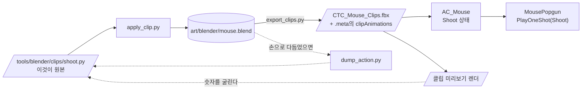

# 쥐 사격 클립 구현 계획

> **For agentic workers:** REQUIRED SUB-SKILL: Use superpowers:subagent-driven-development (recommended) or superpowers:executing-plans to implement this plan task-by-task. Steps use checkbox (`- [ ]`) syntax for tracking.

**Goal:** 쥐가 쏠 때 물어뜯는 `Attack` 대신 **새로 만든 `Shoot`** 이 나가게 한다 — 이 프로젝트의 **첫 신규 애니메이션 클립**.

**Architecture:** 포즈를 파이썬으로 짜 넣고, 오프스크린 렌더로 보면서 각도를 굴린다. 완성되면 그 스크립트가 곧 원본이라 `.blend`를 잃어도 재생성된다. 기존 19클립이 안 깨졌는지는 이미 있는 자(`Probe Clip Parity`)가 판정한다.

**Tech Stack:** Blender 5.2.1 LTS (`bpy`, 헤드리스) · Unity 6000.5.2f1 (Generic rig) · NUnit EditMode

**설계 문서:** [2026-09-12-mouse-shoot-clip-design.md](../specs/2026-09-12-mouse-shoot-clip-design.md)
**전제:** [블렌더 파이프라인](2026-09-12-blender-animation-pipeline.md)이 초록이다.

---

## 설계에서 바뀐 것 하나 — 순서가 뒤집힌다

설계 §5는 **「손으로 포즈 → 스크립트로 굽기」**로 적었다. 그쪽이 사람에게는 맞다.
**하지만 이 계획은 자동화로 실행되고, 에이전트는 블렌더 GUI를 못 쓴다.**

그래서 **스크립트로 먼저 넣고, 렌더를 보며 숫자를 굴린다.** 되먹임은 설계가 말한 것과
같다 — `Tools/CTC/Dev/클립 미리보기 렌더`가 그 자리다.

| | |
|---|---|
| 잃는 것 | 뷰포트에서 잡는 손맛. 첫 결과가 뻣뻣할 수 있다 |
| 얻는 것 | **처음부터 숫자가 원본**이다. 덤프 단계가 필요 없다 |
| 나중에 | 사람이 `.blend`를 열어 손으로 다듬어도 된다. 그때 `dump_action.py`로 다시 숫자로 굽는다 |

**`dump_action.py`는 그래서 여전히 만든다**(Task 1) — 손 작업을 숫자로 되돌리는 길을
열어 두는 것이고, 동시에 **「스크립트가 낳은 커브 == 블렌더 안의 커브」**를 검증하는 자다.

---

## 사전 지식 (이 프로젝트를 모르는 사람용)

| | |
|---|---|
| 리그 | **Generic**. 유니티가 뼈를 **경로 문자열**로 찾는다(`Rig/root/body`). 이름이 한 글자만 어긋나도 **에러 없이** 커브가 죽는다 |
| 뼈 11개 | `root · body · head · ear.L · ear.R · leg.F.L · leg.F.R · leg.B.L · leg.B.R · tail.01 · tail.02` — **팔이 없다.** 앞다리가 손이다 |
| 예산 | 팩 클립 20개가 전부 **10프레임 / 24fps** |
| 블렌더 | **5.2.1 LTS** — `C:/Program Files/Blender Foundation/Blender 5.2/blender.exe` |
| 블렌더 5.x 액션 API | `action.fcurves`가 **없다**. `action.layers[].strips[].channelbag(slot).fcurves`로 간다 |
| 작업 파일 | `art/blender/mouse.blend` — **`Assets/` 밖**. 액션 19개가 들어 있고 이름은 접두 없이 `Walk` 등 |
| 코딩 규칙 | `m_` 멤버 · `_` 매개변수 · public 필드 금지 · 상수 `UPPER_SNAKE_CASE` · **Unity 객체는 `if (x != null)`**(`?.`·`??` 금지) |
| 로그 | 에디터에서 `GameDebug.Log`는 **아무것도 안 찍는다**. 에디터 코드는 `Debug.Log` |

### 경로 주의

git 저장소 루트는 `C:/GitFork/The-Cheese-Thief-and-the-Cat/`, 유니티 프로젝트는 그 밑 `CTC/`.
셸 명령은 **저장소 루트 기준**, `Assets/...`는 프로젝트 기준이다.

### 물리면 안 되는 함정 (전부 에러가 안 난다)

| | |
|---|---|
| 블렌더 `-P` 스크립트의 비-`SystemExit` 예외 | **종료 코드 0**으로 끝난다. `main()`을 감싸 `SystemExit`로 올리고, **출력이 아니라 `echo $?`로 판정** |
| 씬 조작 | `u_editor_scene`·MCP 프리팹 생성·`u_play`·씬 오브젝트 조작은 **씬을 자동 저장**한다. 이름 없는 씬이면 파일 대화상자가 에디터를 멈춘다. **안전한 것만 쓴다: `u_editor_asset(refresh)` · `u_editor_menu` · `u_console` · `u_screenshot`** |
| `LoadAllAssetsAtPath` | `__preview__` 복제 클립까지 준다. 이름을 훑으면 걸러야 한다 |
| MCP 브리지 타임아웃 | 도메인 리로드 후 재시작 실패다. **`Assets/Scripts/` 밑 파일을 건드려 리로드를 유도**하고 ~20초 기다린다. `focus-unity.ps1`만으론 안 된다. **유니티 프로세스를 절대 죽이지 않는다** |
| `.blend`·FBX 바이트 | 같은 입력에도 **매번 달라진다**(타임스탬프). `git diff`로 판정하지 말고 **자로 판정한다** |

---

## 파일 구조

| 파일 | 책임 |
|---|---|
| `tools/blender/dump_action.py` (신규) | 액션 하나의 커브를 **파이썬 스크립트로** 뱉는다. 손 작업을 숫자로 되돌리는 길 |
| `tools/blender/clips/shoot.py` (신규) | `Shoot` 액션을 **만든다**. 이 클립의 원본이다 |
| `tools/blender/apply_clip.py` (신규) | `clips/*.py` 하나를 `.blend`에 적용하고 저장한다. 공통 진입점 |
| `art/blender/mouse.blend` (수정) | 액션 20개가 된다 |
| `CTC/Assets/Animations/Pets/CTC_Mouse_Clips.fbx` (+`.meta`) (수정) | 클립 20개 |
| `CTC/Assets/Quirky Series/.../Animations/AC_Mouse.controller` (수정) | `Shoot` 상태 추가 |
| `CTC/Assets/Scripts/Player/AnimationStateLogic.cs` (수정) | 상수 + `All` |
| `CTC/Assets/Scripts/Combat/MousePopgun.cs:186` (수정) | `Attack` → `Shoot` |
| `CTC/Assets/Scripts/Tests/EditMode/AnimationStateLogicTests.cs` (수정) | 철자 고정 |
| `CTC/Assets/Scripts/Tests/EditMode/ClipParityProbeTests.cs` (수정) | `Shoot` 존재·이름 검사 |

---

## Task 1: 덤프 도구 — 그리고 그것으로 자기 자신을 검증한다

**Files:**
- Create: `tools/blender/dump_action.py`

- [ ] **Step 1: 스크립트를 쓴다**

`tools/blender/dump_action.py`:

```python
"""액션 하나의 커브를 다시 실행 가능한 파이썬으로 뱉는다.

usage:
  blender -b <file.blend> -P tools/blender/dump_action.py -- <액션이름> <out.py>

왜 필요한가: .blend는 바이너리라 diff가 안 된다. 사람이 뷰포트에서 손으로 다듬은 뒤
이걸로 숫자를 다시 구우면 git에 남고 명령 한 줄로 재생성된다.

블렌더 5.x는 action.fcurves가 없다 - 커브가 layers/strips/channelbag 밑으로 내려갔다.
"""
import bpy
import os
import sys


def args_after_dashdash():
    if "--" not in sys.argv:
        raise SystemExit("usage: ... -P dump_action.py -- <action> <out.py>")
    return sys.argv[sys.argv.index("--") + 1:]


def fcurves_of(_action):
    """블렌더 5.x의 레이어드 액션에서 F커브를 전부 끌어낸다. 4.x 배치도 받아 준다."""
    direct = getattr(_action, "fcurves", None)
    if direct is not None and len(direct) > 0:
        return list(direct)

    out = []
    for layer in getattr(_action, "layers", []):
        for strip in getattr(layer, "strips", []):
            for slot in _action.slots:
                bag = strip.channelbag(slot)
                if bag is None:
                    continue
                out.extend(bag.fcurves)
    return out


def main():
    argv = args_after_dashdash()
    if len(argv) != 2:
        raise SystemExit("usage: ... -P dump_action.py -- <action> <out.py>")

    name, out_path = argv[0], os.path.abspath(argv[1])

    action = bpy.data.actions.get(name)
    if action is None:
        have = sorted(a.name for a in bpy.data.actions)
        raise SystemExit(f"액션 '{name}'이 없다. 있는 것: {have}")

    curves = fcurves_of(action)
    if not curves:
        raise SystemExit(f"액션 '{name}'에 커브가 0개다 - 덤프가 잘못됐다")

    lines = [
        '"""%s - dump_action.py가 만든 것. 손으로 고치지 마라."""' % name,
        "",
        "NAME = %r" % name,
        "",
        "# (data_path, array_index, [(frame, value), ...])",
        "CURVES = [",
    ]
    for fc in sorted(curves, key=lambda c: (c.data_path, c.array_index)):
        pts = [(round(k.co[0], 6), round(k.co[1], 6)) for k in fc.keyframe_points]
        lines.append("    (%r, %d, %r)," % (fc.data_path, fc.array_index, pts))
    lines.append("]")
    lines.append("")

    os.makedirs(os.path.dirname(out_path), exist_ok=True)
    with open(out_path, "w", encoding="utf-8", newline="\n") as f:
        f.write("\n".join(lines))

    print(f"DUMPED {name} curves={len(curves)} -> {out_path}")


if __name__ == "__main__":
    # 블렌더는 -P 스크립트에서 SystemExit 말고는 종료 코드를 안 남긴다.
    # 트레이스백은 찍히는데 0으로 끝나서 자동화가 실패를 성공으로 읽는다.
    try:
        main()
    except SystemExit:
        raise
    except Exception as e:
        raise SystemExit(f"예기치 못한 오류: {e}") from e
```

- [ ] **Step 2: 돌려서 커브 수를 확인한다**

저장소 루트에서:

```bash
"/c/Program Files/Blender Foundation/Blender 5.2/blender.exe" -b art/blender/mouse.blend \
  -P tools/blender/dump_action.py -- Walk /tmp/walk_dump.py
echo "exit=$?"
```

기대: `DUMPED Walk curves=119 -> ...` · `exit=0`

**119가 맞다**(유니티에서는 120인데, 아마추어 오브젝트가 블렌더에서는 오일러 3채널이고
FBX를 거치며 쿼터니언 4채널로 정규화된다 — 이미 확인된 사실이다). 숫자가 다르면 멈추고 보고한다.

- [ ] **Step 3: 덤프가 원본과 같은지 잰다 — 이게 이 Task의 요점이다**

임시 검증 스크립트를 **스크래치 디렉터리에** 쓴다(커밋하지 않는다). 덤프를 읽어 들여
**블렌더 안의 원본 커브와 숫자로 대조**한다:

```python
# scratch/verify_dump.py
import bpy, importlib.util, os, sys

argv = sys.argv[sys.argv.index("--") + 1:]
dump_path, action_name = os.path.abspath(argv[0]), argv[1]

spec = importlib.util.spec_from_file_location("dump", dump_path)
dump = importlib.util.module_from_spec(spec)
spec.loader.exec_module(dump)

sys.path.insert(0, os.path.join(os.path.dirname(__file__)))
from dump_action import fcurves_of  # 같은 디렉터리에 복사해 두고 부른다

action = bpy.data.actions[action_name]
live = {(c.data_path, c.array_index): [(round(k.co[0], 6), round(k.co[1], 6))
                                       for k in c.keyframe_points]
        for c in fcurves_of(action)}
dumped = {(p, i): pts for (p, i, pts) in dump.CURVES}

assert set(live) == set(dumped), f"커브 집합이 다르다: {set(live) ^ set(dumped)}"
worst = 0.0
for key in live:
    a, b = live[key], dumped[key]
    assert len(a) == len(b), f"{key}: 키 수가 다르다 {len(a)} vs {len(b)}"
    for (fa, va), (fb, vb) in zip(a, b):
        assert abs(fa - fb) < 1e-6, f"{key}: 프레임이 다르다 {fa} vs {fb}"
        worst = max(worst, abs(va - vb))
print(f"DUMP-MATCHES curves={len(live)} worst_delta={worst:.8f}")
```

돌린다:

```bash
"/c/Program Files/Blender Foundation/Blender 5.2/blender.exe" -b art/blender/mouse.blend \
  -P <스크래치>/verify_dump.py -- /tmp/walk_dump.py Walk
echo "exit=$?"
```

기대: `DUMP-MATCHES curves=119 worst_delta=0.00000000` · `exit=0`

- [ ] **Step 4: 자를 일부러 부러뜨린다 (뮤테이션)**

`dump_action.py`의 `round(k.co[1], 6)`을 `round(k.co[1], 0)`으로 바꾼다. 덤프를 다시 만들고
Step 3을 다시 돌린다.

기대: `worst_delta`가 0이 아니게 되거나 assert가 터진다. **그대로 0이면 검증이 아무것도
안 재고 있다** — 멈추고 원인을 찾는다. 확인했으면 `6`으로 되돌린다.

- [ ] **Step 5: 커밋**

```bash
git add tools/blender/dump_action.py
git commit -m "feat(art): 액션 커브를 파이썬으로 덤프한다

.blend는 바이너리라 diff가 안 된다. 뷰포트에서 손으로 다듬은 뒤 이걸로 숫자를 다시
구우면 git에 남고 명령 한 줄로 재생성된다.

블렌더 5.x는 action.fcurves가 없다 - 커브가 layers/strips/channelbag 밑으로 내려갔다.
4.x 배치도 받게 해 뒀다.

팩 Walk를 덤프해 블렌더 안의 원본과 숫자로 대조했다: 커브 119개, 최대 오차 0.
소수 자리를 줄여 보고 그 대조가 실제로 깨지는 것까지 확인했다.

Co-Authored-By: Claude Opus 5 <noreply@anthropic.com>"
```

---

## Task 2: 적용 도구 + `Shoot` 포즈

**Files:**
- Create: `tools/blender/apply_clip.py`
- Create: `tools/blender/clips/shoot.py`
- Modify: `art/blender/mouse.blend`

- [ ] **Step 1: `clips/shoot.py`를 쓴다**

각도는 설계 §3의 표를 라디안으로 옮긴 것이다. **출발점이지 정답이 아니다** — Task 4에서 굴린다.

`tools/blender/clips/shoot.py`:

```python
"""Shoot - 쥐 사격. 이 파일이 이 클립의 원본이다.

네발 짐승이라 팔이 없다. 쏘려면 뒷다리로 서고 앞다리를 손처럼 쓴다.
root와 뒷다리는 건드리지 않는다 - 발이 미끄러져 보인다.
1프레임과 11프레임이 같은 포즈여야 원샷이 끝나고 이동 상태로 돌아갈 때 안 튄다.

각도는 설계 문서(2026-09-12-mouse-shoot-clip-design.md) 3절의 출발값이고,
미리보기 렌더를 보며 굴린 결과다.
"""
from math import radians

NAME = "Shoot"

# 블렌더는 1부터 센다. 팩 액션 19개가 전부 프레임 1~11이고, 유니티 메타는 그걸
# firstFrame 0 / lastFrame 10으로 받는다 - 1프레임 어긋나면 클립이 밀리거나 잘린다.
# 2026-09-12 실측: 팩 Walk의 키가 1.0~11.0이다.
FRAME_START = 1
FRAME_END = 11

# 뼈마다 (프레임, X각도) - 전부 뼈 로컬 X축 회전이다.
# 음수가 「뒤로 젖힘」(일어섬), 양수가 「앞으로 숙임」.
POSES = {
    "body":     [(1, 0.0), (3, -25.0), (5, -35.0), (7, -20.0), (11, 0.0)],
    "leg.F.L":  [(1, 0.0), (3, -45.0), (5, -70.0), (7, -25.0), (11, 0.0)],
    "leg.F.R":  [(1, 0.0), (3, -45.0), (5, -70.0), (7, -25.0), (11, 0.0)],
    "head":     [(1, 0.0), (3,  -8.0), (5, -18.0), (7,  -5.0), (11, 0.0)],
    "tail.01":  [(1, 0.0), (3,  18.0), (5,  30.0), (7,  12.0), (11, 0.0)],
    "tail.02":  [(1, 0.0), (3,  12.0), (5,  20.0), (7,   8.0), (11, 0.0)],
}


def build(_armature_object):
    """포즈 본을 프레임마다 세우고 키를 찍는다. apply_clip.py가 부른다.

    **rotation_mode을 건드리지 않는다.** 그건 액션이 아니라 아마추어 본 자체의
    속성이라, 바꾸면 .blend에 저장되어 **다른 액션 19개의 베이크까지 깨진다**.
    2026-09-12에 실제로 그렇게 깨뜨렸고 Probe Clip Parity가 잡았다.
    """
    import bpy
    from math import cos, sin

    for bone_name in POSES:
        if _armature_object.pose.bones.get(bone_name) is None:
            raise SystemExit(f"포즈 본 '{bone_name}'이 없다 - 리그가 바뀌었다")

    for bone_name, frames in POSES.items():
        bone = _armature_object.pose.bones[bone_name]
        for frame, degrees in frames:
            bpy.context.scene.frame_set(frame)
            half = radians(degrees) * 0.5
            bone.rotation_quaternion = (cos(half), sin(half), 0.0, 0.0)  # (w, x, y, z)
            bone.keyframe_insert(data_path="rotation_quaternion", frame=frame)
```

- [ ] **Step 2: `apply_clip.py`를 쓴다**

`tools/blender/apply_clip.py`:

```python
"""clips/<이름>.py 하나를 .blend에 적용하고 저장한다.

usage:
  blender -b <file.blend> -P tools/blender/apply_clip.py -- <clips/x.py> <out.blend>

액션 이름은 접두 없이 둔다(`Shoot`). 내보낼 때 블렌더가 `Rig|Shoot`으로 바꿔 쓰고,
유니티 쪽 .meta의 clipAnimations가 그걸 다시 `Shoot`으로 맞춘다.
"""
import bpy
import importlib.util
import os
import sys

ARMATURE_NAME = "Rig"


def args_after_dashdash():
    if "--" not in sys.argv:
        raise SystemExit("usage: ... -P apply_clip.py -- <clips/x.py> <out.blend>")
    return sys.argv[sys.argv.index("--") + 1:]


def load_clip_module(_path):
    spec = importlib.util.spec_from_file_location("clipdef", _path)
    mod = importlib.util.module_from_spec(spec)
    spec.loader.exec_module(mod)
    for attr in ("NAME", "FRAME_START", "FRAME_END", "build"):
        if not hasattr(mod, attr):
            raise SystemExit(f"{_path}에 {attr}가 없다")
    return mod


def main():
    argv = args_after_dashdash()
    if len(argv) != 2:
        raise SystemExit("usage: ... -P apply_clip.py -- <clips/x.py> <out.blend>")

    clip_path, dst = os.path.abspath(argv[0]), os.path.abspath(argv[1])
    if not os.path.isfile(clip_path):
        raise SystemExit(f"클립 정의가 없다: {clip_path}")

    mod = load_clip_module(clip_path)

    arm = bpy.data.objects.get(ARMATURE_NAME)
    if arm is None:
        raise SystemExit(f"아마추어 '{ARMATURE_NAME}'이 없다 - 이 이름이 곧 유니티 경로다")

    # 같은 이름이 이미 있으면 지우고 새로 만든다 - 굴릴 때마다 덧쌓이면 안 된다.
    old = bpy.data.actions.get(mod.NAME)
    if old is not None:
        bpy.data.actions.remove(old)

    bpy.context.view_layer.objects.active = arm
    bpy.ops.object.mode_set(mode="POSE")

    if arm.animation_data is None:
        arm.animation_data_create()
    action = bpy.data.actions.new(mod.NAME)
    action.use_fake_user = True          # 쓰는 데가 없어도 저장될 때 살아남는다
    arm.animation_data.action = action

    bpy.context.scene.frame_start = mod.FRAME_START
    bpy.context.scene.frame_end = mod.FRAME_END

    mod.build(arm)

    bpy.ops.object.mode_set(mode="OBJECT")

    got = bpy.data.actions.get(mod.NAME)
    if got is None:
        raise SystemExit(f"'{mod.NAME}' 액션이 안 만들어졌다")

    # 클립 정의가 rotation_mode를 건드리면 그 순간 다른 액션 19개의 베이크가 깨진다.
    # 액션이 아니라 아마추어의 속성이라서다 - 저장되면 전부에 걸린다(2026-09-12 실측).
    bad = [b.name for b in arm.pose.bones if b.rotation_mode != "QUATERNION"]
    if bad:
        raise SystemExit(
            f"포즈 본의 rotation_mode가 바뀌었다: {bad}
"
            "클립 정의는 rotation_mode를 건드리면 안 된다 - "
            "rotation_quaternion으로 키를 찍어라."
        )

    print(f"APPLIED {mod.NAME} frames={mod.FRAME_START}..{mod.FRAME_END}")
    print(f"ACTIONS {sorted(a.name for a in bpy.data.actions)}")

    bpy.ops.wm.save_as_mainfile(filepath=dst)
    print(f"SAVED {dst}")


if __name__ == "__main__":
    # 블렌더는 SystemExit 말고는 종료 코드를 안 남긴다 - 실패가 성공으로 보인다.
    try:
        main()
    except SystemExit:
        raise
    except Exception as e:
        raise SystemExit(f"예기치 못한 오류: {e}") from e
```

- [ ] **Step 3: 적용한다**

```bash
"/c/Program Files/Blender Foundation/Blender 5.2/blender.exe" -b art/blender/mouse.blend \
  -P tools/blender/apply_clip.py -- tools/blender/clips/shoot.py art/blender/mouse.blend
echo "exit=$?"
```

기대: `APPLIED Shoot frames=1..11` · `ACTIONS [... 20개, 'Shoot' 포함 ...]` · `SAVED ...` · `exit=0`

**액션이 20개여야 한다.** 19개면 기존 것을 덮어썼거나 새 것이 저장되지 않은 것이다.

### ⚠️ rotation_mode를 절대 건드리지 않는다 (2026-09-12 실측)

초안은 `bone.rotation_mode = "XYZ"` 후 `rotation_euler`로 키를 찍게 돼 있었다.
**그게 기존 액션 19개를 통째로 깼다.**

`rotation_mode`는 **액션이 아니라 아마추어 본 자체의 속성**이다. 바꾸면 `.blend`에 저장되고,
그 뒤로 블렌더가 `Walk`를 구울 때 **쿼터니언 커브를 무시하고 오일러(0,0,0)를 읽는다.**

```
[값 어긋남] 16건
  Rig/root/body/leg.F.L:m_LocalRotation.y[0]: 0.21644 vs 0.00000
  Rig/root/body/leg.F.L:m_LocalRotation.z[0]: 0.97630 vs 1.00000   ← 항등 쿼터니언
```

어긋난 뼈 6개가 `POSES`의 키와 **정확히 일치**했다. `apply_clip.py`에 가드를 넣었다.

**Task 3의 「기존 19개부터 잰다」가 이걸 잡았다.** 그 단계가 없었으면 사격만 보고 넘어갔다.

- [ ] **Step 4: 실패하면 — 진단표**

| 증상 | 원인 | 조치 |
|---|---|---|
| `포즈 본 'body'가 없다` | 리그가 바뀌었거나 `.blend`가 잘못된 것 | `import_pack.py`를 다시 돌려 `.blend`를 재생성 |
| `ACTIONS`가 19개 | `use_fake_user`가 안 걸려 저장 시 버려졌다 | 그 줄을 확인한다 |
| `mode_set` 에러 | 오브젝트 모드가 아니거나 활성 오브젝트가 없다 | `view_layer.objects.active` 설정 순서를 본다 |
| 키가 0개 | `frame_set`을 안 불러 같은 프레임에 덮어썼다 | `build()` 안 루프를 본다 |

- [ ] **Step 5: 커밋**

```bash
git add tools/blender/apply_clip.py tools/blender/clips/shoot.py art/blender/mouse.blend
git commit -m "feat(art): Shoot 액션 - 쥐 사격 포즈 다섯

이 프로젝트의 첫 신규 애니메이션이다. 「모션 0」이 여기서 깨진다.

네발 짐승이라 팔이 없어서, 쏘려면 뒷다리로 서고 앞다리를 손처럼 쓴다. body가 뒤로
젖혀지며 일어서고 4프레임에서 반동으로 더 젖혀졌다가 돌아온다. root와 뒷다리는
안 건드린다 - 발이 미끄러져 보인다. 0프레임과 10프레임이 같은 포즈라 원샷이 끝나고
이동 상태로 돌아갈 때 안 튄다.

각도는 아직 출발값이다. 렌더를 보며 굴린다.

clips/*.py가 원본이고 apply_clip.py가 .blend에 적용한다. .blend는 바이너리라
diff가 안 되므로 숫자 쪽을 원본으로 삼는다.

Co-Authored-By: Claude Opus 5 <noreply@anthropic.com>"
```

---

## Task 3: 내보내고 — 기존 19클립이 안 깨졌는지부터 본다

**Files:**
- Modify: `CTC/Assets/Animations/Pets/CTC_Mouse_Clips.fbx`
- Modify: `CTC/Assets/Animations/Pets/CTC_Mouse_Clips.fbx.meta`

- [ ] **Step 1: 내보낸다**

```bash
"/c/Program Files/Blender Foundation/Blender 5.2/blender.exe" -b art/blender/mouse.blend \
  -P tools/blender/export_clips.py -- "CTC/Assets/Animations/Pets/CTC_Mouse_Clips.fbx"
echo "exit=$?"
```

기대: `EXPORTED ...` · `exit=0`

- [ ] **Step 2: `.meta`에 `Shoot` 블록을 더한다**

`CTC/Assets/Animations/Pets/CTC_Mouse_Clips.fbx.meta`의 `clipAnimations` 배열 **끝**에 아래를
그대로 더한다. 기존 19블록은 **건드리지 않는다**.

```yaml
    - serializedVersion: 16
      name: Shoot
      takeName: Rig|Shoot
      internalID: 0
      firstFrame: 0
      lastFrame: 10
      wrapMode: 0
      orientationOffsetY: 0
      level: 0
      cycleOffset: 0
      loop: 0
      hasAdditiveReferencePose: 0
      loopTime: 0
      loopBlend: 0
      loopBlendOrientation: 0
      loopBlendPositionY: 0
      loopBlendPositionXZ: 0
      keepOriginalOrientation: 0
      keepOriginalPositionY: 1
      keepOriginalPositionXZ: 0
      heightFromFeet: 0
      mirror: 0
      bodyMask: 01000000010000000100000001000000010000000100000001000000010000000100000001000000010000000100000001000000
      curves: []
      events: []
      transformMask: []
      maskType: 3
      maskSource: {instanceID: 0}
      additiveReferencePoseFrame: 0
```

**`loopTime: 0`이 기존 19개와 다른 유일한 값이다** — 사격은 반복이 아니라 한 번 도는
원샷이다. 나머지는 `Walk` 블록과 같다.

- [ ] **Step 3: 유니티가 읽게 하고 기존 19개를 잰다**

`u_editor_asset(action: "refresh")` → `u_editor_menu(menuPath: "Tools/CTC/Dev/Probe Clip Parity")` → `u_console`

기대: **`[ClipParityProbe] 같다`**

이 자는 `Walk`를 본다. **클립을 하나 더하면서 있던 것을 안 깼다**는 뜻이다.
`다르다`가 나오면 멈추고 보고서 첫 절을 읽는다 — 값이 아니라 **키 집합**이 먼저다.

- [ ] **Step 4: `Shoot`이 이름 그대로 들어왔는지 본다**

`u_editor_menu`로 EditMode를 돌리기 전에, 빠르게 메타를 눈으로 확인한다:

```bash
grep -c "takeName: Rig|" CTC/Assets/Animations/Pets/CTC_Mouse_Clips.fbx.meta
```

기대: `20`

- [ ] **Step 5: 커밋**

```bash
git add CTC/Assets/Animations/Pets/CTC_Mouse_Clips.fbx \
        CTC/Assets/Animations/Pets/CTC_Mouse_Clips.fbx.meta
git commit -m "feat(art): Shoot 클립을 FBX에 싣는다 - 기존 19개는 그대로

클립이 20개가 됐다. .meta의 clipAnimations에 블록을 하나 더했다 - takeName은
Rig|Shoot이다. 블렌더가 테이크 이름을 {오브젝트}|{액션}으로 강제해서다.

loopTime만 기존 19개와 다르다(0). 사격은 반복이 아니라 한 번 도는 원샷이다.

더하고 나서 Probe Clip Parity로 Walk를 다시 쟀다: 같다. 클립을 더하면서 있던 것을
안 깼다는 뜻이다.

Co-Authored-By: Claude Opus 5 <noreply@anthropic.com>"
```

---

## Task 4: 눈으로 보고 각도를 굴린다

**Files:**
- Modify: `tools/blender/clips/shoot.py` (각도만)

이 Task에는 커밋이 여러 번 있을 수 있다. **숫자를 고칠 때마다 Task 2 Step 3 → Task 3 Step 1 →
아래 Step 1을 한 바퀴 돈다.**

- [ ] **Step 1: 렌더한다**

`u_editor_menu(menuPath: "Tools/CTC/Dev/클립 미리보기 렌더")` → `u_console`로 PNG 경로를 읽는다.

그 도구는 지금 `Walk`를 팩/왕복 두 벌로 그린다. **`Shoot`도 그리도록 고친다** —
`Assets/Scripts/Editor/ClipPreviewRender.cs`에서 대상 클립 목록에 `Shoot`을 더한다
(왕복 FBX 쪽에만 있으므로 팩 쪽은 건너뛰게 한다).

- [ ] **Step 2: 본다**

PNG를 **Read 도구로 직접 열어** 본다. 볼 것:

| | 아니면 |
|---|---|
| 쥐가 **뒷다리로 서는가** | `body` 각도를 키운다 |
| 앞다리가 **손처럼 앞으로** 나오는가 | `leg.F.*`를 키운다 |
| 4프레임에 **반동이 보이는가** | 2와 4의 차이를 벌린다 |
| 1과 11이 **같아 보이는가** | 둘 다 0도여야 한다 |
| 발이 **미끄러지지 않는가** | `root`·뒷다리를 건드렸는지 본다 |
| 팩 클립들과 **톤이 맞는가** | 과장을 키우거나 줄인다 |

- [ ] **Step 3: 굴린다**

`clips/shoot.py`의 `POSES` 숫자만 고친다. **구조는 안 바꾼다.** 고쳤으면 Task 2 Step 3부터
다시 돈다.

- [ ] **Step 4: 사람에게 보여준다**

만족스러워 보이면 **거기서 멈추고 사용자에게 PNG를 보낸다.** 톤이 맞는지는 사람이 판정한다 —
이 프로젝트에서 눈으로만 잡힌 결함이 이미 다섯이다.

- [ ] **Step 5: 커밋**

```bash
git add tools/blender/clips/shoot.py art/blender/mouse.blend \
        CTC/Assets/Animations/Pets/CTC_Mouse_Clips.fbx \
        CTC/Assets/Scripts/Editor/ClipPreviewRender.cs
git commit -m "tune(art): Shoot 각도를 렌더 보며 굴렸다

숫자만 바뀌었다. 구조는 그대로다.

Co-Authored-By: Claude Opus 5 <noreply@anthropic.com>"
```

---

## Task 5: 게임에 물린다

**Files:**
- Modify: `CTC/Assets/Quirky Series/Ultimate Pack Vol.1/Mega Pack Vol.1/Pets Vol.1/Animations/AC_Mouse.controller`
- Modify: `CTC/Assets/Scripts/Player/AnimationStateLogic.cs`
- Modify: `CTC/Assets/Scripts/Combat/MousePopgun.cs`
- Modify: `CTC/Assets/Scripts/Tests/EditMode/AnimationStateLogicTests.cs`

- [ ] **Step 1: 실패하는 테스트를 먼저 쓴다**

`AnimationStateLogicTests.cs`의 `OneShotStateNames_MatchPackSpelling` 바로 아래에 더한다:

```csharp
        // ===== 신규 클립 (2026-09-12, 「모션 0」을 깬 첫 작업) =====
        //
        // Shoot은 팩이 준 것이 아니라 우리가 만든 것이다. 그래서 팩 컨트롤러에 **우리가**
        // 상태를 넣어야 하고, 넣는 것을 잊으면 CrossFadeInFixedTime이 조용히 아무 일도
        // 안 한다 — 화면에서 「원샷이 안 나온다」로만 보인다.

        [Test]
        public void ShootStateName_IsExactlyShoot()
        {
            Assert.AreEqual("Shoot", AnimationStateLogic.Shoot);
        }

        [Test]
        public void Shoot_ExistsInMouseController()
        {
            AssertStatesExist("AC_Mouse.controller", new[] { AnimationStateLogic.Shoot });
        }

        /// <summary>
        /// 고양이는 쏘지 않는다. `AC_Cat`에 `Shoot`을 넣으면 쓰지도 않는 상태가 남아
        /// 「왜 있지」를 다음 사람이 묻게 된다.
        /// </summary>
        [Test]
        public void Shoot_IsNotInCatController()
        {
            string path = Path.Combine(Application.dataPath, CONTROLLER_DIR, "AC_Cat.controller");
            if (!File.Exists(path)) Assert.Ignore($"컨트롤러 원본이 없다: {path}");

            foreach (string line in File.ReadAllLines(path))
            {
                Assert.AreNotEqual("m_Name: " + AnimationStateLogic.Shoot, line.Trim(),
                    "AC_Cat에 Shoot이 들어갔다 — 고양이는 쏘지 않는다");
            }
        }
```

- [ ] **Step 2: 실패를 확인한다**

`u_editor_menu(menuPath: "Tools/CTC/Run EditMode Tests")` → `u_console`

기대: **컴파일 에러** — `AnimationStateLogic.Shoot`이 없다.

- [ ] **Step 3: 상수를 더한다**

`AnimationStateLogic.cs`에서, `Eat` 상수 바로 아래에:

```csharp
        /// <summary>
        /// 사격 — **우리가 만든 첫 클립**이다(2026-09-12). 팩이 준 것이 아니라
        /// `tools/blender/clips/shoot.py`가 원본이다.
        /// </summary>
        public const string Shoot = "Shoot";
```

그리고 `All` 배열을 이렇게 바꾼다:

```csharp
        public static readonly string[] All =
        {
            Idle, Walk, Run, Attack, Hit, Roll, Bounce, Jump, Spin, Clicked, Eat, Shoot,
        };
```

**`All`에 안 넣으면** `PlayerAnimationDriver.PlayingState`가 `Shoot`을 `?해시`로 읽어,
QA가 「원샷이 안 걸렸다」로 오독한다. 기존 테스트
`All_ContainsEveryDeclaredStateConstant`가 그걸 잡는다.

- [ ] **Step 4: 컨트롤러에 상태를 더한다**

`AC_Mouse.controller`는 파라미터 없이 상태만 있는 구조다. 기존 `Attack` 상태 블록과 같은
형식으로 `Shoot` 상태를 더하고, 새 FBX의 `Shoot` 클립을 `m_Motion`으로 가리킨다.

**여기만 정확한 YAML을 미리 못 적는다** — 클립의 `fileID`는 FBX를 다시 구울 때마다
달라져서, Task 3을 돌리기 전에는 값이 존재하지 않는다. 그래서 절차를 적는다.

필요한 값 셋을 먼저 캔다(`unity-scanner`가 아니라 `Read`/`Grep` — YAML 정밀 수정이다):

```bash
# 1) Shoot 클립의 fileID
grep -A 1 "Shoot" CTC/Assets/Animations/Pets/CTC_Mouse_Clips.fbx.meta | grep -B 1 "Shoot"
grep -n "internalIDToNameTable" -A 60 CTC/Assets/Animations/Pets/CTC_Mouse_Clips.fbx.meta | grep -B 2 "Shoot"

# 2) FBX의 guid
grep -n "^guid:" CTC/Assets/Animations/Pets/CTC_Mouse_Clips.fbx.meta

# 3) 본뜰 형식 — 기존 Attack 상태 블록 전체
grep -n "m_Name: Attack" -B 4 -A 25 \
  "CTC/Assets/Quirky Series/Ultimate Pack Vol.1/Mega Pack Vol.1/Pets Vol.1/Animations/AC_Mouse.controller"
```

그다음 두 군데를 고친다:

1. **새 `AnimatorState` 블록**을 파일 끝에 더한다 — `Attack` 블록을 그대로 베끼고
   `m_Name`을 `Shoot`으로, `m_Motion`을 `{fileID: <1의 값>, guid: <2의 값>, type: 3}`으로,
   그리고 **`--- !u!1102 &<새 앵커>`의 앵커 번호를 파일에 없는 값으로** 바꾼다.
2. **Base 레이어의 `m_ChildStates` 배열**에 그 앵커를 가리키는 항목을 더한다.
   `Attack`이 어떻게 들어가 있는지 보고 같은 형식으로 넣는다.

**앵커 번호가 겹치면 유니티가 조용히 상태 하나를 잃는다.** 넣기 전에
`grep -c "&<번호>" <controller>`로 0인지 확인한다.

**손으로 고친 뒤 반드시 Step 5를 돌려 확인한다.** `Shoot_ExistsInMouseController`가
그걸 보라고 있는 것이고, YAML을 틀리면 유니티는 에러 없이 컨트롤러를 못 읽는다.

- [ ] **Step 5: 통과를 확인한다**

`u_editor_asset(action: "refresh")` → `Tools/CTC/Run EditMode Tests` → `u_console`

기대: 신규 3개 PASS, 기존 785개도 초록 → **788**

- [ ] **Step 6: 호출부를 바꾼다**

`CTC/Assets/Scripts/Combat/MousePopgun.cs:186`:

```csharp
                driver.PlayOneShot(Player.AnimationStateLogic.Shoot, ATTACK_ANIM_SECONDS);
```

같은 파일 171행의 상수 이름도 뜻에 맞게 바꾼다:

```csharp
        private const float SHOOT_ANIM_SECONDS = 0.4f;
```

그리고 186행이 그 이름을 쓰게 한다. **값은 안 바꾼다** — 클립 길이가 0.4167초라 0.4초와
거의 같고, 바꿔야 한다면 Task 6에서 재고 바꾼다.

- [ ] **Step 7: 다시 돌린다**

`Tools/CTC/Run EditMode Tests` → **788** 유지.

- [ ] **Step 8: 커밋**

```bash
git add "CTC/Assets/Quirky Series/Ultimate Pack Vol.1/Mega Pack Vol.1/Pets Vol.1/Animations/AC_Mouse.controller" \
        CTC/Assets/Scripts/Player/AnimationStateLogic.cs \
        CTC/Assets/Scripts/Combat/MousePopgun.cs \
        CTC/Assets/Scripts/Tests/EditMode/AnimationStateLogicTests.cs
git commit -m "feat(anim): 쥐가 쏠 때 Shoot이 나간다 - 물어뜯던 Attack 대신

좌클릭이라 한 판에 수십 번 보이는 동작인데 지금까지 무는 모션이 나갔다.

상수를 반드시 거친다. CrossFadeInFixedTime은 없는 상태 이름을 받아도 에러도 경고도
내지 않고 아무 일도 안 하기 때문이다 - 문자열을 호출부에 흘리면 오타가 조용히 죽은
원샷이 된다. All 배열에도 넣었다. 빠지면 PlayingState가 ?해시로 읽어 QA가 「안 걸렸다」로
오독한다.

AC_Cat에는 안 넣는다. 고양이는 쏘지 않는다 - 쓰지도 않는 상태가 남으면 다음 사람이
왜 있는지 묻게 된다. 테스트가 그걸 막는다.

Co-Authored-By: Claude Opus 5 <noreply@anthropic.com>"
```

---

## Task 6: 「돌고 있다」를 확인한다 — 「시켰다」가 아니라

**Files:**
- Modify: `CTC/Assets/Scripts/Tests/EditMode/ClipParityProbeTests.cs`

- [ ] **Step 1: FBX 쪽 회귀 테스트를 더한다**

`ClipParityProbeTests.cs`에, 기존 `RealClips` 헬퍼를 재사용해서:

```csharp
        /// <summary>
        /// `Shoot`은 우리가 만든 클립이라 팩에 없다. **이름이 `Rig|Shoot`으로 새지 않았는지**가
        /// 요점이다 — `.meta`의 `clipAnimations`는 손으로 쓴 것이라, 메타가 새로 생성되면
        /// 매핑이 사라지고 조용히 되돌아간다.
        /// </summary>
        [Test]
        public void RoundTrippedFbx_HasShootNamedPlainly()
        {
            List<AnimationClip> clips = RealClips(ROUNDTRIP_FBX);
            if (clips.Count == 0) Assert.Ignore($"아직 내보내지 않았다: {ROUNDTRIP_FBX}");

            bool found = false;
            foreach (AnimationClip c in clips)
            {
                if (c.name == "Shoot") { found = true; break; }
            }

            Assert.IsTrue(found,
                $"'Shoot' 클립이 없다(실제: {string.Join(", ", clips.ConvertAll(c => c.name))})");
        }

        /// <summary>사격은 반복이 아니다 — 한 번 돌고 끝나야 한다.</summary>
        [Test]
        public void Shoot_DoesNotLoop()
        {
            AnimationClip shoot = ClipParityProbe.FindClip(ROUNDTRIP_FBX, "Shoot");
            if (shoot == null) Assert.Ignore($"아직 내보내지 않았다: {ROUNDTRIP_FBX}");

            Assert.IsFalse(shoot.isLooping, "Shoot이 반복으로 잡혔다 — .meta의 loopTime을 0으로");
        }

        /// <summary>팩 예산은 0~10프레임이다. 새 클립도 같은 예산을 지킨다.</summary>
        [Test]
        public void Shoot_IsWithinTenFrames()
        {
            AnimationClip shoot = ClipParityProbe.FindClip(ROUNDTRIP_FBX, "Shoot");
            if (shoot == null) Assert.Ignore($"아직 내보내지 않았다: {ROUNDTRIP_FBX}");

            Assert.LessOrEqual(shoot.length * shoot.frameRate, 10.5f,
                $"{shoot.length * shoot.frameRate:F1}프레임이다 — 팩 톤에서 벗어난다");
        }
```

- [ ] **Step 2: 돌린다**

`Tools/CTC/Run EditMode Tests` → **791** (788 + 3). 셋 다 PASS이고 **Ignore가 아니어야 한다**.

- [ ] **Step 3: 한 개를 일부러 부러뜨린다 (뮤테이션)**

`.meta`의 `Shoot` 블록에서 `loopTime: 0`을 `1`로 바꾸고 `u_editor_asset(refresh)` 후 돌린다.

기대: `Shoot_DoesNotLoop`만 **FAIL**. 되돌리고 791을 다시 확인한다.

- [ ] **Step 4: 커밋**

```bash
git add CTC/Assets/Scripts/Tests/EditMode/ClipParityProbeTests.cs
git commit -m "test(anim): Shoot을 회귀로 못 박는다 - 이름·반복·예산

이름이 요점이다. .meta의 clipAnimations는 손으로 쓴 것이라 메타가 새로 생성되면
매핑이 사라지고 클립이 조용히 Rig|Shoot으로 되돌아간다.

loopTime을 1로 돌려 보고 그 테스트만 빨개지는 것까지 확인했다.

Co-Authored-By: Claude Opus 5 <noreply@anthropic.com>"
```

---

## Task 7: 문서

**Files:**
- Modify: `CTC/docs/design-vault/코드 다이어그램.md`
- Modify: `CTC/docs/design-vault/게임 기획서.md`
- Modify: `CTC/.claude/handoff-active.md`

- [ ] **Step 1: 코드 다이어그램 (규칙 8)**

「블렌더 애니메이션 파이프라인」 절에 **클립을 만드는 쪽**을 더한다:



- [ ] **Step 2: 기획서 §13 제약표**

「새 모션 0」 줄을 고친다 — 이제 사실이 아니다:

```markdown
| ~~새 모션 0~~ | **2026-09-12에 깼다.** 블렌더 파이프라인을 세우고 `Shoot`(쥐 사격)을 만들었다. 여전히 **싸게** 만든다 — 팩과 같은 10프레임 예산, 뼈 11개 |
```

§14 「지금 미해결」의 계획 2c 줄은 **지운다**(끝났다).

- [ ] **Step 3: 핸드오프**

「블렌더 애니메이션 파이프라인」 절에 한 줄 더한다 — 이제 **새 클립이 1개**이고,
「모션 0」이 깨졌고, 다음 후보는 대시·끈끈이·요새·광분이라는 것.

- [ ] **Step 4: 전체를 돌린다**

```bash
cd CTC && python -m pytest tools/wesqa -q
```
기대: `141 passed`

`Tools/CTC/Run EditMode Tests` → **791**

- [ ] **Step 5: 커밋**

```bash
git add "CTC/docs/design-vault/코드 다이어그램.md" \
        "CTC/docs/design-vault/게임 기획서.md" \
        CTC/.claude/handoff-active.md
git commit -m "docs: 「모션 0」이 깨졌다 - 첫 신규 클립 Shoot

기획서 §13의 제약표를 고쳤다. 이제 사실이 아니라서다. 다만 싸게 만든다는 정신은
그대로다 - 팩과 같은 10프레임 예산에 뼈 11개다.

§14의 계획 2c는 지웠다. 끝났다.

Co-Authored-By: Claude Opus 5 <noreply@anthropic.com>"
```

---

## 완료 기준

| | |
|---|---|
| 쏘면 `PlayingState`가 `Shoot` | **「시켰다」가 아니라 「돌고 있다」** |
| `Probe Clip Parity`가 여전히 `같다` | 클립을 더하면서 기존 19개를 안 깼다 |
| EditMode **791** · pytest **141** | |
| 렌더 5프레임이 의도대로 | 수치가 맞는데 눈이 이상하면 재는 방법이 틀린 것 |
| `apply_clip.py`로 재생성하면 같은 결과 | 숫자가 원본이다 |
| `AC_Cat` 무변경 | 고양이는 쏘지 않는다 |

---

## 범위 밖

| | |
|---|---|
| 티어별 다른 동작 | **기각** — 「저 쥐가 어느 티어인가」는 없던 정보다 (설계 §2) |
| 상체 마스크 | 설계 §4의 전환 조건이 성립하면 |
| 대시·끈끈이·요새·광분 | 사격 하나로 검증한 뒤 |
| 고양이 클립 | 쥐가 뚫리면 같은 절차 |
| 사운드 | 이미 있다 |
