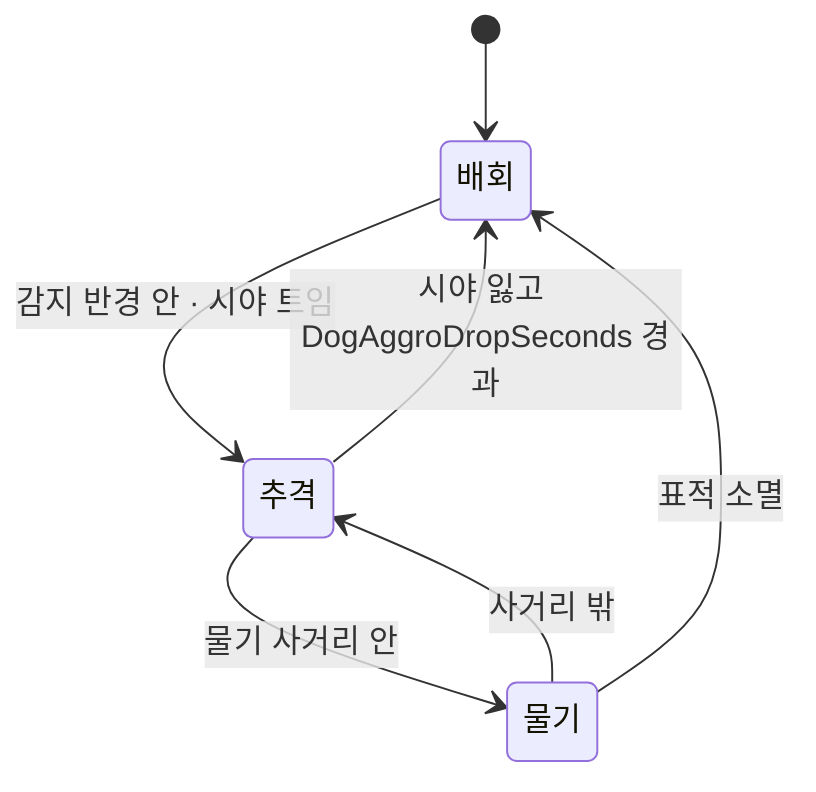

# 제3세력 강아지 — 설계

> v3.8 확장 5항목 중 **5번**. 2번(벽감)이 만든 봉인 장치에 들어가는 두 번째 페이로드다.
> 작성 2026-08-09 · 기준 코드 `5555da9`
> 관련: [벽감 + 즉시 치즈](2026-08-09-breakable-alcove-design.md) · [쥐 감옥](2026-08-09-mouse-jail-design.md)

---

## 왜 만드는가

지금 판은 **한 번 기울면 안 돌아온다.** 고양이가 쥐를 둘 가두면 남은 쥐는 파밍도 구출도
못 하고, 반대로 쥐가 기관총 두 정을 갖추면 고양이는 접근 자체가 안 된다.

강아지는 **지는 쪽이 판을 흔들 수 있는 유일한 손잡이**다. 다만 이기는 쪽이 써도 되고,
푼 사람도 문다 — 그래서 "쓰면 이기는 카드"가 아니라 **무리수**다.

---

## 확정한 설계 결정

### 1. 언제든 부술 수 있다 — 대신 벽이 단단하다

시간 게이트("후반에만")나 열세 판정("지는 쪽만")을 두지 않는다.

게이트를 두면 규칙을 새로 배워야 하고, 열세 판정은 **화면에 안 보인다** — "왜 안 부숴지지"가 된다.
대신 `DogAlcoveHp`를 치즈 벽감보다 훨씬 높게 둔다. 부수는 동안 오래 걸리고 크게 소리 나므로
**여유 있는 쪽은 그 시간을 쓸 이유가 없고, 지는 쪽만 감수한다.** 기회비용이 게이트를 대신한다.

### 2. `Health`를 가진 것은 전부 문다 — 벽감만 빼고

`CatPounce`는 이미 씬의 `Health`를 전부 훑어 때린다
([CatPounce.cs:60](../../../Assets/Scripts/Combat/CatPounce.cs#L60)). 강아지도 **같은 판별면**을 쓴다.
새 개념이 0이고, 요새·미끼가 자동으로 표적이 된다.

**벽감만 제외한다.** 강아지가 치즈 벽을 열면 "강아지를 풀어 파밍한다"가 성립해
무리수가 파밍 도구로 뒤집힌다.

| 표적 | 이유 |
|---|---|
| 쥐 · 고양이 | 판을 흔드는 본체. **푼 사람도 문다** |
| 요새 · 미끼 · 창고 | 쥐의 투자를 날린다 = 진짜 판 뒤집기. 미끼로 강아지를 꾈 여지도 생긴다 |
| ~~벽감~~ | 제외 — 파밍 도구가 되면 안 된다 |
| ~~다른 강아지~~ | 제외 — 판에 하나뿐이지만 방어적으로 막는다 |

### 3. 피해는 **역할별로 따로** 준다

쥐 HP 100, 고양이 HP 1000이다. 한 값으로 물면 한쪽만 죽는다.

`DogBiteDamageCat` · `DogBiteDamageMouse` 두 컬럼을 둔다. 판정 규칙은 한 줄이다 —
**`RoleTag.Cat`이면 Cat 값, 아니면 Mouse 값.** 구조물은 `RoleTag.Mouse`라 Mouse 값을 받는다.

비율(최대 HP의 n%)로 하지 않는 이유: 이 프로젝트의 밸런스는 전부 CSV의 절댓값이고,
비율은 요새처럼 HP 축이 다른 대상에서 엉뚱한 값이 된다.

### 4. 시간 제한 없음 — **쓰러뜨려야 끝난다**

강아지는 스스로 사라지지 않는다. `DogHp`가 사실상 이 기능의 난이도 노브다.

이게 만드는 것: 강아지가 양쪽을 다 물기 때문에 **고양이와 쥐가 잠깐 같은 편이 된다.**
일시 휴전은 이 게임에 없던 상태고, "판을 복잡하게"의 실체가 여기다.

이게 만드는 위험: 아무도 안 잡으면 후반이 강아지 판이 된다. 밸런스 단계 관측 항목.

### 5. 처치해도 **장난기를 주지 않는다**

`CatPounce`는 `!IsPlayerObject`인 대상에 장난기를 준다. 강아지에 `BountyExempt`를 안 붙이면
"강아지 때리기가 최고 수입"이 되어 v3.5의 실패("벽 때리기가 최고 효율")가 되살아난다.
장난기의 축은 **쥐의 방어 지출 = 고양이 수입**이고, 강아지는 쥐가 쓴 돈이 아니다.

### 6. NavMesh를 쓰지 않는다 — 레이아웃이 곧 그래프다

맵은 **방 사각형 + 복도 선분** 목록이다([MapData.cs](../../../Assets/Scripts/Map/MapData.cs)).
여기서 웨이포인트 그래프를 그대로 뽑는다.

| 그래프 | 규칙 |
|---|---|
| 노드 | 방 중심 + 복도 양 끝점 (근접 중복 제거) |
| 간선 | 복도 선분의 두 끝점 / 방 안에 있는 끝점 ↔ 그 방 중심 |
| 경로 | 다익스트라 — 순수 함수라 EditMode가 덮는다 |

NavMesh는 굽기 단계를 요구하는데, 이 프로젝트의 지형은 **런타임에 레이아웃에서 짓는다**
(`MapBuilder`). 매치마다 굽는 건 성립하지 않는다.

> **한계를 명시한다.** 그래프는 방향만 준다. 정확한 회피는 `CharacterController`의
> 물리 충돌이 맡는다 — 복도 폭이 있고 첫·마지막 구간은 같은 방/복도 안이라 실용상 충분하다.

### 7. 안에 강아지가 있다는 건 **소리로 샌다**

벽감 스펙이 예약해 둔 규칙을 여기서 채운다 — 강아지 벽은 낑낑거리고 긁는 소리를 흘리고,
치즈 벽은 조용하다. `DogAlcoveIdleSoundMeters`는 짧게 둔다(가까이 가야 안다).

---

## 고쳐야 하는 기존 코드

### 치즈 총량이 강아지 벽감까지 센다 (버그)

```csharp
// MapBuilder.cs:314 · MapDirector.cs:82
CheeseSpotLogic.ReservePerSpot(spots, AlcoveLogic.TotalCheese(layout.Alcoves.Count));
```

`Alcoves.Count`는 페이로드를 안 본다. 강아지 벽감이 생기면 그 몫(150)이 지점에서 빠지는데
**아무도 그 치즈를 못 받는다** — 맵 총량 4900이 4750으로 새고 고갈이 빨라진다.

`AlcoveLogic.CountCheese(placements)`를 추가해 **치즈 벽감만** 센다.

---

## 컴포넌트 (기능 1개 = 컴포넌트 1개)

| 이름 | 역할 | 종류 |
|---|---|---|
| `Map/NavGraphLogic` | 레이아웃 → 그래프, 경로 탐색 | 순수 (EditMode) |
| `Ai/DogAiLogic` | 표적 선정 · 상태 전이 · 역할별 피해 | 순수 (EditMode) |
| `Ai/DogBrain` | 서버가 도는 상태기 — 표적·경로·재탐색 | NetworkBehaviour |
| `Ai/DogMover` | 경로 폴리라인 주행 (`CC.Move`) | MonoBehaviour |
| `Ai/DogBite` | 물기 — 쿨다운 · 사거리 · 피해 적용 | MonoBehaviour |
| `Ai/DogBark` | 배회 중 주기적 짖음 | MonoBehaviour |
| `Map/AlcoveIdleSound` | 벽 안에서 새는 소리(강아지 벽만) | MonoBehaviour |
| `Map/Alcove` | `AlcovePayload.Dog` 분기 채우기 | 기존 수정 |
| `Map/AlcoveLogic` | `CountCheese` 추가 | 기존 수정 |

강아지 프리팹은 `Editor/Setup/DogPrefabFactory`가 만든다 — `Health` · `RoleTag(None)` ·
`BountyExempt` · `HitFeedback` · `NetworkObject` · `CharacterController` + 위 컴포넌트.

> `RoleTag`는 **`None`**으로 둔다. 어느 쪽도 아닌 제3세력이라는 게 이 기능의 전부다.
> (`CountAlive`는 `IsPlayerObject`로 거르므로 강아지는 승패 판정에 애초에 안 낀다.)

### 8. 무기의 표적 규칙을 "제 진영만 아니면 때린다"로 바꾼다

전에는 무기마다 진영을 박아 뒀다 — 덮치기는 `RoleId.Mouse`만, 팝건은 `RoleId.Cat`만.
**그 상태로 제3세력을 넣으면 양쪽 다 강아지를 못 때린다.** 시간 제한 없이 "쓰러뜨려야 끝나는"
설계인데 아무도 못 죽이는 것이다.

`CombatLogic.CanAttack(attacker, target) => attacker != target` 하나로 모은다.
`RoleId.None`은 누구의 진영도 아니라 자동으로 양쪽의 표적이 되고, 요새·미끼·창고·벽감이
`RoleId.Mouse`라 고양이만 부수는 규칙은 그대로다.

> 이건 설계 단계에서 놓쳤고 `qa_v40`이 잡았다(덮치기 400→400). Model 값이 아니라
> **실제 HP가 줄었는지**를 본 항목이라 걸렸다.

## 상태기



배회는 그래프에서 이웃 노드를 골라 걷는다. 무작위는 **서버가 매치 시드로 굴린다** —
클라마다 다르면 안 되고, QA 재현성도 여기서 나온다.

## CSV (BalanceInfo)

| 컬럼 | 뜻 |
|---|---|
| `DogAlcoveHp` | 강아지 벽감 HP (치즈 벽감보다 훨씬 높다 — 기회비용이 게이트다) |
| `DogHp` | 강아지 HP. **이 기능의 난이도 노브** |
| `DogMoveSpeed` | 이동 속도 |
| `DogDetectRadius` | 표적을 잡는 반경 |
| `DogAggroDropSeconds` | 시야를 잃고 이만큼 지나면 표적을 놓는다 |
| `DogRepathSeconds` | 경로 재탐색 주기 |
| `DogBiteRangeMeters` · `DogBiteCooldown` | 물기 사거리·쿨다운 |
| `DogBiteDamageCat` · `DogBiteDamageMouse` | 역할별 피해 |
| `DogBarkIntervalSeconds` · `DogBarkSoundMeters` | 배회 짖음 주기·도달 거리 |
| `DogAlcoveIdleSoundMeters` | 벽 안 소리가 새는 거리 (짧게) |

## 배치

`AlcoveFactory`가 벽감을 계획할 때 **맵 중심에 가장 가까운 하나**를 `Dog`로 바꾼다.
중심은 양쪽이 다 지나는 자리라 랜드마크가 되고, 규칙이 한 줄이라 읽기 쉽다.
벽감이 0개인 맵에는 강아지가 없다.

## 리소스

| 종류 | 조달 |
|---|---|
| 3D · 애니메이션 | 확보됨 — `Quirky Series/.../Pets Vol.1/Models/Dog_LOD0.fbx` + `AC_Dog.controller` |
| SFX 4종 | ElevenLabs — 벽 안 낑낑·긁기(루프) · 짖음 · 물기 · 쓰러짐 |

루프 소스에는 **`AudioVolumeFollower`를 반드시 붙인다** — 안 붙이면 배경음 슬라이더가
그 소리에만 안 먹는다(2026-08-09에 실제로 밟은 함정).

## 검증

**EditMode**
- `NavGraphLogicTests` — 노드 생성·중복 제거 · 연결성 · 경로 연속성 · 경로 없음
- `DogAiLogicTests` — 가장 가까운 표적 · 벽감/자기 제외 · 어그로 유지와 해제 · 역할별 피해
- `AlcoveLogicTests` — **치즈 총량이 강아지 벽감을 안 센다**(신규)

**wesqa `qa_v40`** (호스트=고양이 · 3인)
1. 맵에 강아지 벽감이 하나 있다
2. 부수면 강아지가 스폰된다
3. 강아지가 가까운 플레이어에게 다가온다(거리 감소)
4. 물리면 쥐 HP가 준다
5. 물려 쓰러진 쥐는 **감옥으로 간다**(기존 경로)
6. 강아지를 쏘면 HP가 줄고, 0이 되면 사라진다
7. **강아지를 때려도 장난기가 안 오른다**

## 밸런스 관측 (구현 후)

| 관측할 것 | 기대 | 어긋나면 |
|---|---|---|
| 판당 강아지 개방 횟수 | 3판에 1번쯤 | 매판이면 `DogAlcoveHp`↑ / 0이면 ↓ |
| 개방 후 처치까지 | 40~60초 | 안 죽으면 `DogHp`↓ |
| 강아지에게 죽은 고양이 | 드물게 | 잦으면 `DogBiteDamageCat`↓ — **쥐가 이기는 지름길이 되면 안 된다** |
| 푼 쪽이 이긴 비율 | 절반 근처 | 크게 높으면 무리수가 아니라 정석이다 |
