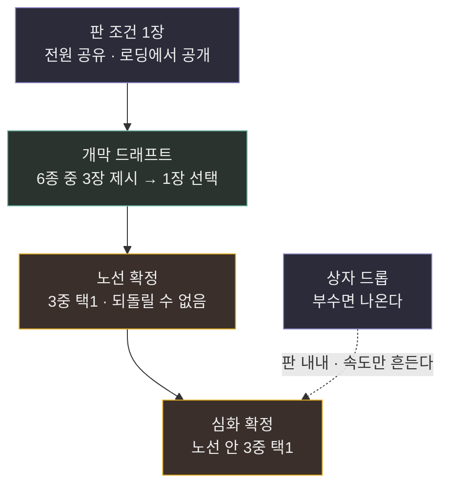
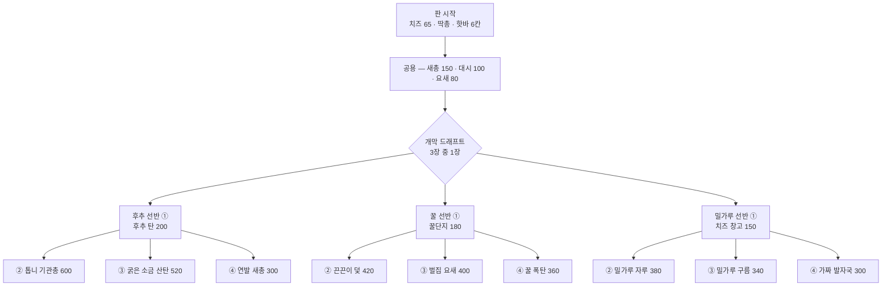

# 기획서 — 2시간을 버티는 빌드 다양성 (배타성 + 확률)

> 발단: 사용자 지시 2026-09-04 — *"스팀은 2시간 안에 환불할 수 있다. 그 2시간 동안 계속 새로운 빌드를 쌓아 나갈 수 있을 만한 양이어야 한다."*
> 추가 지시 — *"배타성도 넣고 확률도 넣자. 게임이 무조건 유저의 의도에 따라 움직이지 않게끔."*
> 기준 문서: [[기획안 - 빌드 심화 v1]] · [[v3.9 확장 로드맵]] · `docs/superpowers/plans/2026-08-31-build-depth-rollout.md`
> 실사 수치 원본: `Assets/Resources/CSVInfo/{ShopInfo,BalanceInfo,WeaponInfo}.csv` (2026-09-04)
> **상태: 초안.** 수치는 전부 조정 대상이며, 구조 결정만 확정을 목표로 한다.

---

## 0. 진단 — 숫자부터

### 0-1. 환불 창은 몇 판인가

| 값 | 근거 |
|---|---|
| 한 판 15:00 | `MatchDurationSeconds` 900 |
| 판당 실소요 17분 | 로비·역할선택·결과 2분 가정 |
| **2시간 = 7판** | 120 ÷ 17 |
| 그중 쥐 **5.6판** / 고양이 **1.4판** | 역할 비율 2:8 |

**고양이 자리는 20%다.** 같은 카탈로그라도 쥐 쪽이 4배 빨리 소모된다 — 고양이 콘텐츠는 쥐보다 적어도 된다(사용자 판단, 숫자로 확인됨).

### 0-2. 지금 몇 가지를 해 볼 수 있는가

**세는 단위는 「잎」** — 판을 끝까지 치렀을 때 나오는 최종 형태 하나. 아이템 개수가 아니다.

| 상태 | 쥐 | 고양이 | 왜 |
|---|---|---|---|
| **현행(빌드된 것)** | **1** | **1** | 배타성이 한 줄도 없다. 쥐 6항목(새총·기관총·대시·요새·창고·후추탄)을 다 살 수 있어 **빌드가 아니라 구매 순서**다. 고양이는 스택 2줄뿐이고 전직은 조건 1050(≈9킬)이라 15분 판에서 안 열린다 |
| 기획안 v1 전개 후 | 6 | 6 | 노선 3 × 노선 내 택1 2 |
| **필요분** | **5.6** | **1.4** | 판마다 새 빌드 기준 |

**결론 두 줄**
- 고양이 6은 필요분의 4배 — **더 늘리지 않는다.**
- 쥐 6은 여유 0.4판 — **모자란다.** 여기만 손본다.

---

## 1. 이 기획의 한 줄과 원칙

> **뼈대는 내가 고르고, 배경은 판이 고른다.**

확률을 넣되 **패배의 책임이 주사위로 넘어가지 않는 자리**에만 넣는다. 그 경계를 두 개의 불변 원칙으로 못박는다.

| # | 불변 원칙 | 이유 |
|---|---|---|
| **INV-1** | **확률은 노선·택1(=뼈대)을 절대 정하지 않는다.** 무엇을 살 수 있는지는 언제나 100% 내 선택이다 | "하고 싶은 걸 못 하게 막는 확률"은 대전 게임에서 재미가 아니라 불만이다 |
| **INV-2** | **판을 흔드는 확률은 시작 전에 전원에게 공개된다.** 숨은 주사위는 없다 | 공개된 무작위는 *조건*이고, 숨은 무작위는 *사고*다. 조건은 그 판의 빌드 선택을 바꾸므로 **확률이 오히려 선택을 만든다** |

INV-2의 실질: "오늘은 바닥이 삐걱댄다"를 로딩에서 알면, 발소리가 1.5배 퍼지니 은폐 노선으로 간다. **무작위가 배타적 선택의 이유가 된다** — 두 축이 서로를 먹여 살리는 구조다.

---

## 2. 네 개의 층

| 층 | 결정 주체 | 판마다 다른가 | 승패에 직결 |
|---|---|---|---|
| **판 조건** | 순수 확률 (공개) | ✅ | 전원 동일 조건이라 유불리 없음 |
| **개막 드래프트** | 확률이 후보를 주고 **내가 고른다** | ✅ | 소모품급 — 초반 40초 정도의 차이 |
| **노선 · 심화** | **100% 내 선택** | 내가 바꿔야 다르다 | 직결. 그래서 확률 금지(INV-1) |
| **상자 드롭** | 순수 확률 | ✅ | 자금·소모품만. 뼈대는 안 나온다 |

---

## 3. 쥐 — 잎 6 → 9 (배타성 축)

노선을 늘리지 않고 **노선 안의 택1을 2중 → 3중으로 넓힌다.** 신규 선반보다 리소스가 싸고, 선반 정체성이 흐려지지 않는다.

### 3-1. 트리

### 3-2. 신규 3항목 (선반당 세 번째 선택지)

기존 ②③이 **「고비용 지속」 vs 「근접·즉발」** 축이었다면, 신규 ④는 전부 **「저비용 — 남은 돈을 다른 데 쓴다」** 축이다. 세 번째 선택지가 같은 축의 복제가 되지 않게 하는 장치다.

| 선반 | ④ | 값 | 효과 | 왜 이게 세 번째인가 | 난이도 |
|---|---|---|---|---|---|
| 후추 | **연발 새총** | 300 | 새총 쿨 0.8 → **0.35**, 사거리 10 → **14m** (`WeaponInfo` Tier 4 신규 행) | 기관총(600)·산탄(520)보다 300 싸다. 남은 220으로 요새를 두 번 더 산다 → **화력 노선인데 잘 안 죽는 형태** | 재사용(무기 티어 행 추가) |
| 꿀 | **꿀 폭탄** | 360 | 던져서 착탄 반경 3.5m에 즉시 장판 6초 (쿨 12초, 소모 아님) | 덫=매복 설치, 벌집=방어. 폭탄은 **원거리 즉발** — 설치할 시간이 없는 난전용 | 신규 코드(꿀단지 로직 + 투척 궤적) |
| 밀가루 | **가짜 발자국** | 300 | 15초간 내 뒤에 흰 발자국이 남는다. **코 노선 고양이의 잔향과 겹쳐 보인다**(구분 불가) · 내 창고 소리 −50% | 자루=경제, 구름=팀 지원. 발자국은 **대(對)추적 개인 생존** | 신규 코드(잔향 표시 재사용) |

- ②③④는 **전부 택1.** 하나를 사면 나머지 둘은 그 판에 영영 못 산다.
- **잎 = 3 노선 × 3 택1 = 9** (필요분 5.6판 대비 여유 3.4판)

---

## 4. 고양이 — 잎 6 유지 (의도적 동결)

§0-1 때문이다. 한 사람이 2시간에 고양이를 1.4판 잡는다 → 6잎은 이미 **4배 여유**다. 여기에 콘텐츠를 더 넣으면 만들자마자 안 보이는 것이 된다.

| 항목 | 결정 |
|---|---|
| 코·수염·발톱 3노선 × ②③ 택1 = 6잎 | 기획안 v1 그대로 |
| 세 번째 선택지(④) | **넣지 않는다** |
| 대신 얻는 다양성 | 고양이 2인 **같은 노선 금지**(v1 P9) → 대진 C(3,2) = **3가지**. 내 잎 6 × 대진 3 = 체감 18 |

> 이 동결은 밸런스 판단이 아니라 **인원 비율에 따른 투자 배분**이다. 2:8이 바뀌면 이 결정을 다시 연다.

---

## 5. 개막 드래프트 (확률 + 선택)

기획안 v1의 개막 카드 3종(각 60치즈)을 **6종 풀에서 3장을 뽑아 1장 고르는 드래프트**로 바꾼다.

| 항목 | v1 | **이 기획서** |
|---|---|---|
| 풀 | 3종 고정 | **6종**, 매 판 3장 무작위 제시 |
| 값 | 각 60 (시작 65) | **무료** — 대신 반드시 1장 고른다 |
| 시점 | 상점에서 알아서 | 판 시작 카운트다운 중 카드 3장 UI |

**무료로 바꾼 이유**: 60을 받으면 "안 사고 노선에 40초 빨리 도달"이 거의 항상 옳은 답이 된다 — 선택이 아니라 함정이다. 무료로 만들면 개막이 **매 판 반드시 발생하는 무작위 변주**가 된다.

### 5-1. 쥐 개막 풀 (6종)

| 카드 | 효과 | 난이도 |
|---|---|---|
| 후추 한 꼬집 | 다음 5발에 지속피해(초당 2 · 3초) | 후추 탄 로직 축소판 |
| 꿀 한 방울 | 반경 1.5m · 5초 소형 장판 1회 | 꿀단지 축소판 |
| 밀가루 한 줌 | 15초간 발소리·파밍 소리 반경 절반 | `FootstepLogic` 배율 |
| **낡은 새총** | 새총(150)을 즉시 무료 지급 | 재사용 |
| **빈 상자** | 요새 1개 무료 지급 | 재사용 |
| **부스러기** | 치즈 +80 (노선 ①에 즉시 도달) | 재사용 |

### 5-2. 고양이 개막 풀 (4종 중 2장 제시)

고양이는 인원이 적으니 풀도 작게 — **4종 중 2장.**

| 카드 | 효과 |
|---|---|
| 갈아둔 발톱 | 발톱 갈기 1스택 무료 (120) |
| 몸 푼 다리 | 발 구르기 1스택 무료 (90) |
| 배고픔 | 장난기 +100 |
| 첫 사냥 | 첫 덮치기 피해 +100% (1회) |

---

## 6. 판 조건 — 「오늘의 팬트리」 (순수 확률 · 공개)

판 시작에 **1장**을 뽑아 로딩 화면과 HUD 상단에 이름을 띄운다. 전원이 같은 조건이므로 진영 유불리가 아니라 **그 판의 성격**이다.

| # | 이름 | 효과 | 누가 웃는가 | 구현 |
|---|---|---|---|---|
| 1 | **삐걱대는 바닥** | 전원 발소리 반경 ×1.5 | 코 고양이 / 밀가루 쥐 | `FootstepLogic` 배율 |
| 2 | **개가 두 마리** | 개 스폰 2 | 제3세력에 밀리는 쪽이 손해 | 스폰 수 |
| 3 | **개가 자는 날** | 개 스폰 0 | 양쪽 다 편해진다 | 스폰 수 |
| 4 | **풍년** | 벽감 치즈 +50% · 벽감 HP −30% | 초반 러시 빌드 | `AlcoveCheese`·`AlcoveHp` |
| 5 | **흉년** | 벽감 치즈 −30% · 창고 수입 +40% | 밀가루(경제) 쥐 | `AlcoveCheese`·`WarehouseIncome` |
| 6 | **상자 더미** | 상자 스폰 ×2 | 발톱 고양이 / 운 좋은 쥐 | 스폰 수 |

- 전부 **기존 시스템의 배율 한두 개**다. 신규 메커니즘 0, 신규 리소스 0(아이콘 6종만).
- **조명을 흔드는 카드는 넣지 않는다**(사용자 결정 2026-09-04) — 「밤의 팬트리」는 항상 밤이고 「빛 = 위험」이 아트의 고정 원칙이라, 밝기를 판마다 바꾸면 그 원칙이 흔들린다.
- 6종은 시작값이다. 나중에 늘리는 비용이 가장 싼 층이므로 **콘텐츠 부족의 첫 번째 완충재**로 쓴다.

---

## 7. 상자 드롭 (순수 확률 · 이미 있음)

`BoxDropCount`로 이미 굴러간다. 이 기획서가 정하는 것은 **무엇이 나와도 되는가**의 경계뿐이다.

| 나와도 되는 것 | 절대 안 나오는 것 |
|---|---|
| 치즈 | **노선 ① · 심화 ②③④** — INV-1 위반 |
| 개막 카드와 같은 급의 1회용 소모품 | 노선 잠금을 푸는 어떤 것 |
| 직업권(v3.9 기존) | 다른 진영의 항목 |

> 상자는 **속도를 흔든다**(노선 ①에 20초 일찍 도달). **방향은 안 흔든다.**

---

## 8. 검산 — 2시간이 버텨지는가

| | 쥐 | 고양이 |
|---|---|---|
| 필요 판 수 | 5.6 | 1.4 |
| 뼈대 잎 | **9** | 6 |
| × 판 조건 | ×6 | ×6 |
| × 개막 제시 조합 | ×20 (6C3) | ×6 (4C2) |
| **같은 뼈대가 반복될 확률** | 6판째까지 0에 가깝다 | 사실상 0 |

**보수적으로 판 조건·개막을 전부 빼고 뼈대만 세도 쥐 9 > 5.6, 고양이 6 > 1.4** — 두 층은 안전 여유가 아니라 *같은 뼈대를 두 번 골라도 다른 판이 되게* 하는 장치다. 이게 확률을 넣는 진짜 이유다.

---

## 9. 구현 영향

| 층 | 선행 | 새 CSV | 새 코드 | 새 리소스 |
|---|---|---|---|---|
| 노선 배타성(9잎) | **Phase 1(미착수)** — `ShopInfo`에 `Branch`·`ChoiceGroup` | 신규 3항목 컬럼 | 꿀 폭탄(투척) · 가짜 발자국 | 폭탄 메시 1 · 발자국 데칼 1 |
| 개막 드래프트 | 없음 | `OpenerPoolSize`·`OpenerDrawCount` | 드래프트 UI + 서버 추첨 RPC | 카드 아이콘 10 |
| 판 조건 | 없음 | `MatchConditionInfo.csv` 신규 표 | 배율 적용 + HUD 배너 | 아이콘 6 |
| 상자 경계 | 없음 | 드롭 테이블 컬럼 | 드롭 테이블 검증 | 0 |

**착수 순서 권고**: 판 조건 → 개막 드래프트 → 노선 배타성.
판 조건이 가장 싸고(배율만), 가장 먼저 "매 판이 다르다"를 만들며, **노선 배타성이 아직 없어도 단독으로 효과가 난다.**

---

## 10. 안티 골

- **뽑기로 강해지는 구조가 아니다.** 확률로 얻는 것은 배경과 20~40초의 속도뿐이다.
- **계정 진행도·이월이 아니다.** 판이 끝나면 전부 리셋([[매치 재시작]]).
- **핫바 칸을 늘리지 않는다.**
- **고양이 콘텐츠를 쥐와 대칭으로 맞추지 않는다.** 인원 비율이 다르므로 대칭이 오히려 낭비다.
- **판 조건을 숨기지 않는다.** 숨은 무작위는 INV-2 위반.

## 11. 미결

| # | 미결 | 정해야 할 때 |
|---|---|---|
| 1 | 판 조건이 3판 시리즈 안에서 매 판 바뀌는가, 시리즈 내내 고정인가 | 판 조건 구현 착수 전 |
| 2 | 개막 드래프트에서 같은 카드가 연속 판에 나오는 것을 막을 것인가(중복 방지 큐) | 드래프트 구현 시 |
| 3 | 신규 3항목의 값(300·360·300)은 기존 ②③보다 싸다는 관계만 확정 — 실수치는 봇 2v8로 잰다 | Phase 2 |
