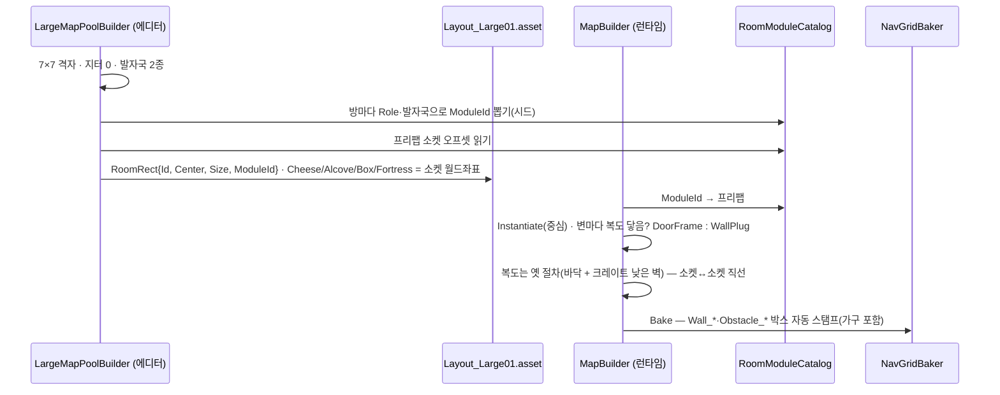

# 방 모듈 — 「레이아웃은 절차, 방은 손으로」 설계 (2026-09-07)

## 왜

2026-08-31 맵 아트(밤의 식료품 창고)는 **재질과 소품만 바꿨다.** 방·복도는 여전히 절차 큐브라
"텍스처 입힌 박스"로 보인다(2026-09-06 검수: 천장·기둥·문틀 없음 · 벽돌 스케일 붕괴 · 빈 선반 ·
평평한 빛 · 격자 바닥). 절차 박스 + 랜덤 소품은 상한이 낮다 — **디자인된 공간으로 안 보인다.**

벤치마크 R.E.P.O.(semiwork): 방은 **손으로 만든 모듈 프리팹**(Start·Normal·Passage·DeadEnd·Extraction),
조립은 격자에 모듈을 꽂고 이음새에 문(Connect)/막벽(Block) 프리팹을 자동 삽입. 소품·밸류어블은
모듈 안에 **손으로 박은 스폰 포인트**에 랜덤 채움. 맵 정체성은 랜드마크 모듈(안뜰·큰 홀)이 준다.

CTC는 이미 절반 와 있다 — 대형 맵은 7×7 격자에 방을 놓고 복도로 잇는다(`LargeMapPoolBuilder`).
빠진 건 **"방 = 프리팹"** 하나다.

## 확정 결정

| # | 결정 | 내용 |
|---|---|---|
| 1 | 범위 | **대형 맵(120×120, 7×7)만.** 기본·확장(개발용)은 옛 큐브 경로 그대로 — `RoomRect.ModuleId`가 비면 옛 길 |
| 2 | 레이아웃 두뇌 유지 | `MapGenerator`·`Layout_*.asset`·격자 A\*·`NavGridBlocker`·요새/치즈/벽감 **자료구조는 그대로.** 바뀌는 건 "방 하나를 어떻게 세우나"와 "방 안의 자리를 누가 정하나" |
| 3 | 발자국(footprint) 2종 | **큰방 12×11 · 작은방 10×9.** 지금의 4조합(10/12 × 9/11)을 2개로 줄인다 — 프리팹 수를 억제. 요새방·중앙 홀은 큰방 발자국 |
| 4 | 지터 0 | 방 중심 흔들기(`JITTER 0.75`)를 **모듈 맵에선 끈다.** 격자 티는 지터가 아니라 모듈 내부 차이로 지운다(REPO 방식). 지터가 있으면 문 소켓이 안 맞는다 |
| 5 | 문 소켓 | 모듈 4변 **한가운데**가 문 자리. 복도는 소켓↔소켓을 잇는다(지터 0이라 직선). 연결되면 `DoorFrame`, 아니면 `WallPlug` 프리팹을 그 자리에 꽂는다 |
| 6 | 소켓 = 자리의 주인 | 치즈·벽감·상자·요새·광원 자리는 **모듈 프리팹 안의 소켓 오브젝트**가 정한다. 계산(`c ± s·0.25`, `AlcoveSpotLogic`)은 모듈 맵에서 안 쓴다 |
| 7 | 큰 가구는 막힌다 | 선반·궤짝더미는 **실물 BoxCollider**(이름 `Obstacle_*`) — `NavGridBaker`가 이름으로 자동 스탬프하므로 봇도 우회한다. 작은 소품(견과·호박·바구니)은 트리거만(통과·페이드용) |
| 8 | 천장 없음 | 3인칭 스프링암 때문에 **천장은 안 덮는다.** 대신 5m 높이에 들보·서까래·상단 선반 테두리로 실루엣만 준다 |
| 9 | 조명 내장 | 모듈마다 `LightSocket` 1~2개에 앰버 포인트라이트(빛웅덩이 = 위험). 전역 달빛은 유지 |
| 10 | 제작 | **Poly Universal Pack 부품으로 에디터에서 손조립.** 셸(바닥·벽·기둥·문 소켓·자리 소켓)은 메뉴로 자동 생성, 가구·소품만 손으로 놓는다 |

## 모듈 구성

```
RoomModule_Big_Pantry01 (prefab, 발자국 12×11, 피벗 = 바닥 중심)
├─ Shell/                    ← 메뉴가 굽는다(손대지 않음)
│  ├─ Floor                  Floor_ 접두 → 격자 무시(장식 바닥)
│  ├─ Wall_N_L · Wall_N_R    문 소켓 양옆 벽(각 변 2조각) — 격자 스탬프
│  ├─ Wall_S_L … Wall_W_R
│  ├─ Pillar_NE … Pillar_SW  모서리 기둥(Obstacle_ 없음 — 벽 안에 든다)
│  └─ Rim                    5m 들보 테두리(콜라이더 없음)
├─ Doors/
│  ├─ DoorSocket_N (Transform, +z 변 중앙)   ← 빌더가 DoorFrame/WallPlug를 꽂는다
│  ├─ DoorSocket_S · DoorSocket_E · DoorSocket_W
├─ Sockets/                  ← 손으로 놓는다
│  ├─ CheeseSocket_0 (…_1)   치즈 지점 자리. 반경 2m 확보 책임은 배치자
│  ├─ AlcoveSocket_0         벽감 자리(벽 등지는 방향 = transform.forward)
│  ├─ BoxSocket_0            상자 자리
│  ├─ FortressSocket         요새방 모듈에만. yaw = 입구 방향
│  └─ LightSocket_0 (…_1)    포인트라이트 자리
└─ Furniture/                ← 손으로 놓는다
   ├─ shelf-wall-a (2×)       자식에 Obstacle_Shelf BoxCollider(실물) + 트리거 박스(페이드)
   ├─ crate-wood-big (…)     Obstacle_Crate
   └─ pumpkin / walnut …     트리거만
```

**RoomModuleCatalog** (ScriptableObject, `Assets/Prefabs/Maps/RoomModuleCatalog.asset`):

| 필드 | 뜻 |
|---|---|
| `Entries[]` | `{ ModuleId, Prefab, Footprint(Vector2), Role }` |
| `Role` | `Normal · Fortress · Center · Landmark` |
| `DoorFrame · WallPlug` | 이음새 프리팹 2종(발자국 무관, 복도 폭 3m 기준) |

프리팹 목록 v1(10개):

| 역할 | 발자국 | 수 | 예 |
|---|---|---|---|
| Normal | 큰방 | 3 | 선반 골목 · 궤짝 창고 · 작업대 방 |
| Normal | 작은방 | 3 | 자루 더미 · 배럴 저장고 · 빈 창고(어두움) |
| Fortress | 큰방 | 2 | 요새 자리 + 입구 앞 스폰 여유 1.8m 보장 |
| Center | 큰방 | 1 | 고양이 시작 홀 — 장애물 적고 넓다 |
| Landmark | 큰방 | 1 | 지하 계단실 or 큰 홀 — 맵당 1개, 방향감 |

## 조립 (전부 서버 = 빌드 시점 결정적)



- 소켓 선택 규칙은 순수 로직 `RoomModuleLogic`(EditMode):
  `PickModule(role, footprint, seed)` · `DoorSides(room, corridors)` · `SocketWorld(room, socketLocal)`.
- 치즈 등급 배분·요새 수·상자 수 규칙은 `MapGenerator` 그대로 — **자리 후보만** 소켓에서 온다.
  소켓이 모자란 방은 그 항목을 못 받는다(방당 치즈 ≤ 소켓 수).
- `MapDresser`는 모듈 방을 건너뛴다(가구는 모듈 몫). 복도 크레이트 타일링·배럴 교체는 유지.

## 바뀌는 코드

| 파일 | 무엇 |
|---|---|
| `MapData.cs` | `RoomRect.ModuleId` (string, 비면 옛 큐브) |
| **신규** `RoomModuleCatalog.cs` | 카탈로그 SO + `RoomModuleSocket`(소켓 종류 enum 마커 컴포넌트) |
| **신규** `RoomModuleLogic.cs` | 순수: 모듈 선택 · 문 변 판정 · 소켓 좌표 변환 |
| `LargeMapPoolBuilder.cs` | 지터 0 · 발자국 2종 · 모듈 배정 · 소켓 → 치즈/벽감/상자/요새 자리 |
| `MapBuilder.cs` | `BuildRoomWalls` 앞에 분기: `ModuleId`면 `BuildRoomModule` (Instantiate + 문/막벽) |
| `MapDresser.cs` | 모듈 방 벽 타일링 건너뜀 |
| `AlcoveSpotLogic` 호출부 | 모듈 맵이면 소켓 목록을 그대로 `Spot`으로 |
| **신규** `RoomModuleShellBuilder.cs` (Editor) | 메뉴 `Tools/CTC/Map/새 방 모듈 셸` — 발자국 고르면 Shell/Doors/Sockets 뼈대 프리팹 생성 |
| **신규** `PlacementAudit.cs` (Editor) | 메뉴 `Tools/CTC/Dev/맵 배치 검수` — 소켓이 가구와 겹침 · 문 앞 2m 막힘 · 치즈 반경 침범 · 통로 잔여 폭 < 0.8m를 `%TEMP%\ctc-placement.txt`로 |
| `코드 다이어그램.md` | 맵 아트 절에 모듈 파이프라인(규칙 8) |

## 검증

| 층 | 방법 | 통과 기준 |
|---|---|---|
| 순수 | EditMode — `RoomModuleLogic` (선택 결정성 · 문 변 · 소켓 변환) | 신규 6~8건 통과, 기존 404 유지 |
| 배치 | `맵 배치 검수` 메뉴 | 위반 0 |
| 길찾기 | BotLab 3판 `TestGetNavStats` | giveups 0 · stuck < 5/판 · 봇 고양이가 방 가구를 우회 |
| 실플레이 | wesqa v36·v37·v38 | 전부 통과 |
| 시각 | 포토부스 4장 | 사용자 검수 |

## 단계

| 단계 | 산출 | 판정 |
|---|---|---|
| 1 | 셸 생성 메뉴 + 카탈로그 + `RoomModuleLogic` + MapBuilder 분기. **모듈 1개(큰방 Pantry01)**만 손조립. 대형 맵 전 방에 그 하나를 꽂아 BotLab 화면 확인 | "박스"가 아니라 "방"으로 보이는가 — 여기서 별로면 멈춘다 |
| 2 | 소켓 → 자리 배선(치즈·벽감·상자·요새) · 요새방 모듈 · 배치 검수 메뉴 | wesqa v36~38 통과 |
| 3 | 나머지 8개 모듈 손조립 · 랜드마크 · 조명 | 포토부스 · 스토어 스크린샷 교체 |

## 열어 둔 것

- 모듈 프리팹 **손조립은 사람 시간**이다(방당 30~60분 추정). 1단계에서 1개만 만들어 판단한다.
- 스팀 방 정원 10·쥐 8 기준 요새 8칸은 그대로. 요새방 모듈이 2종뿐이라 요새 8개가 같은 방 4쌍으로 보일 수 있다 — 3단계에서 변형 추가 여부 결정.
