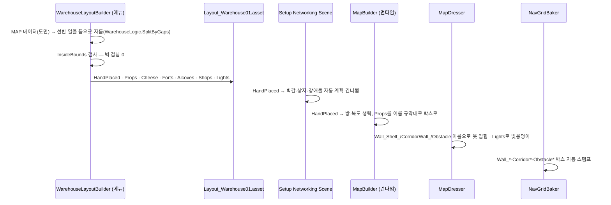

# 창고 평면도 — 「격자를 버린다」 설계 (2026-09-07)

## 왜

방 모듈 1단계(`2026-09-07-room-modules-design.md`)까지 하고 나서 사용자 판정: **"주방이 격자 던전 같다."**
맞다 — 방 49 + 복도 62는 저택(REPO)의 토폴로지지 창고의 것이 아니다. 컨셉아트 4장 전부
"벽으로 나뉜 방"이 아니라 **선반이 벽 노릇을 하는 한 공간**이다. 격자를 버린다.

## 확정 결정

| # | 결정 | 내용 |
|---|---|---|
| 1 | 평면도는 **손으로 1장** | `docs/design-vault/맵 시안 v2 창고.html`의 `MAP` 블록이 원본. 절차 생성은 소품 변주·치즈 등급 배정만 |
| 2 | 방·복도 없음 | 존 5(주방 홀·팬트리 선반 미로·궤짝 야적장·배럴 저장고·하역장) + 계단실 랜드마크 + 남쪽 골목. 존 경계는 **선반 열(5 m, 차단)·궤짝 벽(2.4 m, 넘겨다봄)** 이고 열마다 틈 2~3 |
| 3 | `MapLayout.HandPlaced` | 이 플래그가 켜진 레이아웃은 방 벽·복도를 안 짓고, 벽감·상자·장애물 자동 계획(`Setup Networking Scene`)도 건너뛴다 — 좌표는 전부 레이아웃이 들고 있다 |
| 4 | 이름이 곧 옷 | 선반 열 박스 = `Wall_Shelf_*`(MapDresser가 선반 타일링) · 궤짝 벽 = `CorridorWall_*`(궤짝 1.4배) · 배럴 = `Obstacles/Obstacle`(배럴 비주얼) · 작업대·자루·계단 = `Obstacle_Block_*`. **MapDresser·NavGridBaker 코드 변경 0** |
| 5 | 상점 4 | `MapLayout.Shops` 좌표(골목 교차점, ≥ 25 m). `ShopSpotSpawner`가 이걸 읽도록 ctc-d8이 고친다(합의) |
| 6 | 빛 | `MapLayout.Lights`(앰버 7 + 달빛 1). HandPlaced면 MapDresser의 "3방 중 1" 규칙 대신 이걸 쓴다 |
| 7 | 방 모듈 1단계 코드 | 남긴다 — `Large01`(격자)은 개발용으로 계속 굽힌다. 정식 맵은 `Layout_Warehouse01` |
| 8 | 검수 | `WarehouseLogic.InsideBounds`로 경계벽 겹침 0을 굽는 순간 검사 · BotLab `giveups 0` · 통로 잔여 폭은 도면이 보장(최소 3.5 m) |

## 자료구조

```
MapLayout (+)
├─ m_HandPlaced : bool
├─ m_Props   : PropPlacement[]   { Name, Kind(Shelf|CrateWall|Barrel|Block), Pos, Size, YawDeg, Height }
├─ m_Lights  : LightPlacement[]  { Pos, Radius, Moon }
└─ m_Shops   : ShopPlacement[]   { Pos }
```

## 굽는 순서



## 단계

| 단계 | 산출 | 결과 |
|---|---|---|
| A ✅ | 자료구조 + `WarehouseLogic`(TDD) + MapBuilder/Dresser/Setup 분기 + 빌더 메뉴 + `Layout_Warehouse01` | `f3c040e` · BotLab `giveups 0 · stuck 0` |
| B ✅ | 선반 2단(`TileTiers`) · 궤짝 더미(`CratePile`) · 창고 = 기본 맵, 격자 대형 `DevOnly` | `e7c2a30` |
| C ✅ | 바닥 20 m 타일(URP 오브젝트당 광원 4개 한도 — 빛웅덩이가 4개만 붙던 것) · wesqa 창고 맵 재검 | v36 24/24 · v37 22/24(BGM 2건, 맵 무관) · v38 13/13 · v46 11/11 |

## 남은 것 (다음 세션)
- 존별 손질: 계단실은 판벽 박스(팩에 계단 없음) · 하역장 자루 더미는 궤짝으로 대체 중 · 팬트리 소품 밀도
- 도면(`맵 시안 v2 창고.html`)과 빌더 숫자가 **두 곳**이다 — 도면을 고치면 `WarehouseLayoutBuilder`도 같이
- 요새 8·벽감 6·상점 4 자리의 밸런스는 실플레이로
