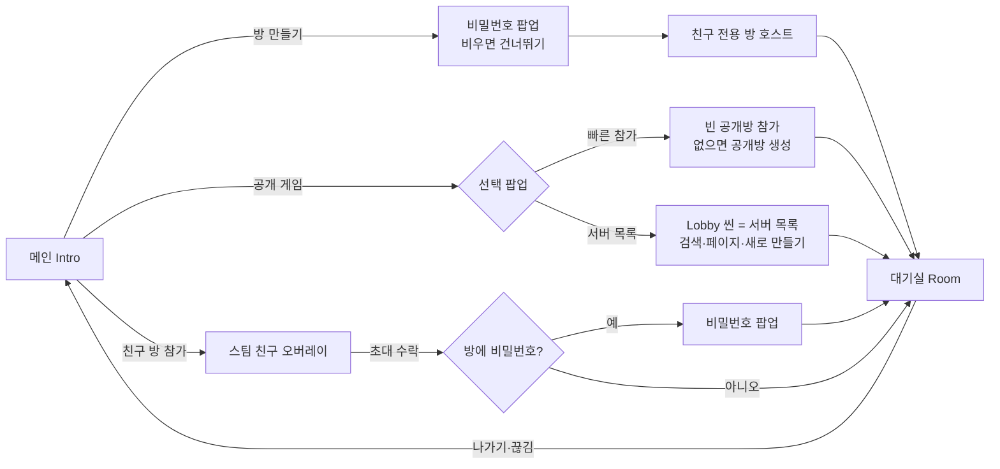

# 대기실 앞단 개편 — R.E.P.O.식 진입 (2026-09-14)

> **범위**: 게임을 켠 뒤 **대기실(Room)에 들어가기 전까지**만 바꾼다. 대기실·인게임은 그대로다.
> 참고: R.E.P.O. 현재 스팀 빌드(23363152)의 메뉴 코드를 디컴파일해 흐름을 대조했다(분석 요약은 아래 부록).
> 사용자 결정: 지역 선택·세이브 선택은 **뺀다**, 참가 흐름도 **같이 바꾼다**, 나머지는 추천안(2026-09-14).

## 흐름

| R.E.P.O. | 우리 | 비고 |
|---|---|---|
| Main: Host Game / Play Random / Join Game | Intro: **방 만들기 / 공개 게임 / 친구 방 참가** / 설정 / 종료 | "게임 시작" 줄이 셋으로 갈린다 |
| Regions | — | 스팀 릴레이가 자동으로 잡는다(고를 대상이 없다) |
| Saves | — | 매 판 새로 시작하는 게임이라 저장할 진행이 없다 |
| Password(호스트는 항상, 비우면 Skip) | 비밀번호 팝업 — 같다 | 최대 10자·공백 불가·대문자로 맞춤 |
| PublicGameChoice | 선택 팝업(빠른 참가 / 서버 목록) | |
| ServerList(8개/페이지, 검색, Create New) | Lobby 씬 개편 — 같다 | 공개 방에는 비밀번호가 없다 |
| Random Matchmaking(가장 찬 방부터) | 빠른 참가 — 같다 | 스팀에 빠른 매칭 기능이 없어 검색→참가/생성을 직접 짠다 |
| 로비 도착 후 방 열기 · 시작하면 잠금 | 같다 | 대기실 도착 = 열림, 시작 = 닫힘 |
| 실패 팝업(Lobby Closed · Wrong Version · Kicked) | 알림 팝업 — 메인으로 돌아와서 보여 준다 | R.E.P.O.의 `PagePopUpScheduled`와 같은 방식 |

## 접속 관문 (`ConnectionGate`)

**모든 접속이 호스트의 NGO 접속 승인을 지난다.** 지금은 승인을 안 써서 매치 중에도 사람이 들어온다
(2026-09-13 조사 §6-4). 비밀번호·잠금·인원을 이 한 곳에서 판정한다.

| 판정 순서 | 거절 코드 | 화면 문구 |
|---|---|---|
| 1. 호스트 자신 | — | 항상 통과 |
| 2. 방이 잠김(대기실 밖) | `CLOSED` | 이미 게임이 시작된 방입니다. |
| 3. 인원 초과(10) | `FULL` | 방이 가득 찼습니다. |
| 4. 비밀번호가 필요한데 안 보냄 | `PW_REQUIRED` | (비밀번호 팝업을 띄워 다시 시도) |
| 5. 비밀번호 틀림 | `PW_WRONG` | 비밀번호가 틀렸습니다. |

- 설치는 `NetworkManager.OnInstantiated`에서 한다 — 네트워크 프리팹·`Game.unity` 둘 다 손대지 않고 걸린다.
- **잠금의 기본값은 열림이다.** `Game.unity` 단독 실행(wesqa·MPPM)은 대기실을 안 거치므로 계속 열려 있다.
  대기실이 서면 열고, 시작을 누르면 닫는다. 스팀 방의 `SetJoinable`도 같이 따라간다(검색에서도 빠진다).
- 비밀번호는 클라이언트가 `NetworkConfig.ConnectionData`에 담아 보낸다. 호스트 쪽 값은 메모리에만 있다.
- 스팀 방에는 `pw=1/0`(비밀번호 유무)과 `ver=프로토콜`만 적는다. 비밀번호 자체는 절대 안 적는다.

## 스팀 방 규칙

| 방 | 공개 범위 | 비밀번호 | 검색에 뜨나 |
|---|---|---|---|
| 방 만들기(메인) | 친구 전용 | 선택 | 안 뜬다(스팀이 친구 전용 방을 검색에서 뺀다) |
| 서버 목록 → 새로 만들기 | 공개 | 없음 | 뜬다 |
| 빠른 참가로 만든 방 | 공개 | 없음 | 뜬다 |

- 만들 때는 `SetJoinable(false)` — **대기실이 서야 연다.** 씬이 넘어가는 사이에 들어온 사람이 빈 화면을 보지 않게.
- 검색 필터: `game=CTC` · `ver=같은 프로토콜` · 빈자리 1 이상. 테스트 AppID 480이라 태그 필터는 계속 필수다.

## 스팀 없는 경로 (에디터·개발 빌드)

지금처럼 로컬 UTP로 대체한다. **비밀번호·잠금·인원은 스팀과 똑같이 검증된다**(관문이 트랜스포트와 무관).

| 버튼 | 에디터 동작 |
|---|---|
| 방 만들기 | 비밀번호 팝업 → 로컬 호스트 |
| 친구 방 참가 | 로컬 참가 → `PW_REQUIRED`로 거절되면 비밀번호 팝업 → 다시 참가 |
| 빠른 참가 | 로컬 호스트가 떠 있으면(포트 파일의 포트가 사용 중) 참가, 아니면 호스트 |
| 서버 목록 | 가짜 목록(기존) · 참가는 로컬 참가 |

## 고치는 기존 버그

- 방 생성·참가가 비동기 실패하면 로비 버튼이 영영 잠기던 것 → 결과를 기다려 실패하면 풀고 알림을 띄운다.
- 매치 중 난입 → 관문 `CLOSED`.

## 이번에 안 하는 것

강퇴·차단(대기실 기능) · 호스트 이전 · 인게임에서 끊겼을 때 메인 복귀 · 지역 선택 · 세이브.

## 부록 — R.E.P.O. 대조 근거 (디컴파일, 2026-09-14)

- `MenuPageMain.ButtonEventHostGame` → Regions(HostGame) → `PickRegion` → Saves → `MenuActionHostGame` → `NetworkConnect`(스팀 방이 없으면 비밀번호 페이지를 **항상** 연다).
- `ButtonEventPlayRandom` → Regions(PlayRandom) → PublicGameChoice → `ButtonRandomMatchmaking` / `ButtonServerList`.
- `MenuPageLobby.ButtonStart`: 접속 중인 사람이 있으면 거절 → `IsOpen=false`·`IsVisible=false`·`LockLobby`.
- `LobbyMenuOpen`: 로비 레벨이 서고 2초 뒤 방장이 `IsOpen=true`·`UnlockLobby`.
- 공개·매칭 방은 저장되지 않는다(`savedLobbyTypes={Private}`).
