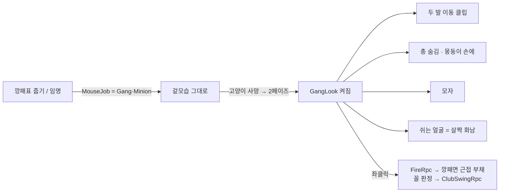

# 깡패 쥐 — 두 발 걷기 · 몽둥이 · 모자 · 화난 눈 (2026-09-14)

> 사용자 요청: "쥐가 깡패 직업권을 얻으면 **나중에 깡패 활성화가 될 때** 기본이동을 뒷다리 두 발로 걸어다니게끔,
> 몽둥이 메쉬 하나 만들어서 그걸로 때려잡는 거야. 깡패의 상징인 모자 하나 씌워주고, 눈도 살짝 화난 눈을 기본으로."
> 방식은 추천안(사용자 부재 중 지시). 판단이 갈리는 곳은 아래 「결정」에 근거와 함께 적는다.

## 결정

| # | 질문 | 결정 | 근거 |
|---|---|---|---|
| 1 | "깡패 활성화"는 언제인가 | **2페이즈(깡패 페이즈)가 열리는 순간** | 요청이 "직업권을 얻으면 → 나중에 활성화"로 두 시점을 가른다. 표를 주운 순간 모습이 바뀌면 **누가 표를 쥐었는지**가 드러난다(기획서 §11 — 없던 정보를 만들지 않는다). 2페이즈는 이미 `GangRise`로 전원에게 알려지는 사건이다 |
| 2 | 누구에게 입히나 | **깡패 편 전원**(보스 + 부하) | 2페이즈 규칙이 "보스+부하 vs 나머지 쥐"다. 편이 눈으로 갈려야 싸움이 읽힌다. 모자가 "깡패의 상징"이라는 요청과도 맞다 |
| 3 | 몽둥이는 총을 대체하나 | **2페이즈 깡패 편은 총 대신 몽둥이** — 같은 공격 버튼(좌클릭) | 입력·쿨다운·봇 경로(`MousePopgun.FireRpc`)를 그대로 타면 봇도 자동으로 몽둥이를 쓴다. 새 키를 만들면 "새 화면·새 조작 0" 제약과 충돌한다 |
| 4 | 몽둥이 판정 | 근접 부채꼴 — 사거리 1.8 m · 90° · 피해 18 · 쿨다운 0.7 s (**CSV `BalanceInfo`**) | 밸런스는 코드에 박지 않는다(CLAUDE.md). 수치는 초기값이고 봇 판으로 다시 잰다 |
| 5 | "살짝 화난 눈" | 쉬는 얼굴을 `Eyes_Annoyed` → **`Eyes_Rabid`를 약하게(가중치 55%) 섞은 얼굴** | 팩에 "Angry" 셰이프키가 없다. Rabid 100%는 "광분"이라 너무 세다 — 요청이 "살짝"이다 |
| 6 | 두 발 걷기 클립 | 블렌더 자작 `BipedIdle` · `BipedWalk` · `BipedRun`(루프) + `ClubSwing`(원샷) | 무릎 리그(`shin.B`)가 이미 있고 `Shoot`·`Fortress`가 뒷다리로 서는 선례다 |
| 7 | 몽둥이·모자 메시 | SDF 코드 생성(`GunMeshBuilder`와 같은 파이프라인) | 총과 같은 톤·같은 방식 — 손으로 늘리는 에셋이 아니다 |

## 흐름

- 켜고 끄는 조건은 순수 함수 `GangLookLogic.Active(job, phase)` 하나. 복제값 두 개(`MouseJob.JobChanged` · `PhaseDirector.PhaseChanged`)를 구독한다 — **새 Rpc 없음**, 늦게 들어온 사람도 맞는 모습.
- 판이 다시 시작되면(페이즈 Hunt로 복귀) 원래 모습으로 돌아간다.

## 안 하는 것

용사 전용 모습 · 몽둥이 업그레이드 · 깡패 전용 사운드(기존 `PounceSwing` 재사용).

## 검증

- EditMode: `GangLookLogic` · 근접 판정(`GangClubLogic`) · 새 상태 이름이 컨트롤러에 있다.
- 블렌더: 두 발 클립 바닥 관통(`measure_clip.py`, 기준 −9 mm 이내).
- MPPM: 2페이즈 강제(`TestForceGangPhase`) → 다른 인스턴스에서 모자·몽둥이 켜짐 · 이동 상태가 Biped · 좌클릭이 근접 피해.
- 스크린샷: 두 발 걷기 · 휘두르기.
