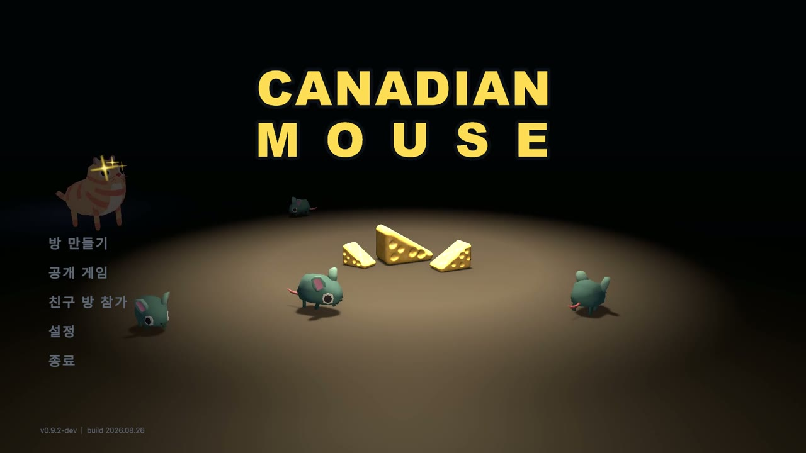
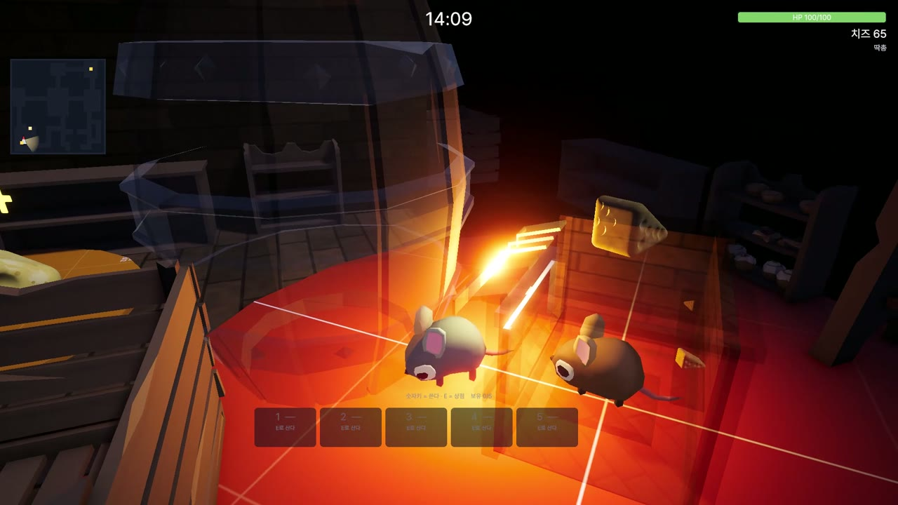
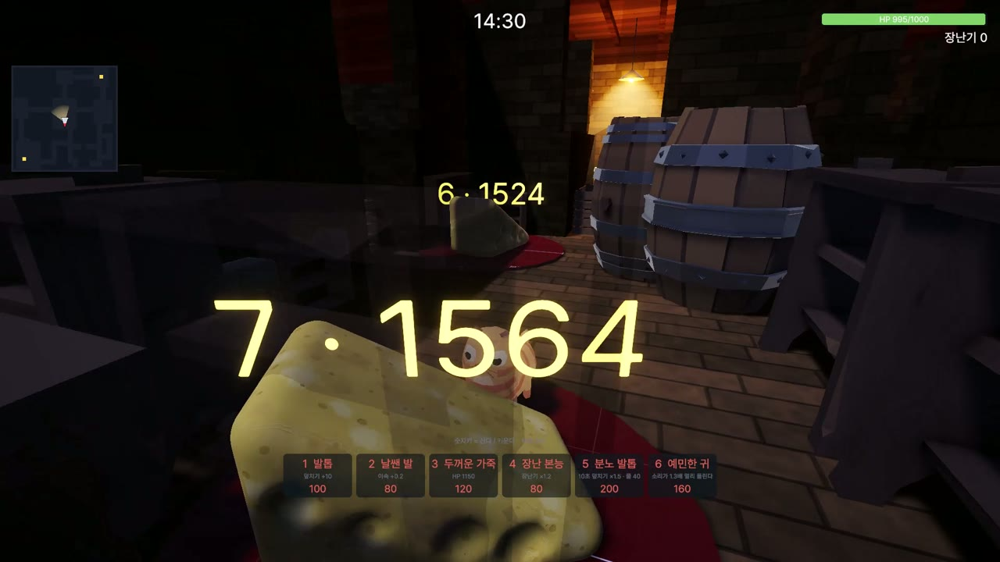
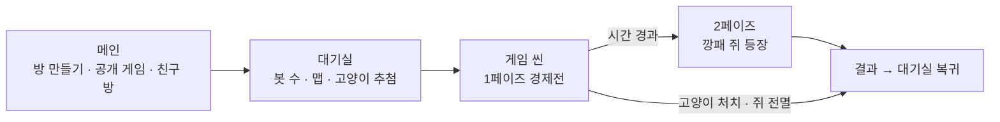
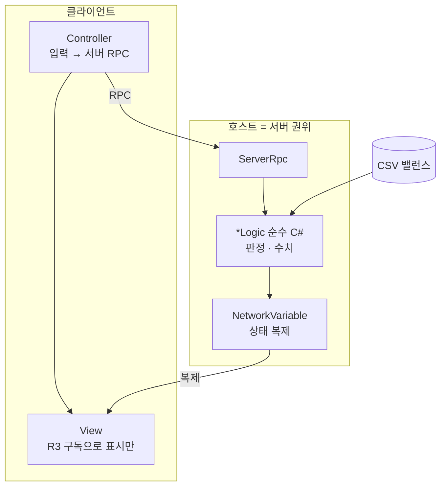

# 🧀 Canadian Mouse (캐네디언 마우스)

> **Unity 6 · Netcode for GameObjects 기반 3인칭 비대칭 멀티플레이 — 고양이 1 vs 쥐 2~7 (PC / Steam 출시 준비 중)**
> 기획 · 클라이언트 · 네트워크 · AI · QA 도구를 **1인 개발**하고, AI 에이전트(Claude Code)를 개발 파이프라인에 결합한 프로젝트

▶ **플레이 영상** — https://youtu.be/YqrUhiuYOUA (3분 · 메인 → 대기실 → 한 판 → 결과)


-1b2838?logo=steam)

| | |
|---|---|
| **장르** | 3D 비대칭 숨바꼭질 × 경제전 — 스타크래프트 UMS 「약올리기 DX」 규칙의 3D 번안 |
| **플레이 인원** | 2 ~ 8인 온라인 (호스트 권위) · 빈 자리는 봇이 채움 |
| **한 판** | 쥐는 치즈 지점에서 돈을 벌어 무장 → 고양이를 쓰러뜨리면 승리. 고양이는 쥐를 전부 잡으면 승리. 후반엔 「깡패 쥐」 2페이즈 |
| **개발 형태** | 1인 개발 (2026.07 ~ 진행 중 · 573 커밋) |
| **규모** | C# 557파일 · 약 8만 줄 · EditMode 테스트 1,100여 개 · E2E 실플레이 스위트 27개 |



---

## 1. 게임 개요

밤의 식료품 창고. 쥐들은 램프 불빛 아래 치즈 지점에서 **치즈(돈)를 캐고**, 상점에서 **총·대시·요새·창고**를 사서 버틴다.
고양이는 어둠 속을 **살금살금** 다가가 덮치고, 전직으로 **불·바람·빛·어둠** 스킬을 얻는다.
쥐가 모은 돈으로 고양이의 체력을 깎아 내면 쥐의 승리, 쥐가 전멸하면 고양이의 승리.
시간이 지나면 쥐 중 한 명이 **깡패 쥐**가 되어 동료를 부하로 끌어들이는 **2페이즈**가 열린다 — 쥐 편 안에서도 편이 갈린다.

| 쥐 시점 — 램프 아래 상점에서 채굴·구매 | 고양이 시점 — 전직 기술 선택 |
|---|---|
|  |  |



---

## 2. 기술 스택

| 영역 | 사용 기술 |
|---|---|
| 엔진 | Unity 6000.5 · URP · Cinemachine 3 · Input System · Addressables |
| 네트워크 | Netcode for GameObjects 2.12 (호스트 권위) · Unity Transport (로컬) · Facepunch Steamworks (스팀 로비·릴레이) |
| 비동기 · 반응형 | UniTask · R3 |
| 데이터 | CSV → 코드 생성 (`BalanceInfo` · `PlayerInfo` · `WeaponInfo` · `TechInfo`) |
| 길찾기 · AI | 자체 격자 A\* · 행동 트리 봇 (쥐 · 고양이 · 강아지) |
| 셰이더 | 커스텀 HLSL 5종 — 트리플래너 맵 · 어둠 · 빛줄기 · 실루엣 · 무적 림 |
| 애니메이션 | Blender Python 스크립트로 자작 클립 11종 · 파이프라인 검증 도구 |
| 사운드 | 생성 AI(ElevenLabs)로 BGM · 효과음 제작 후 LUFS 기준 후처리 |
| QA | NUnit EditMode · 자작 Python E2E 도구 `wesqa` · Multiplayer Play Mode 3인 동시 플레이 |

---

## 3. 아키텍처

**Manager · Controller · Worker · Component** 4계층. 규칙과 수치 판정은 `*Logic` 순수 C# 클래스로 분리해 Unity 없이 테스트한다.



| 규칙 | 내용 |
|---|---|
| UI는 MVC | View는 표시만 · Model은 상태를 가진 컴포넌트 · Controller는 입력을 서버 RPC로 |
| 기능 = 컴포넌트 1개 | 기존 클래스에 덧붙이지 않고 조합한다 (`GangLook` · `HeroInvincibleVisual` · `OccluderFader` …) |
| 밸런스는 코드에 없다 | 수치는 전부 CSV. 컬럼을 바꾸면 `Info` 클래스를 재생성한다 |
| Unity 객체 널 검사 | `?.`·`??` 금지 — 파괴된 객체가 통과하는 함정을 규칙으로 막는다 |

---

## 4. 주요 시스템

| 시스템 | 구현 | 코드 |
|---|---|---|
| **접속 관문** | NGO 연결 승인에서 비밀번호 · 정원 · 버전을 검사 (`CLOSED` · `FULL` · `PW_REQUIRED` · `PW_WRONG`). 에디터·빌드·스팀 경로가 모두 같은 관문을 지난다 | `Network/ConnectionGate.cs` |
| **스팀 앞단** | 방 만들기(친구 전용) · 빠른 참가 · 서버 목록 · 친구 초대(`+connect_lobby` · Rich Presence). 세션 중 트랜스포트 교체 타이밍 버그를 잡아 UTP ↔ Facepunch를 안전하게 전환 | `Network/SteamLobbyManager.cs` · `Lobby/FrontDoor/SessionStarter.cs` |
| **격자 A\* 길찾기** | NavMesh 대신 직접 구운 격자. 요새 벽은 「고양이가 부술 수 있는 칸」, 입구는 「쥐 전용 문」으로 찍어 역할별 경로가 다르다. 칸 예약으로 봇끼리 겹침 방지 | `Ai/Grid/GridPathfinder.cs` · `NavGridBlocker.cs` |
| **봇** | 행동 트리 + 감각(시야·소리) + 주문 체계. 쥐 봇은 채굴·구매·도주, 고양이 봇은 잠복·추격, 강아지는 벽감 지킴이. 전용 실험실 씬(`BotLab`)에서 경로선·통계로 튜닝 | `Bots/BotBrainTrees.cs` · `BotSenses.cs` · `BotShopper.cs` |
| **경제 · 상점** | 치즈 지점 채굴 · 상점 부스(고양이가 오면 철문이 닫힘) · 무기 3티어 · 기술 슬롯 · 요새 · 창고 | `Economy/` · `Assets/Resources/CSVInfo/` |
| **전투 · 변신** | 쥐 총기 · 고양이 덮치기 · 전직 스킬 4종 · 깡패 쥐(몽둥이) · 용사 쥐(칼 · 스턴 · 무적). 변신 중 행동 잠금은 `ActionLock` 하나가 본다 | `Combat/` · `Player/` |
| **밤 창고 맵** | 코드로 굽는 맵 — 트리플래너 셰이더(Forward+ 점광원 루프) · 천장 · 빛줄기 · 후보정. 카메라를 가리는 벽은 알파로 녹인다 | `Map/` · `Rendering/OccluderFader.cs` · `Shaders/CTC_MapTriplanar.shader` |
| **UI** | 미니맵(시야 부채꼴 · 발견 칸) · 채팅 명령 자동완성(↑↓ · Tab) · 상점 팝업 · 옵션(2층 설정값: 스트림/저장) · ESC 라우터 | `UI/` · `Core/EscapeRouter.cs` |
| **애니메이션 파이프라인** | Generic 리그에 Blender 스크립트로 클립 추가(쥐 6 · 고양이 5). 뼈 경로 불일치를 잡는 `Probe Clip Parity`, 바닥 관통을 메시 기준으로 재는 측정 스크립트 | `tools/blender/` · `Editor/ClipPreviewRender.cs` |

---

## 5. 품질 관리 — 테스트와 E2E QA

### 5.1 EditMode 테스트 (NUnit · 113 파일)
규칙은 `*Logic`에만 있으므로 씬 없이 돈다 — 추첨 규칙, 관문 판정, 상점 가격, 길찾기 격자, 깡패 변신 시간표, 애니메이션 클립 파이프라인 회귀까지.

### 5.2 자작 E2E 도구 `wesqa` — 실제로 플레이해서 검증
```
Python 스위트 (qa_v36 ~ qa_v62)
   │  invoke("TestBuySlingshot") · invoke("TestGetAudioVolume") …
   ▼
인게임 리플렉션 서버 (Assets/WesQA, 포트 5001 + MPPM 인덱스 — 개발 빌드에서만)
   │  TestManager.* 훅 310여 개
   ▼
Multiplayer Play Mode 가상 플레이어 3인 — 호스트 · 클라이언트 2
```
- Model 값이 아니라 **들리는 소리(`AudioSource.volume`) · 보이는 오브젝트 수**를 센다 — 배선 누락을 잡기 위해.
- 훅 이름·인자는 호출 전에 정적으로 대조한다(`HookSignatureError`). 리플렉션이 모르는 인자를 조용히 버리던 사고에서 나온 규칙.
- 스위트는 실패·미실행에 0이 아닌 종료 코드를 내고, `pytest`가 게임 없이 스위트 규약을 검사한다.

### 5.3 밸런스 측정 — 봇끼리 대전시켜 수치로 본다
기획서가 정한 쥐 승률 게이트(20~50%)에 대해 **봇만으로 조건당 10판**을 돌려 쟀더니 **쥐 승률 0%**였다.
사망 202건 중 199건이 도주 중 사망, 추격에서 살아 돌아온 쥐가 0명 → 원인은 **고양이 추격 속도**.
파밍 소리 범위부터 줄여 봤지만 효과 0 → 되돌리고, **고양이 이속 8.6 → 7.4**(쥐 대비 1.30 → 1.12배)로 낮추자
분당 처치 2.76 → 1.44, 판 길이 174 → 326초, **쥐 승률 0% → 20%**로 게이트 하단에 닿았다(2026-09-08).
- 도구: 봇 전용 실험실 씬 `Assets/Scenes/BotLab.unity`(`Tools/CTC/Setup BotLab Scene` — 자유 카메라 · 봇 경로선 · F1 통계 오버레이) · 사망 시각과 그때 하던 일을 남기는 `TestGetBotMouseReport` · 봇 시야 통계 `TestGetBotSightStats`(「봇이 반칙한다」 가설을 수치로 기각) · 판 러너 `tools/wesqa/bench/`
- 이후 계측 도구의 오류(첫 발견 시각·우회율 집계)를 고치고 **조건당 30판**으로 다시 재니 쥐 승률은 **0~3%**(95% 신뢰구간 상한 11~17%)로 게이트 밖이었다(`docs/superpowers/specs/2026-09-09-winrate-diagnosis.md` 부록 B). 분당 처치가 인원과 무관한 상수(≈1.55)라는 구조가 원인으로 보여 **현재 재조정 중**이다.

---

## 6. AI 에이전트와 함께 개발하기

무엇을 만들지 · 어떻게 풀지 정하는 설계와 판단, 결과 검수, 플레이 테스트는 본인이 했고, 코드 구현과 콘텐츠 제작(맵 · 애니메이션 클립 · 사운드 · UI 생성기)의 상당 부분은 AI(Claude Code)가 작성했다. MCP로 Unity 에디터(씬 · 프리팹 · 플레이모드 · 콘솔)를 직접 조작하게 하고, 본인은 방향을 정하고 결과를 확인하며 수정을 지시했다.

- `CLAUDE.md` — 코딩 규약 · **「조용히 깨지는 함정」 24개**(에러 없이 어긋나는 Unity 동작을 실측으로 적어 둔 것) · QA 절차
- `docs/superpowers/specs/` — 기능별 설계 스펙 · `docs/design-vault/코드 다이어그램.md` — 코드와 함께 갱신하는 클래스 · 워크플로우 다이어그램
- 사운드 · 애니메이션 · 맵 생성처럼 **반복이 많은 콘텐츠 작업은 전부 스크립트로 재현 가능**하게 만들었다(`tools/`)

---

## 7. 저장소 구조

```
CTC/
├── Assets/Scripts/
│   ├── Ai/ Bots/        격자 A* · 행동 트리 봇
│   ├── Network/ Lobby/  접속 관문 · 스팀 로비 · 앞단
│   ├── Room/ Match/     대기실 · 추첨 · 판 진행 · 결과
│   ├── Combat/ Player/  전투 · 변신 · 이동
│   ├── Economy/ Info/   치즈 · 상점 · CSV 스키마
│   ├── Map/ Rendering/  맵 생성 · 조명 · 가림막
│   ├── UI/ Core/        MVC UI · 설정 · ESC 라우터
│   ├── Testing/         E2E 훅 (TestManager)
│   ├── Tests/EditMode/  NUnit
│   └── Editor/          씬 · 프리팹 · 에셋 생성기, 빌드 메뉴
├── Assets/WesQA/        인게임 리플렉션 서버
├── Assets/Resources/CSVInfo/   밸런스 원본
├── tools/wesqa/         Python E2E 스위트
├── tools/blender/       애니메이션 클립 생성 · 측정
├── tools/audio/         사운드 생성 · 후처리
└── docs/                설계 스펙 · 디자인 볼트
art/blender/             Blender 작업 파일
```

## 8. 열어 보기

1. Unity **6000.5.2f1**로 `CTC/`를 연다 — 패키지는 매니페스트대로 복원된다.
2. `Tools/CTC/Setup Networking Scene`으로 씬 · 프리팹을 굽는다(코드로 생성한다).
3. `Assets/Scenes/Intro.unity` 플레이 → 「방 만들기」 → 대기실에서 봇을 채우고 시작. 여러 명은 Multiplayer Play Mode로.
4. 빌드: `Tools/CTC/Build Windows (배포용)` → `Builds/Windows`.

서드파티 패키지 · 에셋의 라이선스는 [THIRD-PARTY-NOTICES.md](THIRD-PARTY-NOTICES.md). 아트 에셋은 Unity Asset Store 라이선스라 **열람 목적으로만** 포함돼 있다.
